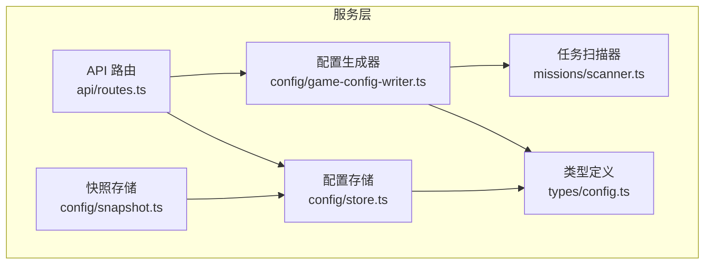
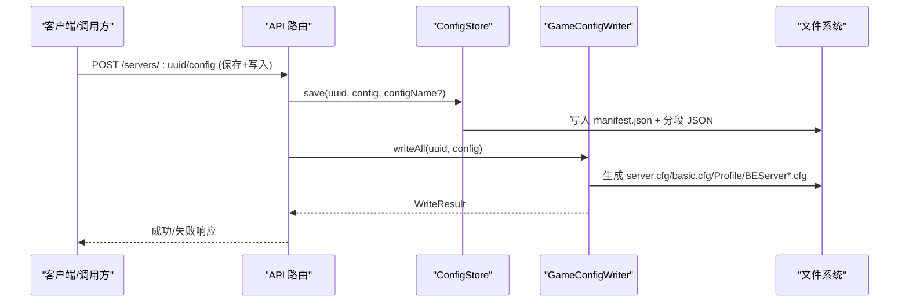
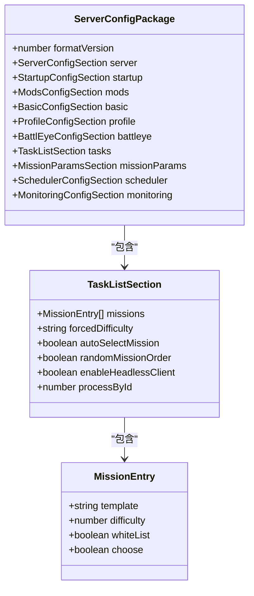
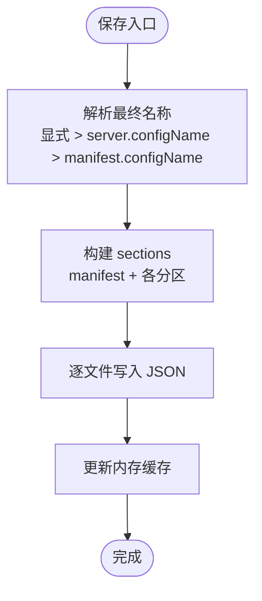
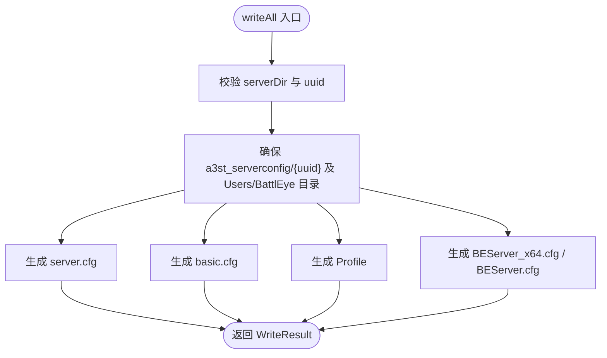
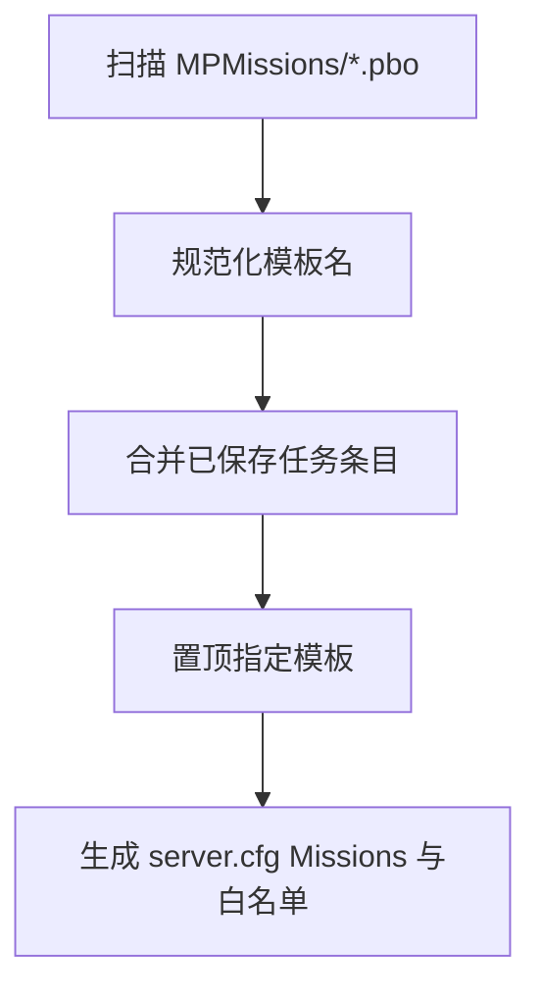
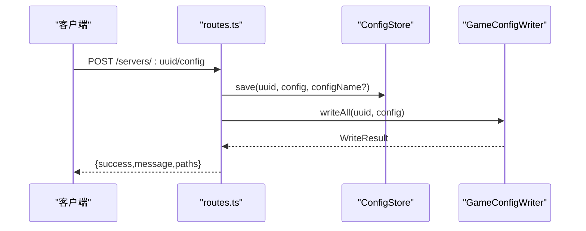
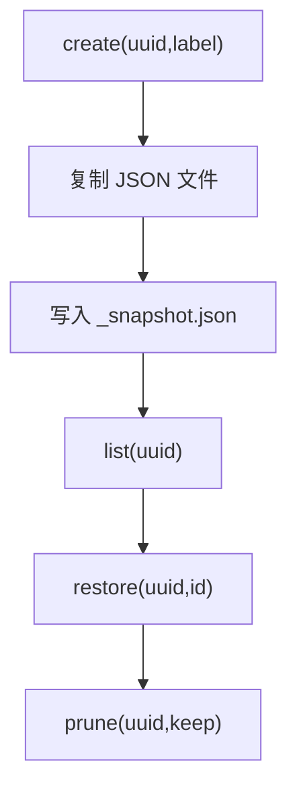
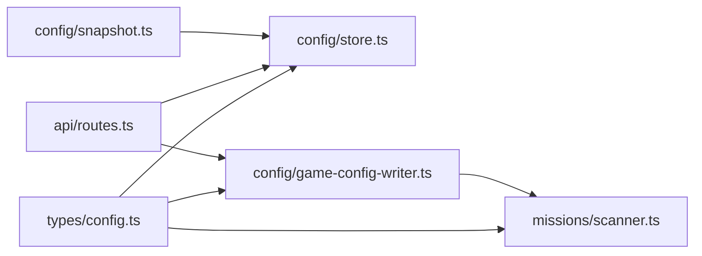

# 配置存储

<cite>
**本文引用的文件**   
- [packages/service/src/types/config.ts](file://packages/service/src/types/config.ts)
- [packages/service/src/config/store.ts](file://packages/service/src/config/store.ts)
- [packages/service/src/config/game-config-writer.ts](file://packages/service/src/config/game-config-writer.ts)
- [packages/service/src/config/snapshot.ts](file://packages/service/src/config/snapshot.ts)
- [packages/service/src/missions/scanner.ts](file://packages/service/src/missions/scanner.ts)
- [packages/service/src/api/routes.ts](file://packages/service/src/api/routes.ts)
- [packages/service/src/config/index.ts](file://packages/service/src/config/index.ts)
- [docs/architecture.md](file://docs/architecture.md)
</cite>

## 目录
1. [简介](#简介)
2. [项目结构](#项目结构)
3. [核心组件](#核心组件)
4. [架构总览](#架构总览)
5. [详细组件分析](#详细组件分析)
6. [依赖关系分析](#依赖关系分析)
7. [性能与一致性](#性能与一致性)
8. [故障排查指南](#故障排查指南)
9. [结论](#结论)
10. [附录：模板与扩展点](#附录模板与扩展点)

## 简介
本文面向 Arma3 Server Tool 的配置存储子系统，系统性说明以下主题：
- 配置文件组织结构、版本管理与变更追踪机制
- JSON 配置包的读写、校验规则与默认值处理
- 游戏配置文件生成器（server.cfg、basic.cfg、Profile、BattlEye）的工作原理
- 任务与任务参数（mission 配置）的动态生成策略
- 配置备份策略、冲突解决与数据迁移方案
- 配置模板定制与扩展点

本仓库采用“工具配置包”与“游戏 cfg 文件”分离的设计：工具侧以 JSON 分段持久化，运行时由生成器写出 Arma3 可识别的 server.cfg、basic.cfg、用户 Profile 与 BattlEye 配置。

## 项目结构
配置相关代码集中在 service 包的 config 子模块，类型定义在 types/config.ts，API 路由通过 routes.ts 暴露保存与写入能力，扫描器负责发现并合并 mission 列表。

**图表来源**
- [packages/service/src/types/config.ts:12-24](file://packages/service/src/types/config.ts#L12-L24)
- [packages/service/src/config/store.ts:29-181](file://packages/service/src/config/store.ts#L29-L181)
- [packages/service/src/config/game-config-writer.ts:590-619](file://packages/service/src/config/game-config-writer.ts#L590-L619)
- [packages/service/src/config/snapshot.ts:12-126](file://packages/service/src/config/snapshot.ts#L12-L126)
- [packages/service/src/missions/scanner.ts:5-100](file://packages/service/src/missions/scanner.ts#L5-L100)
- [packages/service/src/api/routes.ts:126-241](file://packages/service/src/api/routes.ts#L126-L241)

**章节来源**
- [docs/architecture.md:36-53](file://docs/architecture.md#L36-L53)

## 核心组件
- 类型模型：ServerConfigPackage 及其各分区段（server/startup/mods/basic/profile/battleye/tasks/missionParams/scheduler/monitoring），定义了工具配置包的完整结构。
- 配置存储：ConfigStore 将配置按 JSON 分段持久化到磁盘，维护 manifest 清单与内存缓存。
- 配置生成器：GameConfigWriter 根据配置包生成 server.cfg、basic.cfg、Profile 与 BattlEye 配置，并构建启动命令行。
- 快照系统：ConfigSnapshotStore 提供配置的创建、列出、恢复与清理能力。
- 任务扫描器：Scanner 负责扫描 MPMissions 目录、规范化模板名、合并已保存的任务条目。
- API 路由：对外暴露保存、克隆、删除、同步状态等接口，串联 ConfigStore 与 GameConfigWriter。

**章节来源**
- [packages/service/src/types/config.ts:12-134](file://packages/service/src/types/config.ts#L12-L134)
- [packages/service/src/config/store.ts:29-181](file://packages/service/src/config/store.ts#L29-L181)
- [packages/service/src/config/game-config-writer.ts:590-772](file://packages/service/src/config/game-config-writer.ts#L590-L772)
- [packages/service/src/config/snapshot.ts:12-126](file://packages/service/src/config/snapshot.ts#L12-L126)
- [packages/service/src/missions/scanner.ts:5-100](file://packages/service/src/missions/scanner.ts#L5-L100)
- [packages/service/src/api/routes.ts:126-241](file://packages/service/src/api/routes.ts#L126-L241)

## 架构总览
配置生命周期分为两条主线：
- 工具配置包：JSON 分段持久化，支持增量保存、清单管理、快照备份。
- 游戏配置文件：按需从工具配置包生成 server.cfg、basic.cfg、Profile、BattlEye 配置，并输出启动命令。

**图表来源**
- [packages/service/src/api/routes.ts:126-145](file://packages/service/src/api/routes.ts#L126-L145)
- [packages/service/src/config/store.ts:122-162](file://packages/service/src/config/store.ts#L122-L162)
- [packages/service/src/config/game-config-writer.ts:590-619](file://packages/service/src/config/game-config-writer.ts#L590-L619)

## 详细组件分析

### 配置包类型与字段语义
- ServerConfigPackage 是顶层容器，包含服务器路径、启动参数、模组、基础设置、BattlEye、任务、任务参数、调度与监控等分区。
- 各分区段允许使用可选字段与扩展键（如 basic/serverCfgArgs、startup.startConfigArgs），便于保留自定义行或追加额外参数。
- MissionEntry 描述任务模板、难度、白名单与选择行为；MissionParamsSection 支持全局参数与按模板覆盖的参数块。

**图表来源**
- [packages/service/src/types/config.ts:12-134](file://packages/service/src/types/config.ts#L12-L134)

**章节来源**
- [packages/service/src/types/config.ts:12-134](file://packages/service/src/types/config.ts#L12-L134)

### 配置存储（ConfigStore）
- 存储布局：每个服务器一个 UUID 目录，内部存放 manifest.json 与各分区 JSON 文件（server/startup/mods/basic/profile/battleye/tasks/missionparams/scheduler/monitoring）。
- 读取流程：load 会扫描目录下所有 .json，按 SECTION_MAP 映射到 ServerConfigPackage 对应属性，manifest 用于解析 formatVersion。
- 写入流程：save 先确定最终 configName（优先显式传入，其次来自 config.server.configName，最后回退到已有 manifest），然后序列化各分区为独立 JSON 文件，并更新内存缓存。
- 并发与容错：测试覆盖“最后写入获胜”“跳过损坏文件”“不存在返回 null”等场景。

**图表来源**
- [packages/service/src/config/store.ts:122-162](file://packages/service/src/config/store.ts#L122-L162)

**章节来源**
- [packages/service/src/config/store.ts:48-103](file://packages/service/src/config/store.ts#L48-L103)
- [packages/service/src/config/store.ts:122-181](file://packages/service/src/config/store.ts#L122-L181)
- [packages/service/src/config/store.test.ts:1-117](file://packages/service/src/config/store.test.ts#L1-L117)

### 配置生成器（GameConfigWriter）
- 目标文件：
  - server.cfg：主机名、玩家数、投票、事件回调、任务类、日志等。
  - basic.cfg：网络与带宽相关参数。
  - Profile：用户难度预设、视角、AI 等级、地形网格与视距等。
  - BattlEye：RCon 密码与端口、限速策略等。
- 关键逻辑：
  - 默认值：大量字段通过 num()/bool()/str() 提供默认值，保证缺失时仍可生成有效配置。
  - 任务生成：仅将当前激活任务（tasks.missions[0]）写入 server.cfg 的 Missions 类；其余任务留在工具配置中供 GUI/切换使用。
  - 任务参数：resolveMissionParamsText 支持按模板覆盖 byTemplate，否则回退到 params 扁平键值。
  - 白名单：writeMissionWhitelist 收集 whiteList=true 的任务模板（去除 .pbo 后缀）。
  - 启动命令：buildStartCommandLine 组装 -port/-mod/-serverMod/-config/-cfg/-profiles/-name 等参数，并附加模组参数与 startConfigArgs。
  - 安全校验：isSafeStartupExtraArg 限制 startConfigArgs 中的额外参数字符集与长度。

**图表来源**
- [packages/service/src/config/game-config-writer.ts:590-619](file://packages/service/src/config/game-config-writer.ts#L590-L619)

**章节来源**
- [packages/service/src/config/game-config-writer.ts:28-150](file://packages/service/src/config/game-config-writer.ts#L28-L150)
- [packages/service/src/config/game-config-writer.ts:233-290](file://packages/service/src/config/game-config-writer.ts#L233-L290)
- [packages/service/src/config/game-config-writer.ts:322-478](file://packages/service/src/config/game-config-writer.ts#L322-L478)
- [packages/service/src/config/game-config-writer.ts:480-588](file://packages/service/src/config/game-config-writer.ts#L480-L588)
- [packages/service/src/config/game-config-writer.ts:625-724](file://packages/service/src/config/game-config-writer.ts#L625-L724)
- [packages/service/src/config/game-config-writer.ts:759-772](file://packages/service/src/config/game-config-writer.ts#L759-L772)

### 任务与任务参数（mission 配置）
- 扫描：listMissionFiles 扫描 serverDir/MPMissions 下 .pbo 文件并排序。
- 规范化：normalizeMissionTemplate 去除 .pbo 后缀并去空白。
- 置顶：promoteMissionToFront 将指定模板移动到首位，去重并可选更新难度。
- 合并：mergeMissionEntries 将扫描到的模板与已保存的任务条目合并，保留难度、白名单与选择标记。
- 生成：server.cfg 仅写入首个激活任务的模板与难度，并按模板解析 Params 块；白名单任务单独写入 missionWhitelist[]。

**图表来源**
- [packages/service/src/missions/scanner.ts:5-100](file://packages/service/src/missions/scanner.ts#L5-L100)
- [packages/service/src/config/game-config-writer.ts:421-445](file://packages/service/src/config/game-config-writer.ts#L421-L445)
- [packages/service/src/config/game-config-writer.ts:233-290](file://packages/service/src/config/game-config-writer.ts#L233-L290)

**章节来源**
- [packages/service/src/missions/scanner.ts:5-100](file://packages/service/src/missions/scanner.ts#L5-L100)
- [packages/service/src/config/game-config-writer.ts:421-445](file://packages/service/src/config/game-config-writer.ts#L421-L445)

### API 与保存/写入流程
- 保存接口：POST /servers/:uuid/config 接收配置对象，调用 ConfigStore.save 后触发 writeAll 写入游戏配置。
- 克隆接口：POST /servers/:uuid/clone 复制现有配置，重置 processById。
- 同步状态：GET /servers/:uuid/config/sync 计算并返回同步状态（基于 dataDir、uuid 与配置）。
- 错误处理：写入失败返回 WRITE_CFG_FAILED，保存失败返回 SAVE_FAILED，未找到返回 NOT_FOUND。

**图表来源**
- [packages/service/src/api/routes.ts:126-145](file://packages/service/src/api/routes.ts#L126-L145)
- [packages/service/src/api/routes.ts:208-241](file://packages/service/src/api/routes.ts#L208-L241)

**章节来源**
- [packages/service/src/api/routes.ts:126-241](file://packages/service/src/api/routes.ts#L126-L241)

### 配置快照与备份
- 创建快照：copy 配置包内所有 JSON 文件至 snapshots/{uuid}/{id}_*，并记录 _snapshot.json 清单。
- 列出快照：按时间倒序返回快照列表。
- 恢复快照：将快照文件覆盖回配置包目录。
- 清理旧快照：prune 保留最近 N 个快照。

**图表来源**
- [packages/service/src/config/snapshot.ts:30-63](file://packages/service/src/config/snapshot.ts#L30-L63)
- [packages/service/src/config/snapshot.ts:65-126](file://packages/service/src/config/snapshot.ts#L65-L126)

**章节来源**
- [packages/service/src/config/snapshot.ts:12-126](file://packages/service/src/config/snapshot.ts#L12-L126)

## 依赖关系分析
- 类型依赖：store.ts、game-config-writer.ts、scanner.ts 均依赖 types/config.ts 定义的 ServerConfigPackage 与相关分区。
- 模块耦合：
  - API 路由同时依赖 ConfigStore 与 GameConfigWriter，形成“保存→写入”的双阶段流程。
  - GameConfigWriter 依赖 scanner.ts 提供的任务扫描与合并能力，以及 platform 与 mods 模块构建命令行。
  - snapshot.ts 与 store.ts 共享同一 baseDir 下的 config 目录结构。

**图表来源**
- [packages/service/src/types/config.ts:12-134](file://packages/service/src/types/config.ts#L12-L134)
- [packages/service/src/config/store.ts:1-4](file://packages/service/src/config/store.ts#L1-L4)
- [packages/service/src/config/game-config-writer.ts:1-18](file://packages/service/src/config/game-config-writer.ts#L1-L18)
- [packages/service/src/missions/scanner.ts:1-3](file://packages/service/src/missions/scanner.ts#L1-L3)
- [packages/service/src/api/routes.ts:126-241](file://packages/service/src/api/routes.ts#L126-L241)
- [packages/service/src/config/snapshot.ts:1-3](file://packages/service/src/config/snapshot.ts#L1-L3)

**章节来源**
- [packages/service/src/config/index.ts:1-13](file://packages/service/src/config/index.ts#L1-L13)

## 性能与一致性
- 读取性能：listServers 仅读取 manifest 列表，避免全量加载；load 对单个 UUID 进行一次性扫描与缓存。
- 写入原子性：save 顺序写入多个 JSON 文件，无事务保障；建议在上层（如 Session/队列）串行化写操作以避免竞争。
- 并发策略：测试验证“最后写入获胜”，适合简单场景；若需强一致，应在应用层加锁或引入更严格的序列化工具。
- 默认值与健壮性：生成器广泛使用默认值与空集合保护，即使部分字段缺失也能生成可用配置。
- 端口检测：isPortInUse 通过系统命令检查端口占用，避免重复监听。

[本节为通用指导，不直接分析具体文件]

## 故障排查指南
- 保存失败：检查 API 返回码与 message，确认是否触发 WRITE_CFG_FAILED 或 SAVE_FAILED。
- 写入失败：确认 serverDir 与 uuid 非空，且具备写入权限；查看 writeAll 返回的 paths 是否为空。
- 配置损坏：ConfigStore.load 会跳过无效 JSON 文件；可通过 listServers 与 manifest 判断是否存在损坏条目。
- 任务未生效：确认 tasks.missions[0] 存在且 template 非空；检查 byTemplate 与 params 是否正确；确认白名单任务设置了 whiteList=true。
- 端口冲突：使用 isPortInUse 检查端口；必要时调整 startup.port 或 headless 端口分配。

**章节来源**
- [packages/service/src/api/routes.ts:126-145](file://packages/service/src/api/routes.ts#L126-L145)
- [packages/service/src/config/store.ts:82-103](file://packages/service/src/config/store.ts#L82-L103)
- [packages/service/src/config/game-config-writer.ts:197-231](file://packages/service/src/config/game-config-writer.ts#L197-L231)

## 结论
该配置存储子系统通过“工具配置包 + 游戏配置文件生成器”的两阶段设计，实现了高内聚、低耦合的配置管理。ConfigStore 提供稳健的 JSON 分段持久化与清单管理；GameConfigWriter 将配置转换为 Arma3 可识别的文件并构建启动命令；Scanner 与 Snapshot 分别负责任务合并与备份恢复。整体方案具备良好的可扩展性与容错能力，适合多服务器、多任务场景下的配置治理。

[本节为总结性内容，不直接分析具体文件]

## 附录：模板与扩展点
- 新增配置分区：
  - 在 types/config.ts 中新增分区接口，并在 store.ts 的 SECTION_MAP 中添加映射。
  - 在 game-config-writer.ts 中实现对应的写入函数，并在 writeAll 中注册。
- 自定义 server.cfg 行：
  - 使用 basic.serverCfgArgs 追加任意行；生成器会在末尾追加内容。
- 自定义启动参数：
  - 使用 startup.startConfigArgs（Base64 编码的多行文本），经 isSafeStartupExtraArg 过滤后注入命令行。
- 任务参数模板：
  - 使用 missionParams.byTemplate 针对特定模板覆盖参数块；未命中则回退到 missionParams.params。
- 快照策略：
  - 结合 create/list/restore/prune 实现自动备份与清理；可在 UI 或自动化流程中定时触发。

**章节来源**
- [packages/service/src/config/store.ts:8-20](file://packages/service/src/config/store.ts#L8-L20)
- [packages/service/src/config/game-config-writer.ts:143-150](file://packages/service/src/config/game-config-writer.ts#L143-L150)
- [packages/service/src/config/game-config-writer.ts:164-195](file://packages/service/src/config/game-config-writer.ts#L164-L195)
- [packages/service/src/config/game-config-writer.ts:233-290](file://packages/service/src/config/game-config-writer.ts#L233-L290)
- [packages/service/src/config/snapshot.ts:30-126](file://packages/service/src/config/snapshot.ts#L30-L126)