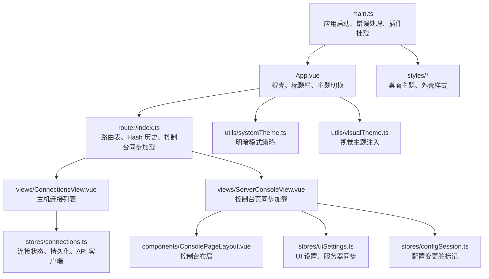
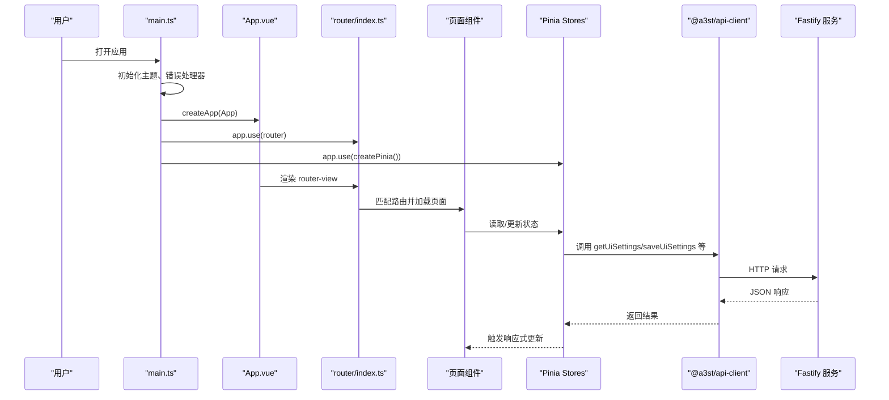
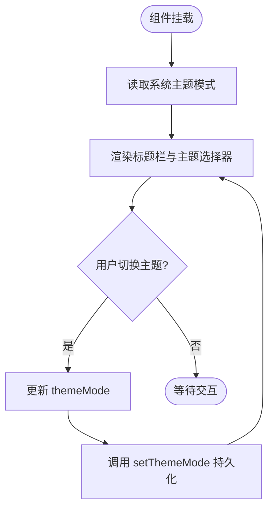
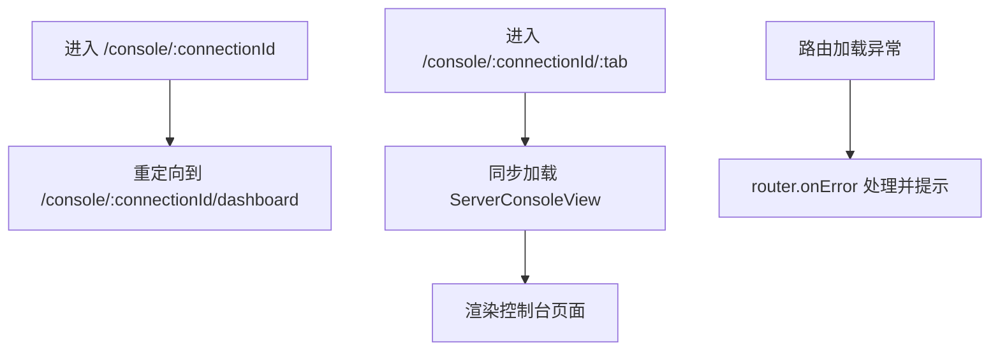
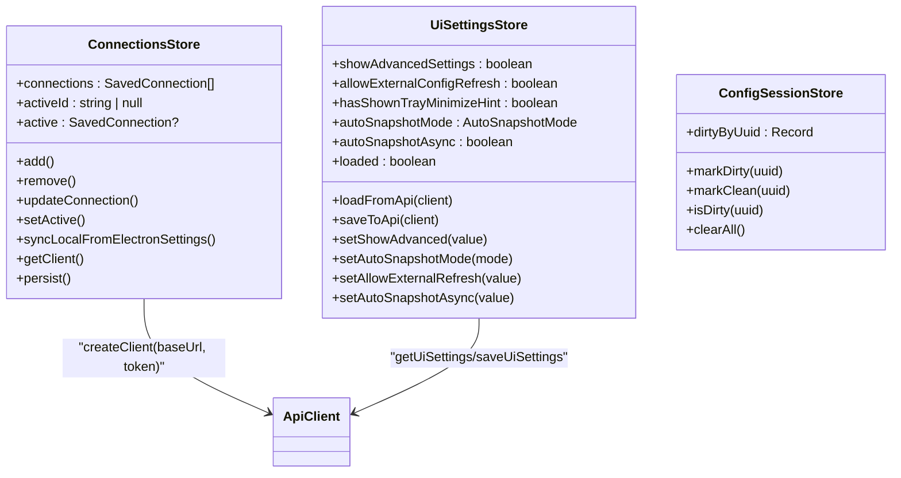
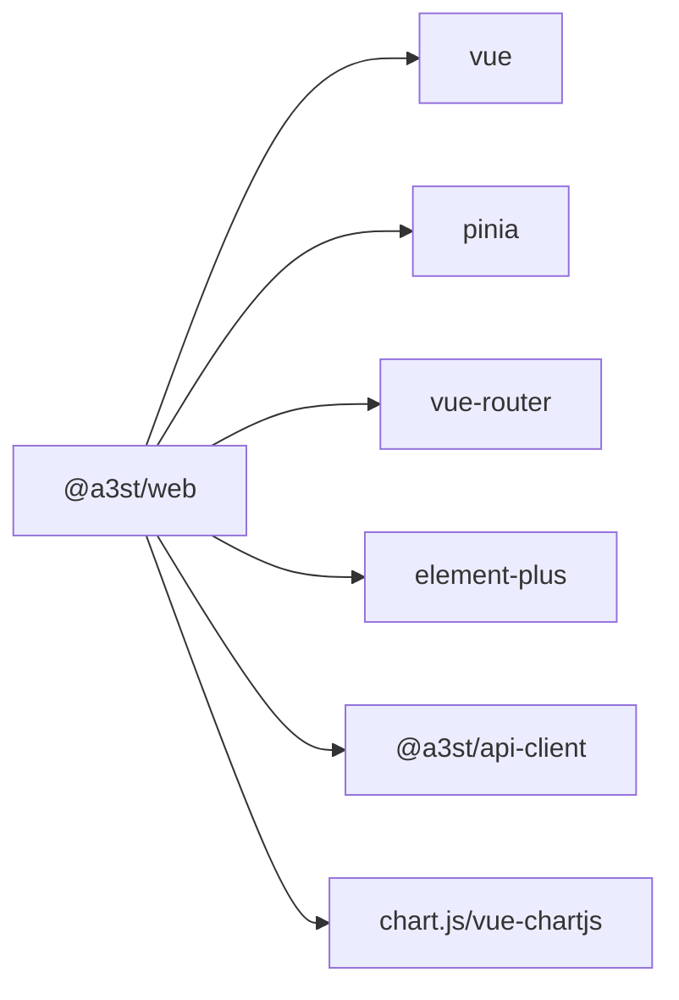

# UI 层设计

<cite>
**本文引用的文件**   
- [packages/web/package.json](file://packages/web/package.json)
- [packages/web/src/main.ts](file://packages/web/src/main.ts)
- [packages/web/src/App.vue](file://packages/web/src/App.vue)
- [packages/web/src/router/index.ts](file://packages/web/src/router/index.ts)
- [packages/web/src/stores/connections.ts](file://packages/web/src/stores/connections.ts)
- [packages/web/src/stores/uiSettings.ts](file://packages/web/src/stores/uiSettings.ts)
- [packages/web/src/stores/configSession.ts](file://packages/web/src/stores/configSession.ts)
- [packages/web/src/views/ConnectionsView.vue](file://packages/web/src/views/ConnectionsView.vue)
- [packages/web/src/views/ServerConsoleView.vue](file://packages/web/src/views/ServerConsoleView.vue)
- [packages/web/src/components/ConsolePageLayout.vue](file://packages/web/src/components/ConsolePageLayout.vue)
- [packages/web/src/utils/systemTheme.ts](file://packages/web/src/utils/systemTheme.ts)
- [packages/web/src/utils/visualTheme.ts](file://packages/web/src/utils/visualTheme.ts)
- [packages/web/src/styles/desktop-theme.css](file://packages/web/src/styles/desktop-theme.css)
- [packages/web/src/styles/shell-v2.css](file://packages/web/src/styles/shell-v2.css)
</cite>

## 目录
1. [引言](#引言)
2. [项目结构](#项目结构)
3. [核心组件与职责划分](#核心组件与职责划分)
4. [架构总览](#架构总览)
5. [详细组件分析](#详细组件分析)
6. [状态管理与响应式数据流](#状态管理与响应式数据流)
7. [依赖关系分析](#依赖关系分析)
8. [性能与可维护性](#性能与可维护性)
9. [无障碍与主题、响应式设计](#无障碍与主题响应式设计)
10. [故障排查指南](#故障排查指南)
11. [结论](#结论)

## 引言
本文件面向 Arma3 Server Tools v2 的 Web 前端 UI 层，聚焦 Vue 3 组件架构、Pinia 状态管理、响应式数据流、组件通信模式、主题与响应式实现，以及无障碍访问支持。该前端位于 packages/web，使用 Vue 3 + TypeScript + Vite + Element Plus + Pinia + Vue Router，并通过 @a3st/api-client 调用后端 Fastify API。

## 项目结构
Web 应用采用“按功能分层”的组织方式：
- 入口与全局初始化：main.ts、App.vue
- 路由：router/index.ts
- 页面视图：views/*（如 ConnectionsView、ServerConsoleView）
- 业务组件：components/*（如 ConsolePageLayout）
- 状态管理：stores/*（连接、UI 设置、配置会话脏标记）
- 工具与样式：utils/*、styles/*

图示来源
- [packages/web/src/main.ts:1-45](file://packages/web/src/main.ts#L1-L45)
- [packages/web/src/App.vue:1-108](file://packages/web/src/App.vue#L1-L108)
- [packages/web/src/router/index.ts:1-79](file://packages/web/src/router/index.ts#L1-L79)
- [packages/web/src/stores/connections.ts:1-136](file://packages/web/src/stores/connections.ts#L1-L136)
- [packages/web/src/stores/uiSettings.ts:1-53](file://packages/web/src/stores/uiSettings.ts#L1-L53)
- [packages/web/src/stores/configSession.ts:1-21](file://packages/web/src/stores/configSession.ts#L1-L21)

章节来源
- [packages/web/package.json:1-36](file://packages/web/package.json#L1-L36)
- [packages/web/src/main.ts:1-45](file://packages/web/src/main.ts#L1-L45)

## 核心组件与职责划分
- 根组件 App.vue
  - 负责应用外壳、标题栏、导航链接、主题选择器、移动端适配判断。
  - 通过 computed 判断当前路由是否属于控制台或连接页，控制标题栏内容显示。
  - 与系统主题工具协作，提供明/暗/跟随系统的切换能力。
- 页面组件 views/*
  - ConnectionsView.vue：展示并管理已保存的主机连接，作为控制台入口。
  - ServerConsoleView.vue：控制台主视图，被路由同步加载以避免白屏。
  - 其他页面：Dashboard、Logs、Mods、Statistics 等，按功能拆分。
- 业务组件 components/*
  - ConsolePageLayout.vue：控制台页面的通用布局与区域划分。
  - FirstServerWizard.vue、NewServerDialog.vue、TerminalOutput.vue 等：具体业务交互组件。
- 基础组件与第三方组件
  - 基于 Element Plus 的表单、对话框、通知等；Chart.js 用于统计图表。

章节来源
- [packages/web/src/App.vue:1-108](file://packages/web/src/App.vue#L1-L108)
- [packages/web/src/router/index.ts:1-79](file://packages/web/src/router/index.ts#L1-L79)

## 架构总览
前端以 Vue 3 为框架，Pinia 管理跨组件状态，Vue Router 管理页面路由，Element Plus 提供 UI 组件库，@a3st/api-client 封装后端 API 调用。

图示来源
- [packages/web/src/main.ts:1-45](file://packages/web/src/main.ts#L1-L45)
- [packages/web/src/App.vue:1-108](file://packages/web/src/App.vue#L1-L108)
- [packages/web/src/router/index.ts:1-79](file://packages/web/src/router/index.ts#L1-L79)
- [packages/web/src/stores/uiSettings.ts:1-53](file://packages/web/src/stores/uiSettings.ts#L1-L53)

## 详细组件分析

### 根组件 App.vue
- 职责
  - 根据路由计算 isConsole/isConnections，控制标题栏和导航项显示。
  - 提供主题模式选择器，调用 setThemeMode 持久化用户偏好。
  - 在移动端隐藏部分桌面端导航项。
- 关键行为
  - onMounted 时从系统主题工具读取当前主题模式。
  - 监听 select 变化，更新本地 ref 并写入主题配置。
- 生命周期与响应式
  - onMounted：初始化主题模式。
  - computed：isConsole、isConnections 由 route.path 派生。
  - ref：themeMode 驱动下拉框选中态。

图示来源
- [packages/web/src/App.vue:1-108](file://packages/web/src/App.vue#L1-L108)
- [packages/web/src/utils/systemTheme.ts](file://packages/web/src/utils/systemTheme.ts)

章节来源
- [packages/web/src/App.vue:1-108](file://packages/web/src/App.vue#L1-L108)

### 路由与页面加载策略
- 路由定义
  - / 重定向到 /connections。
  - /connections 动态导入 ConnectionsView。
  - /console/:connectionId 统一重定向到 dashboard 子路由。
  - /console/:connectionId/:tab 同步加载 ServerConsoleView，避免 Electron/file 或静态托管下异步 chunk 失败导致白屏。
- 错误处理
  - router.onError 捕获路由加载异常，输出友好提示并提供返回连接页的链接。

图示来源
- [packages/web/src/router/index.ts:1-79](file://packages/web/src/router/index.ts#L1-L79)

章节来源
- [packages/web/src/router/index.ts:1-79](file://packages/web/src/router/index.ts#L1-L79)

### 连接管理页面 ConnectionsView.vue
- 职责
  - 展示已保存的连接列表，支持新增、编辑、删除、激活连接。
  - 将 active 连接映射到 API 客户端实例，供控制台页面调用后端接口。
- 与状态管理的关系
  - 通过 useConnectionsStore 读写 connections、activeId、active 计算属性。
  - 调用 add/remove/updateConnection/setActive 等方法。
  - 在 Electron 环境下，可通过 syncLocalFromElectronSettings 同步本机服务端口与 Token。

章节来源
- [packages/web/src/views/ConnectionsView.vue](file://packages/web/src/views/ConnectionsView.vue)
- [packages/web/src/stores/connections.ts:1-136](file://packages/web/src/stores/connections.ts#L1-L136)

### 控制台页面 ServerConsoleView.vue 与布局 ConsolePageLayout.vue
- 职责
  - ServerConsoleView.vue：控制台主容器，承载各功能标签页（仪表盘、日志、模组、统计等）。
  - ConsolePageLayout.vue：提供控制台区域的布局骨架、侧边导航、内容区。
- 数据流
  - 从 useConnectionsStore 获取 active 连接，构造 A3stClient。
  - 从 useUiSettingsStore 加载 UI 设置，决定是否显示高级选项、自动快照策略等。
  - 通过 useConfigSessionStore 跟踪配置变更的脏标记，辅助保存确认逻辑。

章节来源
- [packages/web/src/views/ServerConsoleView.vue](file://packages/web/src/views/ServerConsoleView.vue)
- [packages/web/src/components/ConsolePageLayout.vue](file://packages/web/src/components/ConsolePageLayout.vue)
- [packages/web/src/stores/uiSettings.ts:1-53](file://packages/web/src/stores/uiSettings.ts#L1-L53)
- [packages/web/src/stores/configSession.ts:1-21](file://packages/web/src/stores/configSession.ts#L1-L21)

## 状态管理与响应式数据流

### Pinia 存储概览
- connections.ts
  - 状态：connections 列表、activeId、active 计算属性。
  - 动作：add/remove/updateConnection/setActive/syncLocalFromElectronSettings/getClient/persist。
  - 持久化：localStorage 键 a3st-connections。
  - 客户端：createClient(baseUrl, token) 生成 API 客户端。
- uiSettings.ts
  - 状态：showAdvancedSettings、allowExternalConfigRefresh、hasShownTrayMinimizeHint、autoSnapshotMode、autoSnapshotAsync、loaded。
  - 动作：loadFromApi/saveToApi 与后端 UiSettings 同步。
- configSession.ts
  - 状态：dirtyByUuid 记录配置变更脏标记。
  - 动作：markDirty/markClean/isDirty/clearAll。

图示来源
- [packages/web/src/stores/connections.ts:1-136](file://packages/web/src/stores/connections.ts#L1-L136)
- [packages/web/src/stores/uiSettings.ts:1-53](file://packages/web/src/stores/uiSettings.ts#L1-L53)
- [packages/web/src/stores/configSession.ts:1-21](file://packages/web/src/stores/configSession.ts#L1-L21)

### 全局状态、局部状态与服务器状态同步
- 全局状态
  - 连接信息、活跃连接、UI 设置、配置会话脏标记均保存在 Pinia store，跨组件共享。
- 局部状态
  - 组件内部 ref/computed 用于临时输入、表单校验、UI 交互状态。
- 服务器状态同步
  - UI 设置通过 loadFromApi/saveToApi 与后端同步。
  - 连接信息通过 localStorage 持久化，并在 Electron 环境中与系统设置同步。

章节来源
- [packages/web/src/stores/connections.ts:1-136](file://packages/web/src/stores/connections.ts#L1-L136)
- [packages/web/src/stores/uiSettings.ts:1-53](file://packages/web/src/stores/uiSettings.ts#L1-L53)
- [packages/web/src/stores/configSession.ts:1-21](file://packages/web/src/stores/configSession.ts#L1-L21)

### 组件通信模式
- props 传递
  - 父组件向子组件传递连接对象、配置项、UI 设置等只读数据。
- 事件冒泡
  - 子组件通过 emit 触发事件，父组件监听并更新 store 或调用 API。
- provide/inject 依赖注入
  - 可在控制台布局中提供 client、settings 等上下文，供深层子组件直接读取，减少 props 透传。

章节来源
- [packages/web/src/components/ConsolePageLayout.vue](file://packages/web/src/components/ConsolePageLayout.vue)
- [packages/web/src/views/ServerConsoleView.vue](file://packages/web/src/views/ServerConsoleView.vue)

## 依赖关系分析
- 运行时依赖
  - vue、pinia、vue-router、element-plus、@a3st/api-client、chart.js、vue-chartjs。
- 构建与开发依赖
  - vite、typescript、unplugin-auto-import、unplugin-vue-components、vue-tsc、@playwright/test。

图示来源
- [packages/web/package.json:1-36](file://packages/web/package.json#L1-L36)

章节来源
- [packages/web/package.json:1-36](file://packages/web/package.json#L1-L36)

## 性能与可维护性
- 路由懒加载
  - 除控制台主视图外，其余页面使用动态 import 降低首屏体积。
- 控制台同步加载
  - /console/:connectionId/:tab 同步加载 ServerConsoleView，避免 Electron/file 或静态托管下异步 chunk 失败导致的白屏问题。
- 错误边界
  - main.ts 全局 errorHandler 捕获 Vue 渲染异常，显示友好提示并保留返回连接页的能力。
- 类型检查
  - 使用 vue-tsc 进行类型检查，提升代码健壮性与可维护性。

章节来源
- [packages/web/src/router/index.ts:1-79](file://packages/web/src/router/index.ts#L1-L79)
- [packages/web/src/main.ts:1-45](file://packages/web/src/main.ts#L1-L45)

## 无障碍与主题、响应式设计
- 主题机制
  - systemTheme.ts：读取/设置明/暗/跟随系统模式，持久化用户偏好。
  - visualTheme.ts：根据主题注入 CSS 变量或类名，驱动视觉主题。
  - App.vue：提供主题选择器，结合 computed 与 ref 实现响应式切换。
- 响应式设计
  - main.ts 根据 VITE_APP_MODE 设置 data-app-mode 与 is-mobile-app 类，便于样式区分移动端与桌面端。
  - App.vue 在移动端隐藏部分桌面端导航项，优化小屏体验。
- 无障碍访问
  - 主题选择器使用原生 select，具备良好键盘可达性与屏幕阅读器支持。
  - 标题栏元素使用 aria-hidden 装饰非语义图标，避免干扰阅读顺序。
  - 焦点可见性通过 outline 样式增强键盘导航体验。

章节来源
- [packages/web/src/utils/systemTheme.ts](file://packages/web/src/utils/systemTheme.ts)
- [packages/web/src/utils/visualTheme.ts](file://packages/web/src/utils/visualTheme.ts)
- [packages/web/src/App.vue:1-108](file://packages/web/src/App.vue#L1-L108)
- [packages/web/src/main.ts:1-45](file://packages/web/src/main.ts#L1-L45)
- [packages/web/src/styles/desktop-theme.css](file://packages/web/src/styles/desktop-theme.css)
- [packages/web/src/styles/shell-v2.css](file://packages/web/src/styles/shell-v2.css)

## 故障排查指南
- 全局错误处理
  - main.ts 的 errorHandler 会拦截 Vue 渲染异常，显示“界面异常”横幅并提供返回连接页的链接。
- 路由加载失败
  - router.onError 捕获路由异常，输出错误信息并提供返回连接页的链接，防止白屏。
- 连接不可用
  - 若 Electron 服务端口或 Token 变更，调用 useConnectionsStore.syncLocalFromElectronSettings 同步本机连接，避免 UI 能开但 API 全 401。
- 主题不生效
  - 检查 systemTheme.ts 与 visualTheme.ts 是否正确初始化，确认 App.vue 的主题选择器是否触发 setThemeMode。

章节来源
- [packages/web/src/main.ts:1-45](file://packages/web/src/main.ts#L1-L45)
- [packages/web/src/router/index.ts:1-79](file://packages/web/src/router/index.ts#L1-L79)
- [packages/web/src/stores/connections.ts:1-136](file://packages/web/src/stores/connections.ts#L1-L136)

## 结论
该 UI 层以 Vue 3 为核心，结合 Pinia 与 Vue Router 形成清晰的组件层次与状态管理方案。根组件负责外壳与主题，页面组件按功能拆分，业务组件复用布局与交互逻辑。状态管理覆盖全局连接、UI 设置与配置会话脏标记，并通过 @a3st/api-client 与后端保持同步。路由采用懒加载与关键路径同步加载相结合的策略，兼顾性能与稳定性。主题与响应式设计通过 CSS 变量与环境变量驱动，具备良好的可维护性与扩展性。无障碍方面遵循原生控件与语义化标注原则，确保键盘可达与屏幕阅读器友好。