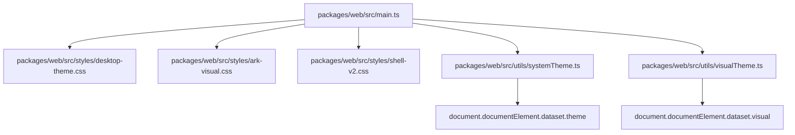
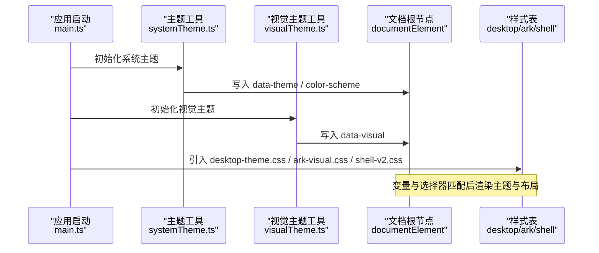
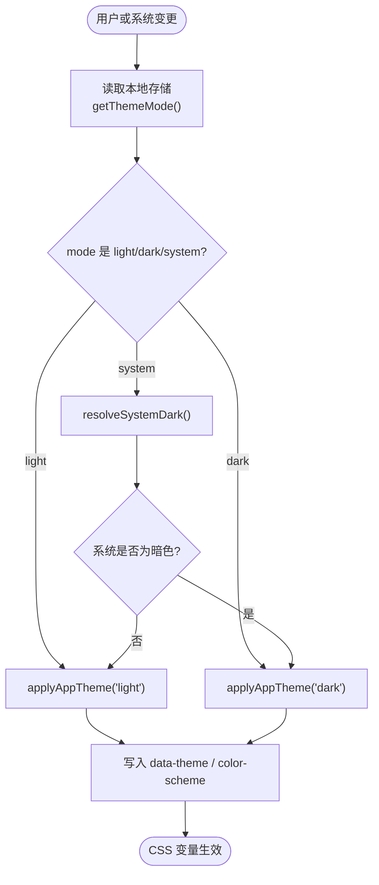
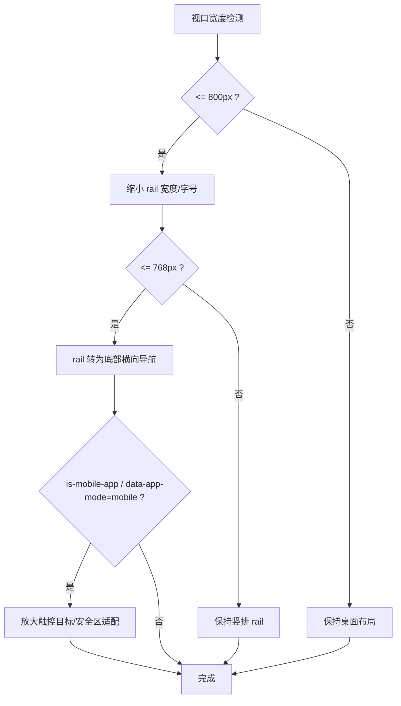
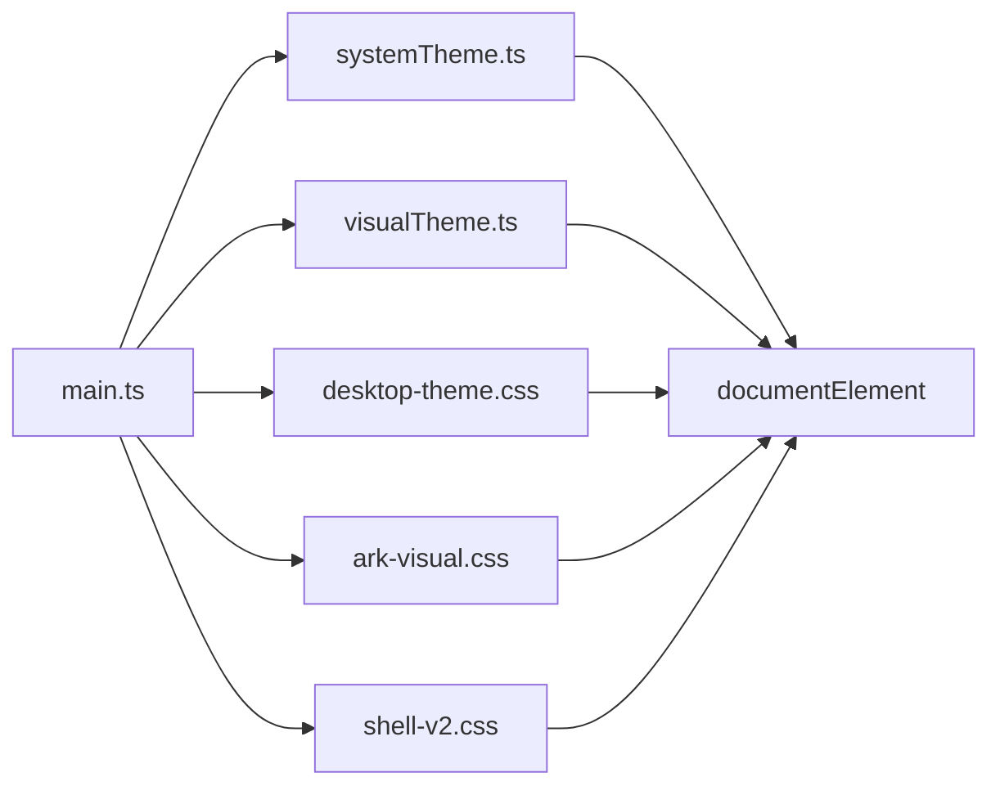

# 主题与样式系统

<cite>
**本文引用的文件**   
- [main.ts](file://packages/web/src/main.ts)
- [systemTheme.ts](file://packages/web/src/utils/systemTheme.ts)
- [visualTheme.ts](file://packages/web/src/utils/visualTheme.ts)
- [desktop-theme.css](file://packages/web/src/styles/desktop-theme.css)
- [ark-visual.css](file://packages/web/src/styles/ark-visual.css)
- [shell-v2.css](file://packages/web/src/styles/shell-v2.css)
- [vite.config.ts](file://packages/web/vite.config.ts)
- [package.json](file://package.json)
- [index.html](file://packages/web/index.html)
</cite>

## 目录
1. [引言](#引言)
2. [项目结构](#项目结构)
3. [核心组件](#核心组件)
4. [架构总览](#架构总览)
5. [详细组件分析](#详细组件分析)
6. [依赖关系分析](#依赖关系分析)
7. [性能与兼容性](#性能与兼容性)
8. [无障碍访问](#无障碍访问)
9. [故障排查](#故障排查)
10. [结论](#结论)

## 引言
本文件系统性梳理 Arma3 Server Tools Web 端的主题与样式体系，覆盖以下关键能力：
- CSS 变量系统与主题切换机制（明/暗主题、系统主题跟随）
- 样式组织策略（CSS Modules、SCSS 预处理器、组件样式隔离）
- 响应式设计（移动端适配、断点管理、弹性布局）
- 主题类名管理与视觉风格切换
- 图标字体集成思路
- 无障碍访问支持（ARIA、键盘导航、屏幕阅读器兼容）
- 样式性能优化、压缩与浏览器兼容性处理方案

## 项目结构
Web 端样式入口位于 packages/web/src/styles，由三个核心样式文件组成：
- desktop-theme.css：定义全局 CSS 变量、浅色/深色主题、Element Plus 主题映射、基础布局与通用组件样式。
- ark-visual.css：在 data-visual="ark" 下提供“工业风”视觉覆写，包含连接页、仪表盘、设置页等页面级样式。
- shell-v2.css：壳层布局（顶部栏、左侧 rail、底部基线），并内置移动端与 Capacitor 应用模式适配。



图表来源
- [main.ts:1-45](file://packages/web/src/main.ts#L1-L45)
- [desktop-theme.css:1-157](file://packages/web/src/styles/desktop-theme.css#L1-L157)
- [ark-visual.css:1-80](file://packages/web/src/styles/ark-visual.css#L1-L80)
- [shell-v2.css:1-40](file://packages/web/src/styles/shell-v2.css#L1-L40)
- [systemTheme.ts:1-91](file://packages/web/src/utils/systemTheme.ts#L1-L91)
- [visualTheme.ts:1-28](file://packages/web/src/utils/visualTheme.ts#L1-L28)

章节来源
- [main.ts:1-45](file://packages/web/src/main.ts#L1-L45)
- [desktop-theme.css:1-157](file://packages/web/src/styles/desktop-theme.css#L1-L157)
- [ark-visual.css:1-80](file://packages/web/src/styles/ark-visual.css#L1-L80)
- [shell-v2.css:1-40](file://packages/web/src/styles/shell-v2.css#L1-L40)

## 核心组件
- 主题模式与系统主题跟随
  - systemTheme.ts 维护 ThemeMode（system/light/dark），通过 localStorage 持久化，并在 Electron 或浏览器环境中监听系统主题变化，最终将 data-theme 与 color-scheme 写入根节点。
- 视觉主题（界面壳层风格）
  - visualTheme.ts 维护 VisualTheme（classic/ark），通过 data-visual 控制 ark-visual.css 的开关。
- 样式入口与初始化
  - main.ts 在应用启动时引入三套样式，并调用 initSystemTheme() 与 initVisualTheme() 完成主题初始化；同时根据运行环境注入 is-mobile-app 或 data-app-mode="mobile"，驱动 shell-v2.css 中的移动端适配。

章节来源
- [systemTheme.ts:1-91](file://packages/web/src/utils/systemTheme.ts#L1-L91)
- [visualTheme.ts:1-28](file://packages/web/src/utils/visualTheme.ts#L1-L28)
- [main.ts:1-45](file://packages/web/src/main.ts#L1-L45)

## 架构总览
主题与样式系统的运行时流程如下：
- 应用启动时加载 CSS 变量与组件样式。
- 读取本地存储的主题模式，若为 system，则监听系统主题变化。
- 将 data-theme 与 color-scheme 同步到 documentElement，使 desktop-theme.css 生效。
- 将 data-visual 设置为 classic 或 ark，以启用 ark-visual.css 的视觉覆写。
- 根据运行环境注入移动端标记，触发 shell-v2.css 的响应式规则。



图表来源
- [main.ts:1-45](file://packages/web/src/main.ts#L1-L45)
- [systemTheme.ts:1-91](file://packages/web/src/utils/systemTheme.ts#L1-L91)
- [visualTheme.ts:1-28](file://packages/web/src/utils/visualTheme.ts#L1-L28)
- [desktop-theme.css:1-157](file://packages/web/src/styles/desktop-theme.css#L1-L157)
- [ark-visual.css:1-80](file://packages/web/src/styles/ark-visual.css#L1-L80)
- [shell-v2.css:1-40](file://packages/web/src/styles/shell-v2.css#L1-L40)

## 详细组件分析

### CSS 变量系统与主题切换机制
- 变量分层
  - 基础变量：--a3st-bg、--a3st-text、--a3st-accent 等，统一在 desktop-theme.css 中按 light/dark 两套值集声明。
  - Element Plus 映射：--el-* 变量直接绑定 --a3st-*，保证第三方组件与业务主题一致。
  - 视觉主题变量：ark-visual.css 在 [data-visual="ark"] 下定义 --ark-* 与 --a3st-* 覆写，形成“工业风”外观。
- 主题切换逻辑
  - setThemeMode(mode) 将 mode 写入 localStorage，并调用 applyThemeFromMode。
  - applyThemeFromMode 根据 mode 决定 light/dark 或跟随系统。
  - applyAppTheme 将 theme 写入 documentElement.dataset.theme 与 style.colorScheme，从而触发 CSS 变量切换。
  - 系统主题监听：优先使用 Electron API（window.electronAPI.getThemeDark/onThemeChanged），否则回退到 matchMedia("(prefers-color-scheme: dark)")。



图表来源
- [systemTheme.ts:10-42](file://packages/web/src/utils/systemTheme.ts#L10-L42)
- [systemTheme.ts:44-91](file://packages/web/src/utils/systemTheme.ts#L44-L91)
- [desktop-theme.css:13-157](file://packages/web/src/styles/desktop-theme.css#L13-L157)

章节来源
- [systemTheme.ts:1-91](file://packages/web/src/utils/systemTheme.ts#L1-L91)
- [desktop-theme.css:1-157](file://packages/web/src/styles/desktop-theme.css#L1-L157)

### 视觉主题（界面壳层风格）与样式类名管理
- visualTheme.ts 通过 data-visual 控制 ark-visual.css 的激活。
- ark-visual.css 在 [data-visual="ark"] 下覆写大量组件与页面样式，如 stat-tile、conn-archive、dash-hero、settings-page 等。
- 类名命名采用 BEM 风格（如 conn-archive__row、dash-hero__grid），便于组合与扩展。

```mermaid
classDiagram
class VisualTheme {
+getVisualTheme()
+setVisualTheme(theme)
+applyVisualTheme(theme)
+initVisualTheme()
}
class ArkVisualCSS {
"[data-visual='ark']"
"覆盖组件与页面样式"
}
VisualTheme --> ArkVisualCSS : "通过 data-visual 控制"
```

图表来源
- [visualTheme.ts:1-28](file://packages/web/src/utils/visualTheme.ts#L1-L28)
- [ark-visual.css:1-80](file://packages/web/src/styles/ark-visual.css#L1-L80)

章节来源
- [visualTheme.ts:1-28](file://packages/web/src/utils/visualTheme.ts#L1-L28)
- [ark-visual.css:1-80](file://packages/web/src/styles/ark-visual.css#L1-L80)

### 响应式设计与移动端适配
- 断点与布局
  - shell-v2.css 在 @media (max-width: 800px) 与 @media (max-width: 768px) 两处进行响应式调整，将竖排 rail 改为底部横向导航，并调整字号与间距。
  - html.is-mobile-app 与 html[data-app-mode="mobile"] 双重标记用于 Capacitor 应用模式，进一步放大触控目标、禁用滚动高亮、适配安全区（env(safe-area-inset-*)）。
- 弹性布局
  - 大量使用 flex 与 grid，例如 .shell-v2__body、.shell-v2__rail、.shell-v2__stage 的组合，确保在不同视口下内容自适应。
- 移动端增强
  - 增大组件尺寸（--el-component-size）、隐藏非关键元素（如 .shell-v2__relay/.shell-v2__picker）、优化触摸体验（overscroll-behavior、-webkit-tap-highlight-color）。



图表来源
- [shell-v2.css:456-636](file://packages/web/src/styles/shell-v2.css#L456-L636)
- [shell-v2.css:638-800](file://packages/web/src/styles/shell-v2.css#L638-L800)

章节来源
- [shell-v2.css:456-636](file://packages/web/src/styles/shell-v2.css#L456-L636)
- [shell-v2.css:638-800](file://packages/web/src/styles/shell-v2.css#L638-L800)

### 样式组织策略：CSS Modules、SCSS、组件样式隔离
- CSS Modules
  - 当前仓库未显式启用 CSS Modules（vite.config.ts 未配置 css.modules），样式以全局 CSS 文件为主，通过 data-visual 与 data-theme 属性进行作用域控制。
- SCSS 预处理器
  - 未发现 .scss 文件，样式以原生 CSS 编写，便于快速迭代与跨平台一致性。
- 组件样式隔离
  - 通过 data-visual 与 data-theme 属性限定样式作用域，避免不同视觉主题之间的相互污染。
  - 组件级样式集中在 ark-visual.css 与 shell-v2.css，配合 BEM 命名提升可维护性。

章节来源
- [vite.config.ts:1-41](file://packages/web/vite.config.ts#L1-L41)
- [ark-visual.css:1-80](file://packages/web/src/styles/ark-visual.css#L1-L80)
- [shell-v2.css:1-40](file://packages/web/src/styles/shell-v2.css#L1-L40)

### 图标字体集成
- 当前样式未直接引用外部图标字体库，主要通过 CSS 伪元素与 SVG 图形实现装饰效果（例如 dash-hero__orbit、dash-hero__core）。
- 若需集成图标字体，建议：
  - 在 index.html 中引入字体资源，或在 vite.config.ts 中配置静态资源路径。
  - 在 desktop-theme.css 中定义统一的 --a3st-icon-font-family 变量，供组件复用。
  - 使用 CSS 变量控制图标颜色与大小，以保持主题一致性。

[本节为概念性说明，不直接分析具体文件]

## 依赖关系分析
- 入口依赖
  - main.ts 引入 ElementPlus、三套样式文件，并初始化主题与视觉主题。
- 主题依赖
  - systemTheme.ts 依赖 Electron API 或浏览器 matchMedia。
  - visualTheme.ts 仅依赖 localStorage 与 DOM dataset。
- 样式依赖
  - desktop-theme.css 定义基础变量与 Element Plus 映射。
  - ark-visual.css 依赖 data-visual 与 data-theme 选择器。
  - shell-v2.css 依赖 is-mobile-app/data-app-mode 与媒体查询。



图表来源
- [main.ts:1-45](file://packages/web/src/main.ts#L1-L45)
- [systemTheme.ts:1-91](file://packages/web/src/utils/systemTheme.ts#L1-L91)
- [visualTheme.ts:1-28](file://packages/web/src/utils/visualTheme.ts#L1-L28)
- [desktop-theme.css:1-157](file://packages/web/src/styles/desktop-theme.css#L1-L157)
- [ark-visual.css:1-80](file://packages/web/src/styles/ark-visual.css#L1-L80)
- [shell-v2.css:1-40](file://packages/web/src/styles/shell-v2.css#L1-L40)

章节来源
- [main.ts:1-45](file://packages/web/src/main.ts#L1-L45)
- [systemTheme.ts:1-91](file://packages/web/src/utils/systemTheme.ts#L1-L91)
- [visualTheme.ts:1-28](file://packages/web/src/utils/visualTheme.ts#L1-L28)
- [desktop-theme.css:1-157](file://packages/web/src/styles/desktop-theme.css#L1-L157)
- [ark-visual.css:1-80](file://packages/web/src/styles/ark-visual.css#L1-L80)
- [shell-v2.css:1-40](file://packages/web/src/styles/shell-v2.css#L1-L40)

## 性能与兼容性
- 构建与压缩
  - Vite 默认在生产构建时启用 CSS 压缩与 Tree Shaking，outDir 指向 dist。
  - base 设为 "./"，适配 Electron file://、Service 静态托管与 Capacitor 场景。
- 浏览器兼容性
  - 使用 prefers-reduced-motion 减少动效，提升可访问性与性能。
  - 使用 env(safe-area-inset-*) 适配现代移动浏览器安全区。
  - 使用 dvh 单位适配移动端动态视口。
- 变量复用与性能
  - 通过 --a3st-* 与 --el-* 变量集中管理主题，减少重复计算与样式体积。
  - 使用 data-visual 与 data-theme 属性选择器，避免不必要的样式覆盖。

章节来源
- [vite.config.ts:1-41](file://packages/web/vite.config.ts#L1-L41)
- [desktop-theme.css:587-596](file://packages/web/src/styles/desktop-theme.css#L587-L596)
- [shell-v2.css:638-800](file://packages/web/src/styles/shell-v2.css#L638-L800)

## 无障碍访问
- 键盘导航
  - desktop-theme.css 对 .nav-item、.server-item、.title-link、.dir-link 的 :focus-visible 提供可见焦点环，确保键盘操作可达。
- 减少动效
  - 使用 @media (prefers-reduced-motion: reduce) 关闭动画与过渡，满足敏感用户需求。
- 屏幕阅读器兼容
  - 建议在交互元素上添加 aria-label、aria-live 等属性，以提升读屏体验。
- 颜色对比度
  - 通过 --a3st-text、--a3st-text-muted、--a3st-border 等变量统一管理对比度，避免主题切换导致可读性下降。

章节来源
- [desktop-theme.css:577-596](file://packages/web/src/styles/desktop-theme.css#L577-L596)

## 故障排查
- 主题未生效
  - 检查 documentElement 是否包含 data-theme 与 data-visual 属性。
  - 确认 localStorage 中 a3st-theme-mode 与 a3st-visual-theme 的值是否正确。
- 移动端样式异常
  - 检查 html 是否包含 is-mobile-app 类或 data-app-mode="mobile"。
  - 确认 safe-area-inset-* 环境变量是否被正确识别。
- 系统主题不同步
  - 在 Electron 环境中，确认 window.electronAPI.getThemeDark 与 onThemeChanged 可用。
  - 在非 Electron 环境，确认 matchMedia("(prefers-color-scheme: dark)") 事件正常触发。

章节来源
- [systemTheme.ts:51-91](file://packages/web/src/utils/systemTheme.ts#L51-L91)
- [main.ts:16-20](file://packages/web/src/main.ts#L16-L20)

## 结论
该主题与样式系统通过清晰的变量分层、明确的属性选择器与模块化样式文件，实现了明暗主题、系统主题跟随与视觉风格切换的统一管理。响应式设计与移动端适配覆盖了从桌面到移动设备的多形态场景。结合无障碍支持与性能优化策略，系统在可访问性、可维护性与性能之间取得了良好平衡。未来可在 SCSS 与 CSS Modules 方面逐步演进，进一步提升大型项目的样式治理能力。