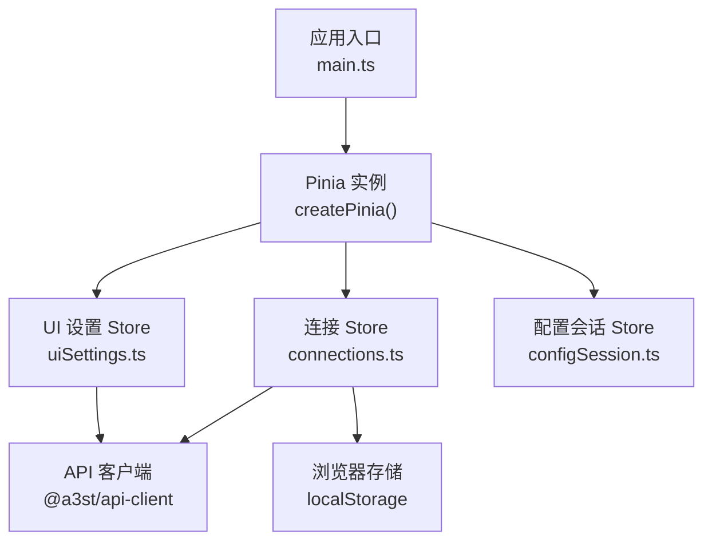
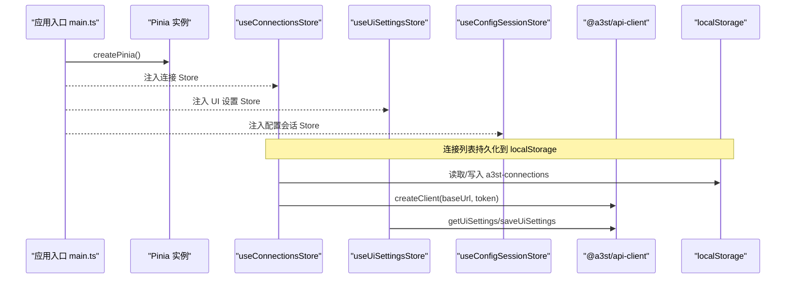
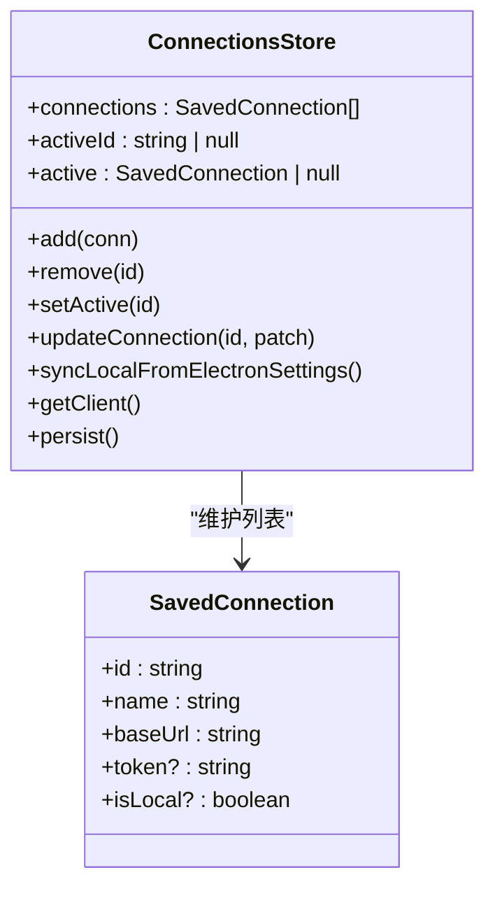
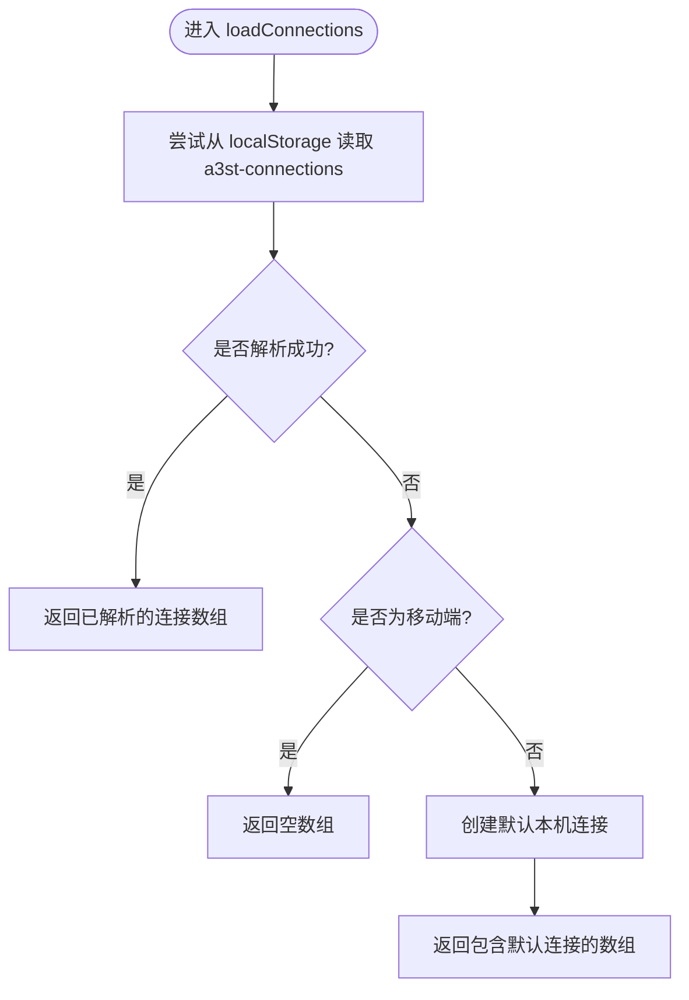
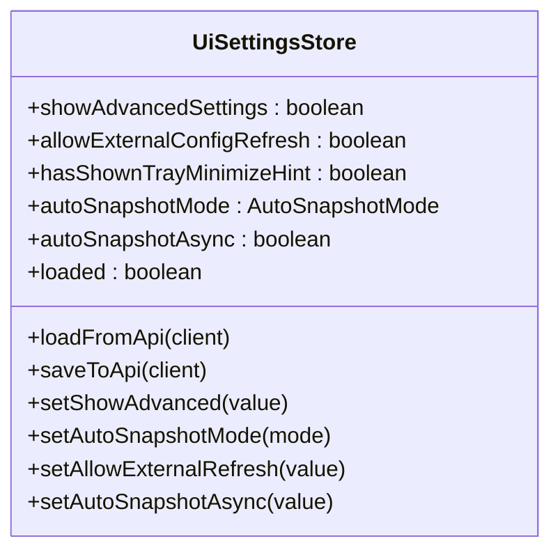
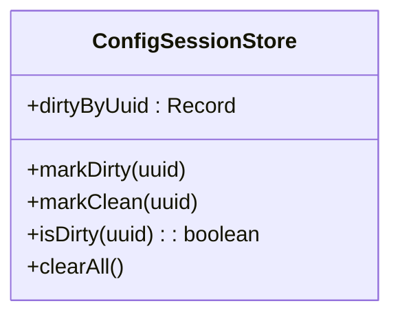
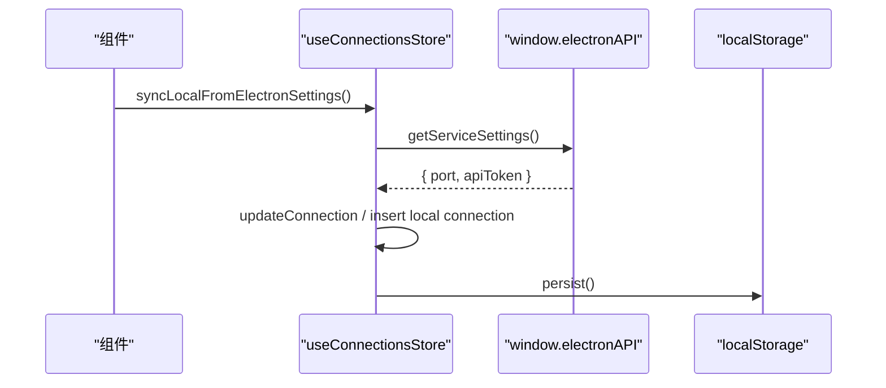
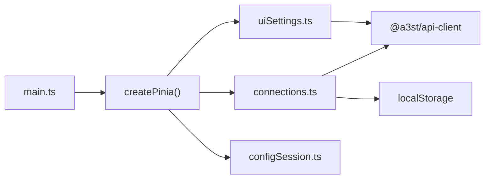

# 状态管理

<cite>
**本文引用的文件**   
- [packages/web/src/main.ts](file://packages/web/src/main.ts)
- [packages/web/src/stores/connections.ts](file://packages/web/src/stores/connections.ts)
- [packages/web/src/stores/uiSettings.ts](file://packages/web/src/stores/uiSettings.ts)
- [packages/web/src/stores/configSession.ts](file://packages/web/src/stores/configSession.ts)
- [packages/web/package.json](file://packages/web/package.json)
- [package-lock.json](file://package-lock.json)
- [packages/web/src/components/FirstServerWizard.vue](file://packages/web/src/components/FirstServerWizard.vue)
- [packages/web/src/views/ConnectionsView.vue](file://packages/web/src/views/ConnectionsView.vue)
- [packages/web/src/composables/configEditor.ts](file://packages/web/src/composables/configEditor.ts)
</cite>

## 目录
1. [引言](#引言)
2. [项目结构](#项目结构)
3. [核心组件](#核心组件)
4. [架构总览](#架构总览)
5. [详细组件分析](#详细组件分析)
6. [依赖关系分析](#依赖关系分析)
7. [性能与内存优化](#性能与内存优化)
8. [调试与排错指南](#调试与排错指南)
9. [状态迁移与版本管理](#状态迁移与版本管理)
10. [结论](#结论)

## 引言
本文面向 Arma3 Server Tools 的前端 Web 应用，系统性梳理基于 Pinia 的状态管理模式。重点说明：
- 全局状态与局部状态的划分原则：服务器连接、用户配置、UI 设置、配置编辑会话等。
- Store 模块设计：模块化组织、状态持久化、异步操作处理。
- reactive state、computed properties、actions 的实现模式。
- 状态同步机制：与后端 API 的实时同步、本地缓存策略。
- 状态调试工具、性能优化技巧与内存泄漏防护。
- 状态迁移与版本管理的最佳实践。

## 项目结构
Web 应用使用 Vue 3 + TypeScript + Vite，并通过 createPinia 初始化 Pinia 实例。状态集中在 packages/web/src/stores 目录下，按领域拆分为多个 Store 模块：
- connections：服务器连接列表、当前激活连接、客户端工厂方法。
- uiSettings：界面与功能开关、自动快照策略等 UI 相关设置。
- configSession：配置编辑器脏标记会话状态。

**图表来源**
- [packages/web/src/main.ts:1-45](file://packages/web/src/main.ts#L1-L45)
- [packages/web/src/stores/connections.ts:1-136](file://packages/web/src/stores/connections.ts#L1-L136)
- [packages/web/src/stores/uiSettings.ts:1-53](file://packages/web/src/stores/uiSettings.ts#L1-L53)
- [packages/web/src/stores/configSession.ts:1-22](file://packages/web/src/stores/configSession.ts#L1-L22)

**章节来源**
- [packages/web/src/main.ts:1-45](file://packages/web/src/main.ts#L1-L45)
- [packages/web/package.json](file://packages/web/package.json)

## 核心组件
本项目的状态管理由三个 Store 组成，分别承担不同职责：
- useConnectionsStore：维护服务器连接集合、当前激活连接、生成 API 客户端、与 Electron 服务设置同步、将连接数据持久化到 localStorage。
- useUiSettingsStore：维护 UI 行为与功能开关，提供从后端加载和保存设置的异步 action。
- useConfigSessionStore：维护配置编辑器的脏标记集合，用于提示未保存变更。

这些 Store 通过 defineStore 创建，遵循“状态集中、动作内聚”的原则，组件仅消费状态并触发 actions。

**章节来源**
- [packages/web/src/stores/connections.ts:1-136](file://packages/web/src/stores/connections.ts#L1-L136)
- [packages/web/src/stores/uiSettings.ts:1-53](file://packages/web/src/stores/uiSettings.ts#L1-L53)
- [packages/web/src/stores/configSession.ts:1-22](file://packages/web/src/stores/configSession.ts#L1-L22)

## 架构总览
下图展示应用启动后，Pinia 如何被挂载，以及各 Store 之间的交互关系。

**图表来源**
- [packages/web/src/main.ts:22-44](file://packages/web/src/main.ts#L22-L44)
- [packages/web/src/stores/connections.ts:17-135](file://packages/web/src/stores/connections.ts#L17-L135)
- [packages/web/src/stores/uiSettings.ts:12-52](file://packages/web/src/stores/uiSettings.ts#L12-L52)

## 详细组件分析

### 连接 Store（useConnectionsStore）
该 Store 负责：
- 维护 SavedConnection[] 列表与 activeId。
- 计算属性 active 返回当前激活的连接对象。
- 从 localStorage 加载默认连接，移动端不预置本机连接。
- 提供 add/remove/setActive/updateConnection 等方法，并在变更后持久化。
- 与 Electron 服务设置同步，确保本机连接的端口与 Token 一致。
- 根据当前连接生成 API 客户端实例。

**图表来源**
- [packages/web/src/stores/connections.ts:5-11](file://packages/web/src/stores/connections.ts#L5-L11)
- [packages/web/src/stores/connections.ts:17-135](file://packages/web/src/stores/connections.ts#L17-L135)

关键实现要点：
- 状态定义：使用 ref 包裹数组与 ID，active 为 computed，保证响应式更新。
- 持久化：loadConnections 从 localStorage 读取；persist 在增删改后写入。
- 平台差异：移动端不预置本机连接，避免无 Service 场景下的无效连接。
- 异步同步：syncLocalFromElectronSettings 调用 window.electronAPI.getServiceSettings，更新或插入本机连接。
- 客户端工厂：getClient 根据 active 连接构造 @a3st/api-client 实例。

**图表来源**
- [packages/web/src/stores/connections.ts:23-43](file://packages/web/src/stores/connections.ts#L23-L43)

**章节来源**
- [packages/web/src/stores/connections.ts:1-136](file://packages/web/src/stores/connections.ts#L1-L136)

### UI 设置 Store（useUiSettingsStore）
该 Store 负责：
- 维护 UiSettings 类型对应的 UI 偏好与功能开关。
- 提供 loadFromApi 与 saveToApi 两个异步 action，与后端 API 同步设置。
- 暴露 setter actions 以修改具体字段。
- 增加 loaded 标志位，便于组件判断设置是否已从后端加载完成。

**图表来源**
- [packages/web/src/stores/uiSettings.ts:4-16](file://packages/web/src/stores/uiSettings.ts#L4-L16)
- [packages/web/src/stores/uiSettings.ts:17-52](file://packages/web/src/stores/uiSettings.ts#L17-L52)

关键实现要点：
- 默认值集中定义 DEFAULTS，保证前后端一致性。
- loadFromApi 成功后填充字段，并设置 loaded = true。
- saveToApi 将当前状态序列化为 UiSettings 并调用后端接口。

**章节来源**
- [packages/web/src/stores/uiSettings.ts:1-53](file://packages/web/src/stores/uiSettings.ts#L1-L53)

### 配置会话 Store（useConfigSessionStore）
该 Store 负责：
- 维护 dirtyByUuid 字典，记录哪些配置项存在未保存变更。
- 提供 markDirty/markClean/isDirty/clearAll 等动作，供配置编辑器使用。

**图表来源**
- [packages/web/src/stores/configSession.ts:3-20](file://packages/web/src/stores/configSession.ts#L3-L20)

关键实现要点：
- 使用简单字典记录脏标记，避免复杂状态耦合。
- clearAll 用于提交成功后清空脏标记。

**章节来源**
- [packages/web/src/stores/configSession.ts:1-22](file://packages/web/src/stores/configSession.ts#L1-L22)

### 状态同步机制
- 与后端 API 的同步：
  - UI 设置通过 useUiSettingsStore.loadFromApi/saveToApi 与后端进行读写。
  - 连接 Store 通过 getClient 生成 API 客户端，供其他模块发起请求。
- 本地缓存策略：
  - 连接列表通过 localStorage 持久化，键名为 a3st-connections。
  - 首次加载时根据运行环境决定默认连接。
- 与 Electron 服务的同步：
  - syncLocalFromElectronSettings 会读取 Electron 提供的服务设置，更新本机连接的 baseUrl 与 token，避免 UI 能打开但 API 鉴权失败的问题。

**图表来源**
- [packages/web/src/stores/connections.ts:83-115](file://packages/web/src/stores/connections.ts#L83-L115)
- [packages/web/src/stores/connections.ts:45-81](file://packages/web/src/stores/connections.ts#L45-L81)

**章节来源**
- [packages/web/src/stores/connections.ts:83-115](file://packages/web/src/stores/connections.ts#L83-L115)
- [packages/web/src/stores/connections.ts:45-81](file://packages/web/src/stores/connections.ts#L45-L81)

### reactive state、computed properties、actions 示例路径
- reactive state：
  - 连接列表与活跃 ID：[connections.ts:17-21](file://packages/web/src/stores/connections.ts#L17-L21)
  - UI 设置字段与 loaded 标志：[uiSettings.ts:12-16](file://packages/web/src/stores/uiSettings.ts#L12-L16)
  - 配置会话脏标记字典：[configSession.ts:3-6](file://packages/web/src/stores/configSession.ts#L3-L6)
- computed properties：
  - 当前激活连接 active：[connections.ts:21](file://packages/web/src/stores/connections.ts#L21)
- actions：
  - 连接 CRUD 与同步：[connections.ts:49-115](file://packages/web/src/stores/connections.ts#L49-L115)
  - UI 设置加载与保存：[uiSettings.ts:17-52](file://packages/web/src/stores/uiSettings.ts#L17-L52)
  - 配置会话脏标记管理：[configSession.ts:7-20](file://packages/web/src/stores/configSession.ts#L7-L20)

**章节来源**
- [packages/web/src/stores/connections.ts:17-115](file://packages/web/src/stores/connections.ts#L17-L115)
- [packages/web/src/stores/uiSettings.ts:12-52](file://packages/web/src/stores/uiSettings.ts#L12-L52)
- [packages/web/src/stores/configSession.ts:3-20](file://packages/web/src/stores/configSession.ts#L3-L20)

## 依赖关系分析
- 应用入口 main.ts 中引入 createPinia 并挂载到 Vue 应用。
- 各 Store 通过 defineStore 导出，组件通过 import 引入并使用。
- connections.ts 依赖 @a3st/api-client 生成 API 客户端，并访问 localStorage。
- uiSettings.ts 依赖 @a3st/api-client 的类型与 API 方法。
- configSession.ts 无外部依赖，纯状态管理。

**图表来源**
- [packages/web/src/main.ts:1-45](file://packages/web/src/main.ts#L1-L45)
- [packages/web/src/stores/connections.ts:1-4](file://packages/web/src/stores/connections.ts#L1-L4)
- [packages/web/src/stores/uiSettings.ts:1-3](file://packages/web/src/stores/uiSettings.ts#L1-L3)

**章节来源**
- [packages/web/src/main.ts:1-45](file://packages/web/src/main.ts#L1-L45)
- [packages/web/src/stores/connections.ts:1-4](file://packages/web/src/stores/connections.ts#L1-L4)
- [packages/web/src/stores/uiSettings.ts:1-3](file://packages/web/src/stores/uiSettings.ts#L1-L3)

## 性能与内存优化
- 避免不必要的重渲染：
  - 尽量只订阅必要的状态字段，例如组件中仅绑定 active 而非整个 connections 数组。
  - 对大数组进行分页或虚拟滚动，减少 DOM 压力。
- 合理持久化：
  - 仅在必要时写入 localStorage，如连接增删改后统一 persist，避免频繁 I/O。
- 清理副作用：
  - 在组件销毁时取消 SSE 监听、定时器、事件监听器，防止内存泄漏。
- 控制状态体积：
  - 避免在 Store 中缓存大量历史数据；如需历史，考虑分片或时间窗口策略。
- 计算属性优先：
  - 使用 computed 派生状态，避免重复计算与冗余状态。

[本节为通用指导，不涉及具体文件]

## 调试与排错指南
- 使用 Vue DevTools：
  - 在浏览器中启用 Vue DevTools，查看 Pinia Store 的状态变化、actions 调用栈。
- 错误边界与全局错误处理：
  - main.ts 中设置了 app.config.errorHandler，捕获 Vue 异常并显示友好提示，同时提供返回连接页的链接。
- 常见问题排查：
  - 连接无法访问：检查 active 连接是否正确，baseUrl 与 token 是否与 Electron 服务设置一致。
  - 设置未生效：确认 useUiSettingsStore.loaded 是否为 true，且后端返回 success。
  - 脏标记未清除：提交成功后调用 useConfigSessionStore.clearAll。

**章节来源**
- [packages/web/src/main.ts:23-40](file://packages/web/src/main.ts#L23-L40)
- [packages/web/src/stores/connections.ts:83-115](file://packages/web/src/stores/connections.ts#L83-L115)
- [packages/web/src/stores/uiSettings.ts:17-28](file://packages/web/src/stores/uiSettings.ts#L17-L28)
- [packages/web/src/stores/configSession.ts:17-20](file://packages/web/src/stores/configSession.ts#L17-L20)

## 状态迁移与版本管理
- 版本号与兼容性：
  - 为持久化状态（如 a3st-connections）添加 schemaVersion 字段，迁移逻辑在 loadConnections 中执行。
- 迁移策略：
  - 当后端或前端升级导致状态结构变化时，先兼容旧结构，再逐步淘汰旧字段。
  - 对关键字段（如 baseUrl、token）进行校验与规范化（trim、URL 格式）。
- 回滚与降级：
  - 若迁移失败，保留原始备份并回退到默认值，避免应用不可用。
- 测试覆盖：
  - 为迁移逻辑编写单元测试，覆盖旧版本数据结构与新版本目标结构。

[本节为通用指导，不涉及具体文件]

## 结论
Arma3 Server Tools 的 Web 前端采用 Pinia 作为状态管理方案，围绕连接、UI 设置与配置会话三大领域构建 Store 模块。通过 reactive state、computed properties 与 actions 的组合，实现了清晰的状态流与可维护的业务逻辑。结合 localStorage 与后端 API，完成了本地缓存与远程同步。建议在后续迭代中加强状态迁移、性能监控与内存泄漏防护，进一步提升用户体验与系统稳定性。

[本节为总结性内容，不涉及具体文件]