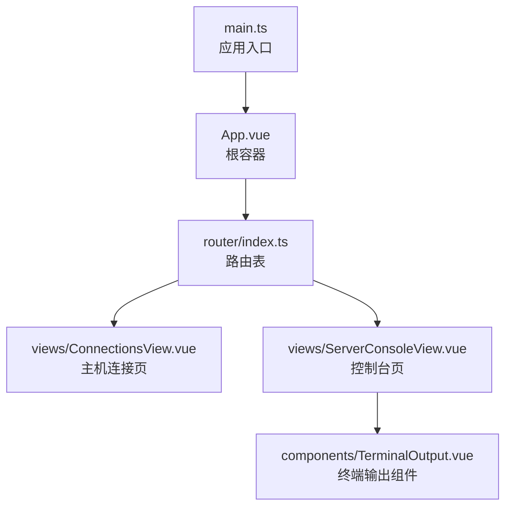
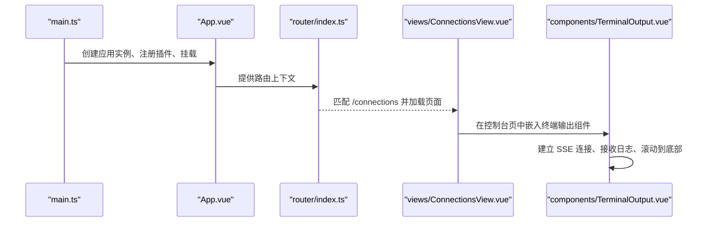
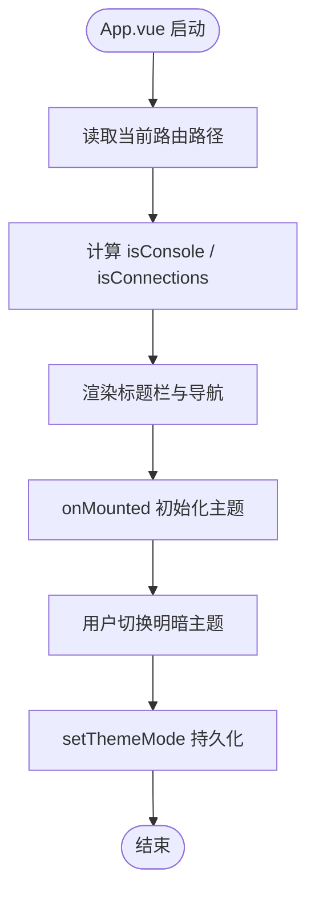
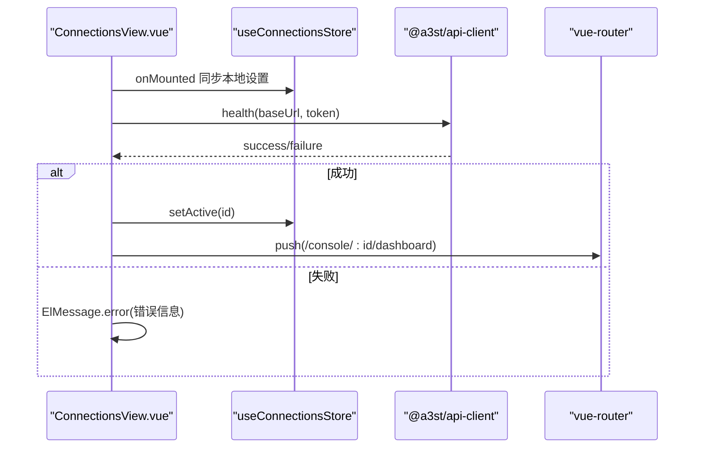
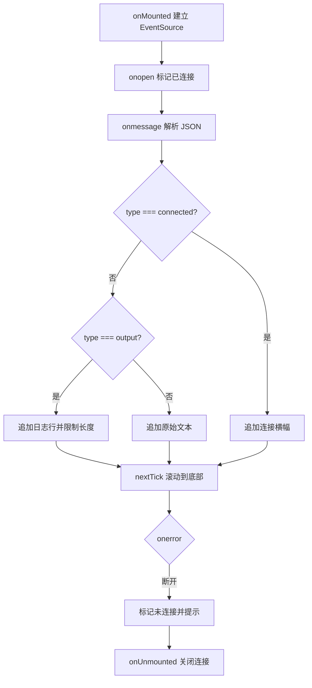
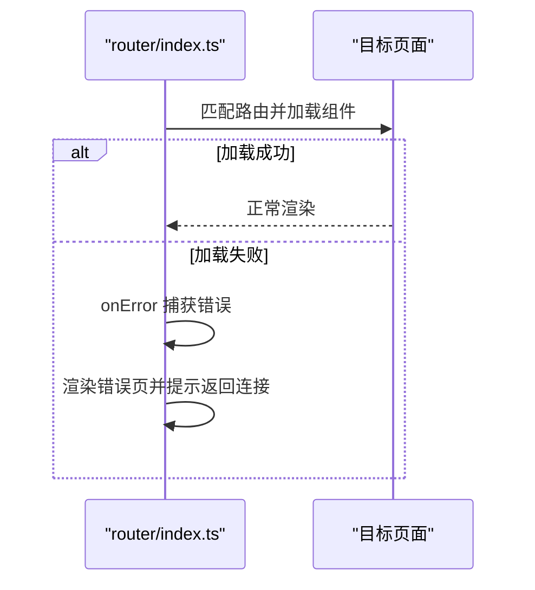
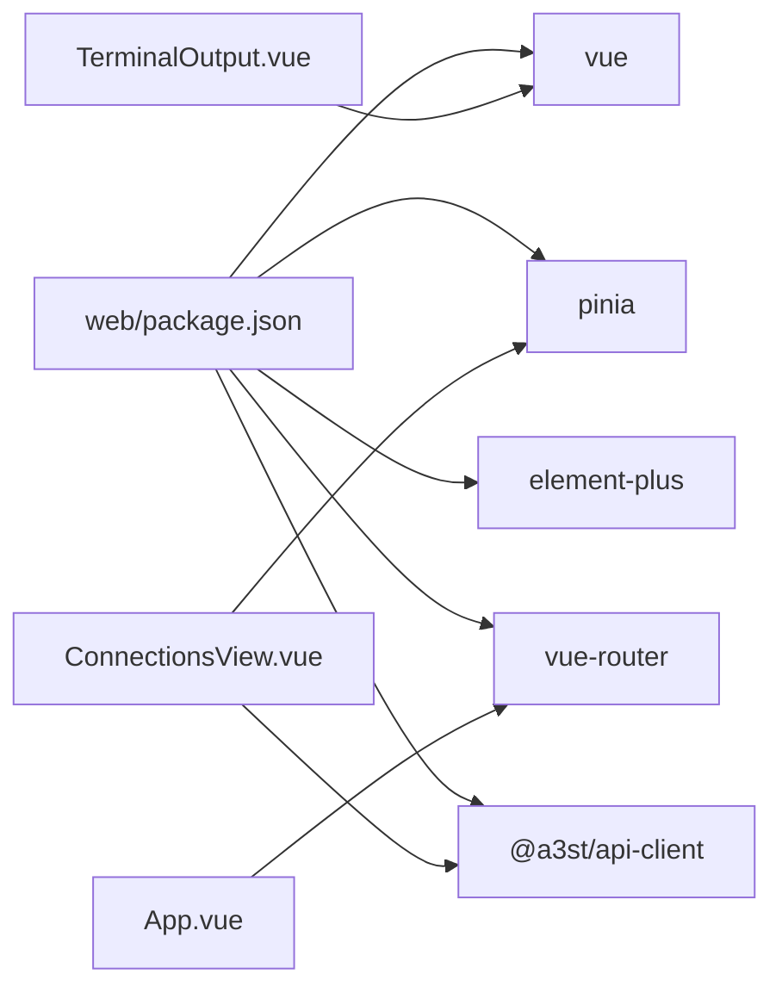

# 组件架构设计

<cite>
**本文引用的文件**   
- [packages/web/src/main.ts](file://packages/web/src/main.ts)
- [packages/web/src/App.vue](file://packages/web/src/App.vue)
- [packages/web/src/router/index.ts](file://packages/web/src/router/index.ts)
- [packages/web/src/views/ConnectionsView.vue](file://packages/web/src/views/ConnectionsView.vue)
- [packages/web/src/components/TerminalOutput.vue](file://packages/web/src/components/TerminalOutput.vue)
- [packages/web/package.json](file://packages/web/package.json)
</cite>

## 目录
1. [引言](#引言)
2. [项目结构](#项目结构)
3. [核心组件与职责划分](#核心组件与职责划分)
4. [架构总览](#架构总览)
5. [详细组件分析](#详细组件分析)
6. [依赖关系分析](#依赖关系分析)
7. [性能与可维护性建议](#性能与可维护性建议)
8. [测试与调试策略](#测试与调试策略)
9. [结论](#结论)

## 引言
本文面向 Arma3 Server Tools v2 的 Vue 3 前端，目标是建立一套清晰、可扩展的组件架构文档。重点包括：根组件 App.vue 的职责边界、页面级组件 views 与业务组件 components 的划分原则、命名与目录规范、组件通信机制（props、事件、provide/inject）、组合式 API 最佳实践、插槽复用设计、以及测试与调试方法。

该项目采用 Vite + Vue 3 + TypeScript + Pinia + Element Plus + Vue Router 技术栈，Web 应用位于 packages/web 下，桌面端通过 Electron 壳加载同一前端产物。

## 项目结构
packages/web 是 Vue 3 单页应用，主要目录如下：
- src/main.ts：应用入口，注册全局插件、错误处理、主题初始化。
- src/App.vue：根容器，负责外壳布局、标题栏、主题切换、路由视图挂载。
- src/router/index.ts：路由定义，包含连接页、控制台页、演示页等。
- src/views：页面级组件，按功能域组织，如 ConnectionsView、DashboardView、ServerConsoleView 等。
- src/components：通用或领域内业务组件，如 TerminalOutput、ConsolePageLayout、FirstServerWizard 等。
- src/stores：Pinia 状态管理模块。
- src/composables：组合式函数，封装可复用逻辑。
- src/utils、src/constants、src/styles、src/config：工具、常量、样式与配置。

**图表来源**
- [packages/web/src/main.ts:1-45](file://packages/web/src/main.ts#L1-L45)
- [packages/web/src/App.vue:1-108](file://packages/web/src/App.vue#L1-L108)
- [packages/web/src/router/index.ts:1-79](file://packages/web/src/router/index.ts#L1-L79)
- [packages/web/src/views/ConnectionsView.vue:1-321](file://packages/web/src/views/ConnectionsView.vue#L1-L321)
- [packages/web/src/components/TerminalOutput.vue:1-135](file://packages/web/src/components/TerminalOutput.vue#L1-L135)

**章节来源**
- [packages/web/src/main.ts:1-45](file://packages/web/src/main.ts#L1-L45)
- [packages/web/src/App.vue:1-108](file://packages/web/src/App.vue#L1-L108)
- [packages/web/src/router/index.ts:1-79](file://packages/web/src/router/index.ts#L1-L79)

## 核心组件与职责划分
- 根组件 App.vue
  - 职责：应用外壳、标题栏、主题模式选择器、根据路由判断是否显示导航、渲染 <router-view />。
  - 关键行为：读取当前路由路径，判断是否为控制台页面或连接页；在移动端隐藏部分 UI；监听主题变化并持久化。
- 页面级组件 views
  - 职责：承载具体业务页面，协调多个子组件与状态，调用 API 客户端，驱动路由跳转。
  - 示例：ConnectionsView 负责主机列表展示、添加/删除主机、健康检查、选中与跳转。
- 业务组件 components
  - 职责：可复用的业务块，如终端日志流、控制台布局、向导对话框等。
  - 示例：TerminalOutput 负责 SSE 日志流、自动滚动、连接状态指示。

命名与目录规范建议：
- 组件命名使用 PascalCase，文件名与组件名一致。
- 页面组件放在 src/views，按功能域分文件；领域相关的小组件放在 src/components/<domain>/。
- 组合式函数放在 src/composables，工具函数放在 src/utils，常量放在 src/constants。
- 路由定义集中在 src/router/index.ts，避免分散。

**章节来源**
- [packages/web/src/App.vue:1-108](file://packages/web/src/App.vue#L1-L108)
- [packages/web/src/views/ConnectionsView.vue:1-321](file://packages/web/src/views/ConnectionsView.vue#L1-L321)
- [packages/web/src/components/TerminalOutput.vue:1-135](file://packages/web/src/components/TerminalOutput.vue#L1-L135)

## 架构总览
整体架构遵循“入口 → 根容器 → 路由 → 页面 → 业务组件”的分层模型。

**图表来源**
- [packages/web/src/main.ts:22-44](file://packages/web/src/main.ts#L22-L44)
- [packages/web/src/App.vue:25-76](file://packages/web/src/App.vue#L25-L76)
- [packages/web/src/router/index.ts:6-62](file://packages/web/src/router/index.ts#L6-L62)
- [packages/web/src/views/ConnectionsView.vue:75-88](file://packages/web/src/views/ConnectionsView.vue#L75-L88)
- [packages/web/src/components/TerminalOutput.vue:20-53](file://packages/web/src/components/TerminalOutput.vue#L20-L53)

## 详细组件分析

### 根组件 App.vue
- 职责边界
  - 外壳布局：标题栏、内容区、移动端适配。
  - 主题控制：从系统读取主题模式，用户切换后持久化。
  - 路由感知：根据路径决定是否显示返回连接按钮与被控设置链接。
- 生命周期与组合式 API
  - onMounted：初始化主题模式。
  - computed：isConsole、isConnections 用于条件渲染。
- 通信机制
  - 通过 props 与模板绑定主题值，触发 onThemeModeChange 更新并持久化。
  - 不直接持有业务状态，保持轻量外壳。

**图表来源**
- [packages/web/src/App.vue:6-22](file://packages/web/src/App.vue#L6-L22)
- [packages/web/src/App.vue:25-76](file://packages/web/src/App.vue#L25-L76)

**章节来源**
- [packages/web/src/App.vue:1-108](file://packages/web/src/App.vue#L1-L108)

### 页面组件 ConnectionsView.vue
- 职责边界
  - 主机连接列表展示、新增/移除主机、健康检查、选中与路由跳转。
  - 移动端与桌面端差异化交互（单击连接 vs 双击连接）。
- 数据流与通信
  - 使用 Pinia store（useConnectionsStore）管理连接集合与活跃连接。
  - 通过 @a3st/api-client 发起 health 请求验证服务可达性。
  - 成功后调用 store.setActive 并 router.push 进入控制台页。
- 生命周期与组合式 API
  - onMounted：同步本地设置到 Electron 环境（若存在）。
  - 异步函数 testConnection/connect/doAdd 统一错误提示与状态恢复。

**图表来源**
- [packages/web/src/views/ConnectionsView.vue:32-34](file://packages/web/src/views/ConnectionsView.vue#L32-L34)
- [packages/web/src/views/ConnectionsView.vue:46-73](file://packages/web/src/views/ConnectionsView.vue#L46-L73)
- [packages/web/src/views/ConnectionsView.vue:75-88](file://packages/web/src/views/ConnectionsView.vue#L75-L88)

**章节来源**
- [packages/web/src/views/ConnectionsView.vue:1-321](file://packages/web/src/views/ConnectionsView.vue#L1-L321)

### 业务组件 TerminalOutput.vue
- 职责边界
  - 基于 EventSource 订阅后端日志流，解析 JSON 消息，维护行数组，自动滚动到底部。
  - 连接状态指示、清空日志、SSE 错误处理。
- 生命周期与组合式 API
  - onMounted：建立 SSE 连接，注册 onopen/onmessage/onerror。
  - onUnmounted：关闭 EventSource，防止内存泄漏。
  - nextTick：DOM 更新后滚动容器到底部。
- 输入与复用
  - props：url、baseUrl、token，支持拼接完整流地址与鉴权参数。
  - 无具名插槽，但可通过 clearLog 暴露操作能力给父组件。

**图表来源**
- [packages/web/src/components/TerminalOutput.vue:20-53](file://packages/web/src/components/TerminalOutput.vue#L20-L53)
- [packages/web/src/components/TerminalOutput.vue:55-65](file://packages/web/src/components/TerminalOutput.vue#L55-L65)

**章节来源**
- [packages/web/src/components/TerminalOutput.vue:1-135](file://packages/web/src/components/TerminalOutput.vue#L1-L135)

### 路由与页面加载流程
- 路由定义
  - 首页重定向到 /connections。
  - 控制台路由 /console/:connectionId/:tab 同步加载，避免 Electron/file 或静态托管下异步 chunk 失败导致白屏。
  - 移动端屏蔽部分路由（如 /settings/host）。
- 错误处理
  - router.onError 捕获路由切换异常，渲染友好错误页并提供返回连接页链接。

**图表来源**
- [packages/web/src/router/index.ts:6-62](file://packages/web/src/router/index.ts#L6-L62)
- [packages/web/src/router/index.ts:64-79](file://packages/web/src/router/index.ts#L64-L79)

**章节来源**
- [packages/web/src/router/index.ts:1-79](file://packages/web/src/router/index.ts#L1-L79)

## 依赖关系分析
- 外部依赖
  - vue、pinia、element-plus、vue-router、@a3st/api-client、chart.js、vue-chartjs。
- 内部依赖
  - App.vue 依赖 router 与主题工具。
  - ConnectionsView.vue 依赖 api-client、store、router、Element Plus 消息框。
  - TerminalOutput.vue 依赖 Vue 响应式 API 与原生 EventSource。

**图表来源**
- [packages/web/package.json:16-25](file://packages/web/package.json#L16-L25)
- [packages/web/src/App.vue:3-4](file://packages/web/src/App.vue#L3-L4)
- [packages/web/src/views/ConnectionsView.vue:5-7](file://packages/web/src/views/ConnectionsView.vue#L5-L7)
- [packages/web/src/components/TerminalOutput.vue:2](file://packages/web/src/components/TerminalOutput.vue#L2)

**章节来源**
- [packages/web/package.json:1-36](file://packages/web/package.json#L1-L36)

## 性能与可维护性建议
- 组件粒度
  - 将 TerminalOutput 这类独立功能拆分为业务组件，便于复用与测试。
  - 页面组件尽量薄，仅做编排与状态协调。
- 数据流
  - 优先使用 props 单向数据流，避免跨层级双向绑定。
  - 复杂状态放入 Pinia store，减少组件间耦合。
- 长列表与日志
  - TerminalOutput 已限制行数上限，避免 DOM 膨胀。
  - 对大量日志可采用虚拟滚动或分页加载。
- 路由懒加载
  - 非控制台路由使用动态 import，控制台路由同步加载以避免白屏。
- 主题与样式
  - 主题切换集中处理，避免在组件内重复逻辑。
  - 使用 CSS 变量统一管理视觉风格。

[本节为通用建议，不直接分析具体文件]

## 测试与调试策略
- 单元测试
  - 针对 TerminalOutput 的 SSE 消息解析、连接状态、滚动行为编写用例。
  - 针对 ConnectionsView 的连接测试、表单校验、路由跳转进行断言。
- 端到端测试
  - 使用 Playwright 模拟用户点击“添加主机”“连接”，验证页面跳转与状态。
- 调试技巧
  - main.ts 中全局 errorHandler 会捕获 Vue 运行时错误并显示错误横幅，便于快速定位问题。
  - router.onError 会在路由切换失败时渲染错误页，避免白屏。
  - 使用浏览器开发者工具的 Network 面板观察 SSE 连接与 API 请求。

**章节来源**
- [packages/web/src/main.ts:23-40](file://packages/web/src/main.ts#L23-L40)
- [packages/web/src/router/index.ts:64-79](file://packages/web/src/router/index.ts#L64-L79)

## 结论
本项目的 Vue 3 前端采用清晰的层次结构与职责划分：App.vue 作为外壳与主题中枢，views 承担页面编排，components 提供可复用业务能力。通过 props 单向数据流、Pinia 状态管理与路由懒加载，保证了良好的可维护性与扩展性。建议在后续开发中继续遵循该模式，完善组合式函数与测试覆盖，提升组件复用率与稳定性。