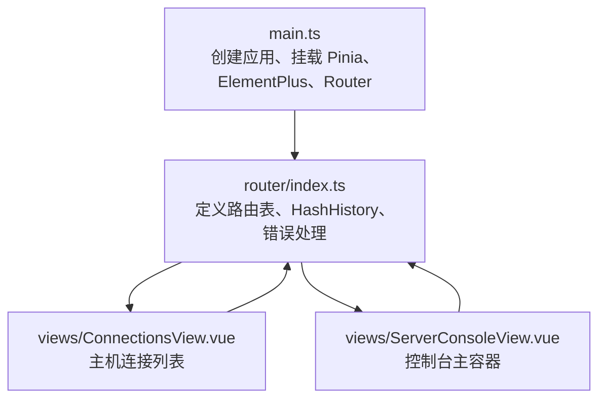
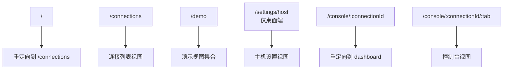
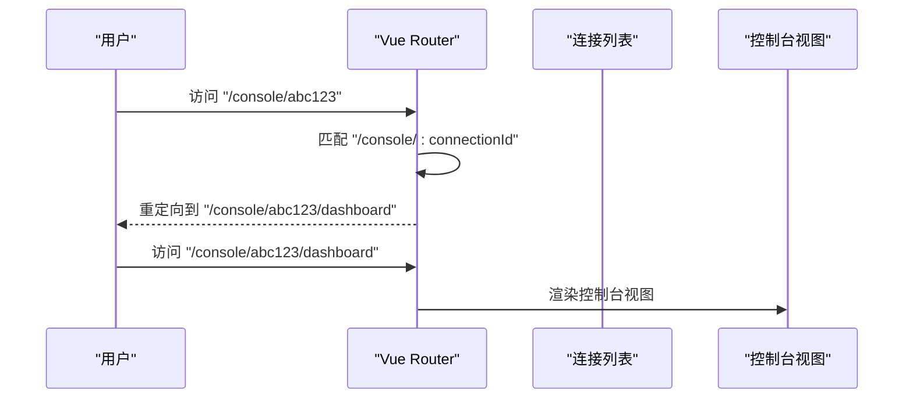
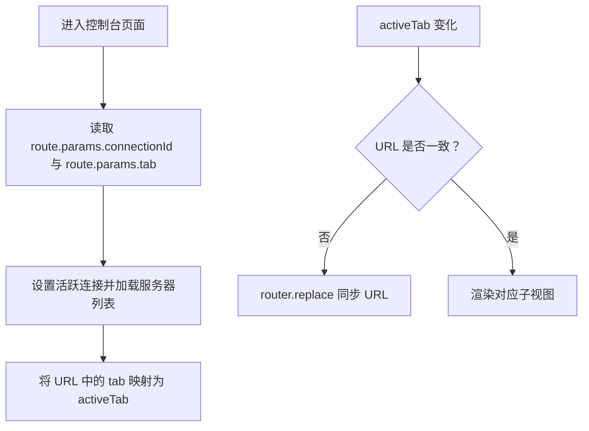
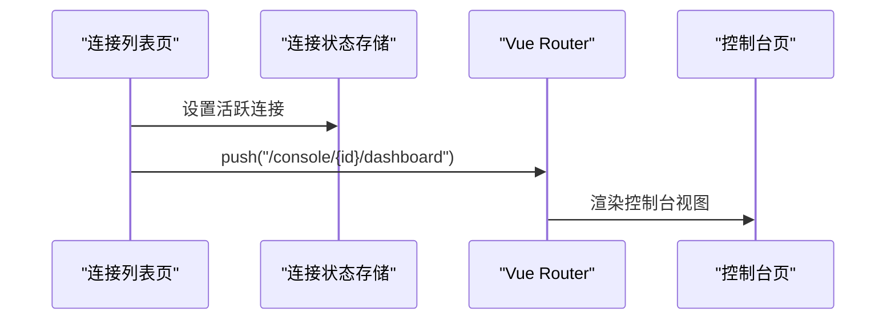
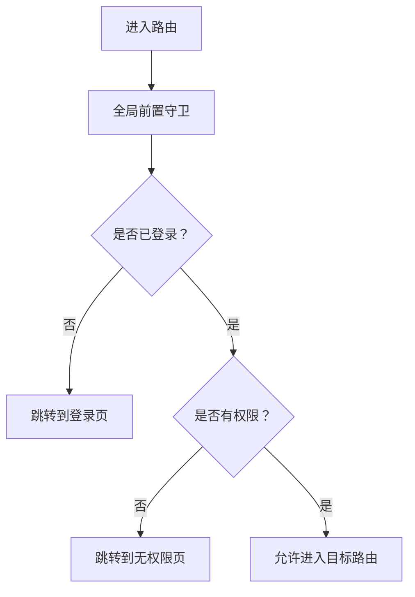
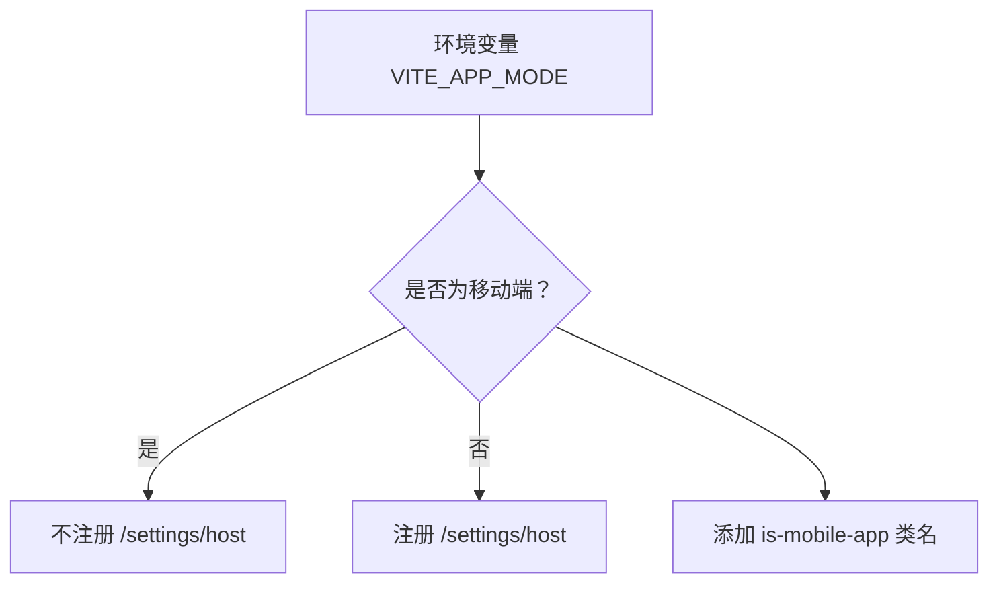
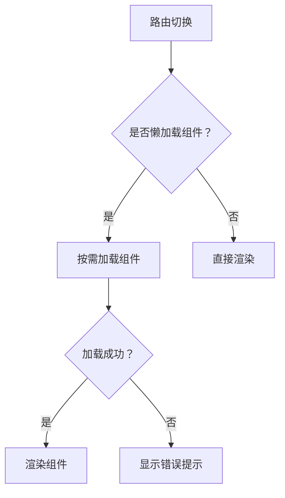

# 路由与导航

<cite>
**本文引用的文件**   
- [packages/web/src/main.ts](file://packages/web/src/main.ts)
- [packages/web/src/router/index.ts](file://packages/web/src/router/index.ts)
- [packages/web/src/views/ConnectionsView.vue](file://packages/web/src/views/ConnectionsView.vue)
- [packages/web/src/views/ServerConsoleView.vue](file://packages/web/src/views/ServerConsoleView.vue)
</cite>

## 目录
1. [引言](#引言)
2. [项目结构中的路由位置](#项目结构中的路由位置)
3. [核心路由配置总览](#核心路由配置总览)
4. [路由定义与动态参数](#路由定义与动态参数)
5. [嵌套路由与标签页状态同步](#嵌套路由与标签页状态同步)
6. [导航模式：编程式与声明式](#导航模式编程式与声明式)
7. [路由守卫、权限控制与登录验证现状](#路由守卫权限控制与登录验证现状)
8. [移动端适配的路由策略](#移动端适配的路由策略)
9. [URL 状态管理与面包屑建议](#url-状态管理与面包屑建议)
10. [路由性能优化技巧](#路由性能优化技巧)
11. [SEO 友好性与无障碍访问支持](#seo-友好性与无障碍访问支持)
12. [常见问题排查](#常见问题排查)
13. [结论](#结论)

## 引言
本文围绕当前仓库中基于 Vue Router 的路由与导航实现，系统化说明路由定义方式、动态参数、页面跳转流程、移动端适配策略，并结合现有代码给出可落地的扩展建议。文档重点包括：
- 路由注册、重定向与懒加载
- 控制台页面的动态路由与标签页状态同步
- 编程式导航的使用场景
- 当前未实现路由守卫的现状与扩展方案
- URL 状态管理、面包屑导航设计思路
- 性能优化、SEO 和无障碍访问建议

## 项目结构中的路由位置
本项目的前端 Web 应用位于 `packages/web` 目录，Vue Router 的入口和配置集中在以下位置：
- 应用初始化时挂载路由：`packages/web/src/main.ts`
- 路由表与历史模式配置：`packages/web/src/router/index.ts`
- 连接列表页面：`packages/web/src/views/ConnectionsView.vue`
- 服务器控制台页面：`packages/web/src/views/ServerConsoleView.vue`

**图表来源** 
- [packages/web/src/main.ts:22-44](file://packages/web/src/main.ts#L22-L44)
- [packages/web/src/router/index.ts:59-62](file://packages/web/src/router/index.ts#L59-L62)

**章节来源**
- [packages/web/src/main.ts:1-45](file://packages/web/src/main.ts#L1-L45)
- [packages/web/src/router/index.ts:1-79](file://packages/web/src/router/index.ts#L1-L79)

## 核心路由配置总览
当前路由配置采用 Hash 历史模式，适合 Electron 或静态托管环境；路由表包含：
- 根路径 `/` 重定向到 `/connections`
- 主机连接页 `/connections`
- 多个演示页面 `/demo/*`
- 桌面端专属设置页 `/settings/host`（仅在非移动端启用）
- 控制台动态路由 `/console/:connectionId` 与 `/console/:connectionId/:tab`

**图表来源** 
- [packages/web/src/router/index.ts:6-57](file://packages/web/src/router/index.ts#L6-L57)

**章节来源**
- [packages/web/src/router/index.ts:1-79](file://packages/web/src/router/index.ts#L1-L79)

## 路由定义与动态参数
### 基础路由
- `/`：作为入口，统一重定向到 `/connections`，保证首次进入时用户看到连接列表。
- `/connections`：连接列表页，使用懒加载组件 `ConnectionsView.vue`。
- `/demo/*`：样式演示页面，全部使用懒加载。
- `/settings/host`：仅在非移动端环境下注册，避免移动端出现无关设置入口。

### 动态路由参数
- `/console/:connectionId`：控制台基础路径，通过 `redirect` 函数将任意子路径统一跳转到 `/console/:connectionId/dashboard`，确保默认打开仪表盘。
- `/console/:connectionId/:tab`：控制台具体标签页，例如 `dashboard`、`basic`、`performance` 等。该路由使用同步加载组件 `ServerConsoleView.vue`，注释明确说明是为了避免在 Electron/file 协议或静态托管下异步 chunk 失败导致白屏。

**图表来源** 
- [packages/web/src/router/index.ts:46-56](file://packages/web/src/router/index.ts#L46-L56)

**章节来源**
- [packages/web/src/router/index.ts:6-57](file://packages/web/src/router/index.ts#L6-L57)

## 嵌套路由与标签页状态同步
当前控制台页面没有使用 Vue Router 的嵌套路由语法，而是通过一个父级路由 `/console/:connectionId/:tab` 承载整个控制台容器，并在组件内部根据 `route.params.tab` 决定显示哪个子视图。这种方式的优势是：
- 简化路由结构，避免多层嵌套带来的复杂维护成本
- 便于统一管理服务器选择、状态轮询、配置保存等逻辑

组件内部的状态同步机制如下：
- 监听 `route.params.connectionId`，切换连接时重置选中服务器并重新加载数据
- 监听 `route.params.tab`，将 URL 中的 tab 名称映射为内部 `activeTab`
- 监听内部 `activeTab`，当与 URL 不一致时使用 `router.replace` 同步 URL，避免地址栏与界面状态不一致

**图表来源** 
- [packages/web/src/views/ServerConsoleView.vue:176-195](file://packages/web/src/views/ServerConsoleView.vue#L176-L195)

**章节来源**
- [packages/web/src/views/ServerConsoleView.vue:146-195](file://packages/web/src/views/ServerConsoleView.vue#L146-L195)

## 导航模式：编程式与声明式
### 编程式导航
项目中主要使用编程式导航进行业务跳转：
- 连接列表页点击连接后，调用 `router.push('/console/${conn.id}/dashboard')` 进入控制台
- 控制台内部切换标签页时，使用 `router.replace` 保持地址栏与内部状态一致

这种方式的优点是：
- 可在跳转前执行校验、保存、确认等操作
- 可结合业务状态决定是否允许跳转

**图表来源** 
- [packages/web/src/views/ConnectionsView.vue:75-88](file://packages/web/src/views/ConnectionsView.vue#L75-L88)
- [packages/web/src/views/ServerConsoleView.vue:190-195](file://packages/web/src/views/ServerConsoleView.vue#L190-L195)

**章节来源**
- [packages/web/src/views/ConnectionsView.vue:75-125](file://packages/web/src/views/ConnectionsView.vue#L75-L125)
- [packages/web/src/views/ServerConsoleView.vue:190-195](file://packages/web/src/views/ServerConsoleView.vue#L190-L195)

### 声明式导航
当前路由表中没有直接使用 `<router-link>` 的示例，但可以通过以下方式扩展：
- 在连接列表中为每个主机添加“前往控制台”链接
- 在控制台顶部添加“返回连接列表”链接
- 在演示页面之间添加跳转链接

声明式导航适合简单跳转场景，无需额外逻辑；若需要前置校验或条件跳转，则应优先使用编程式导航。

[本节为概念性说明，不直接分析具体文件]

## 路由守卫、权限控制与登录验证现状
当前路由配置中没有全局前置守卫、后置守卫或路由元信息权限控制。这意味着：
- 所有路由均可直接访问
- 没有统一的登录验证流程
- 没有基于角色或权限的路由拦截

如果需要实现权限控制，建议在 `router/index.ts` 中添加全局前置守卫，例如：
- 检查本地是否存在有效 Token
- 检查用户是否已登录
- 对受保护路由进行跳转或拒绝访问
- 记录访问日志用于审计

同时可为路由添加 `meta` 字段，例如：
- `requiresAuth`：是否需要登录
- `roles`：允许访问的角色列表
- `title`：页面标题，用于 SEO 和浏览器标签
- `breadcrumb`：面包屑层级信息

[本节为概念性说明，不直接分析具体文件]

**章节来源**
- [packages/web/src/router/index.ts:59-79](file://packages/web/src/router/index.ts#L59-L79)

## 移动端适配的路由策略
当前路由配置会根据环境变量 `VITE_APP_MODE` 判断是否为移动端：
- 如果是移动端，不注册 `/settings/host` 路由，避免移动端出现桌面端专属设置入口
- 在 `main.ts` 中，如果运行模式为移动端，会给根元素添加 `is-mobile-app` 类名，便于 CSS 层做差异化样式

此外，连接列表页也针对移动端做了交互调整：
- 单点即可连接主机，而非双击
- 对话框宽度、表单布局、占位符文本均针对移动端优化

**图表来源** 
- [packages/web/src/router/index.ts:4-44](file://packages/web/src/router/index.ts#L4-L44)
- [packages/web/src/main.ts:16-20](file://packages/web/src/main.ts#L16-L20)

**章节来源**
- [packages/web/src/router/index.ts:4-44](file://packages/web/src/router/index.ts#L4-L44)
- [packages/web/src/main.ts:16-20](file://packages/web/src/main.ts#L16-L20)
- [packages/web/src/views/ConnectionsView.vue:11-21](file://packages/web/src/views/ConnectionsView.vue#L11-L21)

## URL 状态管理与面包屑建议
### URL 状态管理
当前控制台页面的 URL 已经承载了关键状态：
- `connectionId`：当前连接的服务器标识
- `tab`：当前激活的标签页

组件通过 `useRoute` 读取这些参数，并通过 `useRouter` 更新 URL，实现了“URL 即状态源”的模式。建议进一步：
- 为每个标签页定义明确的语义化路径，例如 `/console/:connectionId/settings/basic`
- 将服务器 UUID 与连接 ID 的关系纳入状态管理，避免重复请求
- 在路由变更时清理定时器、取消未完成的 API 请求，防止内存泄漏

### 面包屑导航建议
虽然当前没有实现面包屑，但可以基于路由元信息和 URL 结构生成：
- 根路径：连接列表
- 控制台首页：连接列表 > 控制台
- 控制台子页：连接列表 > 控制台 > 当前标签页

可通过解析 `route.matched` 和 `route.meta.breadcrumb` 动态生成面包屑，并结合 Pinia 存储用户自定义面包屑规则。

[本节为概念性说明，不直接分析具体文件]

## 路由性能优化技巧
当前路由已经采用了部分优化手段：
- 大多数页面使用懒加载，减少首屏体积
- 控制台主视图使用同步加载，避免在 Electron/file 协议下 chunk 加载失败导致白屏
- 使用 Hash 历史模式，兼容静态托管和 Electron 环境

进一步优化建议：
- 对大型组件继续采用按需导入，避免一次性加载所有视图
- 使用路由级别的预加载策略，例如在进入连接列表前预加载控制台组件
- 对频繁切换的标签页考虑缓存组件，例如使用 `<keep-alive>` 包裹控制台内容区域
- 对路由错误进行降级处理，当前已有 `router.onError` 展示友好错误信息

**图表来源** 
- [packages/web/src/router/index.ts:14-56](file://packages/web/src/router/index.ts#L14-L56)
- [packages/web/src/router/index.ts:64-78](file://packages/web/src/router/index.ts#L64-L78)

**章节来源**
- [packages/web/src/router/index.ts:14-56](file://packages/web/src/router/index.ts#L14-L56)
- [packages/web/src/router/index.ts:64-78](file://packages/web/src/router/index.ts#L64-L78)

## SEO 友好性与无障碍访问支持
### SEO 友好性
当前使用 Hash 历史模式，不利于搜索引擎抓取完整 URL。建议：
- 如果使用服务端渲染或静态站点生成，可改用 `createWebHistory` 并配置服务器重写规则
- 为每个路由添加 `meta.title`、`meta.description`，并在组件挂载时更新 `<title>` 和 `<meta>` 标签
- 为重要页面添加结构化数据，例如 BreadcrumbList、Organization

### 无障碍访问支持
建议：
- 为所有可点击元素添加 `role`、`aria-label`、`tabindex`
- 为路由切换后的焦点进行管理，例如将焦点移动到页面标题或主要内容区域
- 为错误页面提供清晰的错误信息和返回链接，当前错误页面已包含返回连接列表的链接

[本节为概念性说明，不直接分析具体文件]

## 常见问题排查
### 路由切换报错
当前已在 `router.onError` 中捕获路由错误，并展示友好提示。常见原因包括：
- 懒加载组件路径错误
- 动态导入失败
- 组件依赖缺失

解决方案：
- 检查组件导入路径是否正确
- 检查构建配置是否包含必要的资源
- 查看浏览器控制台中的详细错误信息

### 控制台页面状态不同步
如果 URL 中的 `tab` 与界面显示的标签页不一致，可能是由于：
- 组件内部 `activeTab` 与 URL 同步逻辑被中断
- 路由参数类型转换问题

解决方案：
- 检查 `watch(route.params.tab)` 和 `watch(activeTab)` 的逻辑
- 确保 `resolveTabName` 能正确映射 URL 中的 tab 名称

**章节来源**
- [packages/web/src/router/index.ts:64-78](file://packages/web/src/router/index.ts#L64-L78)
- [packages/web/src/views/ServerConsoleView.vue:183-195](file://packages/web/src/views/ServerConsoleView.vue#L183-L195)

## 结论
当前项目的路由与导航实现简洁实用，重点在于：
- 使用 Hash 历史模式兼容多种部署环境
- 通过动态路由参数管理控制台页面状态
- 使用编程式导航实现业务驱动的跳转逻辑
- 针对移动端进行路由和交互适配

未来可扩展的方向包括：
- 添加全局路由守卫实现权限控制
- 引入路由元信息实现 SEO 和无障碍支持
- 优化路由性能，提升用户体验
- 完善错误处理和用户反馈