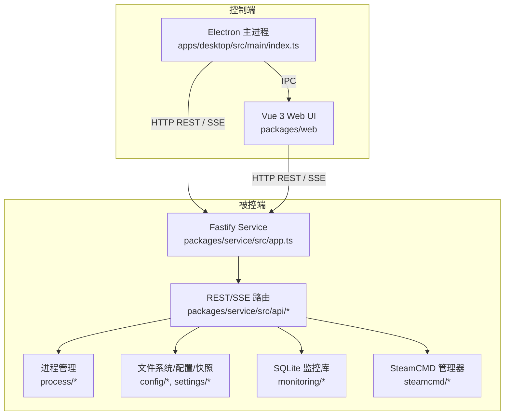
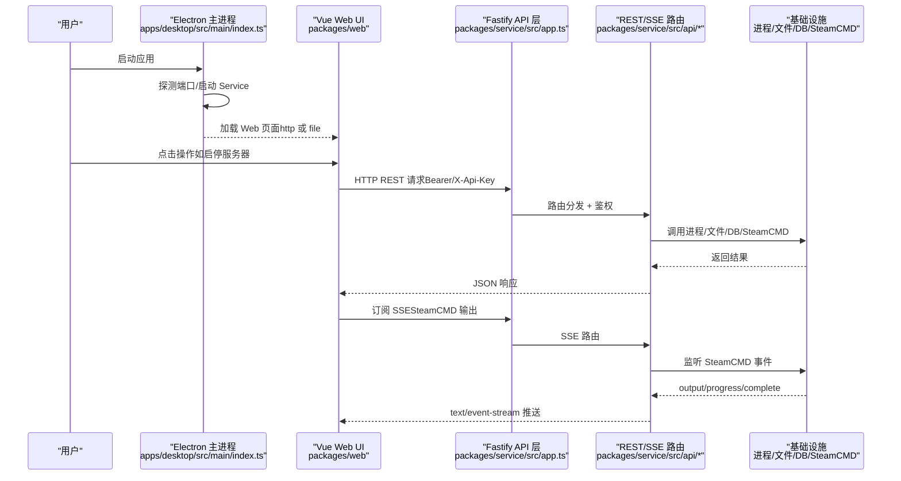
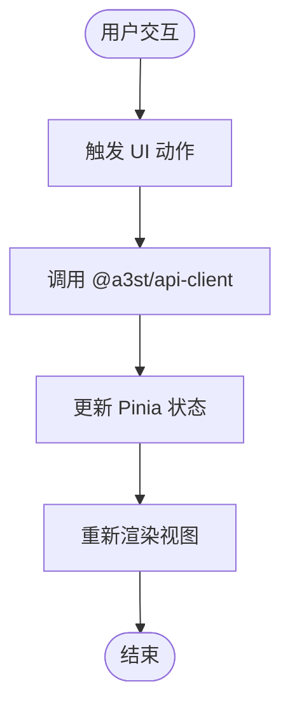
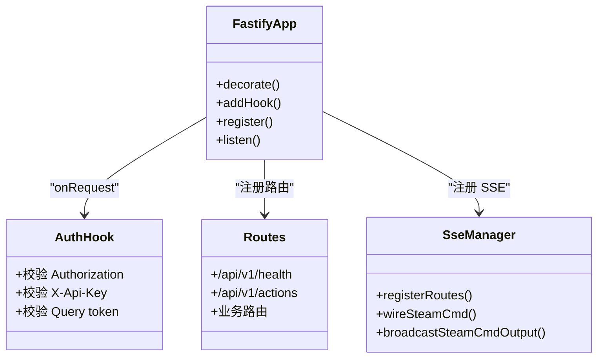
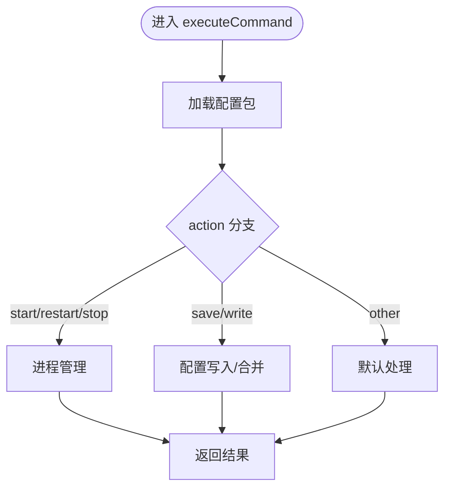
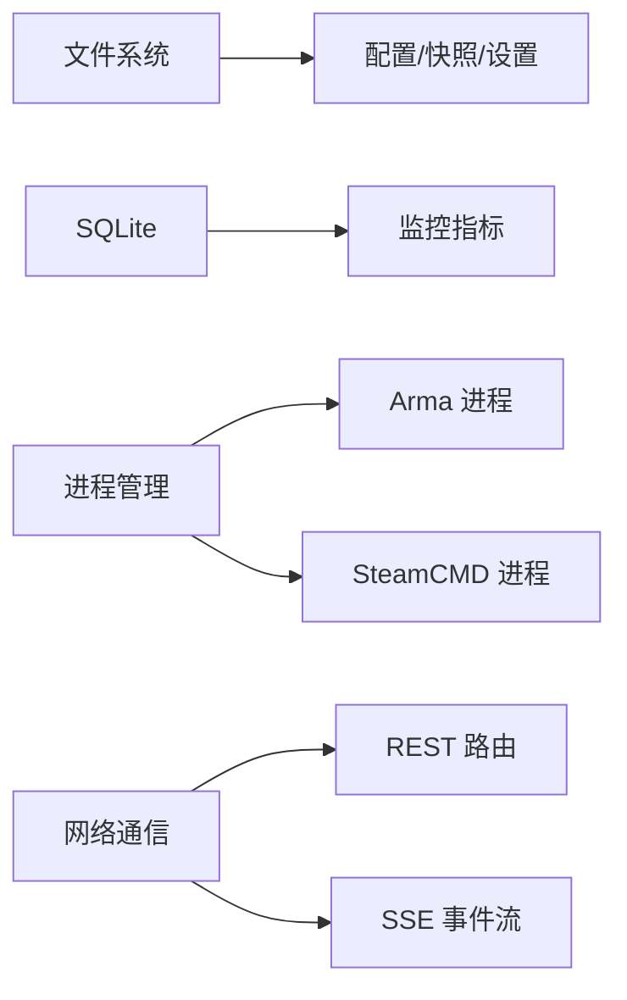
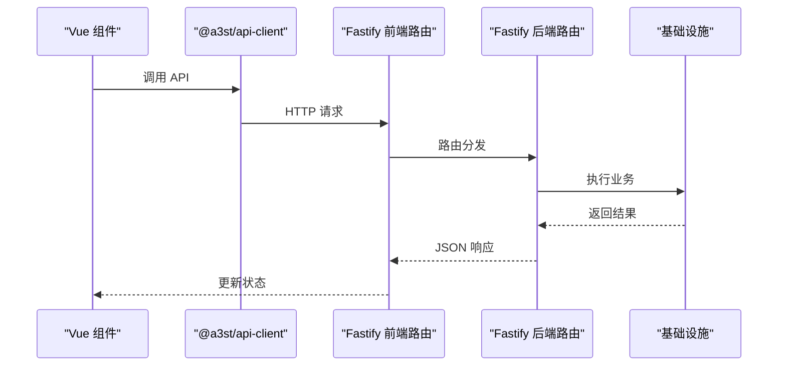
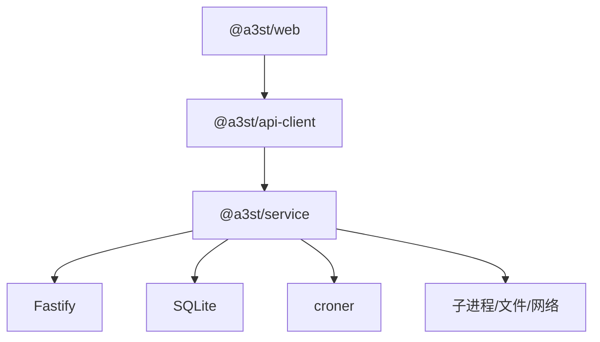

# 分层架构设计

<cite>
**本文引用的文件**   
- [README.md](file://README.md)
- [architecture-v2.md](file://docs/architecture-v2.md)
- [index.ts](file://apps/desktop/src/main/index.ts)
- [app.ts](file://packages/service/src/app.ts)
- [index.ts](file://packages/service/src/index.ts)
- [routes.ts](file://packages/service/src/api/routes.ts)
- [sse.ts](file://packages/service/src/api/sse.ts)
- [web-static.ts](file://packages/service/src/web-static.ts)
- [configSession.ts](file://packages/web/src/stores/configSession.ts)
</cite>

## 目录
1. [引言](#引言)
2. [项目结构](#项目结构)
3. [核心组件](#核心组件)
4. [架构总览](#架构总览)
5. [详细组件分析](#详细组件分析)
6. [依赖关系分析](#依赖关系分析)
7. [性能与可扩展性](#性能与可扩展性)
8. [故障排查指南](#故障排查指南)
9. [结论](#结论)

## 引言
本文件面向 Arma 3 服务器管理工具 v2，给出四层分层架构设计文档：UI 层（Vue 3 + Pinia）、API 层（Fastify 路由、中间件、认证）、Service 层（业务逻辑与领域模型）、Infrastructure 层（文件系统、数据库、进程管理、网络通信）。文档明确每层职责边界、接口契约、数据流转方式（REST、SSE、IPC），并总结错误处理、日志与监控策略，同时提供代码级调用示例路径与最佳实践。

## 项目结构
v2 采用“控制端 UI + 被控端 Service”的分层模型，Electron 作为桌面壳，不充当后端。关键包角色如下：
- `@a3st/web`：Vue 3 控制台 UI，运行在浏览器或 Electron 窗口。
- `@a3st/service`：Node.js Fastify 服务，负责启停、配置、SteamCMD、RCon、日志、调度、统计等。
- `@a3st/api-client`：共享 HTTP 契约与类型，供 web 与脚本/Agent 复用。
- `apps/desktop`：Electron 主进程，spawn 本机 service，加载 web 静态页或开发时 Vite 前端。

图示来源
- [index.ts:1-731](file://apps/desktop/src/main/index.ts#L1-L731)
- [app.ts:1-178](file://packages/service/src/app.ts#L1-L178)
- [sse.ts:1-94](file://packages/service/src/api/sse.ts#L1-L94)

章节来源
- [README.md:1-108](file://README.md#L1-L108)
- [architecture-v2.md:1-118](file://docs/architecture-v2.md#L1-L118)

## 核心组件
- UI 层（Vue 3 + Pinia）
  - 通过 `@a3st/api-client` 调用 REST/SSE；使用 Pinia store 管理连接、配置会话状态等。
  - 典型 Store：配置脏标记、连接信息等。
- API 层（Fastify）
  - 统一入口 `createService` 注册 CORS、Multipart、鉴权钩子、健康检查、REST 路由、SSE 流、静态 Web 托管。
  - 鉴权支持 Bearer Token、X-Api-Key、Query token；静态资源与 `/api/v1/health`、`/api/v1/actions` 免鉴权。
- Service 层
  - 聚合进程管理、配置存储、SteamCMD、Mod 扫描、监控入库、定时任务、RPT 日志读取等能力。
  - 对外暴露 REST 与 SSE 接口，内部以装饰器注入依赖。
- Infrastructure 层
  - 文件系统：配置包、快照、设置、扫描路径、Web 静态根解析。
  - 数据库：SQLite 监控指标持久化。
  - 进程管理：Arma 进程、SteamCMD 子进程生命周期。
  - 网络通信：HTTP REST、SSE 实时事件。

章节来源
- [app.ts:1-178](file://packages/service/src/app.ts#L1-L178)
- [sse.ts:1-94](file://packages/service/src/api/sse.ts#L1-L94)
- [web-static.ts:1-93](file://packages/service/src/web-static.ts#L1-L93)
- [configSession.ts:1-21](file://packages/web/src/stores/configSession.ts#L1-L21)

## 架构总览
下图展示从 UI 到基础设施的端到端调用链，包括 REST 与 SSE 两条通道，以及 Electron IPC 与 Service 进程管理。

图示来源
- [index.ts:95-137](file://apps/desktop/src/main/index.ts#L95-L137)
- [index.ts:323-378](file://apps/desktop/src/main/index.ts#L323-L378)
- [app.ts:96-170](file://packages/service/src/app.ts#L96-L170)
- [sse.ts:51-91](file://packages/service/src/api/sse.ts#L51-L91)

## 详细组件分析

### UI 层（Vue 3 + Pinia）
- 职责边界
  - 渲染控制台界面、表单与列表。
  - 通过 `@a3st/api-client` 发起 REST 请求与 SSE 订阅。
  - 使用 Pinia 维护本地状态（如连接信息、配置会话脏标记）。
- 关键模式
  - Store 仅持有轻量状态，避免直接访问系统资源。
  - 所有副作用（写盘、启停进程）由 Service 完成。
- 示例参考
  - 配置会话脏标记 Store：[configSession.ts:1-21](file://packages/web/src/stores/configSession.ts#L1-L21)

章节来源
- [configSession.ts:1-21](file://packages/web/src/stores/configSession.ts#L1-L21)

### API 层（Fastify 路由、中间件、认证）
- 职责边界
  - 定义 REST 与 SSE 端点。
  - 统一鉴权、CORS、Multipart 上传限制。
  - 将请求委派给 Service 层能力。
- 关键实现
  - 鉴权钩子：对 `/api/*` 校验 Bearer/X-Api-Key/Query token；静态资源与 health/actions 免鉴权。
  - 路由挂载：`/api/v1/health`、`/api/v1/actions`、业务路由、SSE 流。
  - 静态 Web 托管：当存在 Web 根目录时，按规则回退到 index.html。
- 示例参考
  - 服务创建与中间件装配：[app.ts:57-170](file://packages/service/src/app.ts#L57-L170)
  - 静态 Web 根解析与 404 回退：[web-static.ts:17-93](file://packages/service/src/web-static.ts#L17-L93)

图示来源
- [app.ts:96-170](file://packages/service/src/app.ts#L96-L170)
- [sse.ts:51-91](file://packages/service/src/api/sse.ts#L51-L91)

章节来源
- [app.ts:57-170](file://packages/service/src/app.ts#L57-L170)
- [web-static.ts:17-93](file://packages/service/src/web-static.ts#L17-L93)

### Service 层（业务逻辑、领域模型）
- 职责边界
  - 封装服务器启停、配置读写、SteamCMD 安装/更新、模组扫描、BattlEye RCon、监控统计、定时任务等。
  - 通过装饰器向路由暴露能力，保持路由薄、逻辑内聚。
- 关键流程
  - 命令执行：根据 action 分支调用 processManager、configStore、steamCmd 等。
  - 配置合并：对嵌套对象进行浅合并，避免覆盖未传字段。
- 示例参考
  - 命令执行与重启策略：[routes.ts:1196-1245](file://packages/service/src/api/routes.ts#L1196-L1245)

图示来源
- [routes.ts:1196-1245](file://packages/service/src/api/routes.ts#L1196-L1245)

章节来源
- [routes.ts:1196-1245](file://packages/service/src/api/routes.ts#L1196-L1245)

### Infrastructure 层（文件系统、数据库、进程管理、网络通信）
- 文件系统
  - 配置包、快照、UI 设置、扫描路径、SteamCMD 设置等均以文件形式持久化。
  - Web 静态根通过环境变量与多候选路径解析。
- 数据库
  - SQLite 用于监控指标采集与趋势存储。
- 进程管理
  - 管理 Arma 进程与 SteamCMD 子进程的生命周期。
- 网络通信
  - REST：Fastify 路由。
  - SSE：SteamCMD 输出、进度、完成事件广播。
- 示例参考
  - Service 进程入口与环境变量：[index.ts:1-41](file://packages/service/src/index.ts#L1-L41)
  - SSE 管理与事件广播：[sse.ts:1-94](file://packages/service/src/api/sse.ts#L1-L94)

图示来源
- [index.ts:1-41](file://packages/service/src/index.ts#L1-L41)
- [sse.ts:1-94](file://packages/service/src/api/sse.ts#L1-L94)

章节来源
- [index.ts:1-41](file://packages/service/src/index.ts#L1-L41)
- [sse.ts:1-94](file://packages/service/src/api/sse.ts#L1-L94)

### 层间通信机制

#### RESTful API
- 用途：服务器管理、配置保存、SteamCMD 操作、监控采集等。
- 鉴权：Bearer Token、X-Api-Key、Query token；health/actions 免鉴权。
- 示例参考：
  - 鉴权钩子与 CORS/Multipart：[app.ts:96-145](file://packages/service/src/app.ts#L96-L145)
  - 健康检查与动作清单：[routes.ts:1196-1245](file://packages/service/src/api/routes.ts#L1196-L1245)

#### SSE 实时事件
- 用途：SteamCMD 下载/安装/更新的实时输出与进度。
- 机制：SseManager 订阅 SteamCMD 事件，向已连接客户端广播。
- 示例参考：
  - SSE 路由与心跳保活：[sse.ts:51-91](file://packages/service/src/api/sse.ts#L51-L91)
  - 事件绑定与广播：[sse.ts:10-49](file://packages/service/src/api/sse.ts#L10-L49)

#### IPC 进程间通信（Electron）
- 用途：Electron 主进程与渲染进程之间传递主题、服务状态、文件对话框、Shell 打开等。
- 示例参考：
  - IPC 处理器注册与服务启停：[index.ts:423-468](file://apps/desktop/src/main/index.ts#L423-L468)
  - 服务探测与启动流程：[index.ts:95-137](file://apps/desktop/src/main/index.ts#L95-L137)

图示来源
- [app.ts:96-170](file://packages/service/src/app.ts#L96-L170)
- [routes.ts:1196-1245](file://packages/service/src/api/routes.ts#L1196-L1245)

章节来源
- [index.ts:423-468](file://apps/desktop/src/main/index.ts#L423-L468)
- [index.ts:95-137](file://apps/desktop/src/main/index.ts#L95-L137)
- [app.ts:96-170](file://packages/service/src/app.ts#L96-L170)
- [sse.ts:51-91](file://packages/service/src/api/sse.ts#L51-L91)

## 依赖关系分析
- 包依赖
  - `@a3st/service` 依赖 Fastify、CORS、Multipart、croner、sql.js、undici。
  - `@a3st/web` 依赖 Vue 3、Pinia、Vite 生态。
- 模块耦合
  - API 层通过装饰器解耦 Service 层能力，降低路由与业务耦合。
  - SSE 与 SteamCMD 通过事件总线松耦合。
- 外部集成
  - SteamCMD 子进程、Arma 进程、SQLite 数据库、文件系统。

图示来源
- [package-lock.json:10086-10111](file://package-lock.json#L10086-L10111)
- [package-lock.json:10143-10182](file://package-lock.json#L10143-L10182)

章节来源
- [package-lock.json:10086-10111](file://package-lock.json#L10086-L10111)
- [package-lock.json:10143-10182](file://package-lock.json#L10143-L10182)

## 性能与可扩展性
- 可观测性
  - Fastify 内置 logger；Service 启动/关闭、监听重试、Cron 同步数量均有日志。
  - 监控指标通过 SQLite 持久化，便于趋势分析。
- 并发与吞吐
  - SSE 使用 hijack 直写流，适合长连接实时输出。
  - Multipart 限制最大上传大小，防止大文件阻塞。
- 扩展建议
  - 将重 IO 操作（如 SteamCMD 下载）异步化并通过 SSE 反馈进度。
  - 为关键路由增加限流与超时保护。
  - 将 Cron 任务与监控采集拆分为独立 Worker，避免阻塞主线程。

## 故障排查指南
- 服务无法启动
  - 检查端口占用与权限；Service 会尝试重试监听。
  - 查看 Electron 侧服务日志与提示。
- 鉴权失败
  - 确认请求头包含正确的 Authorization/Bearer 或 X-Api-Key，或在查询参数携带 token。
- Web 页面 404
  - 确认 WEB_ROOT 或 packages/web/dist 存在；静态托管会在 404 时回退到 index.html。
- SSE 无输出
  - 确认已连接 `/api/v1/steamcmd/stream`，且 SteamCMD 正在运行。
- 进程异常退出
  - 检查 Service 优雅关闭逻辑与子进程树清理。

章节来源
- [app.ts:28-55](file://packages/service/src/app.ts#L28-L55)
- [app.ts:155-170](file://packages/service/src/app.ts#L155-L170)
- [web-static.ts:62-93](file://packages/service/src/web-static.ts#L62-L93)
- [sse.ts:51-91](file://packages/service/src/api/sse.ts#L51-L91)
- [index.ts:323-378](file://apps/desktop/src/main/index.ts#L323-L378)

## 结论
本项目采用清晰的四层分层架构：UI 层专注交互与状态，API 层定义稳定契约与安全边界，Service 层封装领域能力，Infrastructure 层屏蔽底层差异。通过 REST 与 SSE 实现同步与实时双通道通信，Electron IPC 提升桌面体验。该设计兼顾远程可控性与本地易用性，具备良好的可测试性与扩展性。建议在后续迭代中持续强化可观测性、错误恢复与性能优化，确保在多机管理与自动化场景下的稳定性。