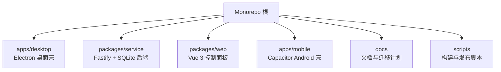
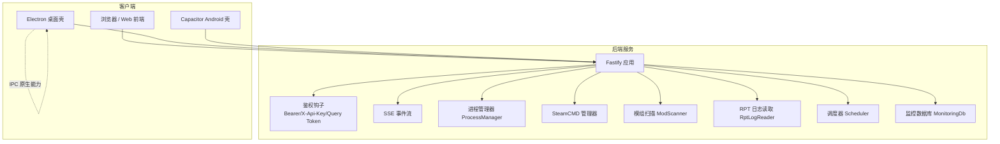
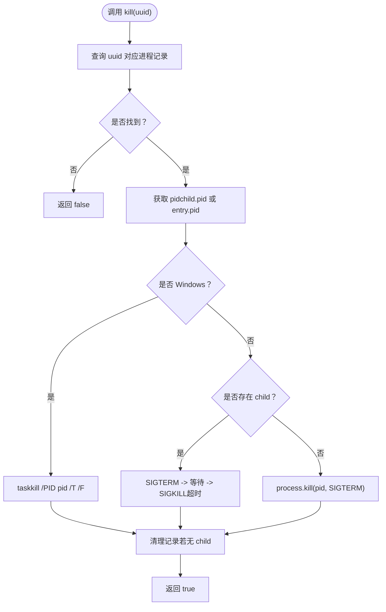
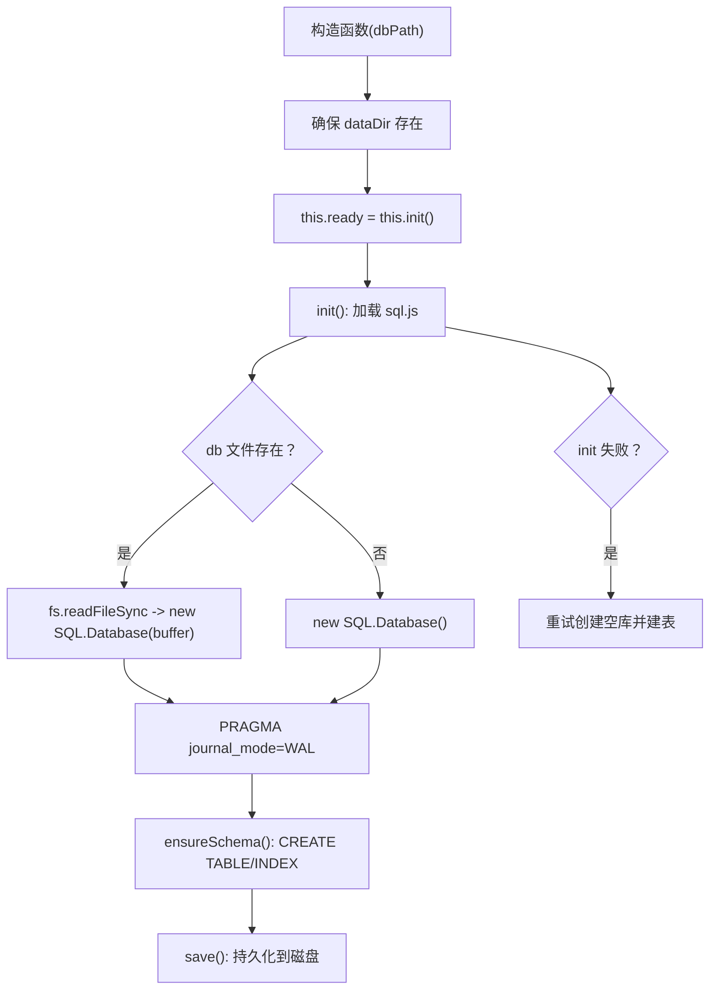
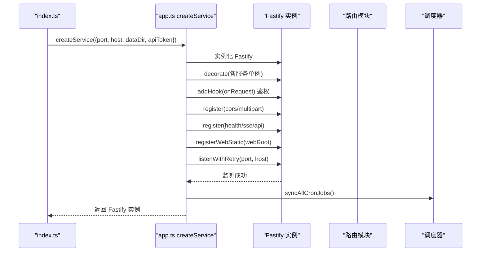
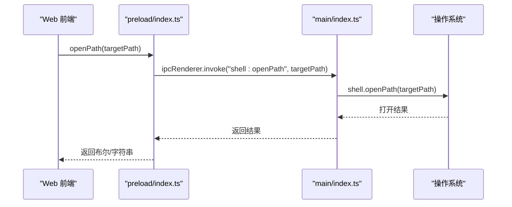
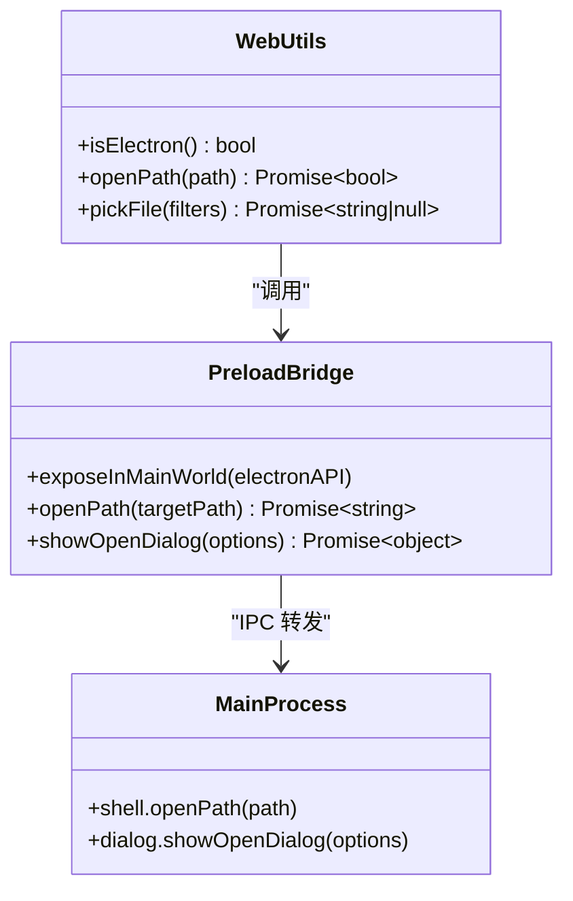
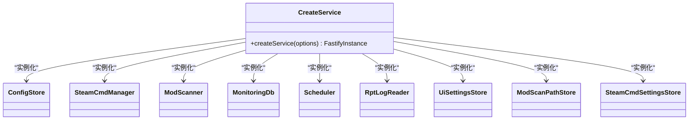
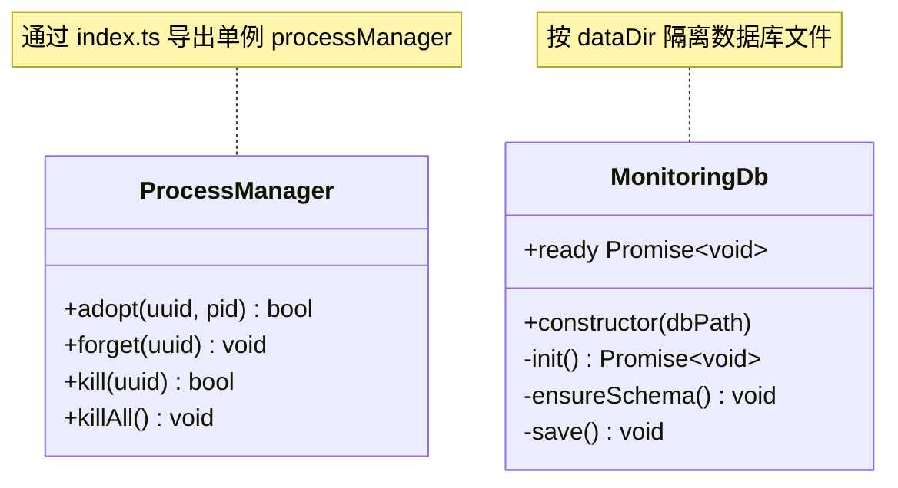
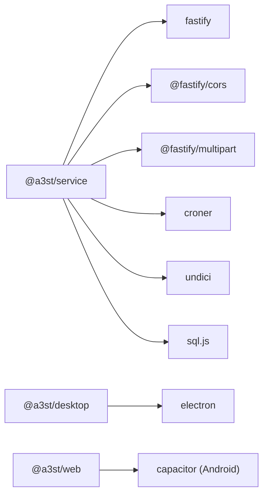

# 基础设施层设计

<cite>
**本文引用的文件**   
- [README.md](file://README.md)
- [package.json](file://package.json)
- [apps/desktop/src/main/index.ts](file://apps/desktop/src/main/index.ts)
- [apps/desktop/src/preload/index.ts](file://apps/desktop/src/preload/index.ts)
- [packages/web/src/utils/electron.ts](file://packages/web/src/utils/electron.ts)
- [packages/service/package.json](file://packages/service/package.json)
- [packages/service/src/index.ts](file://packages/service/src/index.ts)
- [packages/service/src/app.ts](file://packages/service/src/app.ts)
- [packages/service/src/monitoring/db.ts](file://packages/service/src/monitoring/db.ts)
- [packages/service/src/types/sqljs.d.ts](file://packages/service/src/types/sqljs.d.ts)
- [packages/service/src/process/index.ts](file://packages/service/src/process/index.ts)
- [packages/service/src/process/manager.ts](file://packages/service/src/process/manager.ts)
- [packages/service/src/types/server.ts](file://packages/service/src/types/server.ts)
</cite>

## 目录
1. [引言](#引言)
2. [项目结构](#项目结构)
3. [核心组件](#核心组件)
4. [架构总览](#架构总览)
5. [详细组件分析](#详细组件分析)
6. [依赖关系分析](#依赖关系分析)
7. [性能与资源管理](#性能与资源管理)
8. [故障排查指南](#故障排查指南)
9. [结论](#结论)

## 引言
本文件聚焦 Arma 3 服务器工具的基础设施层设计，覆盖底层技术抽象、数据存储方案、跨平台适配机制、资源管理与性能优化策略，以及安全与权限控制。系统采用 TypeScript 全栈实现：后端服务基于 Node.js + Fastify + SQLite（sql.js），桌面端使用 Electron，移动端通过 Capacitor 构建 Android 壳；同时提供 HTTP API 供浏览器或外部系统集成。

## 项目结构
仓库为 monorepo，包含桌面应用、移动端壳、后端服务与 Web 前端等子包。根 package.json 定义 npm workspaces，统一脚本入口；后端服务位于 packages/service，桌面应用位于 apps/desktop，Web 前端位于 packages/web。

图表来源
- [README.md:50-66](file://README.md#L50-L66)
- [package.json:1-36](file://package.json#L1-L36)

章节来源
- [README.md:1-108](file://README.md#L1-L108)
- [package.json:1-36](file://package.json#L1-L36)

## 核心组件
- 进程管理：ProcessManager 负责拉起、跟踪、终止 Arma 3 服务器进程，支持 Windows 与非 Windows 差异处理，并提供“认领”已存在进程的语义。
- 监控数据库：MonitoringDb 基于 sql.js 在内存/文件中维护 SQLite 统计库，自动创建 schema、启用 WAL 模式并持久化。
- 服务装配：createService 组装 Fastify 实例、鉴权钩子、CORS、Multipart、SSE、静态 Web UI 与定时任务。
- 跨平台桥接：Electron preload 暴露 IPC 能力，Web 侧 electron.ts 封装 isElectron/openPath/pickFile 等调用。
- 启动与配置：service 入口读取环境变量 PORT/HOST/DATA_DIR/API_TOKEN，解析数据目录，注册优雅关闭信号。

章节来源
- [packages/service/src/process/manager.ts:121-167](file://packages/service/src/process/manager.ts#L121-L167)
- [packages/service/src/monitoring/db.ts:1-93](file://packages/service/src/monitoring/db.ts#L1-L93)
- [packages/service/src/app.ts:57-171](file://packages/service/src/app.ts#L57-L171)
- [apps/desktop/src/preload/index.ts:1-34](file://apps/desktop/src/preload/index.ts#L1-L34)
- [packages/web/src/utils/electron.ts:1-44](file://packages/web/src/utils/electron.ts#L1-L44)
- [packages/service/src/index.ts:1-41](file://packages/service/src/index.ts#L1-L41)

## 架构总览
后端服务作为中心枢纽，对外暴露 REST/SSE 接口，对内协调进程、SteamCMD、模组扫描、日志读取、调度器与监控数据库。桌面端通过 Electron IPC 调用原生能力并代理部分服务设置；移动端通过 Capacitor WebView 访问同一后端 API。

图表来源
- [packages/service/src/app.ts:57-171](file://packages/service/src/app.ts#L57-L171)
- [packages/service/src/index.ts:1-41](file://packages/service/src/index.ts#L1-L41)
- [apps/desktop/src/main/index.ts:226-325](file://apps/desktop/src/main/index.ts#L226-L325)
- [apps/desktop/src/preload/index.ts:1-34](file://apps/desktop/src/preload/index.ts#L1-L34)

## 详细组件分析

### 进程管理：ProcessManager
- 职责：维护 serverUuid 到 OS PID 的映射，支持 adopt（认领已有进程）、kill（跨平台终止）、forget（丢弃追踪）。
- 关键行为：
  - Windows 使用 taskkill /T /F 终止进程树；非 Windows 优先 SIGTERM，超时后 SIGKILL。
  - 对无 child 的“认领”条目，在 kill 后直接删除记录，避免残留。
- 复杂度：Map 查找 O(1)，事件广播 O(1)。

图表来源
- [packages/service/src/process/manager.ts:121-167](file://packages/service/src/process/manager.ts#L121-L167)

章节来源
- [packages/service/src/process/index.ts:1-1](file://packages/service/src/process/index.ts#L1-L1)
- [packages/service/src/process/manager.ts:121-167](file://packages/service/src/process/manager.ts#L121-L167)
- [packages/service/src/types/server.ts:1-15](file://packages/service/src/types/server.ts#L1-L15)

### 监控数据库：MonitoringDb（SQLite）
- 存储位置：dataDir/a3st_statistics.db，目录不存在时自动创建。
- 初始化流程：
  - 加载 sql.js，若文件存在则从 Buffer 构造 Database，否则新建。
  - 尝试 PRAGMA journal_mode=WAL，失败仅记录错误不中断。
  - ensureSchema 创建 a3st_statistics 表及索引 idx_stats_server_time。
  - 每次 init 成功后 save() 落盘。
- 异常回退：init 失败时尝试重建空库并重新建表。

图表来源
- [packages/service/src/monitoring/db.ts:1-93](file://packages/service/src/monitoring/db.ts#L1-L93)
- [packages/service/src/types/sqljs.d.ts:1-27](file://packages/service/src/types/sqljs.d.ts#L1-L27)

章节来源
- [packages/service/src/monitoring/db.ts:1-93](file://packages/service/src/monitoring/db.ts#L1-L93)
- [packages/service/src/types/sqljs.d.ts:1-27](file://packages/service/src/types/sqljs.d.ts#L1-L27)

### 服务装配与生命周期：createService
- 服务装配：
  - 实例化 ConfigStore、SnapshotStore、SteamCmdManager、ModScanner、MonitoringDb、Scheduler、RptLogReader、UiSettingsStore、ModScanPathStore、SteamCmdSettingsStore。
  - 通过 app.decorate 注入到请求上下文，便于路由模块使用。
- 鉴权钩子：
  - 非 /api/* 路径放行；/health 与 /actions 放行。
  - 支持 Authorization Bearer、X-Api-Key、query token 三种方式。
- CORS/Multipart：
  - 允许任意 Origin（适配 Capacitor WebView file:// 与 localhost）。
  - 上传限制 100MB。
- 启动与监听：
  - listenWithRetry 针对 EADDRINUSE/EACCES/EADDRNOTAVAIL 重试最多 15 次。
  - 注册健康检查、SSE、API 路由，挂载静态 Web 资源。
  - 启动后同步 cron 任务。

图表来源
- [packages/service/src/index.ts:1-41](file://packages/service/src/index.ts#L1-L41)
- [packages/service/src/app.ts:57-171](file://packages/service/src/app.ts#L57-L171)

章节来源
- [packages/service/src/app.ts:57-171](file://packages/service/src/app.ts#L57-L171)
- [packages/service/src/index.ts:1-41](file://packages/service/src/index.ts#L1-L41)

### 跨平台适配：Electron IPC 与 Capacitor
- Electron 主进程：
  - 暴露 shell.openPath、dialog.showOpenDialog、fs.readTextFile 等能力。
  - 探测后端服务状态，根据结果选择 UI 模式。
- Preload 桥接：
  - contextBridge.exposeInMainWorld("electronAPI", {...})，将服务设置、版本、路径、文件对话框等能力暴露给渲染进程。
- Web 前端适配：
  - isElectron/isElectronShellWithoutBridge 判断运行环境。
  - openPath/pickDirectory/pickFile 封装调用 electronAPI，未注入时降级返回空值。

图表来源
- [apps/desktop/src/preload/index.ts:1-34](file://apps/desktop/src/preload/index.ts#L1-L34)
- [apps/desktop/src/main/index.ts:448-493](file://apps/desktop/src/main/index.ts#L448-L493)
- [packages/web/src/utils/electron.ts:1-44](file://packages/web/src/utils/electron.ts#L1-L44)

章节来源
- [apps/desktop/src/main/index.ts:226-325](file://apps/desktop/src/main/index.ts#L226-L325)
- [apps/desktop/src/main/index.ts:448-493](file://apps/desktop/src/main/index.ts#L448-L493)
- [apps/desktop/src/preload/index.ts:1-34](file://apps/desktop/src/preload/index.ts#L1-L34)
- [packages/web/src/utils/electron.ts:1-44](file://packages/web/src/utils/electron.ts#L1-L44)

### 设计模式示例

#### 适配器模式：Electron IPC 与 Web 前端
- 目的：屏蔽 Electron 与浏览器环境的差异，统一 openPath/pickFile 等能力。
- 实现要点：
  - Web 侧 electron.ts 检测 window.electronAPI 是否存在，不存在则返回空值或走默认逻辑。
  - Preload 将 IPC 调用包装成 Promise，主进程执行系统级操作。

图表来源
- [packages/web/src/utils/electron.ts:1-44](file://packages/web/src/utils/electron.ts#L1-L44)
- [apps/desktop/src/preload/index.ts:1-34](file://apps/desktop/src/preload/index.ts#L1-L34)
- [apps/desktop/src/main/index.ts:448-493](file://apps/desktop/src/main/index.ts#L448-L493)

章节来源
- [packages/web/src/utils/electron.ts:1-44](file://packages/web/src/utils/electron.ts#L1-L44)
- [apps/desktop/src/preload/index.ts:1-34](file://apps/desktop/src/preload/index.ts#L1-L34)
- [apps/desktop/src/main/index.ts:448-493](file://apps/desktop/src/main/index.ts#L448-L493)

#### 工厂模式：服务装配 createService
- 目的：集中创建与装饰所有后端服务，解耦路由与具体实现。
- 实现要点：
  - 根据 options.dataDir 创建各 Store/Manager。
  - 通过 app.decorate 注入到请求上下文，路由按需取用。

图表来源
- [packages/service/src/app.ts:57-94](file://packages/service/src/app.ts#L57-L94)

章节来源
- [packages/service/src/app.ts:57-94](file://packages/service/src/app.ts#L57-L94)

#### 单例模式：ProcessManager 与 MonitoringDb
- ProcessManager：通过 index.ts 导出 processManager 单例，供全局进程管理。
- MonitoringDb：每个实例持有独立 db 连接与 ready 状态，按 dataDir 隔离。

图表来源
- [packages/service/src/process/index.ts:1-1](file://packages/service/src/process/index.ts#L1-L1)
- [packages/service/src/monitoring/db.ts:1-93](file://packages/service/src/monitoring/db.ts#L1-L93)

章节来源
- [packages/service/src/process/index.ts:1-1](file://packages/service/src/process/index.ts#L1-L1)
- [packages/service/src/monitoring/db.ts:1-93](file://packages/service/src/monitoring/db.ts#L1-L93)

## 依赖关系分析
- 后端服务依赖：
  - Fastify、@fastify/cors、@fastify/multipart、croner、undici、sql.js。
- 桌面端依赖：
  - Electron（通过 main/index.ts 与 preload/index.ts 集成）。
- 移动端依赖：
  - Capacitor（Android 壳与 web 打包产物）。

图表来源
- [packages/service/package.json:17-24](file://packages/service/package.json#L17-L24)
- [package.json:10-30](file://package.json#L10-L30)

章节来源
- [packages/service/package.json:1-32](file://packages/service/package.json#L1-L32)
- [package.json:1-36](file://package.json#L1-L36)

## 性能与资源管理
- 数据库性能：
  - 启用 WAL 模式提升并发写入性能；必要时回退继续运行。
  - 使用索引 idx_stats_server_time 加速按服务器与时间范围查询。
  - 文件替换 replaceFile 处理 EPERM/EEXIST/EBUSY，避免锁冲突。
- 网络与 I/O：
  - Fastify 启用 CORS 与 multipart，限制上传大小 100MB。
  - listenWithRetry 对端口占用/权限不足进行重试，提高启动成功率。
- 进程管理：
  - Windows 使用 taskkill /T /F 快速终止进程树；非 Windows 先 SIGTERM 再 SIGKILL，兼顾优雅退出。
- 资源释放：
  - SIGINT/SIGTERM 触发 graceful shutdown：中止 SteamCMD、终止所有进程、关闭 Fastify。

章节来源
- [packages/service/src/monitoring/db.ts:1-93](file://packages/service/src/monitoring/db.ts#L1-L93)
- [packages/service/src/app.ts:28-55](file://packages/service/src/app.ts#L28-L55)
- [packages/service/src/app.ts:132-149](file://packages/service/src/app.ts#L132-L149)
- [packages/service/src/process/manager.ts:121-167](file://packages/service/src/process/manager.ts#L121-L167)
- [packages/service/src/index.ts:25-41](file://packages/service/src/index.ts#L25-L41)

## 故障排查指南
- 服务无法启动：
  - 检查端口占用与权限（EADDRINUSE/EACCES/EADDRNOTAVAIL），listenWithRetry 会重试；确认 HOST/PORT 环境变量。
- 数据库初始化失败：
  - 查看 console.error 输出；WAL 不可用时仍继续运行；确认 dataDir 可写。
- 进程无法终止：
  - Windows 下 taskkill 可能失败；非 Windows 下检查 child.killed 状态与超时逻辑。
- Electron 功能不可用：
  - 确认 preload 正确加载；window.electronAPI 是否存在；isElectronShellWithoutBridge 用于诊断旧安装包 ESM preload 失败场景。

章节来源
- [packages/service/src/app.ts:28-55](file://packages/service/src/app.ts#L28-L55)
- [packages/service/src/monitoring/db.ts:49-78](file://packages/service/src/monitoring/db.ts#L49-L78)
- [packages/service/src/process/manager.ts:136-167](file://packages/service/src/process/manager.ts#L136-L167)
- [packages/web/src/utils/electron.ts:1-11](file://packages/web/src/utils/electron.ts#L1-L11)

## 结论
基础设施层以 Fastify 服务为核心，结合 Electron/Capacitor 跨平台桥接，形成统一的服务器管理后端。通过 ProcessManager、MonitoringDb、SteamCmdManager 等组件抽象文件系统、数据库、网络与进程管理；采用适配器、工厂与单例模式提升可维护性与扩展性。WAL 与索引优化数据库性能，CORS/Multipart 与鉴权钩子保障兼容与安全。建议在后续迭代中持续完善错误恢复、资源回收与可观测性指标，进一步提升稳定性与可运维性。