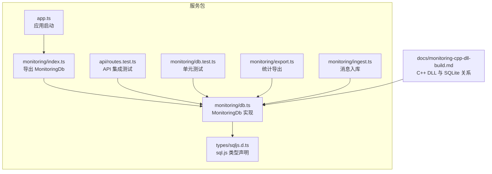
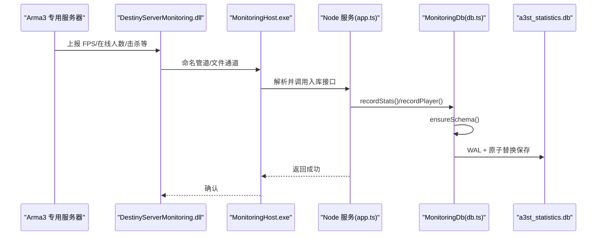
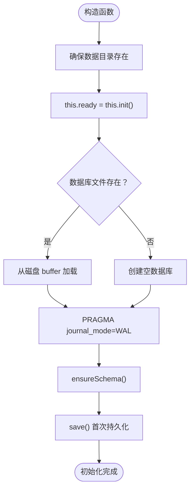
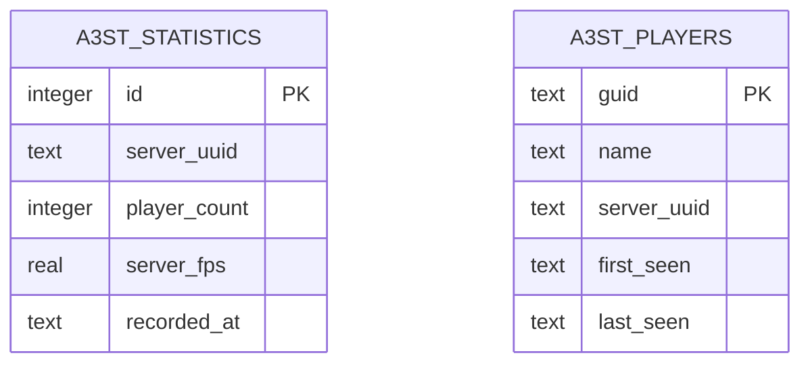
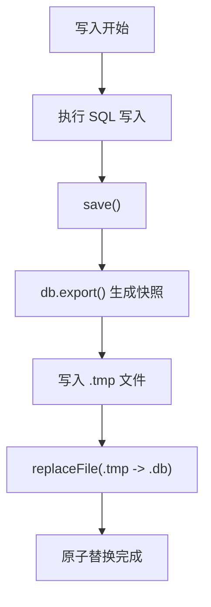
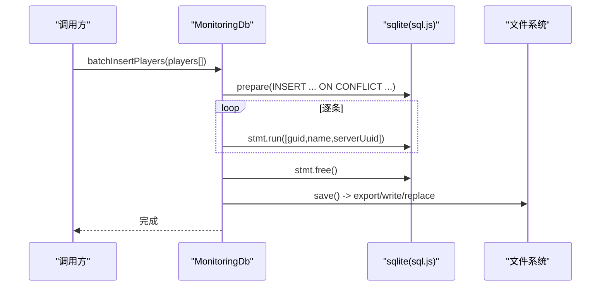
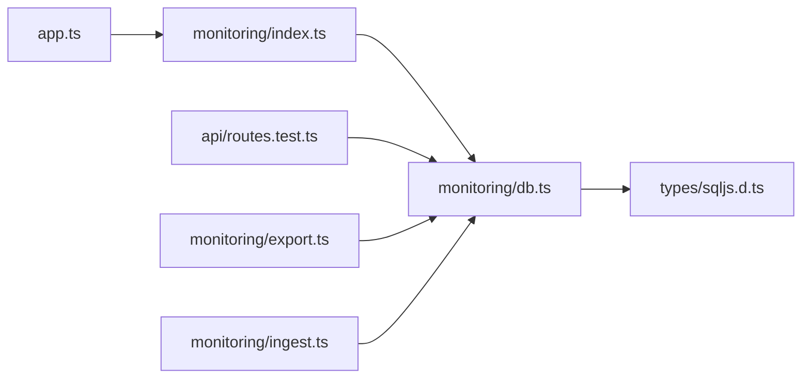

# 数据库存储层

<cite>
**本文引用的文件**   
- [packages/service/src/monitoring/db.ts](file://packages/service/src/monitoring/db.ts)
- [packages/service/src/types/sqljs.d.ts](file://packages/service/src/types/sqljs.d.ts)
- [packages/service/src/app.ts](file://packages/service/src/app.ts)
- [packages/service/src/api/routes.test.ts](file://packages/service/src/api/routes.test.ts)
- [packages/service/src/monitoring/db.test.ts](file://packages/service/src/monitoring/db.test.ts)
- [packages/service/src/monitoring/export.ts](file://packages/service/src/monitoring/export.ts)
- [packages/service/src/monitoring/index.ts](file://packages/service/src/monitoring/index.ts)
- [packages/service/src/monitoring/ingest.ts](file://packages/service/src/monitoring/ingest.ts)
- [docs/monitoring-cpp-dll-build.md](file://docs/monitoring-cpp-dll-build.md)
</cite>

## 目录
1. [引言](#引言)
2. [项目结构](#项目结构)
3. [核心组件](#核心组件)
4. [架构总览](#架构总览)
5. [详细组件分析](#详细组件分析)
6. [依赖关系分析](#依赖关系分析)
7. [性能与并发](#性能与并发)
8. [故障排查](#故障排查)
9. [结论](#结论)
10. [附录：CRUD 与优化示例路径](#附录crud-与优化示例路径)

## 引言
本文聚焦 Arma3 Server Tool 的 SQLite 监控数据持久化层，围绕以下目标展开：
- 解释 SQLite 初始化、连接管理与 WAL 模式配置。
- 说明 a3st_statistics 与 a3st_players 两张表的 schema、字段含义与索引策略。
- 阐述原子写入、备份与错误恢复机制。
- 给出 CRUD、批量插入与查询优化的实践建议。
- 讨论迁移策略、版本兼容性与连接池、内存优化、并发访问控制的最佳实践。

该存储层基于 Node.js 环境中的 sql.js（SQLite 的 JavaScript 实现），以单进程、单实例方式管理一个名为 a3st_statistics.db 的数据库文件。

## 项目结构
监控数据库相关代码集中在 packages/service 子包中，核心类 MonitoringDb 负责数据库生命周期、schema 创建、读写操作与持久化保存；类型定义位于 types/sqljs.d.ts；应用入口在 app.ts 中构造并注入 MonitoringDb；测试与导出模块分别覆盖功能验证与数据导出场景。

图表来源
- [packages/service/src/app.ts:68-68](file://packages/service/src/app.ts#L68-L68)
- [packages/service/src/monitoring/index.ts:1-1](file://packages/service/src/monitoring/index.ts#L1-L1)
- [packages/service/src/monitoring/db.ts:36-47](file://packages/service/src/monitoring/db.ts#L36-L47)
- [packages/service/src/types/sqljs.d.ts:1-27](file://packages/service/src/types/sqljs.d.ts#L1-L27)
- [docs/monitoring-cpp-dll-build.md:36-42](file://docs/monitoring-cpp-dll-build.md#L36-L42)

章节来源
- [packages/service/src/app.ts:68-68](file://packages/service/src/app.ts#L68-L68)
- [packages/service/src/monitoring/index.ts:1-1](file://packages/service/src/monitoring/index.ts#L1-L1)
- [packages/service/src/monitoring/db.ts:36-47](file://packages/service/src/monitoring/db.ts#L36-L47)
- [packages/service/src/types/sqljs.d.ts:1-27](file://packages/service/src/types/sqljs.d.ts#L1-L27)
- [docs/monitoring-cpp-dll-build.md:36-42](file://docs/monitoring-cpp-dll-build.md#L36-L42)

## 核心组件
- MonitoringDb：封装 sqlite 数据库初始化、schema 保证、统计与玩家记录、批量插入、查询汇总与列表、关闭等能力。
- PlayerRecord / StatsRecord：面向业务的数据模型接口。
- sql.js 类型声明：为 Database、Statement、QueryExecResult 提供 TypeScript 类型约束。

关键职责划分
- 初始化与持久化：构造函数设置 dbPath，init 加载或新建数据库，ensureSchema 保证表结构，save 将内存数据库导出到磁盘。
- 写入路径：recordStats、recordPlayer、batchInsertPlayers 均调用 save 触发原子落盘。
- 读取路径：getSummary、getStats、listPlayers 通过 exec 执行聚合与过滤查询。
- 资源释放：close 先 save 再 close。

章节来源
- [packages/service/src/monitoring/db.ts:22-34](file://packages/service/src/monitoring/db.ts#L22-L34)
- [packages/service/src/monitoring/db.ts:36-47](file://packages/service/src/monitoring/db.ts#L36-L47)
- [packages/service/src/monitoring/db.ts:49-78](file://packages/service/src/monitoring/db.ts#L49-L78)
- [packages/service/src/monitoring/db.ts:80-104](file://packages/service/src/monitoring/db.ts#L80-L104)
- [packages/service/src/monitoring/db.ts:106-115](file://packages/service/src/monitoring/db.ts#L106-L115)
- [packages/service/src/monitoring/db.ts:121-159](file://packages/service/src/monitoring/db.ts#L121-L159)
- [packages/service/src/monitoring/db.ts:161-225](file://packages/service/src/monitoring/db.ts#L161-L225)
- [packages/service/src/monitoring/db.ts:227-243](file://packages/service/src/monitoring/db.ts#L227-L243)
- [packages/service/src/types/sqljs.d.ts:1-27](file://packages/service/src/types/sqljs.d.ts#L1-L27)

## 架构总览
从数据采集到持久化的整体流程如下：上游 C++ DLL 或 RCon 采集数据后，由宿主进程写入 SQLite；工具侧通过 API 暴露查询能力，并在前端展示趋势图、玩家列表与导出报表。

图表来源
- [docs/monitoring-cpp-dll-build.md:36-42](file://docs/monitoring-cpp-dll-build.md#L36-L42)
- [packages/service/src/app.ts:68-68](file://packages/service/src/app.ts#L68-L68)
- [packages/service/src/monitoring/db.ts:49-78](file://packages/service/src/monitoring/db.ts#L49-L78)
- [packages/service/src/monitoring/db.ts:106-115](file://packages/service/src/monitoring/db.ts#L106-L115)

## 详细组件分析

### 数据库初始化与连接管理
- 数据库路径：dbPath = dataDir/a3st_statistics.db，自动确保目录存在。
- 初始化流程：
  - 若文件存在，则从磁盘 buffer 加载数据库；否则创建空库。
  - 尝试启用 WAL 模式；失败时记录日志但不中断初始化。
  - 执行 ensureSchema 保证表结构与索引。
  - 立即 save 一次，确保基础 schema 已持久化。
- 连接对象：使用 sql.js 的 Database 实例，当前实现为单例式持有，未实现连接池。
- 就绪状态：ready 为 Promise<void>，外部可通过 waitReady 等待初始化完成。
- 关闭流程：先 save 再 close，避免内存态丢失。

图表来源
- [packages/service/src/monitoring/db.ts:41-47](file://packages/service/src/monitoring/db.ts#L41-L47)
- [packages/service/src/monitoring/db.ts:49-78](file://packages/service/src/monitoring/db.ts#L49-L78)
- [packages/service/src/monitoring/db.ts:80-104](file://packages/service/src/monitoring/db.ts#L80-L104)
- [packages/service/src/monitoring/db.ts:106-115](file://packages/service/src/monitoring/db.ts#L106-L115)

章节来源
- [packages/service/src/monitoring/db.ts:41-47](file://packages/service/src/monitoring/db.ts#L41-L47)
- [packages/service/src/monitoring/db.ts:49-78](file://packages/service/src/monitoring/db.ts#L49-L78)
- [packages/service/src/monitoring/db.ts:117-119](file://packages/service/src/monitoring/db.ts#L117-L119)
- [packages/service/src/monitoring/db.ts:227-233](file://packages/service/src/monitoring/db.ts#L227-L233)

### 监控数据存储结构
- a3st_statistics 表
  - id：自增主键。
  - server_uuid：服务器标识，非空。
  - player_count：在线人数，整数，默认 0。
  - server_fps：可选浮点帧率。
  - recorded_at：记录时间，默认 datetime('now')。
  - 索引：idx_stats_server_time(server_uuid, recorded_at)，用于按服务器和时间范围查询。
- a3st_players 表
  - guid：玩家 GUID，主键。
  - name：玩家名称，非空。
  - server_uuid：所属服务器，非空。
  - first_seen：首次出现时间，默认 datetime('now')。
  - last_seen：最近出现时间，默认 datetime('now')。

图表来源
- [packages/service/src/monitoring/db.ts:80-104](file://packages/service/src/monitoring/db.ts#L80-L104)

章节来源
- [packages/service/src/monitoring/db.ts:80-104](file://packages/service/src/monitoring/db.ts#L80-L104)

### 事务处理与原子写入
- 事务语义：当前实现未显式开启事务块，每条写入语句独立提交。由于 SQLite 单写者特性，短小语句通常具备原子性。
- 原子持久化：每次写入后调用 save，内部通过临时文件 + replaceFile 原子替换目标数据库文件，提升崩溃恢复一致性。
- replaceFile 容错：对 EPERM/EEXIST/EBUSY 进行重试与清理后再替换，增强健壮性。

图表来源
- [packages/service/src/monitoring/db.ts:106-115](file://packages/service/src/monitoring/db.ts#L106-L115)
- [packages/service/src/monitoring/db.ts:5-20](file://packages/service/src/monitoring/db.ts#L5-L20)

章节来源
- [packages/service/src/monitoring/db.ts:5-20](file://packages/service/src/monitoring/db.ts#L5-L20)
- [packages/service/src/monitoring/db.ts:106-115](file://packages/service/src/monitoring/db.ts#L106-L115)

### 数据持久化策略
- WAL 模式：初始化阶段尝试 PRAGMA journal_mode=WAL，失败仅记录日志，不阻断初始化。
- 同步策略：未显式设置 synchronous 与 cache_size，保留 sql.js/SQLite 默认值。
- 备份机制：save 每次写入后导出完整数据库到磁盘；可结合外部定时任务复制 .db 与可能的 .db-wal/.db-shm 文件做离线备份。

章节来源
- [packages/service/src/monitoring/db.ts:58-62](file://packages/service/src/monitoring/db.ts#L58-L62)
- [packages/service/src/monitoring/db.ts:106-115](file://packages/service/src/monitoring/db.ts#L106-L115)

### CRUD 操作与批量优化
- 创建（写入）
  - 统计记录：recordStats(serverUuid, playerCount, fps?) 插入 a3st_statistics。
  - 玩家记录：recordPlayer(player) 使用 ON CONFLICT(guid) DO UPDATE 实现 upsert。
  - 批量玩家：batchInsertPlayers(players) 使用 prepare + 循环 run，最后 free 释放语句句柄。
- 读取
  - 汇总：getSummary(serverUuid) 计算平均/峰值/总数。
  - 时序：getStats(serverUuid, sinceHours) 按时间窗口过滤并按时间升序返回。
  - 列表：listPlayers(serverUuid, limit) 按 last_seen 降序取前 N 名。
- 更新
  - 玩家信息通过 upsert 更新 name 与 last_seen。
- 删除
  - 当前未提供删除接口；如需归档/清理，可在上层扩展 DELETE 逻辑。

图表来源
- [packages/service/src/monitoring/db.ts:145-159](file://packages/service/src/monitoring/db.ts#L145-L159)
- [packages/service/src/monitoring/db.ts:106-115](file://packages/service/src/monitoring/db.ts#L106-L115)

章节来源
- [packages/service/src/monitoring/db.ts:121-159](file://packages/service/src/monitoring/db.ts#L121-L159)
- [packages/service/src/monitoring/db.ts:161-225](file://packages/service/src/monitoring/db.ts#L161-L225)

### 查询性能调优
- 索引利用：idx_stats_server_time 支持按 server_uuid 与 recorded_at 的组合条件高效过滤。
- 时间窗口：getStats 使用 datetime('now', '-X hours') 过滤，减少扫描量。
- 结果限制：listPlayers 使用 LIMIT 控制返回规模，降低内存与网络传输压力。
- 聚合查询：getSummary 使用 AVG/MAX/COUNT 在数据库端计算，减少应用层开销。

章节来源
- [packages/service/src/monitoring/db.ts:90-93](file://packages/service/src/monitoring/db.ts#L90-L93)
- [packages/service/src/monitoring/db.ts:187-201](file://packages/service/src/monitoring/db.ts#L187-L201)
- [packages/service/src/monitoring/db.ts:203-225](file://packages/service/src/monitoring/db.ts#L203-L225)
- [packages/service/src/monitoring/db.ts:161-185](file://packages/service/src/monitoring/db.ts#L161-L185)

### 数据迁移与版本兼容性
- 当前实现通过 CREATE TABLE IF NOT EXISTS 与 CREATE INDEX IF NOT EXISTS 保证向后兼容，新增字段或索引不会破坏已有数据。
- 建议在后续引入显式迁移脚本与版本号字段，便于升级与回滚。
- 参考文档指出未来可能迁移至 Microsoft.Data.Sqlite 9.x，需关注驱动差异与 API 变更。

章节来源
- [packages/service/src/monitoring/db.ts:80-104](file://packages/service/src/monitoring/db.ts#L80-L104)
- [docs/archive/net10-migration-plan.md:65-70](file://docs/archive/net10-migration-plan.md#L65-L70)

### 错误恢复机制
- 初始化失败：捕获异常并记录日志；若已有 db 实例则直接返回，否则尝试重建空库并重新 ensureSchema。
- WAL 不可用：忽略错误继续运行，降级为默认 journal 模式。
- 文件替换失败：针对 EPERM/EEXIST/EBUSY 进行重试与清理，提高跨平台与权限场景下的成功率。

章节来源
- [packages/service/src/monitoring/db.ts:49-78](file://packages/service/src/monitoring/db.ts#L49-L78)
- [packages/service/src/monitoring/db.ts:58-62](file://packages/service/src/monitoring/db.ts#L58-L62)
- [packages/service/src/monitoring/db.ts:5-20](file://packages/service/src/monitoring/db.ts#L5-L20)

## 依赖关系分析
- MonitoringDb 依赖 sql.js 提供的 Database/Statement 接口，并通过 fs/path 进行文件操作。
- 应用层 app.ts 在启动时构造 MonitoringDb，并将其注入到服务上下文。
- API 测试与监控导出模块依赖 MonitoringDb 的类型与方法契约。

图表来源
- [packages/service/src/app.ts:68-68](file://packages/service/src/app.ts#L68-L68)
- [packages/service/src/monitoring/index.ts:1-1](file://packages/service/src/monitoring/index.ts#L1-L1)
- [packages/service/src/monitoring/db.ts:1-3](file://packages/service/src/monitoring/db.ts#L1-L3)
- [packages/service/src/types/sqljs.d.ts:1-27](file://packages/service/src/types/sqljs.d.ts#L1-L27)
- [packages/service/src/api/routes.test.ts:13-36](file://packages/service/src/api/routes.test.ts#L13-L36)
- [packages/service/src/monitoring/export.ts:1-1](file://packages/service/src/monitoring/export.ts#L1-L1)
- [packages/service/src/monitoring/ingest.ts:1-1](file://packages/service/src/monitoring/ingest.ts#L1-L1)

章节来源
- [packages/service/src/app.ts:68-68](file://packages/service/src/app.ts#L68-L68)
- [packages/service/src/monitoring/index.ts:1-1](file://packages/service/src/monitoring/index.ts#L1-L1)
- [packages/service/src/monitoring/db.ts:1-3](file://packages/service/src/monitoring/db.ts#L1-L3)
- [packages/service/src/types/sqljs.d.ts:1-27](file://packages/service/src/types/sqljs.d.ts#L1-L27)
- [packages/service/src/api/routes.test.ts:13-36](file://packages/service/src/api/routes.test.ts#L13-L36)
- [packages/service/src/monitoring/export.ts:1-1](file://packages/service/src/monitoring/export.ts#L1-L1)
- [packages/service/src/monitoring/ingest.ts:1-1](file://packages/service/src/monitoring/ingest.ts#L1-L1)

## 性能与并发
- 连接池：当前未实现连接池，MonitoringDb 为单实例持有单一 Database 对象。在高并发写入场景下，应谨慎评估锁竞争与 I/O 瓶颈。
- 内存优化：
  - 避免频繁大结果集返回，尽量使用 LIMIT 与聚合查询。
  - 批量写入使用 prepare + 循环 run，减少重复编译开销。
  - 及时 free 预编译语句，防止内存泄漏。
- 并发访问控制：
  - SQLite 单写者模型下，应避免多个 MonitoringDb 实例同时写入同一数据库文件。
  - 上层服务应串行化写入请求或使用队列，避免竞态条件。
- WAL 模式：
  - 提升读多写少场景的并发读性能，但写放大仍存在；注意 .db-wal/.db-shm 文件的备份与清理。
- 缓存与同步：
  - 可根据负载调整 cache_size、synchronous 等 PRAGMA，但需权衡一致性与性能。

[本节为通用指导，不直接分析具体文件]

## 故障排查
- 数据库始终为空
  - 检查上游 DLL 是否加载、MonitoringHost 是否启动、EnableMonitoringService 是否开启。
- 仅有玩家库无快照
  - 检查 RCon 连接与 DLL 注入情况。
- 图表为空
  - 数据不足或时间戳异常，运行一段时间后重试。
- 初始化失败
  - 查看日志中“Monitoring database init failed”与“fallback failed”，确认磁盘权限与空间。
- WAL 跳过
  - 查看日志“PRAGMA journal_mode=WAL skipped”，系统可能不支持 WAL 或权限受限。

章节来源
- [docs/monitoring-cpp-dll-build.md:82-89](file://docs/monitoring-cpp-dll-build.md#L82-L89)
- [packages/service/src/monitoring/db.ts:49-78](file://packages/service/src/monitoring/db.ts#L49-L78)
- [packages/service/src/monitoring/db.ts:58-62](file://packages/service/src/monitoring/db.ts#L58-L62)

## 结论
本存储层以 MonitoringDb 为核心，围绕 a3st_statistics 与 a3st_players 两张表实现了监控数据的采集、持久化与查询。其特点包括：
- 使用 sql.js 在 Node.js 环境中运行 SQLite，简化部署。
- 通过 WAL 与原子替换提升数据一致性与崩溃恢复能力。
- 提供基础的 CRUD 与批量写入能力，配合索引优化查询性能。
- 当前未实现连接池与显式事务，适合中小规模监控场景；高并发场景需在上层进行串行化与批量化优化。
- 后续可引入显式迁移脚本、连接池与更细粒度的 PRAGMA 调优，进一步提升可扩展性与稳定性。

[本节为总结性内容，不直接分析具体文件]

## 附录：CRUD 与优化示例路径
- 初始化与 WAL 配置
  - [packages/service/src/monitoring/db.ts:49-78](file://packages/service/src/monitoring/db.ts#L49-L78)
- 表结构与索引
  - [packages/service/src/monitoring/db.ts:80-104](file://packages/service/src/monitoring/db.ts#L80-L104)
- 原子写入与备份
  - [packages/service/src/monitoring/db.ts:106-115](file://packages/service/src/monitoring/db.ts#L106-L115)
  - [packages/service/src/monitoring/db.ts:5-20](file://packages/service/src/monitoring/db.ts#L5-L20)
- 写入接口（CRUD）
  - [packages/service/src/monitoring/db.ts:121-159](file://packages/service/src/monitoring/db.ts#L121-L159)
- 查询接口（聚合/分页）
  - [packages/service/src/monitoring/db.ts:161-225](file://packages/service/src/monitoring/db.ts#L161-L225)
- 类型定义
  - [packages/service/src/types/sqljs.d.ts:1-27](file://packages/service/src/types/sqljs.d.ts#L1-L27)
- 应用注入与测试
  - [packages/service/src/app.ts:68-68](file://packages/service/src/app.ts#L68-L68)
  - [packages/service/src/api/routes.test.ts:13-36](file://packages/service/src/api/routes.test.ts#L13-L36)
  - [packages/service/src/monitoring/db.test.ts:46-80](file://packages/service/src/monitoring/db.test.ts#L46-L80)
- 导出与消费
  - [packages/service/src/monitoring/export.ts:1-1](file://packages/service/src/monitoring/export.ts#L1-L1)
  - [packages/service/src/monitoring/ingest.ts:1-1](file://packages/service/src/monitoring/ingest.ts#L1-L1)