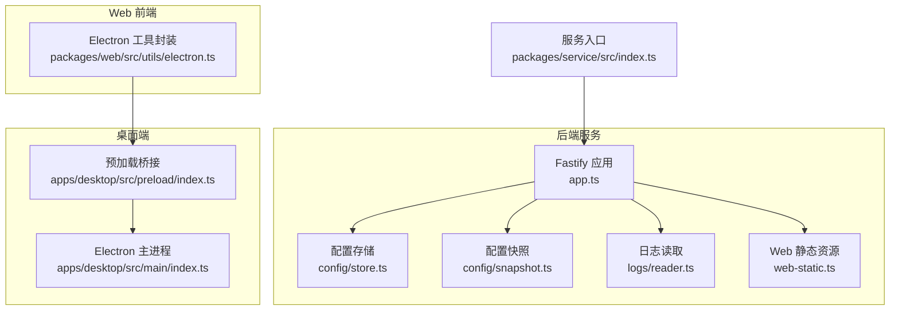
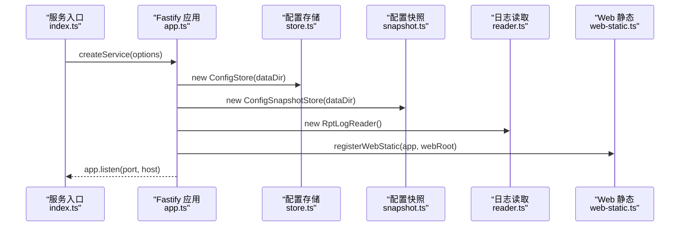
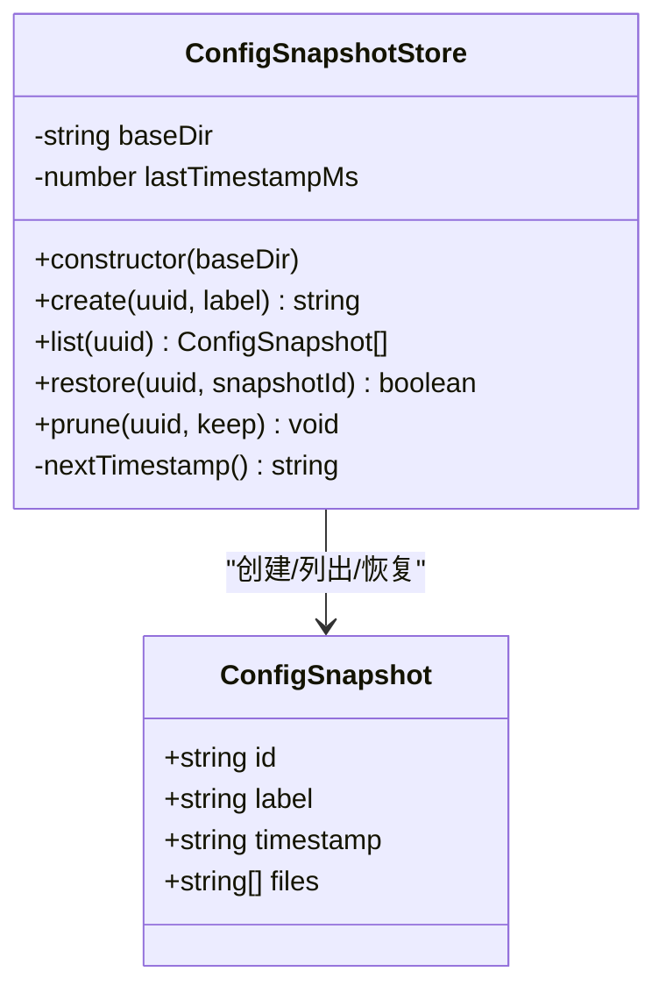
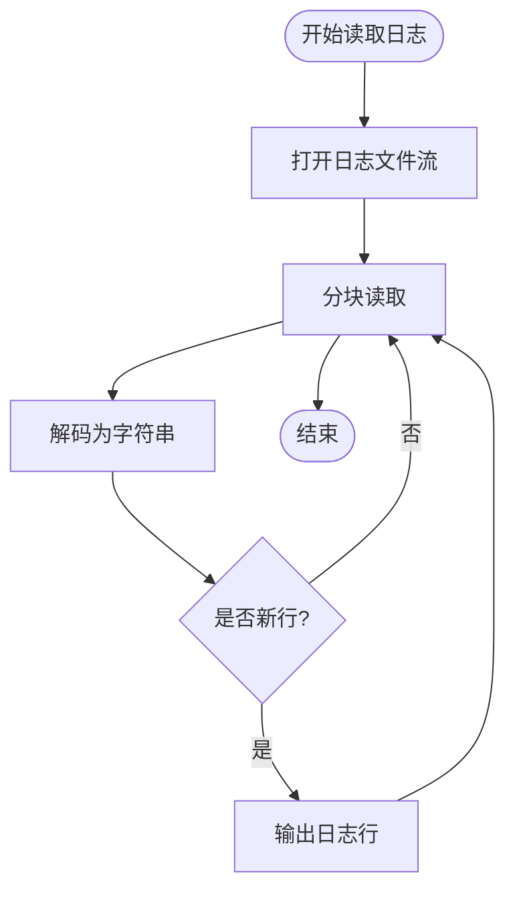
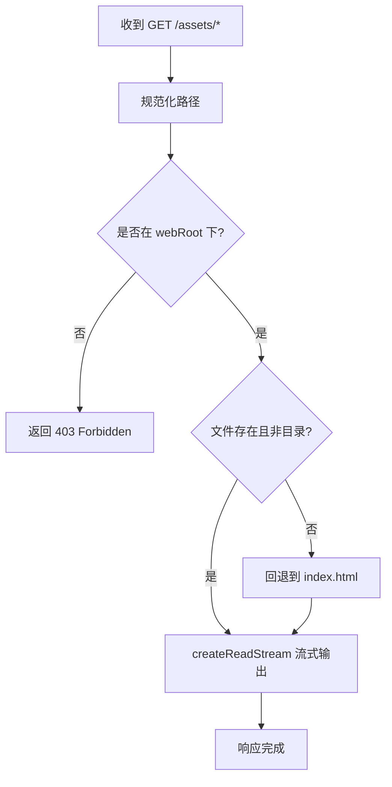
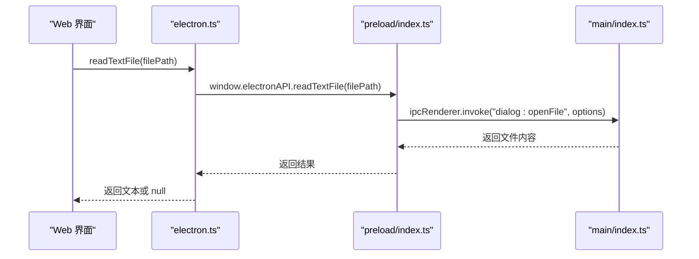
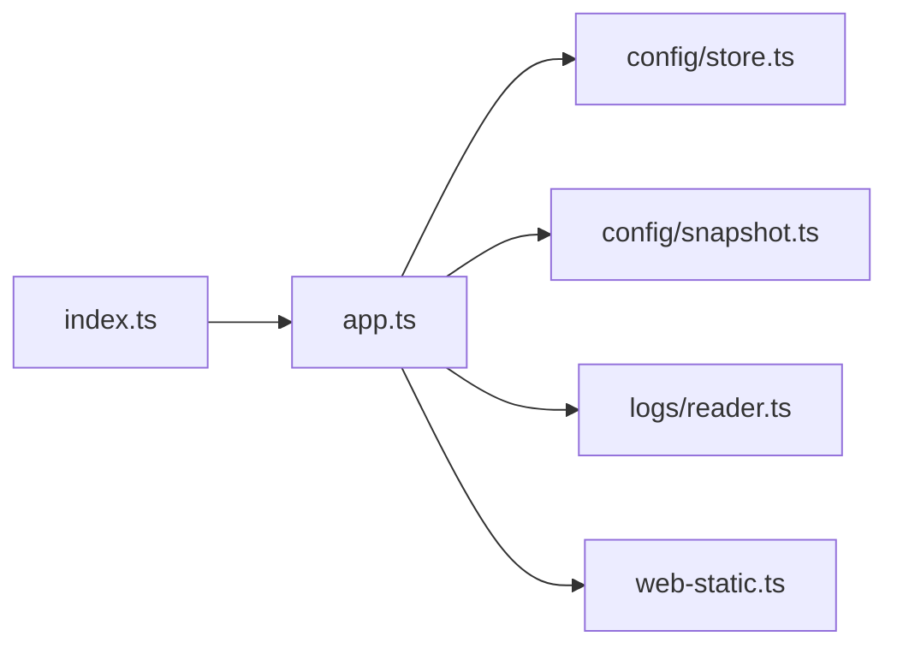

# 文件系统适配器

<cite>
**本文引用的文件**   
- [README.md](file://README.md)
- [index.ts](file://packages\service\src\index.ts)
- [app.ts](file://packages\service\src\app.ts)
- [web-static.ts](file://packages\service\src\web-static.ts)
- [snapshot.ts](file://packages\service\src\config\snapshot.ts)
- [store.ts](file://packages\service\src\config\store.ts)
- [game-config-writer.ts](file://packages\service\src\config\game-config-writer.ts)
- [reader.ts](file://packages\service\src\logs\reader.ts)
- [decode.ts](file://packages\service\src\logs\decode.ts)
- [preload/index.ts](file://apps\desktop\src\preload\index.ts)
- [main/index.ts](file://apps\desktop\src\main\index.ts)
- [electron.ts](file://packages\web\src\utils\electron.ts)
</cite>

## 目录
1. [引言](#引言)
2. [项目结构](#项目结构)
3. [核心组件](#核心组件)
4. [架构总览](#架构总览)
5. [详细组件分析](#详细组件分析)
6. [依赖关系分析](#依赖关系分析)
7. [性能与并发](#性能与并发)
8. [故障排查指南](#故障排查指南)
9. [结论](#结论)
10. [附录：示例与最佳实践](#附录示例与最佳实践)

## 引言
本文件面向 Arma3 Server Tools v2 的文件系统适配器设计，聚焦以下目标：
- 统一的文件读写接口、路径管理与权限控制
- 日志文件的轮转策略、压缩归档与清理机制
- 配置文件的 JSON 序列化、版本控制与热重载
- 异步文件操作、流式处理与错误重试
- 跨平台兼容性、符号链接支持与特殊字符编码
- 文件锁机制、并发访问控制与性能优化

本项目为全栈 TypeScript 实现，后端基于 Node.js + Fastify + SQLite，桌面端使用 Electron，移动端通过 Capacitor 提供 Android 壳。服务入口与数据目录解析位于服务启动脚本中，Web 静态资源由 Fastify 中间件安全地以流方式输出，配置快照与日志读取分别由独立模块负责。

**章节来源**
- [README.md:1-108](file://README.md#L1-L108)

## 项目结构
仓库采用多包（monorepo）组织，关键与文件系统相关的代码集中在 packages/service 与 apps/desktop：
- packages/service/src：后端服务、API、配置、日志、任务调度等
- apps/desktop/src：Electron 主进程与预加载脚本，暴露 IPC 能力给前端
- packages/web/src/utils/electron.ts：Web 层对 Electron API 的封装

**图表来源**
- [app.ts:57-94](file://packages\service\src\app.ts#L57-L94)
- [snapshot.ts:12-126](file://packages\service\src\config\snapshot.ts#L12-L126)
- [reader.ts](file://packages\service\src\logs\reader.ts)
- [web-static.ts:62-93](file://packages\service\src\web-static.ts#L62-L93)
- [preload/index.ts:10-34](file://apps\desktop\src\preload\index.ts#L10-L34)
- [main/index.ts:48-63](file://apps\desktop\src\main\index.ts#L48-L63)
- [electron.ts:51-60](file://packages\web\src\utils\electron.ts#L51-L60)
- [index.ts:1-23](file://packages\service\src\index.ts#L1-L23)

**章节来源**
- [README.md:50-66](file://README.md#L50-L66)
- [index.ts:1-23](file://packages\service\src\index.ts#L1-L23)

## 核心组件
- 配置存储与快照：ConfigStore 负责按服务器 UUID 管理 JSON 配置文件；ConfigSnapshotStore 提供快照创建、列出、恢复与裁剪（保留最近 N 个）。
- 日志读取：RptLogReader 提供 RPT 日志的读取与解码能力，支持流式读取与编码处理。
- Web 静态资源：registerWebStatic 将 UI 资源以流形式安全输出，包含路径校验与 MIME 类型映射。
- 桌面端文件交互：Electron 主进程通过 IPC 暴露打开文件、读取文本、打开路径等能力；Web 层通过 electron.ts 封装调用。

这些组件共同构成“文件系统适配器”的统一抽象：上层业务无需关心底层是 Node fs、Electron shell 还是浏览器环境。

**章节来源**
- [snapshot.ts:12-126](file://packages\service\src\config\snapshot.ts#L12-L126)
- [reader.ts](file://packages\service\src\logs\reader.ts)
- [web-static.ts:62-93](file://packages\service\src\web-static.ts#L62-L93)
- [preload/index.ts:10-34](file://apps\desktop\src\preload\index.ts#L10-L34)
- [electron.ts:51-60](file://packages\web\src\utils\electron.ts#L51-L60)

## 架构总览
后端服务在启动时初始化各子系统，并通过 Fastify 装饰器注入到请求上下文；同时注册认证钩子、CORS、Multipart、SSE 与路由，最后启动监听并挂载 Web UI。

**图表来源**
- [index.ts:18-23](file://packages\service\src\index.ts#L18-L23)
- [app.ts:57-94](file://packages\service\src\app.ts#L57-L94)
- [web-static.ts:62-93](file://packages\service\src\web-static.ts#L62-L93)

**章节来源**
- [app.ts:57-178](file://packages\service\src\app.ts#L57-L178)
- [index.ts:1-41](file://packages\service\src\index.ts#L1-L41)

## 详细组件分析

### 配置存储与快照（JSON 序列化、版本控制、热重载）
- JSON 序列化：配置文件以 JSON 格式持久化，快照模块复制 .json 文件并生成清单 manifest，便于恢复与审计。
- 版本控制：快照按时间戳排序，支持列表、恢复与裁剪（prune），默认保留最近 10 个快照。
- 热重载：结合调度器与配置变更事件，可在不重启服务的情况下重新加载配置（具体逻辑由调度与配置模块协作完成）。

**图表来源**
- [snapshot.ts:5-126](file://packages\service\src\config\snapshot.ts#L5-L126)

**章节来源**
- [snapshot.ts:12-126](file://packages\service\src\config\snapshot.ts#L12-L126)

### 日志读取与解码（流式处理、编码处理）
- 流式读取：日志读取器通常以流的方式逐行或分块读取 RPT 日志，避免一次性加载大文件导致内存峰值。
- 编码处理：日志可能包含非 UTF-8 字符，解码模块负责将原始字节转换为可读字符串。
- 轮转与清理：建议结合外部工具（如 logrotate）或内部定时任务进行轮转、压缩与清理；当前仓库未直接实现轮转逻辑，但提供了读取与解码能力以便上层集成。

**图表来源**
- [reader.ts](file://packages\service\src\logs\reader.ts)
- [decode.ts](file://packages\service\src\logs\decode.ts)

**章节来源**
- [reader.ts](file://packages\service\src\logs\reader.ts)
- [decode.ts](file://packages\service\src\logs\decode.ts)

### Web 静态资源（路径安全、流式输出）
- 路径安全：通过 isSafeUnderRoot 校验请求路径是否在 webRoot 下，防止目录穿越。
- 流式输出：使用 createReadStream 将静态文件以流方式返回，降低内存占用。
- MIME 类型：根据扩展名映射正确的 Content-Type，未知类型回退为 application/octet-stream。

**图表来源**
- [web-static.ts:52-93](file://packages\service\src\web-static.ts#L52-L93)

**章节来源**
- [web-static.ts:45-93](file://packages\service\src\web-static.ts#L45-L93)

### 桌面端文件交互（IPC、权限与路径）
- 预加载桥接：preload/index.ts 暴露 openFile、openPath、readTextFile 等方法给渲染进程。
- 主进程实现：main/index.ts 使用 Node fs 与 shell.openItem 等能力执行实际文件操作。
- Web 封装：packages/web/src/utils/electron.ts 提供 readTextFile 等便捷方法，统一错误处理。

**图表来源**
- [preload/index.ts:22-34](file://apps\desktop\src\preload\index.ts#L22-L34)
- [main/index.ts:466-466](file://apps\desktop\src\main\index.ts#L466-L466)
- [electron.ts:51-60](file://packages\web\src\utils\electron.ts#L51-L60)

**章节来源**
- [preload/index.ts:10-34](file://apps\desktop\src\preload\index.ts#L10-L34)
- [main/index.ts:48-63](file://apps\desktop\src\main\index.ts#L48-L63)
- [electron.ts:51-60](file://packages\web\src\utils\electron.ts#L51-L60)

## 依赖关系分析
- 服务入口 index.ts 解析环境变量并创建服务实例，传入 dataDir 作为所有子系统的数据根目录。
- app.ts 初始化配置、快照、SteamCMD、模组扫描、监控数据库、调度器、日志读取器等，并通过装饰器注入到 Fastify 上下文。
- web-static.ts 作为静态资源中间件，依赖 Node path/fs 进行路径校验与流式输出。
- snapshot.ts 依赖 node:fs、node:path、node:crypto 进行快照的创建、列举、恢复与裁剪。

**图表来源**
- [index.ts:1-23](file://packages\service\src\index.ts#L1-L23)
- [app.ts:57-94](file://packages\service\src\app.ts#L57-L94)
- [snapshot.ts:1-3](file://packages\service\src\config\snapshot.ts#L1-L3)
- [web-static.ts:62-93](file://packages\service\src\web-static.ts#L62-L93)

**章节来源**
- [index.ts:1-23](file://packages\service\src\index.ts#L1-L23)
- [app.ts:57-94](file://packages\service\src\app.ts#L57-L94)

## 性能与并发
- 流式 I/O：Web 静态资源与日志读取均采用流式处理，减少内存占用，提升吞吐。
- 连接重试：服务监听端口失败时进行有限次重试，提高启动鲁棒性。
- 并发控制：建议对同一配置文件的写操作加锁（例如使用 file-lock 或信号量），避免并发写入导致数据损坏。
- 缓存与索引：对频繁读取的配置与日志可引入内存缓存或倒排索引，加速查询。
- 压缩归档：建议在日志轮转后使用 gzip/zstd 压缩归档，节省磁盘空间。

[本节为通用指导，不涉及具体文件分析]

## 故障排查指南
- 端口占用或权限不足：app.ts 中的 listenWithRetry 会捕获 EADDRINUSE/EACCES/EADDRNOTAVAIL 并重试；若仍失败，检查端口占用与运行用户权限。
- 静态资源 403/404：web-static.ts 的路径校验失败会返回 403；不存在文件或目录会回退到 index.html。
- 配置快照恢复失败：snapshot.ts 的 restore 返回 false 表示未找到对应快照文件，检查快照目录与文件名前缀。
- 桌面端读取文件为空：electron.ts 的 readTextFile 捕获异常返回 null，确认 filePath 有效且 Electron 已暴露 readTextFile。

**章节来源**
- [app.ts:26-55](file://packages\service\src\app.ts#L26-L55)
- [web-static.ts:52-93](file://packages\service\src\web-static.ts#L52-L93)
- [snapshot.ts:90-108](file://packages\service\src\config\snapshot.ts#L90-L108)
- [electron.ts:51-60](file://packages\web\src\utils\electron.ts#L51-L60)

## 结论
本文件系统适配器通过分层抽象将 Node fs、Electron shell 与 Web 环境统一起来，提供一致的读写接口、路径安全校验、流式处理与错误处理。配置快照机制实现了轻量级版本控制，日志读取模块为后续轮转与归档打下基础。未来可进一步引入文件锁、更完善的轮转策略与跨平台符号链接处理，以提升健壮性与可维护性。

[本节为总结性内容，不涉及具体文件分析]

## 附录：示例与最佳实践
- 异步文件操作：在服务中使用 Promise 包装 fs 操作，或在 Electron 主进程中通过 IPC 异步调用。
- 流式处理：对大文件（日志、静态资源）优先使用 createReadStream 与管道组合，避免阻塞事件循环。
- 错误重试：对网络与端口绑定等易错场景实现指数退避重试；对文件 I/O 错误进行分类处理（权限、路径、编码）。
- 跨平台兼容：使用 path.join/normalize 处理路径分隔符；对符号链接使用 fs.realpath 解析真实路径。
- 特殊字符编码：日志解码时根据源编码（如 GBK、UTF-16）选择合适解码器，必要时做容错替换。
- 并发控制：对同一配置文件的写操作加互斥锁，读操作可并发；写完成后触发热重载钩子。

[本节为通用指导，不涉及具体文件分析]