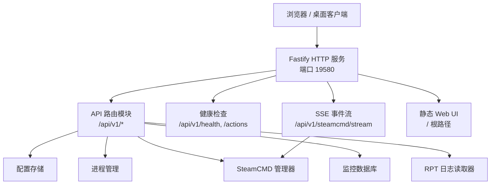
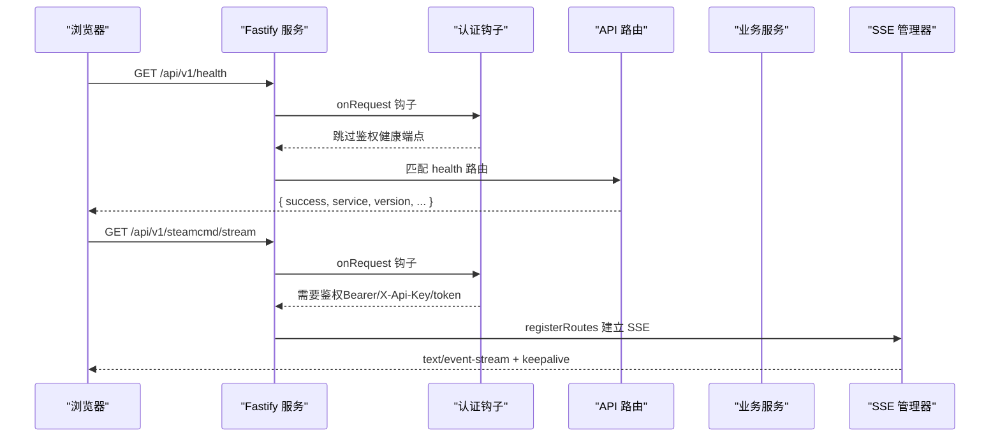
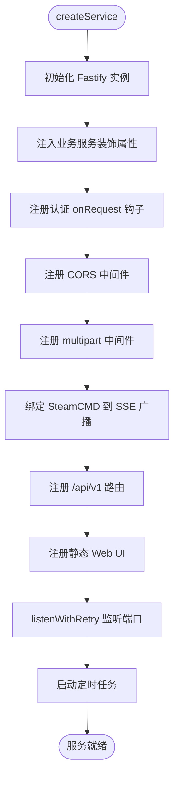
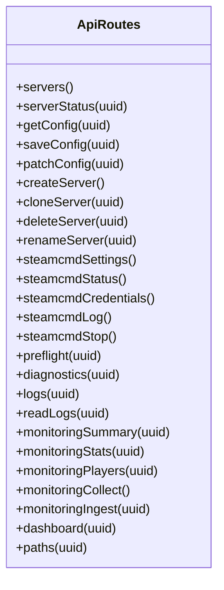
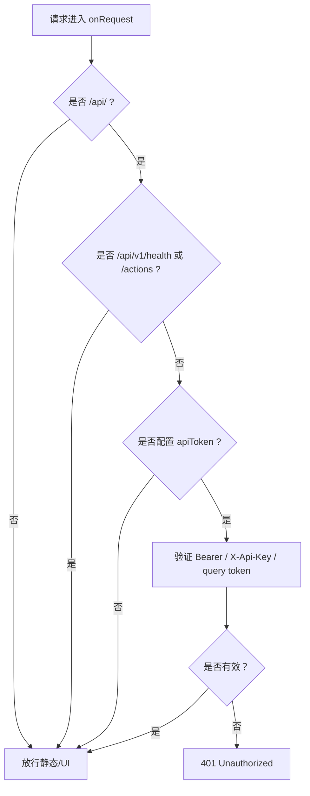
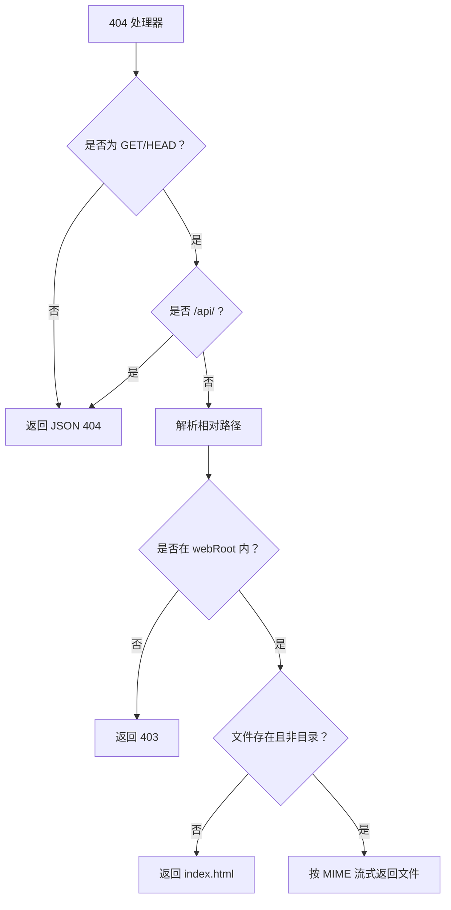
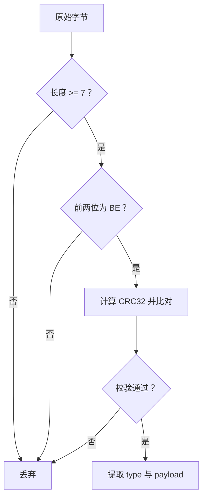
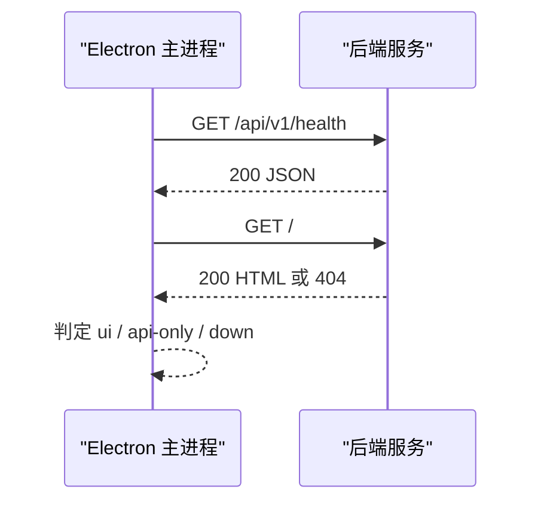
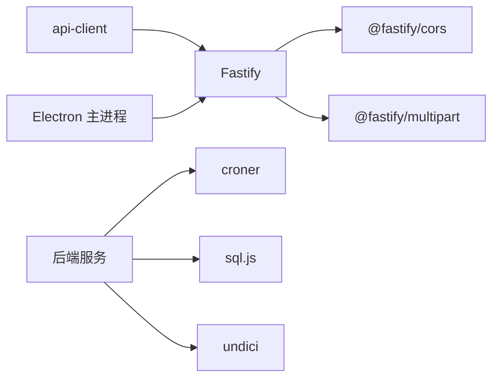

# 网络通信层

<cite>
**本文引用的文件**   
- [packages/service/src/app.ts](file://packages/service/src/app.ts)
- [packages/service/src/api/health.ts](file://packages/service/src/api/health.ts)
- [packages/service/src/api/routes.ts](file://packages/service/src/api/routes.ts)
- [packages/service/src/api/sse.ts](file://packages/service/src/api/sse.ts)
- [packages/service/src/web-static.ts](file://packages/service/src/web-static.ts)
- [packages/service/package.json](file://packages/service/package.json)
- [packages/api-client/src/client.ts](file://packages/api-client/src/client.ts)
- [apps/desktop/src/main/index.ts](file://apps/desktop/src/main/index.ts)
- [packages/service/src/rcon/packet.ts](file://packages/service/src/rcon/packet.ts)
</cite>

## 目录
1. [引言](#引言)
2. [项目结构](#项目结构)
3. [核心组件](#核心组件)
4. [架构总览](#架构总览)
5. [详细组件分析](#详细组件分析)
6. [依赖关系分析](#依赖关系分析)
7. [性能与扩展性](#性能与扩展性)
8. [故障排查指南](#故障排查指南)
9. [结论](#结论)

## 引言
本文件聚焦 Arma 3 服务器管理工具的后端网络通信层，围绕 Fastify HTTP API、中间件管道、路由组织、SSE 实时事件流、RESTful API 设计、认证授权、静态资源服务以及底层 RCon 协议适配展开。当前仓库未实现 GraphQL 或 gRPC；文档将明确说明现有能力边界，并给出可落地的扩展建议。

## 项目结构
后端服务位于 `packages/service`，以 Fastify 为 HTTP 框架，结合 SQLite（sql.js）、Croner 定时任务、undici 网络请求等依赖。前端 Web UI 由 Fastify 在启动时尝试从 `packages/web/dist` 或环境变量 `WEB_ROOT` 提供静态资源。桌面端 Electron 主进程通过本地 HTTP 探测后端健康状态和 UI 可用性。



**图表来源**
- [packages/service/src/app.ts:57-171](file://packages/service/src/app.ts#L57-L171)
- [packages/service/src/api/health.ts:5-66](file://packages/service/src/api/health.ts#L5-L66)
- [packages/service/src/api/sse.ts:9-94](file://packages/service/src/api/sse.ts#L9-L94)
- [packages/service/src/web-static.ts:17-93](file://packages/service/src/web-static.ts#L17-L93)

**章节来源**
- [packages/service/src/app.ts:57-171](file://packages/service/src/app.ts#L57-L171)
- [packages/service/package.json:17-24](file://packages/service/package.json#L17-L24)

## 核心组件
- Fastify 应用实例：负责初始化、装饰全局服务、注册中间件、挂载路由、监听端口。
- 认证钩子：对 `/api/` 前缀的请求进行 Bearer Token、X-Api-Key、Query Token 校验，静态页面与健康端点豁免鉴权。
- CORS 与 Multipart：允许跨域、支持大文件上传（100MB）。
- SSE 管理器：订阅 SteamCMD 输出事件，向已连接 SSE 客户端广播。
- Web 静态资源：兜底 404 处理，安全限制访问范围，按扩展名设置 MIME。
- API 路由：服务器生命周期、配置读写、SteamCMD 控制、监控采集、日志读取、任务调度等。
- RCon 协议适配：基于字节包的 BattlEye RCon V2 封装，用于玩家列表、踢人、封禁、广播等。

**章节来源**
- [packages/service/src/app.ts:57-171](file://packages/service/src/app.ts#L57-L171)
- [packages/service/src/api/sse.ts:9-94](file://packages/service/src/api/sse.ts#L9-L94)
- [packages/service/src/web-static.ts:17-93](file://packages/service/src/web-static.ts#L17-L93)
- [packages/service/src/api/routes.ts:62-800](file://packages/service/src/api/routes.ts#L62-L800)
- [packages/service/src/rcon/packet.ts:43-84](file://packages/service/src/rcon/packet.ts#L43-L84)

## 架构总览
Fastify 作为统一入口，承载三类流量：
- RESTful JSON API：服务器配置、状态、SteamCMD、监控、日志、任务等。
- SSE 事件流：SteamCMD 后台任务的实时输出。
- 静态资源：Web UI 的 HTML/CSS/JS。



**图表来源**
- [packages/service/src/app.ts:96-144](file://packages/service/src/app.ts#L96-L144)
- [packages/service/src/api/health.ts:5-19](file://packages/service/src/api/health.ts#L5-L19)
- [packages/service/src/api/sse.ts:51-90](file://packages/service/src/api/sse.ts#L51-L90)

## 详细组件分析

### Fastify 服务与中间件管道
- 服务创建：使用 `Fastify({ logger: true })` 初始化实例，注入配置存储、进程管理、SteamCMD、模组扫描、监控数据库、调度器、日志读取器等装饰属性。
- 启动重试：端口监听失败时按错误码重试最多 15 次，避免 EADDRINUSE/EACCES/EADDRNOTAVAIL 导致启动失败。
- 认证钩子：
  - 非 `/api/` 路径直接放行。
  - `/api/v1/health` 与 `/api/v1/actions` 免鉴权。
  - 若未配置 `apiToken`，则放行所有 API。
  - 支持三种令牌来源：Authorization Bearer、X-Api-Key、query token。
  - 未通过返回 401。
- CORS：允许任意 Origin（适配 Capacitor WebView），暴露 Authorization、Content-Type、X-Api-Key、Accept 头。
- Multipart：最大 100MB 文件上传。
- SSE 绑定：将 SteamCMD 的输出、进度、完成事件桥接到 SSE 广播。
- 路由挂载：健康路由、SSE 路由、通用 API 路由均挂载于 `/api/v1`。
- 静态资源：根据 `WEB_ROOT` 或默认路径提供 Web UI，缺失时记录错误。



**图表来源**
- [packages/service/src/app.ts:57-171](file://packages/service/src/app.ts#L57-L171)

**章节来源**
- [packages/service/src/app.ts:26-55](file://packages/service/src/app.ts#L26-L55)
- [packages/service/src/app.ts:57-171](file://packages/service/src/app.ts#L57-L171)

### RESTful API 设计与路由组织
- 统一响应包装：路由处理器普遍返回 `{ success, data/message, error?, uuid? }` 结构，便于前端统一处理。
- 服务器 CRUD：
  - `GET /servers`：列出服务器清单，可选强制刷新磁盘缓存。
  - `GET /servers/:uuid/status`：运行状态、PID、活跃任务模板、模组数量。
  - `GET /servers/:uuid/config`：读取配置，支持强制从磁盘重载。
  - `PUT /servers/:uuid/config`：保存配置，可选择同时写入 server.cfg。
  - `PATCH /servers/:uuid/config`：增量合并配置，校验模组目录有效性。
  - `POST /servers`：新建服务器，生成 UUID 与初始配置。
  - `POST /servers/:uuid/clone`：克隆配置并重命名。
  - `DELETE /servers/:uuid`：删除配置。
  - `PUT /servers/:uuid/rename`：重命名。
- SteamCMD 控制：
  - `GET /settings/steamcmd`：获取设置视图。
  - `PUT /settings/steamcmd`：保存设置并应用。
  - `GET /steamcmd/status`：运行/忙碌/安装/中止状态。
  - `PUT /steamcmd/credentials`：设置凭据。
  - `GET /steamcmd/log`：聚合日志尾部。
  - `POST /steamcmd/stop`：中止后台任务。
- 预检与诊断：
  - `GET /servers/:uuid/preflight`：环境预检。
  - `GET /servers/:uuid/diagnostics`：完整诊断信息。
- 日志与监控：
  - `GET /servers/:uuid/logs`、`/logs/read`、`/rpt`：日志列表、读取、RPT。
  - `GET /servers/:uuid/monitoring/*`：摘要、统计、玩家列表、导出 HTML/CSV。
  - `POST /monitoring/collect`：批量采集在线人数与玩家。
  - `POST /servers/:uuid/monitoring/ingest`：外部监控消息入库。
- 其他：
  - `GET /servers/:uuid/dashboard`：仪表盘数据。
  - `GET /servers/:uuid/paths`：路径信息。
  - `POST /mods/validate-path`：模组目录校验。
  - `GET /servers/:uuid/mods/bikeys/files`：bikey 文件列表。
  - `GET /servers/:uuid/missions/scan`：任务模板扫描。



**图表来源**
- [packages/service/src/api/routes.ts:62-800](file://packages/service/src/api/routes.ts#L62-L800)

**章节来源**
- [packages/service/src/api/routes.ts:62-800](file://packages/service/src/api/routes.ts#L62-L800)

### SSE 实时事件流
- 连接建立：`/api/v1/steamcmd/stream` 使用 `reply.hijack()` 直接操作底层 socket，设置 `text/event-stream`、`no-cache`、`keep-alive`、CORS 头。
- 历史回放：连接后回推最近 150 行聚合日志。
- 心跳保活：每 15 秒发送 `: keepalive` 注释帧，防止代理或浏览器超时断开。
- 事件广播：订阅 SteamCMD 的 output、progress、complete 事件，转换为 SSE data 帧推送给所有已连接客户端。
- 客户端清理：当客户端关闭连接或写入失败时，自动移除对应客户端。

```mermaid
sequenceDiagram
participant Client as "SSE 客户端"
participant Fastify as "Fastify"
participant SSE as "SseManager"
participant SteamCmd as "SteamCmdManager"
Client->>Fastify : GET /api/v1/steamcmd/stream
Fastify->>SSE : addSteamCmdClient(id, reply)
SSE->>SteamCmd : wireSteamCmd(事件订阅)
SteamCmd-->>SSE : emit("output"/"progress"/"complete")
SSE-->>Client : data : {"type" : "output","text" : "..."}
SSE->>Client : : keepalive (每15秒)
Client--x>SSE : close
SSE->>SSE : remove client from map/set
```

**图表来源**
- [packages/service/src/api/sse.ts:51-90](file://packages/service/src/api/sse.ts#L51-L90)
- [packages/service/src/api/sse.ts:13-48](file://packages/service/src/api/sse.ts#L13-L48)

**章节来源**
- [packages/service/src/api/sse.ts:9-94](file://packages/service/src/api/sse.ts#L9-L94)

### 认证与授权
- 鉴权策略：
  - 非 API 路径直接放行。
  - 健康与动作端点免鉴权。
  - 若未配置 `apiToken`，则全部放行（开发模式常见）。
  - 生产模式需配置 `apiToken`，支持 Authorization Bearer、X-Api-Key、query token。
- 客户端侧：API 客户端在请求头中附加 `Authorization: Bearer <token>`。
- 安全建议：
  - 生产环境必须设置 `apiToken`。
  - 仅在内网或反向代理后暴露服务。
  - 配合 TLS 终止（如 Nginx/Traefik）启用 HTTPS。



**图表来源**
- [packages/service/src/app.ts:96-130](file://packages/service/src/app.ts#L96-L130)
- [packages/api-client/src/client.ts:61-67](file://packages/api-client/src/client.ts#L61-L67)

**章节来源**
- [packages/service/src/app.ts:96-130](file://packages/service/src/app.ts#L96-L130)
- [packages/api-client/src/client.ts:61-99](file://packages/api-client/src/client.ts#L61-L99)

### 静态资源与 404 处理
- Web 根解析：优先 `WEB_ROOT`，其次 `packages/web/dist`、`../web/dist`、`web/dist`、`../web`。
- 安全限制：禁止越权访问 webRoot 之外的路径。
- 404 兜底：非 API 路径且 GET/HEAD 方法下，返回 index.html；否则返回 404 JSON。
- MIME 映射：CSS/HTML/JS/JSON/PNG/SVG/WOFF/WOFF2 等类型正确设置。



**图表来源**
- [packages/service/src/web-static.ts:52-90](file://packages/service/src/web-static.ts#L52-L90)

**章节来源**
- [packages/service/src/web-static.ts:17-93](file://packages/service/src/web-static.ts#L17-L93)

### 底层协议适配：BattlEye RCon V2
- 包格式：以 `BE` 开头，包含 CRC32 校验、分隔符与负载。
- 登录包：类型为 0x01，负载为密码字节。
- 命令包：类型为 0x02，携带序列号与命令字符串。
- 解析流程：校验长度、魔数、CRC32，提取分隔符与 payload。



**图表来源**
- [packages/service/src/rcon/packet.ts:43-84](file://packages/service/src/rcon/packet.ts#L43-L84)

**章节来源**
- [packages/service/src/rcon/packet.ts:43-84](file://packages/service/src/rcon/packet.ts#L43-L84)

### 桌面端与服务发现
- Electron 主进程通过 HTTP 探测后端健康接口 `/api/v1/health`，判断服务状态。
- 同时请求根路径 `/`，若返回 HTML 则判定 UI 可用，否则为 API-only 模式。
- 超时与错误处理：探测失败或超时视为 down 或 api-only。



**图表来源**
- [apps/desktop/src/main/index.ts:95-131](file://apps/desktop/src/main/index.ts#L95-L131)

**章节来源**
- [apps/desktop/src/main/index.ts:95-131](file://apps/desktop/src/main/index.ts#L95-L131)

## 依赖关系分析
- Fastify 生态：@fastify/cors、@fastify/multipart。
- 运行时依赖：croner（定时任务）、sql.js（SQLite in-memory）、undici（HTTP 客户端）。
- 前端集成：api-client 统一封装 fetch 调用，附带 Bearer Token。
- 桌面集成：Electron 主进程通过原生 http 模块探测后端。



**图表来源**
- [packages/service/package.json:17-24](file://packages/service/package.json#L17-L24)
- [packages/api-client/src/client.ts:61-99](file://packages/api-client/src/client.ts#L61-L99)
- [apps/desktop/src/main/index.ts:95-131](file://apps/desktop/src/main/index.ts#L95-L131)

**章节来源**
- [packages/service/package.json:17-24](file://packages/service/package.json#L17-L24)

## 性能与扩展性
- 连接池管理：
  - 当前未显式维护数据库连接池；sql.js 通常以内存数据库形式使用，适合单机轻量场景。
  - 如需高并发持久化，可考虑迁移至真实 SQLite 文件或 PostgreSQL，并引入连接池。
- 负载均衡：
  - 当前单实例部署；可通过反向代理（Nginx/Traefik）多实例轮询或会话亲和。
  - 注意 SSE 长连接与状态共享，建议使用粘性会话或集中式事件总线。
- 故障转移：
  - 端口监听失败具备重试机制；业务层无主动故障转移逻辑。
  - 建议增加健康检查探针与优雅停机，配合容器编排实现滚动升级与故障恢复。
- 速率限制与流量控制：
  - 当前未实现限流；可在 Fastify 层接入 @fastify/rate-limit 或在反向代理层配置。
- WebSocket：
  - 当前未实现 WebSocket；如需双向实时通信，可引入 @fastify/websocket 并与 SSE 并存，按场景选择单向推送（SSE）或双向交互（WS）。

[本节为通用指导，不直接分析具体文件]

## 故障排查指南
- 401 Unauthorized：
  - 检查是否配置 `apiToken`，确认请求头 Authorization、X-Api-Key 或 query token 是否正确。
  - 参考认证钩子逻辑定位拦截点。
- 端口占用或权限不足：
  - 查看 listenWithRetry 的错误码与重试日志，确认 EADDRINUSE/EACCES/EADDRNOTAVAIL。
- 静态资源 404：
  - 检查 WEB_ROOT 或 packages/web/dist 是否存在 index.html。
  - 确认 404 处理器未误拦截 API 路径。
- SSE 断连：
  - 检查 keepalive 是否被代理层丢弃，必要时调整代理超时。
  - 关注客户端 close 事件与写异常导致的客户端清理。
- RCon 连接失败：
  - 检查 BattlEye 配置与密码，确认 packet 校验与 CRC32 计算正常。

**章节来源**
- [packages/service/src/app.ts:26-55](file://packages/service/src/app.ts#L26-L55)
- [packages/service/src/app.ts:96-130](file://packages/service/src/app.ts#L96-L130)
- [packages/service/src/web-static.ts:52-90](file://packages/service/src/web-static.ts#L52-L90)
- [packages/service/src/api/sse.ts:81-90](file://packages/service/src/api/sse.ts#L81-L90)
- [packages/service/src/rcon/packet.ts:59-80](file://packages/service/src/rcon/packet.ts#L59-L80)

## 结论
该项目的网络通信层以 Fastify 为核心，提供清晰的 RESTful API、SSE 实时事件流与静态资源服务。认证采用轻量 Token 方案，适用于内网或受控环境。当前未实现 GraphQL 与 gRPC，但架构具备良好的扩展空间：可在 Fastify 上按需接入 GraphQL 插件或 gRPC 网关，并通过反向代理实现负载均衡与 TLS 终止。建议在生产环境中启用 apiToken、HTTPS、限流与监控，并结合容器编排提升可靠性与可观测性。