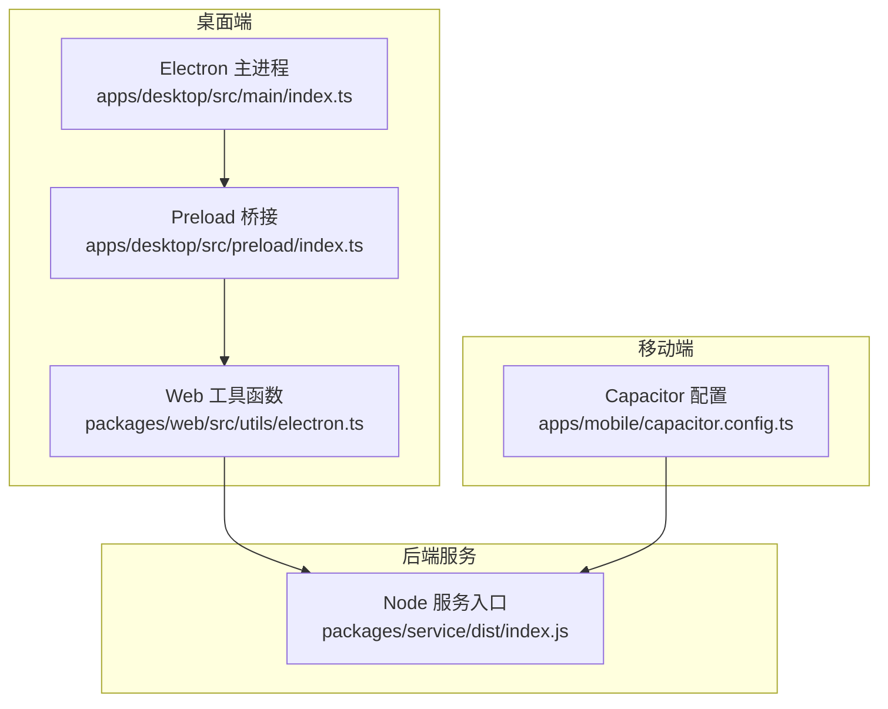
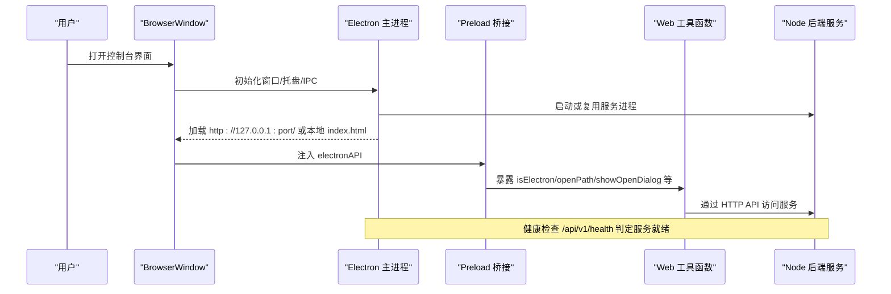
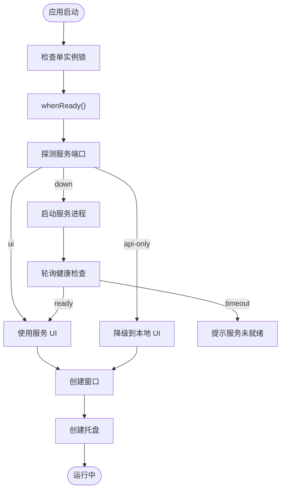
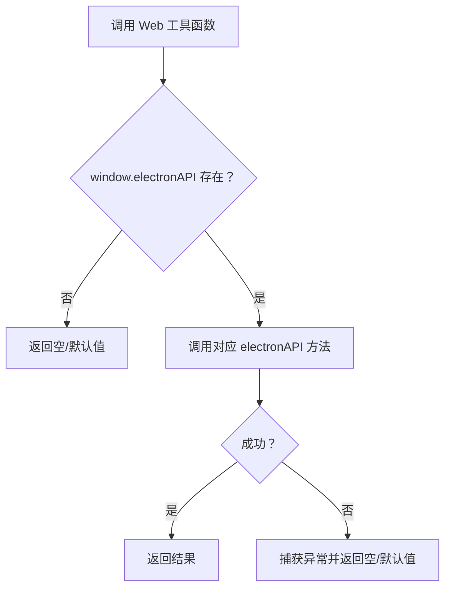
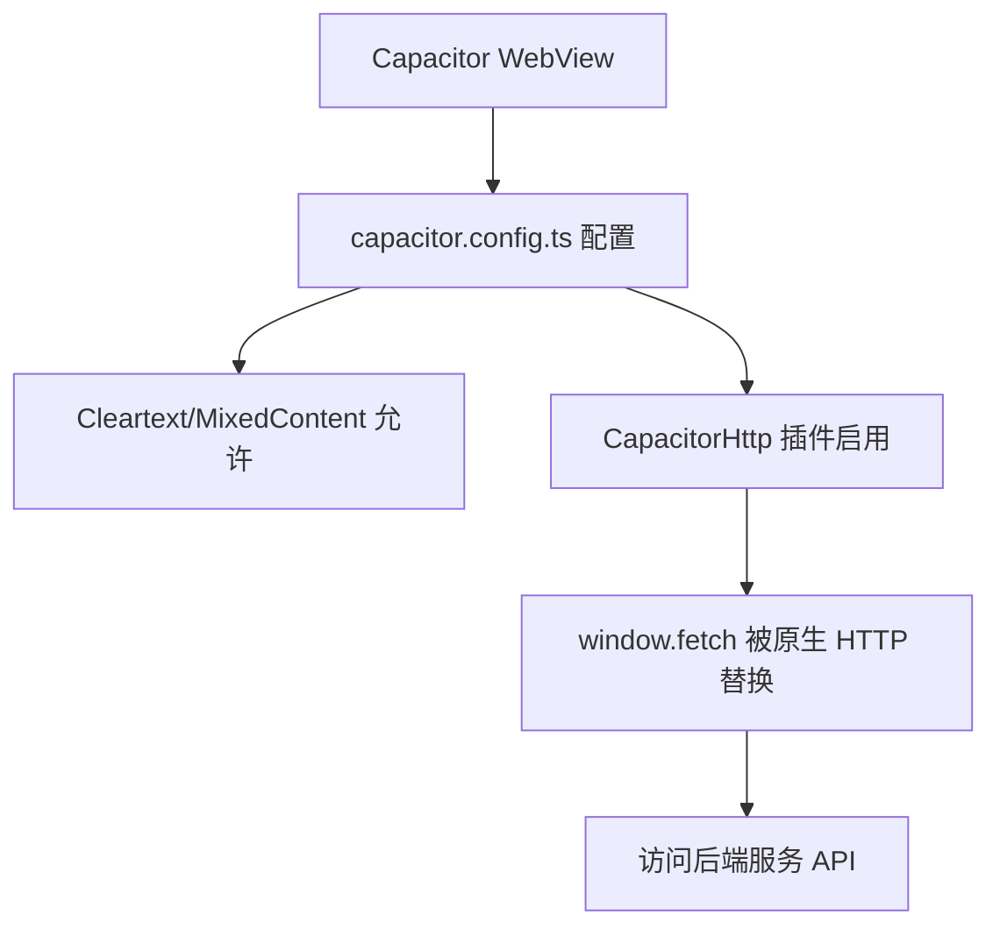
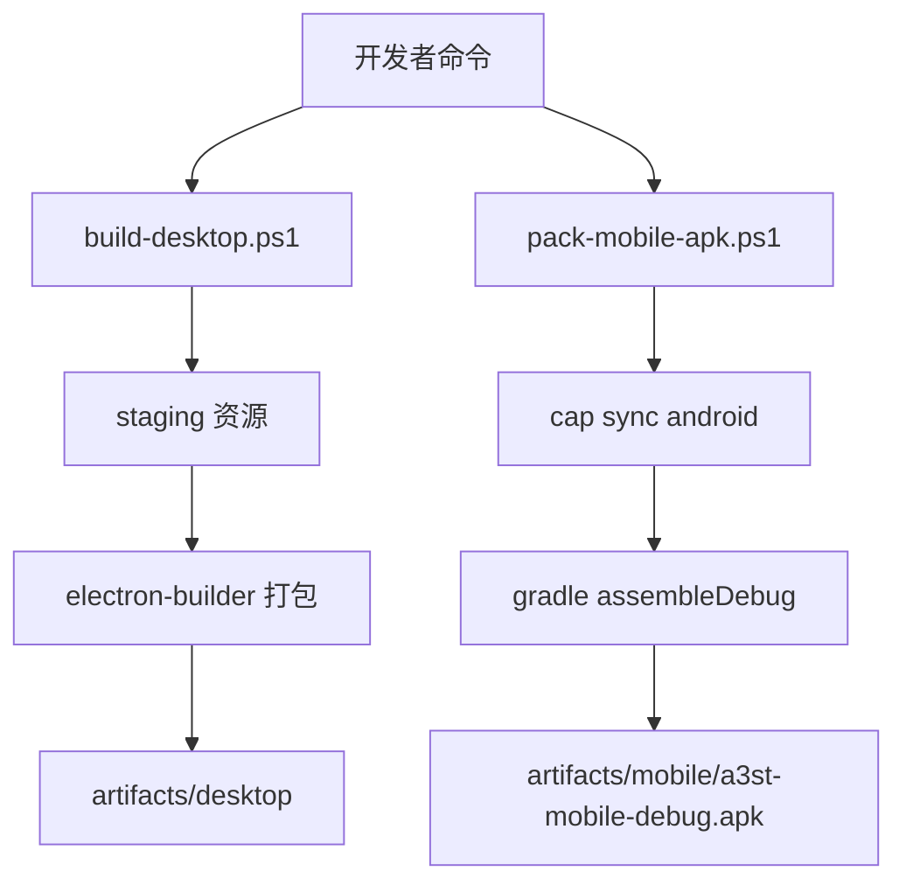
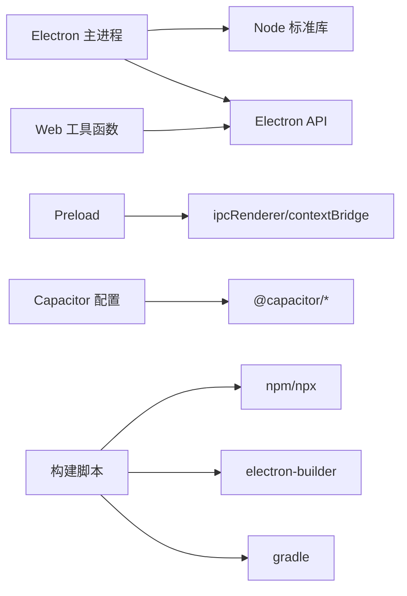

# 跨平台适配层

<cite>
**本文引用的文件**   
- [README.md](file://README.md)
- [apps/desktop/package.json](file://apps/desktop/package.json)
- [apps/mobile/package.json](file://apps/mobile/package.json)
- [apps/desktop/src/main/index.ts](file://apps/desktop/src/main/index.ts)
- [apps/desktop/src/preload/index.ts](file://apps/desktop/src/preload/index.ts)
- [packages/web/src/utils/electron.ts](file://packages/web/src/utils/electron.ts)
- [apps/mobile/capacitor.config.ts](file://apps/mobile/capacitor.config.ts)
- [apps/desktop/electron-builder.yml](file://apps/desktop/electron-builder.yml)
- [scripts/build-desktop.ps1](file://scripts/build-desktop.ps1)
- [scripts/pack-mobile-apk.ps1](file://scripts/pack-mobile-apk.ps1)
</cite>

## 目录
1. [引言](#引言)
2. [项目结构](#项目结构)
3. [核心组件](#核心组件)
4. [架构总览](#架构总览)
5. [详细组件分析](#详细组件分析)
6. [依赖关系分析](#依赖关系分析)
7. [性能与兼容性考量](#性能与兼容性考量)
8. [故障排查指南](#故障排查指南)
9. [结论](#结论)

## 引言
本文件聚焦 Arma3 Server Tools v2 的跨平台适配层，围绕 Electron 桌面端、Capacitor Android 移动端以及共享后端服务展开。目标是解释多平台抽象设计、统一接口、构建集成、运行时检测、条件编译、动态加载与降级策略，并给出调试、日志与错误上报的统一思路。

项目当前为全栈 TypeScript：
- 桌面端：Electron（Windows）
- 移动端：Capacitor Android
- 后端服务：Node.js + Fastify + SQLite
- 控制界面：Vue 3 Web 应用

**章节来源**
- [README.md:1-108](file://README.md#L1-L108)

## 项目结构
跨平台适配层由以下关键部分组成：
- Electron 主进程：负责启动/管理 Node 后端服务、窗口生命周期、系统托盘、IPC 能力桥接。
- Preload 脚本：在渲染进程暴露最小化 API，屏蔽 Electron 原生细节。
- Web 前端工具函数：以 isElectron 等运行时检测决定调用路径，实现“同代码、多运行环境”。
- Capacitor 配置：Android WebView 网络与安全策略，配合原生 HTTP 插件绕过 CORS/Cleartext 限制。
- 构建脚本：打包 Electron 安装包、生成 Android APK，并注入额外资源。



**图表来源**
- [apps/desktop/src/main/index.ts:1-731](file://apps/desktop/src/main/index.ts#L1-L731)
- [apps/desktop/src/preload/index.ts:1-48](file://apps/desktop/src/preload/index.ts#L1-L48)
- [packages/web/src/utils/electron.ts:1-61](file://packages/web/src/utils/electron.ts#L1-L61)
- [apps/mobile/capacitor.config.ts:1-24](file://apps/mobile/capacitor.config.ts#L1-L24)

**章节来源**
- [apps/desktop/package.json:1-31](file://apps/desktop/package.json#L1-L31)
- [apps/mobile/package.json:1-23](file://apps/mobile/package.json#L1-L23)

## 核心组件
- Electron 主进程
  - 启动/停止/重启 Node 后端服务，探测端口占用、复用已有监听进程。
  - 创建 BrowserWindow，处理 UI 加载失败回退到本地静态页面。
  - 提供 IPC 接口：服务设置、状态查询、文件对话框、打开路径、主题同步。
  - 系统托盘菜单与单实例锁。
- Preload 桥接
  - 向渲染进程暴露 electronAPI，封装 IPC 调用。
  - 暴露 platform、isElectron 等运行时标识。
- Web 工具函数
  - isElectron/isElectronShellWithoutBridge 判断运行环境。
  - openPath/pickFile/pickDirectory/readTextFile 等安全封装。
- Capacitor 配置
  - 允许混合内容、明文 HTTP，启用 CapacitorHttp 插件绕过 WebView CORS。
- 构建与打包
  - electron-builder 配置 extraResources 注入 web 与 service 产物。
  - PowerShell 脚本串联 build、stage、pack 流程。

**章节来源**
- [apps/desktop/src/main/index.ts:1-731](file://apps/desktop/src/main/index.ts#L1-L731)
- [apps/desktop/src/preload/index.ts:1-48](file://apps/desktop/src/preload/index.ts#L1-L48)
- [packages/web/src/utils/electron.ts:1-61](file://packages/web/src/utils/electron.ts#L1-L61)
- [apps/mobile/capacitor.config.ts:1-24](file://apps/mobile/capacitor.config.ts#L1-L24)
- [apps/desktop/electron-builder.yml:1-48](file://apps/desktop/electron-builder.yml#L1-L48)
- [scripts/build-desktop.ps1:1-59](file://scripts/build-desktop.ps1#L1-L59)

## 架构总览
下图展示从用户交互到后端服务的完整链路，包括 Electron 主进程、Preload、Web 工具函数与后端服务之间的交互。



**图表来源**
- [apps/desktop/src/main/index.ts:95-137](file://apps/desktop/src/main/index.ts#L95-L137)
- [apps/desktop/src/main/index.ts:470-616](file://apps/desktop/src/main/index.ts#L470-L616)
- [apps/desktop/src/preload/index.ts:10-47](file://apps/desktop/src/preload/index.ts#L10-L47)
- [packages/web/src/utils/electron.ts:1-61](file://packages/web/src/utils/electron.ts#L1-L61)

## 详细组件分析

### Electron 主进程：服务生命周期与 UI 加载
- 服务发现与复用
  - 通过 HTTP 健康检查探测服务是否可用，区分“UI 已就绪”“仅 API 可用”“服务不可用”。
  - 在非 Windows 使用 lsof，在 Windows 使用 PowerShell 查找监听端口进程；支持复用已有进程。
- 服务启动与清理
  - 根据开发/生产模式选择 node 或 process.execPath 启动服务，注入 PORT/HOST/DATA_DIR/API_TOKEN/WEB_ROOT/ELECTRON_RUN_AS_NODE 等环境变量。
  - 将子进程标准输出重定向到 dataDir/service.log，并在退出时关闭句柄。
- UI 加载与降级
  - 开发模式优先加载 Vite 开发服务器，失败则回退到打包后的本地 index.html。
  - 生产模式下优先加载本机服务提供的静态页；若健康检查失败或返回非 HTML，则降级到 file:// 本地页面。
- IPC 能力
  - 暴露服务设置读写、服务状态、版本/路径、打开路径、文件对话框、读取文本文件、主题同步等。
- 系统托盘与单实例
  - 托盘菜单提供显示窗口和退出；单实例锁保证只运行一个实例，重复启动时聚焦已有窗口。



**图表来源**
- [apps/desktop/src/main/index.ts:95-137](file://apps/desktop/src/main/index.ts#L95-L137)
- [apps/desktop/src/main/index.ts:236-249](file://apps/desktop/src/main/index.ts#L236-L249)
- [apps/desktop/src/main/index.ts:281-321](file://apps/desktop/src/main/index.ts#L281-L321)
- [apps/desktop/src/main/index.ts:323-396](file://apps/desktop/src/main/index.ts#L323-L396)
- [apps/desktop/src/main/index.ts:470-616](file://apps/desktop/src/main/index.ts#L470-L616)
- [apps/desktop/src/main/index.ts:618-645](file://apps/desktop/src/main/index.ts#L618-L645)
- [apps/desktop/src/main/index.ts:659-731](file://apps/desktop/src/main/index.ts#L659-L731)

**章节来源**
- [apps/desktop/src/main/index.ts:1-731](file://apps/desktop/src/main/index.ts#L1-L731)

### Preload 桥接：渲染进程安全 API
- 暴露 electronAPI，包含：
  - 平台与运行时标识：platform、isElectron
  - 服务相关：getServiceSettings/saveServiceSettings/getServiceStatus/restartService
  - 文件系统与系统能力：openPath/showOpenDialog/readTextFile
  - 主题：getThemeDark/onThemeChanged
- 所有能力均通过 ipcRenderer.invoke 调用主进程，避免直接暴露 Node API。

```mermaid
classDiagram
class ElectronAPI {
+string platform
+boolean isElectron
+Promise<ServiceSettings> getServiceSettings()
+Promise<void> saveServiceSettings(settings)
+Promise<{running : boolean;pid? : number}> getServiceStatus()
+Promise<{running : boolean;pid? : number}> restartService()
+Promise<string> openPath(targetPath)
+Promise<{canceled : boolean;filePaths : string[]}> showOpenDialog(options)
+Promise<string> readTextFile(filePath)
+Promise<boolean> getThemeDark()
+Function onThemeChanged(callback)
}
```

**图表来源**
- [apps/desktop/src/preload/index.ts:10-47](file://apps/desktop/src/preload/index.ts#L10-L47)

**章节来源**
- [apps/desktop/src/preload/index.ts:1-48](file://apps/desktop/src/preload/index.ts#L1-L48)

### Web 工具函数：运行时检测与能力封装
- isElectron：基于 window.electronAPI.isElectron 判断是否在 Electron 环境中。
- isElectronShellWithoutBridge：兼容旧包 ESM preload 失败场景，通过 UA 识别外壳存在但桥接缺失。
- openPath/pickFile/pickDirectory/readTextFile：对 electronAPI 进行空值保护与异常捕获，返回稳定类型。



**图表来源**
- [packages/web/src/utils/electron.ts:1-61](file://packages/web/src/utils/electron.ts#L1-L61)

**章节来源**
- [packages/web/src/utils/electron.ts:1-61](file://packages/web/src/utils/electron.ts#L1-L61)

### Capacitor 移动端：WebView 网络与安全策略
- 允许混合内容与明文 HTTP，确保与局域网内 Node 服务通信。
- 启用 CapacitorHttp 插件，用原生 HTTP 打补丁 window.fetch，绕过 WebView CORS 与部分 cleartext 限制。
- 与 Web 工具函数结合，在移动端走 HTTP API 而非 Electron IPC。



**图表来源**
- [apps/mobile/capacitor.config.ts:1-24](file://apps/mobile/capacitor.config.ts#L1-L24)

**章节来源**
- [apps/mobile/capacitor.config.ts:1-24](file://apps/mobile/capacitor.config.ts#L1-L24)

### 构建系统集成：打包配置、依赖注入与运行时检测
- Electron 打包
  - electron-builder.yml 定义产物名称、输出目录、extraResources（web/service/assets）、asar 压缩、NSIS 安装器选项。
  - scripts/build-desktop.ps1 串联 TypeScript 检查、测试、服务构建、Web 构建、Electron 构建、资源 staging、electron-builder 打包。
- 移动端打包
  - scripts/pack-mobile-apk.ps1 校验 ANDROID_HOME/JAVA_HOME，构建 Web（mobile 模式），cap sync android，确保 cleartext，gradle assembleDebug，输出 debug APK。
- 运行时检测
  - isElectron/isElectronShellWithoutBridge 决定调用路径；Capacitor 环境下不依赖 electronAPI，直接通过 HTTP 访问服务。



**图表来源**
- [apps/desktop/electron-builder.yml:1-48](file://apps/desktop/electron-builder.yml#L1-L48)
- [scripts/build-desktop.ps1:1-59](file://scripts/build-desktop.ps1#L1-L59)
- [scripts/pack-mobile-apk.ps1:1-76](file://scripts/pack-mobile-apk.ps1#L1-L76)

**章节来源**
- [apps/desktop/electron-builder.yml:1-48](file://apps/desktop/electron-builder.yml#L1-L48)
- [scripts/build-desktop.ps1:1-59](file://scripts/build-desktop.ps1#L1-L59)
- [scripts/pack-mobile-apk.ps1:1-76](file://scripts/pack-mobile-apk.ps1#L1-L76)

## 依赖关系分析
- Electron 主进程依赖 Node 标准库（child_process/fs/path/url）与 Electron API（app/BrowserWindow/Tray/Menu/nativeImage/dialog/ipcMain/shell/nativeTheme）。
- Preload 依赖 contextBridge/ipcRenderer，仅暴露最小 API。
- Web 工具函数依赖 window.electronAPI，具备运行时检测与降级逻辑。
- Capacitor 配置依赖 @capacitor/core/@capacitor/android，启用 CapacitorHttp 插件。
- 构建脚本依赖 npm/npx/electron-builder/gradle/Android SDK。



**图表来源**
- [apps/desktop/src/main/index.ts:1-731](file://apps/desktop/src/main/index.ts#L1-L731)
- [apps/desktop/src/preload/index.ts:1-48](file://apps/desktop/src/preload/index.ts#L1-L48)
- [packages/web/src/utils/electron.ts:1-61](file://packages/web/src/utils/electron.ts#L1-L61)
- [apps/mobile/capacitor.config.ts:1-24](file://apps/mobile/capacitor.config.ts#L1-L24)
- [scripts/build-desktop.ps1:1-59](file://scripts/build-desktop.ps1#L1-L59)
- [scripts/pack-mobile-apk.ps1:1-76](file://scripts/pack-mobile-apk.ps1#L1-L76)

**章节来源**
- [apps/desktop/package.json:1-31](file://apps/desktop/package.json#L1-L31)
- [apps/mobile/package.json:1-23](file://apps/mobile/package.json#L1-L23)

## 性能与兼容性考量
- 服务探测与健康检查
  - 使用短超时与轮询避免阻塞 UI；区分 UI 与 API 可用性，减少不必要的回退。
- 进程复用与端口释放
  - 复用已有监听进程减少冷启动开销；必要时通过平台命令释放端口，避免冲突。
- 预加载脚本定位
  - 多候选路径回退，兼容 asar/asar.unpacked 与不同打包布局，降低部署风险。
- 环境变量注入
  - 生产模式注入 WEB_ROOT/ELECTRON_RUN_AS_NODE，提升服务启动稳定性。
- 移动端网络
  - CapacitorHttp 绕过 WebView CORS/Cleartext 限制，提高局域网连通性。
- 降级策略
  - UI 加载失败自动回退到本地静态页面；服务不可用时提示日志位置，便于快速定位。

[本节为通用指导，不直接分析具体文件]

## 故障排查指南
- 服务未找到
  - 现象：主进程提示未找到服务入口，需先执行服务构建。
  - 处理：确认 packages/service 已构建，检查入口路径与服务日志。
- 服务未就绪
  - 现象：健康检查失败，弹窗提示服务未就绪。
  - 处理：查看 dataDir/service.log，检查端口占用、防火墙、HOST/PORT 配置。
- 控制台页面未就绪
  - 现象：服务响应但首页不是 HTML，自动降级到本地 UI。
  - 处理：检查服务静态资源路径 WEB_ROOT，或更换端口后重启服务。
- 界面加载失败
  - 现象：did-fail-load 触发，尝试加载本地 index.html 失败。
  - 处理：确认打包资源是否包含 web 目录，检查 preload 是否正确注入。
- 渲染进程崩溃
  - 现象：render-process-gone，弹窗提示异常原因并重试加载。
  - 处理：检查前端 JS 错误、内存占用、第三方库兼容性。
- 移动端无法访问局域网服务
  - 现象：WebView 报混合内容或 CORS 错误。
  - 处理：确认 capacitor.config.ts 已启用 Cleartext/MixedContent 与 CapacitorHttp。

**章节来源**
- [apps/desktop/src/main/index.ts:323-396](file://apps/desktop/src/main/index.ts#L323-L396)
- [apps/desktop/src/main/index.ts:470-616](file://apps/desktop/src/main/index.ts#L470-L616)
- [apps/mobile/capacitor.config.ts:1-24](file://apps/mobile/capacitor.config.ts#L1-L24)

## 结论
该跨平台适配层通过 Electron 主进程与 Preload 桥接，为 Web 前端提供统一的系统能力接口；同时通过 Capacitor 配置与运行时检测，使同一套 Web 代码能在桌面与移动端运行。构建脚本将服务与前端资源打包进安装包，并通过环境变量与资源注入保证运行一致性。整体方案强调健壮性：健康检查、进程复用、多路径回退与降级策略，确保在不同平台与部署形态下保持稳定可用。

[本节为总结性内容，不直接分析具体文件]