# 进程管理基础设施

<cite>
**本文引用的文件**   
- [README.md](file://README.md)
- [manager.ts](file://packages/service/src/process/manager.ts)
- [identity.ts](file://packages/service/src/process/identity.ts)
- [server-lifecycle.ts](file://packages/service/src/scheduling/server-lifecycle.ts)
- [ingest.ts](file://packages/service/src/monitoring/ingest.ts)
- [ArmaMonitoringService.cs](file://DestinyServerMonitoring/DestinyServerMonitoring/ArmaMonitoringService.cs)
- [index.ts（桌面主进程）](file://apps/desktop/src/main/index.ts)
- [server.ts（类型定义）](file://packages/service/src/types/server.ts)
</cite>

## 目录
1. [引言](#引言)
2. [项目结构](#项目结构)
3. [核心组件](#核心组件)
4. [架构总览](#架构总览)
5. [详细组件分析](#详细组件分析)
6. [依赖关系分析](#依赖关系分析)
7. [性能与可靠性考虑](#性能与可靠性考虑)
8. [故障排查指南](#故障排查指南)
9. [结论](#结论)

## 引言
本文面向 Arma 3 服务器管理工具 v2 的进程管理基础设施，围绕以下目标展开：
- 解释进程生命周期管理：启动、停止、重启、检测与监控。
- 说明跨平台进程控制：Windows 任务管理器集成、Linux 进程信号处理、macOS 系统调用封装。
- 梳理进程间通信机制：IPC 通道、消息队列和事件总线。
- 给出进程守护、资源监控、异常恢复的具体实现路径。
- 说明进程隔离策略、安全沙箱和资源限制配置。
- 提供进程崩溃检测、自动重启和健康检查方案。

该仓库是一个 TypeScript 全栈项目，后端服务基于 Node.js + Fastify + SQLite，桌面端使用 Electron，同时包含一个用于游戏扩展监控的 C# DLL 模块。进程管理主要分布在后端服务的 `process` 与 `scheduling` 模块、桌面主进程的子进程托管逻辑，以及游戏侧监控扩展之间。

**章节来源**
- [README.md:1-108](file://README.md#L1-L108)

## 项目结构
从进程管理视角看，关键代码集中在以下位置：
- 后端服务进程管理：`packages/service/src/process/manager.ts`、`packages/service/src/process/identity.ts`。
- 服务器启停编排：`packages/service/src/scheduling/server-lifecycle.ts`。
- 监控数据摄入：`packages/service/src/monitoring/ingest.ts`。
- 游戏扩展监控桥接：`DestinyServerMonitoring/DestinyServerMonitoring/ArmaMonitoringService.cs`。
- 桌面端 Electron 主进程对后端服务的托管：`apps/desktop/src/main/index.ts`。
- 进程状态类型：`packages/service/src/types/server.ts`。

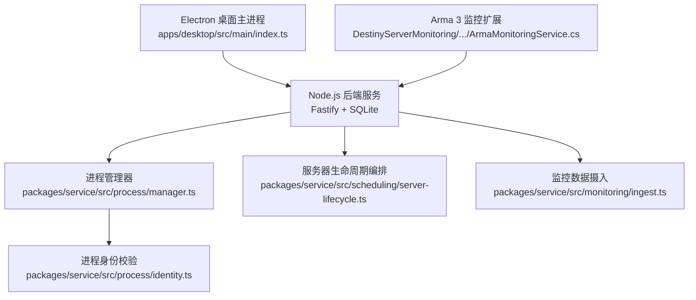

**图表来源**
- [index.ts（桌面主进程）:1-731](file://apps/desktop/src/main/index.ts#L1-L731)
- [manager.ts:1-219](file://packages/service/src/process/manager.ts#L1-L219)
- [identity.ts:1-229](file://packages/service/src/process/identity.ts#L1-L229)
- [server-lifecycle.ts:1-270](file://packages/service/src/scheduling/server-lifecycle.ts#L1-L270)
- [ingest.ts:1-40](file://packages/service/src/monitoring/ingest.ts#L1-L40)
- [ArmaMonitoringService.cs:1-148](file://DestinyServerMonitoring/DestinyServerMonitoring/ArmaMonitoringService.cs#L1-L148)

**章节来源**
- [README.md:50-66](file://README.md#L50-L66)

## 核心组件
本节聚焦进程管理的核心类与职责边界。

### 进程管理器 `ProcessManager`
`ProcessManager` 是后端服务中所有游戏进程的统一入口，负责：
- 注册启动参数。
- 启动游戏进程并记录 PID。
- 在 Windows 与非 Windows 平台采用不同标准 I/O 策略。
- 监听子进程退出与错误事件，触发内部事件。
- 收养已存在的孤儿进程 PID，避免重复启动。
- 跨平台终止进程树。
- 查询进程状态、PID 与运行标志。

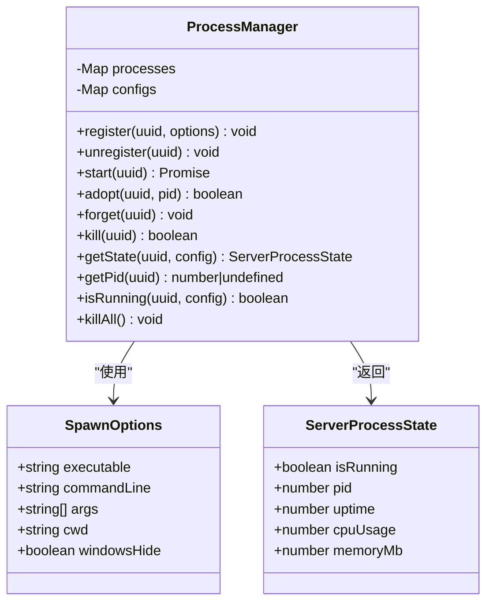

**图表来源**
- [manager.ts:11-34](file://packages/service/src/process/manager.ts#L11-L34)
- [manager.ts:32-219](file://packages/service/src/process/manager.ts#L32-L219)
- [server.ts:1-15](file://packages/service/src/types/server.ts#L1-L15)

**章节来源**
- [manager.ts:11-34](file://packages/service/src/process/manager.ts#L11-L34)
- [manager.ts:45-109](file://packages/service/src/process/manager.ts#L45-L109)
- [manager.ts:115-166](file://packages/service/src/process/manager.ts#L115-L166)
- [manager.ts:168-219](file://packages/service/src/process/manager.ts#L168-L219)
- [server.ts:1-15](file://packages/service/src/types/server.ts#L1-L15)

### 进程身份与平台控制 `identity.ts`
`identity.ts` 提供跨平台进程探测与身份验证能力：
- 判断进程是否存活。
- 获取进程可执行文件路径。
- 读取进程命令行参数。
- 根据期望可执行文件和标记（如 `-name=<uuid>`、`-port=`）验证进程身份。
- 提供进程树终止工具。

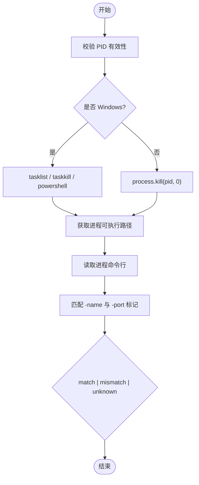

**图表来源**
- [identity.ts:14-32](file://packages/service/src/process/identity.ts#L14-L32)
- [identity.ts:34-85](file://packages/service/src/process/identity.ts#L34-L85)
- [identity.ts:87-147](file://packages/service/src/process/identity.ts#L87-L147)
- [identity.ts:149-212](file://packages/service/src/process/identity.ts#L149-L212)
- [identity.ts:214-229](file://packages/service/src/process/identity.ts#L214-L229)

**章节来源**
- [identity.ts:14-32](file://packages/service/src/process/identity.ts#L14-L32)
- [identity.ts:34-85](file://packages/service/src/process/identity.ts#L34-L85)
- [identity.ts:87-147](file://packages/service/src/process/identity.ts#L87-L147)
- [identity.ts:149-212](file://packages/service/src/process/identity.ts#L149-L212)
- [identity.ts:214-229](file://packages/service/src/process/identity.ts#L214-L229)

### 服务器生命周期编排 `server-lifecycle.ts`
该模块将配置、进程管理与端口就绪检查组合成完整的服务器启停流程：
- 停止服务器时先验证 PID 身份，防止误杀其他进程。
- 启动前检查配置文件、可执行文件与防双实例逻辑。
- 启动后等待端口就绪，超时或退出时给出明确提示。
- 支持定时任务动作解析与执行。

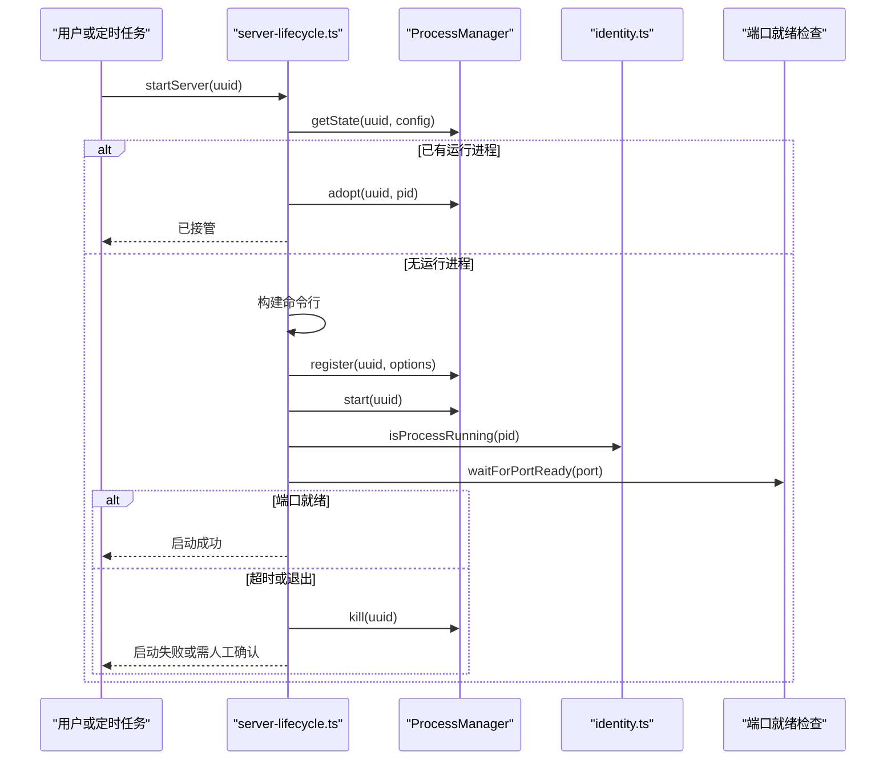

**图表来源**
- [server-lifecycle.ts:58-112](file://packages/service/src/scheduling/server-lifecycle.ts#L58-L112)
- [server-lifecycle.ts:114-212](file://packages/service/src/scheduling/server-lifecycle.ts#L114-L212)
- [server-lifecycle.ts:214-270](file://packages/service/src/scheduling/server-lifecycle.ts#L214-L270)

**章节来源**
- [server-lifecycle.ts:58-112](file://packages/service/src/scheduling/server-lifecycle.ts#L58-L112)
- [server-lifecycle.ts:114-212](file://packages/service/src/scheduling/server-lifecycle.ts#L114-L212)
- [server-lifecycle.ts:214-270](file://packages/service/src/scheduling/server-lifecycle.ts#L214-L270)

### 监控数据摄入 `ingest.ts`
监控数据通过结构化消息被解析并写入数据库：
- 解析 `ObjectManipulationNum` 消息，提取玩家数与 FPS。
- 解析 `PlayerInfo` 消息，记录玩家 GUID 与名称。
- 为后续统计入库与在线人数采集提供基础。

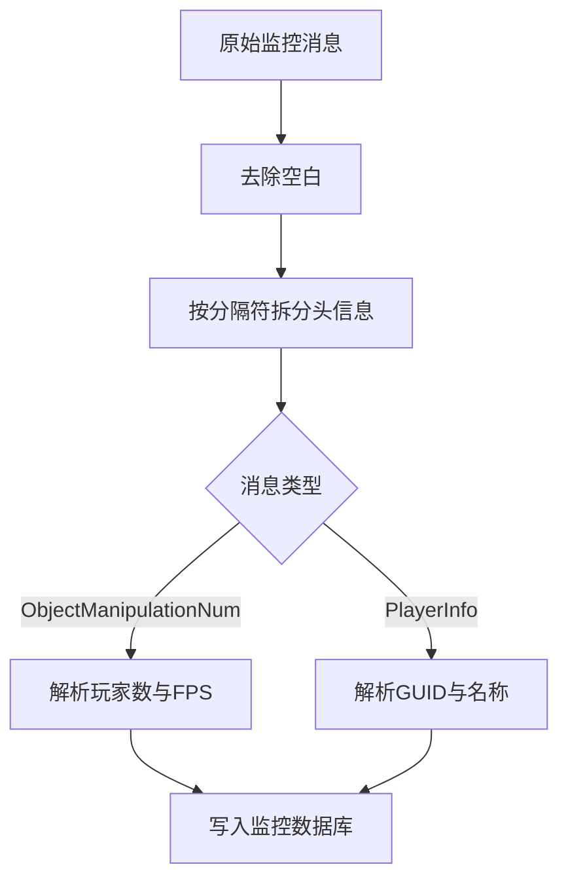

**图表来源**
- [ingest.ts:3-39](file://packages/service/src/monitoring/ingest.ts#L3-L39)

**章节来源**
- [ingest.ts:3-39](file://packages/service/src/monitoring/ingest.ts#L3-L39)

### 游戏扩展监控桥接 `ArmaMonitoringService.cs`
C# 扩展作为 Arma 3 的 RVExtension 模块，负责：
- 向 Arma 引擎注册回调。
- 接收游戏内监控命令。
- 通过 Windows 窗口消息将监控数据发送到桌面端指定窗口。
- 异步发送以避免阻塞游戏线程。

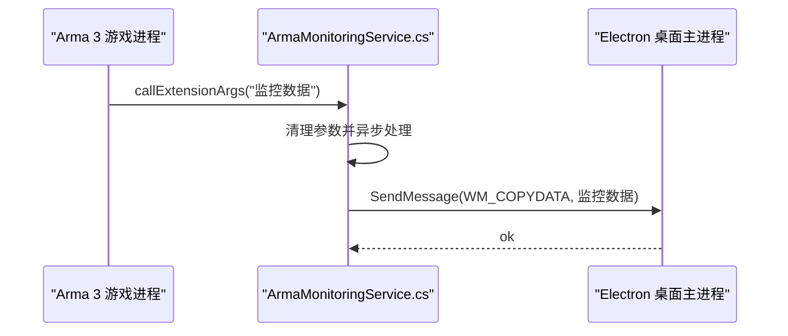

**图表来源**
- [ArmaMonitoringService.cs:51-59](file://DestinyServerMonitoring/DestinyServerMonitoring/ArmaMonitoringService.cs#L51-L59)
- [ArmaMonitoringService.cs:102-143](file://DestinyServerMonitoring/DestinyServerMonitoring/ArmaMonitoringService.cs#L102-L143)

**章节来源**
- [ArmaMonitoringService.cs:51-59](file://DestinyServerMonitoring/DestinyServerMonitoring/ArmaMonitoringService.cs#L51-L59)
- [ArmaMonitoringService.cs:102-143](file://DestinyServerMonitoring/DestinyServerMonitoring/ArmaMonitoringService.cs#L102-L143)

### 桌面端 Electron 主进程对后端服务的托管
桌面端负责：
- 探测后端服务健康状态。
- 查找占用端口的进程 PID。
- 启动或停止后端服务。
- 收养已存在的监听进程。
- 将服务日志输出到本地文件。
- 提供托盘菜单与应用生命周期管理。

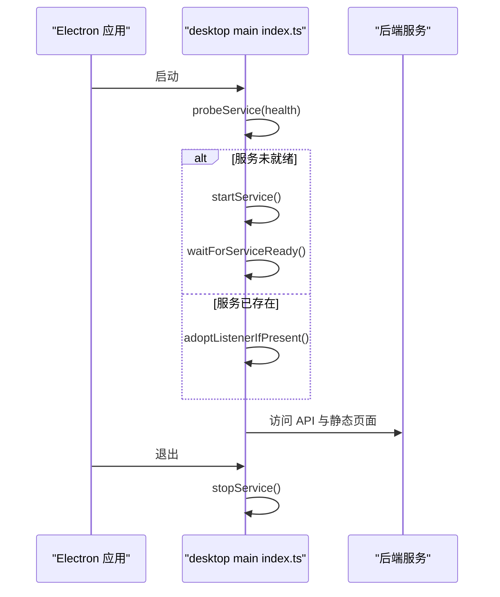

**图表来源**
- [index.ts（桌面主进程）:95-137](file://apps/desktop/src/main/index.ts#L95-L137)
- [index.ts（桌面主进程）:139-222](file://apps/desktop/src/main/index.ts#L139-L222)
- [index.ts（桌面主进程）:323-396](file://apps/desktop/src/main/index.ts#L323-L396)
- [index.ts（桌面主进程）:686-719](file://apps/desktop/src/main/index.ts#L686-L719)

**章节来源**
- [index.ts（桌面主进程）:95-137](file://apps/desktop/src/main/index.ts#L95-L137)
- [index.ts（桌面主进程）:139-222](file://apps/desktop/src/main/index.ts#L139-L222)
- [index.ts（桌面主进程）:323-396](file://apps/desktop/src/main/index.ts#L323-L396)
- [index.ts（桌面主进程）:686-719](file://apps/desktop/src/main/index.ts#L686-L719)

## 架构总览
整体架构由三层组成：
- 桌面层：Electron 主进程负责 UI、托盘、后端服务托管与用户交互。
- 服务层：Node.js Fastify 服务负责服务器启停、RCon、调度、监控数据入库与 HTTP API。
- 游戏层：Arma 3 监控扩展通过 DLL 回调与 Windows 窗口消息与桌面端通信。

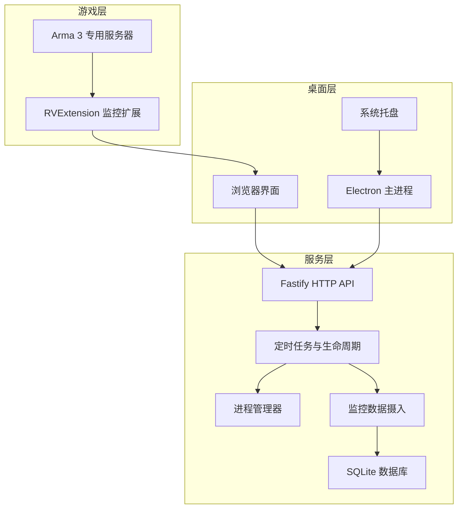

**图表来源**
- [index.ts（桌面主进程）:1-731](file://apps/desktop/src/main/index.ts#L1-L731)
- [server-lifecycle.ts:1-270](file://packages/service/src/scheduling/server-lifecycle.ts#L1-L270)
- [manager.ts:1-219](file://packages/service/src/process/manager.ts#L1-L219)
- [ingest.ts:1-40](file://packages/service/src/monitoring/ingest.ts#L1-L40)
- [ArmaMonitoringService.cs:1-148](file://DestinyServerMonitoring/DestinyServerMonitoring/ArmaMonitoringService.cs#L1-L148)

## 详细组件分析

### 进程生命周期管理：启动、停止、重启与监控
- 启动流程：
  - 检查配置与可执行文件。
  - 防双实例：若已有运行进程则收养而非重复 spawn。
  - 构建命令行并注册启动参数。
  - 启动进程并持久化 PID。
  - 等待端口就绪；超时或退出时给出明确提示。
- 停止流程：
  - 优先通过进程身份验证确认 PID 归属。
  - 若 PID 被复用或命令行不匹配，仅清理记录，不终止外部进程。
  - 使用跨平台进程树终止方法。
- 重启流程：
  - 先停止再启动，中间有短暂延迟。
- 检测流程：
  - 若已在运行则直接接管；否则启动。

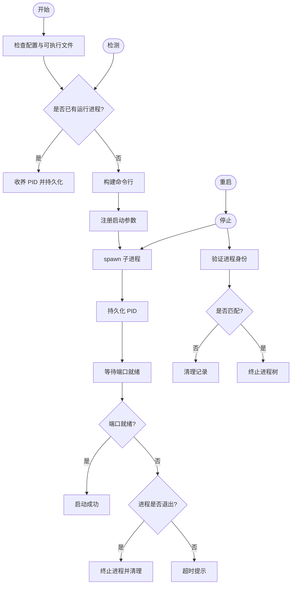

**图表来源**
- [server-lifecycle.ts:58-112](file://packages/service/src/scheduling/server-lifecycle.ts#L58-L112)
- [server-lifecycle.ts:114-212](file://packages/service/src/scheduling/server-lifecycle.ts#L114-L212)
- [server-lifecycle.ts:214-270](file://packages/service/src/scheduling/server-lifecycle.ts#L214-L270)

**章节来源**
- [server-lifecycle.ts:58-112](file://packages/service/src/scheduling/server-lifecycle.ts#L58-L112)
- [server-lifecycle.ts:114-212](file://packages/service/src/scheduling/server-lifecycle.ts#L114-L212)
- [server-lifecycle.ts:214-270](file://packages/service/src/scheduling/server-lifecycle.ts#L214-L270)

### 跨平台进程控制：Windows、Linux、macOS
- Windows：
  - 使用 `tasklist` 判断进程存活。
  - 使用 PowerShell 获取进程可执行路径与命令行。
  - 使用 `taskkill /T /F` 终止进程树。
  - 桌面端通过 PowerShell 查找监听端口进程。
- Linux/macOS：
  - 使用 `process.kill(pid, 0)` 探测进程存活。
  - 通过 `/proc/<pid>/exe` 与 `/proc/<pid>/cmdline` 读取进程信息。
  - 使用 `SIGTERM` 与 `SIGKILL` 进行优雅与强制终止。
  - 桌面端通过 `lsof` 查找监听端口进程。

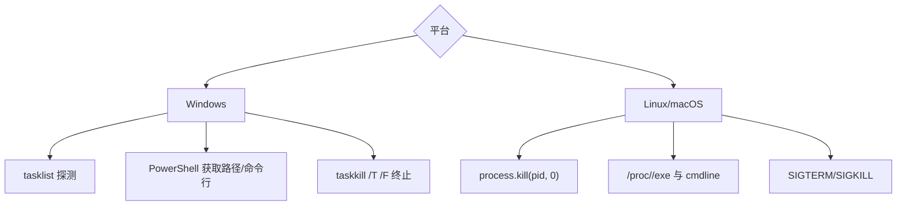

**图表来源**
- [identity.ts:14-32](file://packages/service/src/process/identity.ts#L14-L32)
- [identity.ts:34-85](file://packages/service/src/process/identity.ts#L34-L85)
- [identity.ts:214-229](file://packages/service/src/process/identity.ts#L214-L229)
- [index.ts（桌面主进程）:139-179](file://apps/desktop/src/main/index.ts#L139-L179)

**章节来源**
- [identity.ts:14-32](file://packages/service/src/process/identity.ts#L14-L32)
- [identity.ts:34-85](file://packages/service/src/process/identity.ts#L34-L85)
- [identity.ts:214-229](file://packages/service/src/process/identity.ts#L214-L229)
- [index.ts（桌面主进程）:139-179](file://apps/desktop/src/main/index.ts#L139-L179)

### 进程间通信机制：IPC、消息队列与事件总线
- 事件总线：
  - `ProcessManager` 继承 `EventEmitter`，发出 `exit`、`error`、`adopt` 等事件。
- IPC 通道：
  - 桌面端通过 Electron `ipcMain` 暴露服务状态、设置、重启等接口。
  - 游戏扩展通过 Windows `WM_COPYDATA` 向桌面端窗口发送监控数据。
- 消息队列：
  - 监控数据以字符串消息形式传递，后端按固定格式解析并入库。

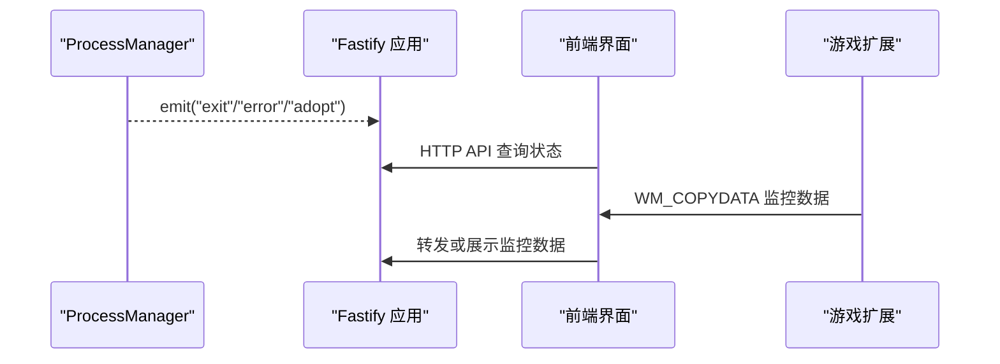

**图表来源**
- [manager.ts:32-34](file://packages/service/src/process/manager.ts#L32-L34)
- [manager.ts:95-105](file://packages/service/src/process/manager.ts#L95-L105)
- [index.ts（桌面主进程）:423-468](file://apps/desktop/src/main/index.ts#L423-L468)
- [ArmaMonitoringService.cs:102-143](file://DestinyServerMonitoring/DestinyServerMonitoring/ArmaMonitoringService.cs#L102-L143)

**章节来源**
- [manager.ts:32-34](file://packages/service/src/process/manager.ts#L32-L34)
- [manager.ts:95-105](file://packages/service/src/process/manager.ts#L95-L105)
- [index.ts（桌面主进程）:423-468](file://apps/desktop/src/main/index.ts#L423-L468)
- [ArmaMonitoringService.cs:102-143](file://DestinyServerMonitoring/DestinyServerMonitoring/ArmaMonitoringService.cs#L102-L143)

### 进程守护、资源监控与异常恢复
- 进程守护：
  - 桌面端启动后端服务，并在应用退出时终止服务。
  - 后端服务通过 `ProcessManager` 跟踪游戏进程，捕获 `exit` 与 `error` 事件。
- 资源监控：
  - 监控数据摄入解析玩家数与 FPS，并写入数据库。
  - 定时任务周期性采集在线人数与玩家列表。
- 异常恢复：
  - 启动后若进程立即退出，尝试终止并返回错误提示。
  - 端口就绪超时提示用户查看服务器窗口或开启显示窗口模式。

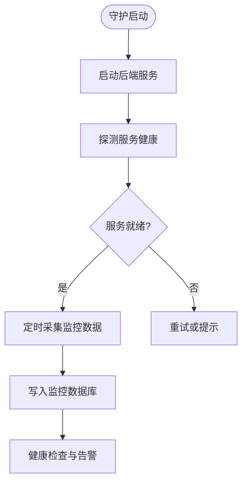

**图表来源**
- [index.ts（桌面主进程）:323-396](file://apps/desktop/src/main/index.ts#L323-L396)
- [index.ts（桌面主进程）:686-719](file://apps/desktop/src/main/index.ts#L686-L719)
- [ingest.ts:3-39](file://packages/service/src/monitoring/ingest.ts#L3-L39)
- [server-lifecycle.ts:188-212](file://packages/service/src/scheduling/server-lifecycle.ts#L188-L212)

**章节来源**
- [index.ts（桌面主进程）:323-396](file://apps/desktop/src/main/index.ts#L323-L396)
- [index.ts（桌面主进程）:686-719](file://apps/desktop/src/main/index.ts#L686-L719)
- [ingest.ts:3-39](file://packages/service/src/monitoring/ingest.ts#L3-L39)
- [server-lifecycle.ts:188-212](file://packages/service/src/scheduling/server-lifecycle.ts#L188-L212)

### 进程隔离策略、安全沙箱与资源限制
- 进程隔离：
  - 每个服务器实例通过 UUID 标识，进程状态与配置分离。
  - 启动前校验可执行文件与配置文件，防止非法路径。
- 安全沙箱：
  - 桌面端启用 `contextIsolation`，禁用 `nodeIntegration`，降低渲染进程风险。
  - 后端服务通过 Bearer 鉴权保护 HTTP API。
- 资源限制：
  - 当前代码未显式设置 CPU/内存限制；可通过操作系统级 cgroup（Linux）、Job Object（Windows）或 ulimit 进行限制。
  - 建议在生产环境结合容器化或系统资源控制器实施限制。

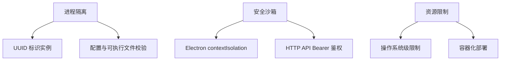

**图表来源**
- [index.ts（桌面主进程）:474-489](file://apps/desktop/src/main/index.ts#L474-L489)
- [README.md:37-47](file://README.md#L37-L47)

**章节来源**
- [index.ts（桌面主进程）:474-489](file://apps/desktop/src/main/index.ts#L474-L489)
- [README.md:37-47](file://README.md#L37-L47)

### 进程崩溃检测、自动重启与健康检查
- 崩溃检测：
  - `ProcessManager` 监听子进程 `exit` 与 `error` 事件。
  - 桌面端监听后端服务 `exit` 与 `error` 事件。
- 自动重启：
  - 定时任务支持 restart/start/stop/detect 动作。
  - 桌面端在应用启动时探测服务，若未就绪则启动并轮询就绪。
- 健康检查：
  - 后端提供 `/api/v1/health` 健康端点。
  - 桌面端通过 HTTP 请求探测服务状态。

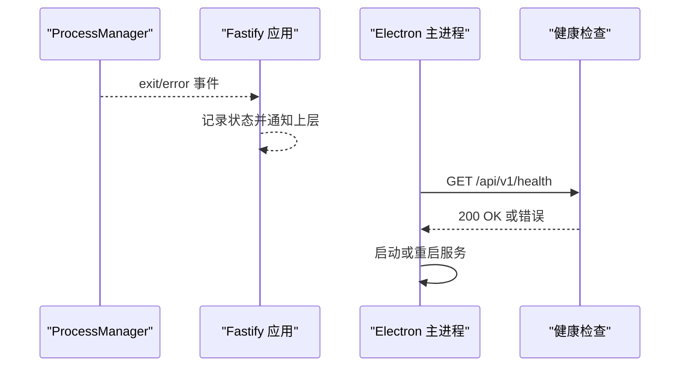

**图表来源**
- [manager.ts:95-105](file://packages/service/src/process/manager.ts#L95-L105)
- [index.ts（桌面主进程）:95-137](file://apps/desktop/src/main/index.ts#L95-L137)
- [server-lifecycle.ts:239-270](file://packages/service/src/scheduling/server-lifecycle.ts#L239-L270)

**章节来源**
- [manager.ts:95-105](file://packages/service/src/process/manager.ts#L95-L105)
- [index.ts（桌面主进程）:95-137](file://apps/desktop/src/main/index.ts#L95-L137)
- [server-lifecycle.ts:239-270](file://packages/service/src/scheduling/server-lifecycle.ts#L239-L270)

## 依赖关系分析
进程管理相关模块之间的依赖如下：
- `server-lifecycle.ts` 依赖 `config/game-config-writer.ts`、`mods/mod-config-sync.js`、`process/identity.ts`、`process/port-check.js`。
- `manager.ts` 依赖 `platform/index.js`、`process/identity.js`、`config/game-config-writer.js`。
- `identity.ts` 依赖 Node.js 原生模块与系统命令。
- 桌面端 `index.ts` 依赖 Electron API 与 Node.js 子进程。

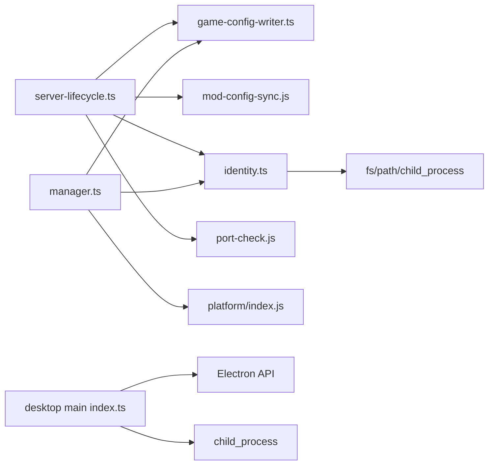

**图表来源**
- [server-lifecycle.ts:1-17](file://packages/service/src/scheduling/server-lifecycle.ts#L1-L17)
- [manager.ts:1-10](file://packages/service/src/process/manager.ts#L1-L10)
- [identity.ts:1-4](file://packages/service/src/process/identity.ts#L1-L4)
- [index.ts（桌面主进程）:1-6](file://apps/desktop/src/main/index.ts#L1-L6)

**章节来源**
- [server-lifecycle.ts:1-17](file://packages/service/src/scheduling/server-lifecycle.ts#L1-L17)
- [manager.ts:1-10](file://packages/service/src/process/manager.ts#L1-L10)
- [identity.ts:1-4](file://packages/service/src/process/identity.ts#L1-L4)
- [index.ts（桌面主进程）:1-6](file://apps/desktop/src/main/index.ts#L1-L6)

## 性能与可靠性考虑
- 启动性能：
  - Windows 上忽略 stdout/stderr 以避免专用服务器不再写入 logFile。
  - 非 Windows 平台捕获 stdout/stderr 并写入日志文件。
- 可靠性：
  - 启动后等待端口就绪，超时或退出时给出明确提示。
  - 停止前验证进程身份，防止误杀其他进程。
  - 桌面端与服务端均具备健康检查与日志输出。
- 可扩展性：
  - 定时任务支持自定义 cron 表达式，便于扩展监控与自动化。
  - 监控数据摄入支持扩展更多消息类型。

[本节为通用指导，不直接分析具体文件]

## 故障排查指南
常见问题与定位方式：
- 服务未就绪：
  - 检查后端服务是否启动，查看 `service.log`。
  - 确认端口未被占用，必要时释放端口。
- 服务器启动失败：
  - 检查配置文件与可执行文件是否存在。
  - 查看 RPT 日志与服务器窗口是否有报错弹窗。
- 进程身份不匹配：
  - 确认 PID 是否被其他程序复用。
  - 检查命令行是否包含正确的 `-name` 与 `-port` 标记。
- 监控数据未入库：
  - 检查游戏扩展是否正确加载。
  - 确认监控消息格式是否符合预期。

**章节来源**
- [index.ts（桌面主进程）:323-396](file://apps/desktop/src/main/index.ts#L323-L396)
- [server-lifecycle.ts:114-212](file://packages/service/src/scheduling/server-lifecycle.ts#L114-L212)
- [identity.ts:149-212](file://packages/service/src/process/identity.ts#L149-L212)
- [ingest.ts:3-39](file://packages/service/src/monitoring/ingest.ts#L3-L39)

## 结论
该项目的进程管理基础设施以 `ProcessManager` 为核心，结合 `identity.ts` 的跨平台进程控制、`server-lifecycle.ts` 的生命周期编排、`ingest.ts` 的监控数据摄入，以及桌面端 Electron 主进程的服务托管，形成了完整的进程守护、启停、监控与异常恢复体系。通过严格的进程身份验证与端口就绪检查，系统在多平台上实现了安全的进程控制与可靠的运维体验。未来可在资源限制、容器化部署与更丰富的监控指标方面进一步扩展。

[本节为总结性内容，不直接分析具体文件]