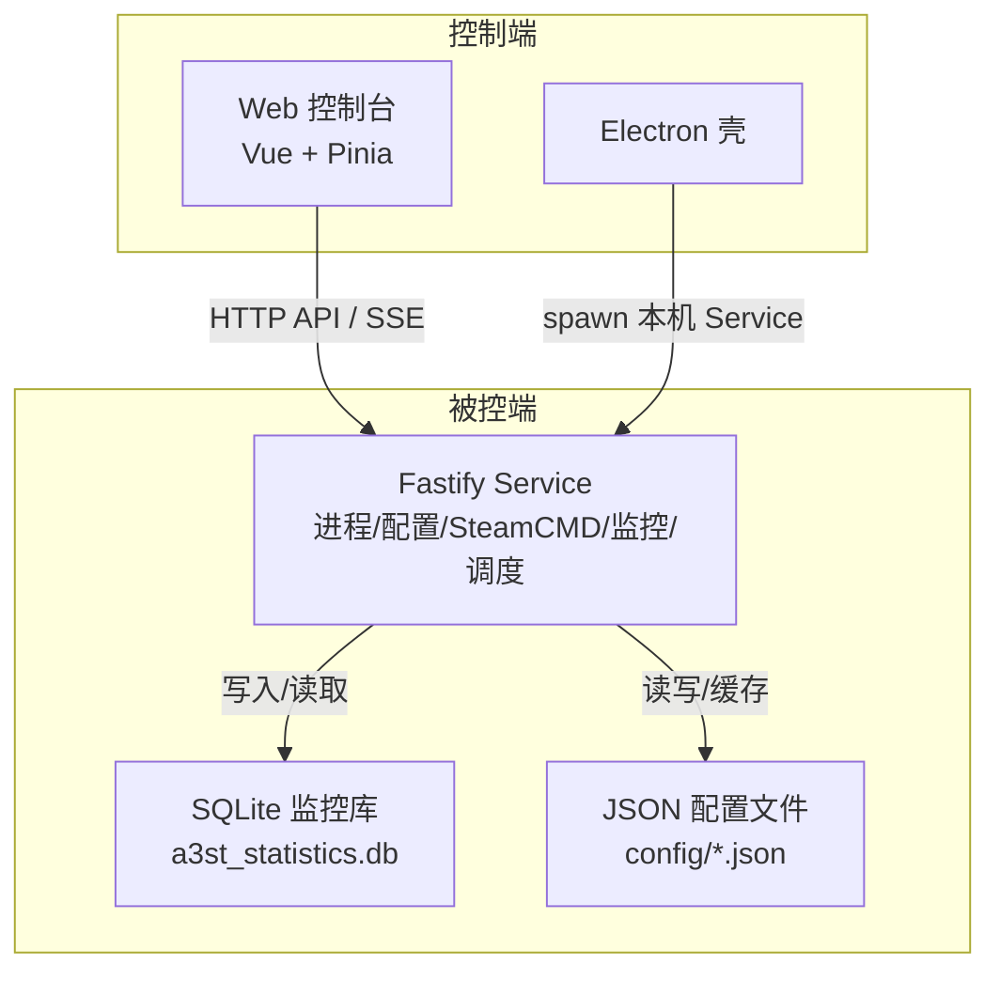
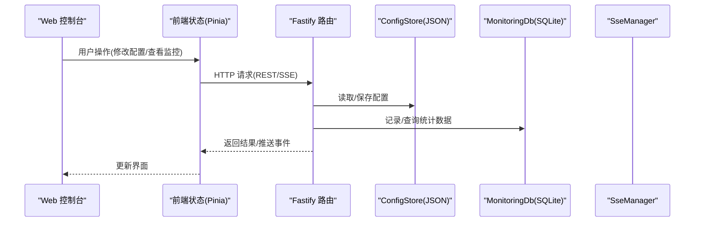
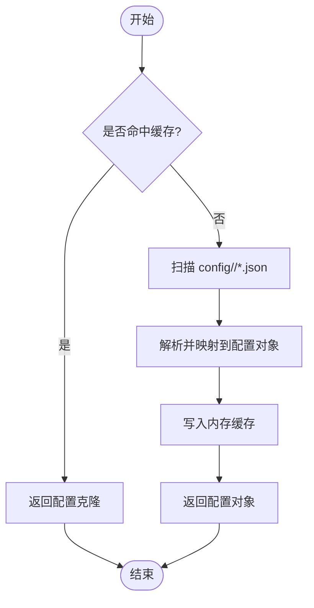
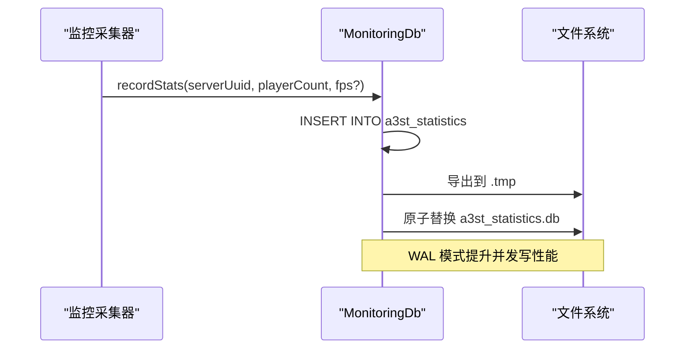
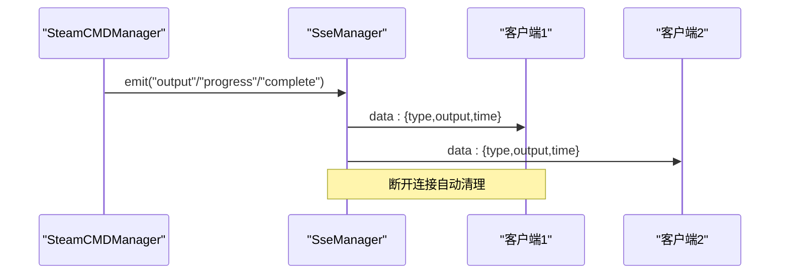
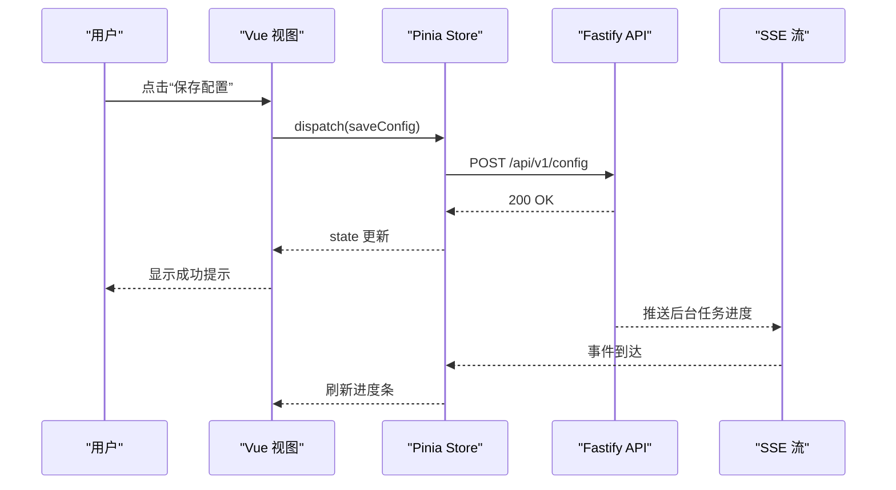
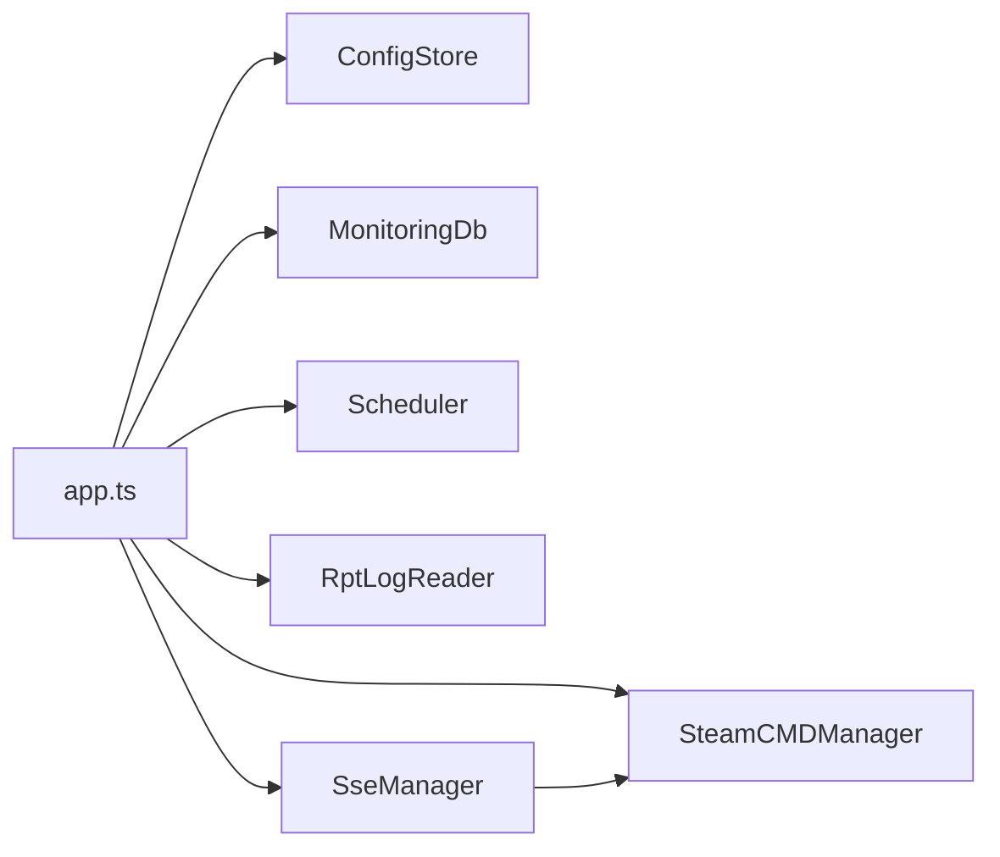

# 数据流设计

<cite>
**本文引用的文件**   
- [README.md](file://README.md)
- [architecture-v2.md](file://docs/architecture-v2.md)
- [app.ts](file://packages/service/src/app.ts)
- [store.ts](file://packages/service/src/config/store.ts)
- [db.ts](file://packages/service/src/monitoring/db.ts)
- [index.ts](file://packages/service/src/monitoring/index.ts)
- [sse.ts](file://packages/service/src/api/sse.ts)
- [main.ts](file://packages/web/src/main.ts)
</cite>

## 目录
1. [引言](#引言)
2. [项目结构](#项目结构)
3. [核心组件](#核心组件)
4. [架构总览](#架构总览)
5. [详细组件分析](#详细组件分析)
6. [依赖关系分析](#依赖关系分析)
7. [性能与一致性](#性能与一致性)
8. [故障排查指南](#故障排查指南)
9. [结论](#结论)

## 引言
本数据流设计文档面向 Arma 3 服务器管理工具 v2，聚焦三类关键数据流：
- 用户操作到界面更新的完整数据流
- 服务器状态到实时监控的数据采集流
- 配置文件到运行时状态的配置加载流

同时说明数据存储策略（SQLite 监控数据库、JSON 配置文件、内存缓存）、数据同步机制（前端状态与后端服务、多客户端一致性、离线处理）、数据验证规则、转换逻辑与错误恢复机制，并给出数据流图与状态同步时序图。

## 项目结构
v2 采用“控制端 UI + 被控端 Service”的分层模型：
- `@a3st/web`：Vue 控制台 UI，运行在浏览器或 Electron 窗口
- `@a3st/service`：Node.js Fastify 后端，负责进程、配置、SteamCMD、日志、调度、监控等
- `@a3st/api-client`：共享 HTTP 契约与类型，供 web 与脚本使用
- `apps/desktop`：Electron 壳，启动本机 service 并托管 web 静态资源

图示来源
- [README.md:50-66](file://README.md#L50-L66)
- [architecture-v2.md:5-21](file://docs/architecture-v2.md#L5-L21)

章节来源
- [README.md:1-108](file://README.md#L1-L108)
- [architecture-v2.md:1-118](file://docs/architecture-v2.md#L1-L118)

## 核心组件
- 配置存储 ConfigStore：将每个实例的配置拆分为多个 JSON 文件，并在内存中维护 Map 缓存；提供 list/load/save/delete 能力。
- 监控数据库 MonitoringDb：基于 sql.js 的 SQLite 实现，持久化玩家与统计指标，支持 WAL 模式与原子替换保存。
- 事件流 SseManager：将 SteamCMD 输出、进度、完成事件广播给所有 SSE 客户端，保持多客户端一致视图。
- 服务装配 app.ts：创建并装饰各服务，注册路由、CORS、鉴权、SSE、静态页面与定时任务。
- Web 入口 main.ts：初始化主题、错误处理、Pinia 与路由，作为前端数据流的起点。

章节来源
- [store.ts:29-180](file://packages/service/src/config/store.ts#L29-L180)
- [db.ts:36-244](file://packages/service/src/monitoring/db.ts#L36-L244)
- [sse.ts:9-92](file://packages/service/src/api/sse.ts#L9-L92)
- [app.ts:57-171](file://packages/service/src/app.ts#L57-L171)
- [main.ts:13-44](file://packages/web/src/main.ts#L13-L44)

## 架构总览
系统以 HTTP API 为唯一业务边界，UI 不直接读写磁盘或 spawn 进程。Service 内部通过装饰器暴露各子系统，统一由 Fastify 路由调用。

图示来源
- [app.ts:81-153](file://packages/service/src/app.ts#L81-L153)
- [store.ts:71-162](file://packages/service/src/config/store.ts#L71-L162)
- [db.ts:121-201](file://packages/service/src/monitoring/db.ts#L121-L201)
- [sse.ts:51-90](file://packages/service/src/api/sse.ts#L51-L90)

## 详细组件分析

### 配置加载与保存流（JSON 配置文件 + 内存缓存）
- 加载流程：按 UUID 扫描 config/<uuid>/*.json，映射到 ServerConfigPackage 字段，命中内存缓存则直接返回克隆副本；否则从磁盘解析并回填缓存。
- 保存流程：组装 manifest 与各 section 文件，落盘后更新内存缓存。
- 失效策略：显式 invalidateCache 可清空单个或全部缓存。

图示来源
- [store.ts:71-103](file://packages/service/src/config/store.ts#L71-L103)
- [store.ts:122-162](file://packages/service/src/config/store.ts#L122-L162)

章节来源
- [store.ts:1-180](file://packages/service/src/config/store.ts#L1-L180)

### 监控数据采集与持久化流（SQLite 监控数据库）
- 采集入口：Service 启动时创建 MonitoringDb，监听/轮询服务器状态后调用 recordStats/recordPlayer/batchInsertPlayers。
- 持久化：每次写入后导出 SQLite 内存数据库到临时文件，再原子替换目标 a3st_statistics.db，避免损坏。
- 查询接口：getSummary/getStats/listPlayers 提供聚合、时间序列与最近玩家列表。

图示来源
- [db.ts:49-78](file://packages/service/src/monitoring/db.ts#L49-L78)
- [db.ts:106-115](file://packages/service/src/monitoring/db.ts#L106-L115)
- [db.ts:121-143](file://packages/service/src/monitoring/db.ts#L121-L143)

章节来源
- [db.ts:1-245](file://packages/service/src/monitoring/db.ts#L1-L245)
- [index.ts:1-2](file://packages/service/src/monitoring/index.ts#L1-L2)

### 实时事件流（SteamCMD 输出 → SSE → 多客户端）
- 事件源：SteamCMDManager 发出 output/progress/complete 事件。
- 转发：SseManager.wireSteamCmd 订阅事件并广播给所有已连接 SSE 客户端。
- 客户端：浏览器打开 /api/v1/steamcmd/stream，接收历史片段与实时增量，服务端周期性 keepalive。

图示来源
- [sse.ts:40-49](file://packages/service/src/api/sse.ts#L40-L49)
- [sse.ts:51-90](file://packages/service/src/api/sse.ts#L51-L90)

章节来源
- [sse.ts:1-94](file://packages/service/src/api/sse.ts#L1-L94)

### 前端状态与后端同步（用户操作 → 界面更新）
- 前端入口：main.ts 初始化主题、全局错误处理、Pinia 与路由。
- 交互路径：用户在 Web 控制台触发操作 → Pinia store 发起 API 调用 → Fastify 路由执行业务 → 返回数据或 SSE 事件 → Pinia 更新 → Vue 渲染。

图示来源
- [main.ts:13-44](file://packages/web/src/main.ts#L13-L44)
- [app.ts:96-153](file://packages/service/src/app.ts#L96-L153)
- [sse.ts:51-90](file://packages/service/src/api/sse.ts#L51-L90)

章节来源
- [main.ts:1-45](file://packages/web/src/main.ts#L1-L45)
- [app.ts:57-171](file://packages/service/src/app.ts#L57-L171)

## 依赖关系分析
- Service 装配：app.ts 集中创建 ConfigStore、MonitoringDb、SteamCMD、Scheduler、RptLogReader、UI Settings 等，并通过 app.decorate 注入路由。
- 模块耦合：
  - api/routes 依赖 processManager、configStore、monitorDb、scheduler 等
  - sse.ts 依赖 steamcmd manager 的事件
  - monitoring/db.ts 依赖 sql.js 与文件系统
  - config/store.ts 依赖文件系统与内存 Map 缓存

图示来源
- [app.ts:57-94](file://packages/service/src/app.ts#L57-L94)
- [sse.ts:40-49](file://packages/service/src/api/sse.ts#L40-L49)

章节来源
- [app.ts:1-178](file://packages/service/src/app.ts#L1-L178)

## 性能与一致性
- 配置缓存：ConfigStore 使用内存 Map 缓存配置包，减少频繁磁盘 I/O；save 后更新缓存，invalidateCache 支持细粒度失效。
- 监控写入：MonitoringDb 使用 SQL.js 内存数据库 + WAL 模式，批量插入玩家并使用 prepare 语句，降低重复解析开销；每次写入后原子替换 db 文件，保证一致性。
- 实时性：SSE 长连接 + keepalive，确保多客户端对 SteamCMD 输出的一致性视图；断连自动清理。
- 多客户端一致性：SSE 广播同一事件至所有客户端；若某客户端写入失败，仅移除该客户端，不影响其他客户端。

[本节为通用指导，不直接分析具体文件]

## 故障排查指南
- 数据库初始化失败：MonitoringDb.init 捕获异常并尝试回退方案；WAL PRAGMA 不可用时会跳过并继续。
- 文件替换冲突：replaceFile 对 EPERM/EEXIST/EBUSY 进行容错，必要时删除目标后再替换。
- SSE 写入异常：SseManager.broadcastSteamCmdOutput 捕获 write 异常并移除对应客户端，防止影响整体广播。
- 前端全局错误：main.ts 设置 Vue errorHandler，出现未捕获错误时在界面顶部展示错误横幅并提供返回连接页链接。

章节来源
- [db.ts:49-78](file://packages/service/src/monitoring/db.ts#L49-L78)
- [db.ts:5-20](file://packages/service/src/monitoring/db.ts#L5-L20)
- [sse.ts:24-38](file://packages/service/src/api/sse.ts#L24-L38)
- [main.ts:23-40](file://packages/web/src/main.ts#L23-L40)

## 结论
本设计以 HTTP API 为统一边界，将配置、监控、事件流解耦为独立组件：
- 配置流通过 JSON 文件与内存缓存平衡可读性与性能
- 监控流通过 SQLite 持久化趋势数据，WAL 与原子替换保障可靠性
- 实时流通过 SSE 向多客户端广播，维持一致的后台任务视图
- 前端通过 Pinia 与 API/SSE 协同，形成“操作→服务→状态→界面”的闭环

建议后续优化方向：
- 为监控数据增加分页与时间范围参数，避免大表全量查询
- 为配置变更引入版本号与乐观锁，增强多端编辑一致性
- 为 SSE 增加断线重连与去抖合并，提升弱网体验

[本节为总结性内容，不直接分析具体文件]