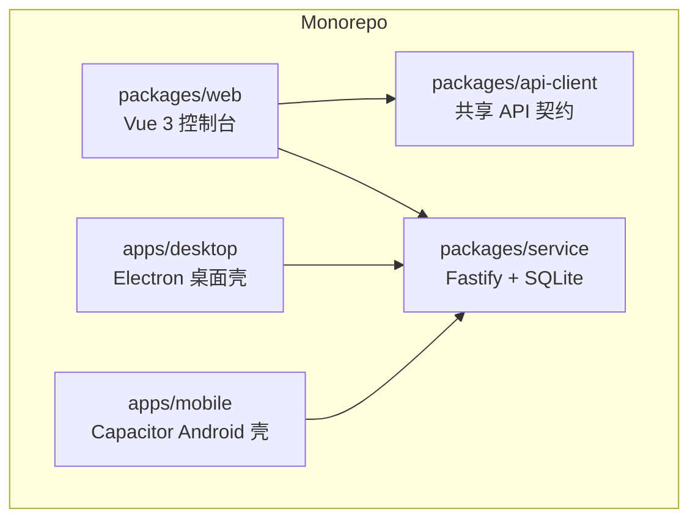
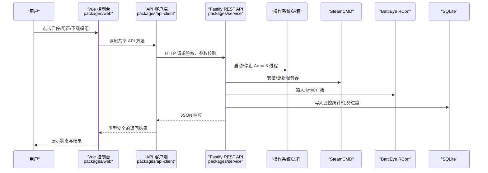
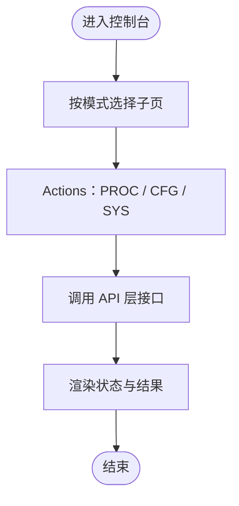
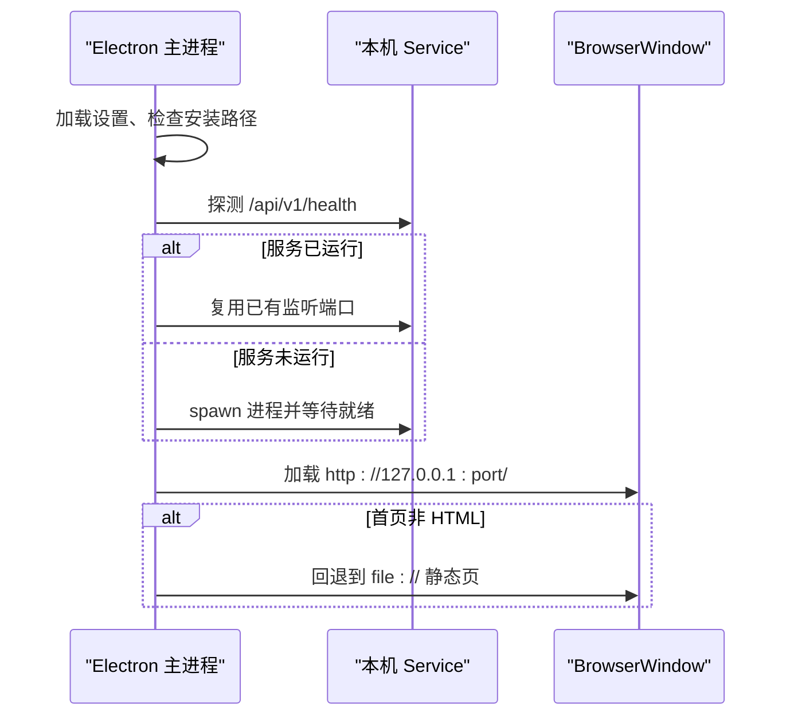
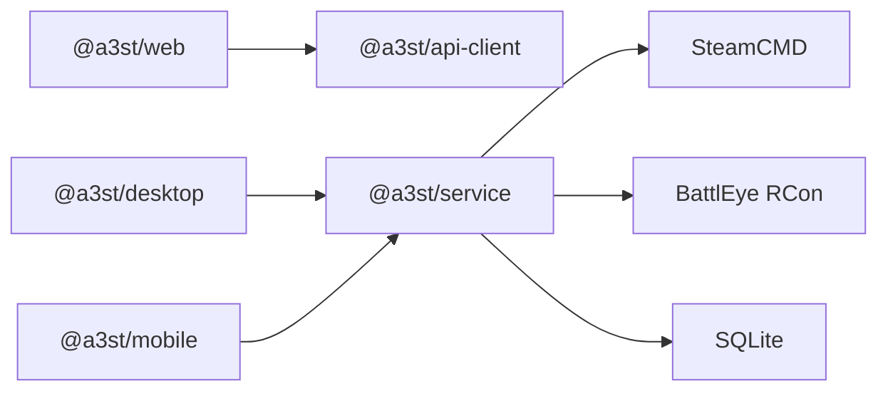

# 架构概览

<cite>
**本文引用的文件**   
- [README.md](file://README.md)
- [package.json](file://package.json)
- [docs/architecture-v2.md](file://docs/architecture-v2.md)
- [docs/v2-quickstart.md](file://docs/v2-quickstart.md)
- [apps/desktop/src/main/index.ts](file://apps/desktop/src/main/index.ts)
</cite>

## 目录
1. [引言](#引言)
2. [项目结构](#项目结构)
3. [核心组件](#核心组件)
4. [架构总览](#架构总览)
5. [详细组件分析](#详细组件分析)
6. [依赖关系分析](#依赖关系分析)
7. [性能与部署特性](#性能与部署特性)
8. [故障排查指南](#故障排查指南)
9. [结论](#结论)

## 引言
Arma3 Server Tools v2 是一个跨平台 Arma 3 专用服务器管理工具，采用“控制端 UI + 被控端 Service”的三层分离架构。UI 层由 Vue 3 控制台提供，API 层由 Fastify REST API 暴露，Service 层是运行在开服机上的 Node.js 被控端，负责进程、配置、SteamCMD、BattlEye RCon、日志、监控等能力。Electron 桌面应用和 Capacitor Android 移动应用共享同一后端服务，Web 控制台也可通过浏览器直接访问远程 Service。

该设计强调三个边界：
- 代码边界：UI 不直接读写磁盘或启动进程，所有操作走 HTTP API。
- 进程边界：开发时常见 Service 与 Web 两个独立进程；生产可合并部署。
- 部署边界：Linux 开服机通常只部署 Service，控制端使用任意系统浏览器。

## 项目结构
仓库为 npm workspaces monorepo，核心包位于 packages，应用壳层位于 apps：
- packages/web：Vue 3 控制台前端。
- packages/service：Fastify + SQLite 后端服务。
- packages/api-client：前后端共享的 TypeScript API 契约与类型。
- apps/desktop：Electron 桌面壳，spawn 本机 service 并加载 web 静态页。
- apps/mobile：Capacitor Android 壳，复用 web 构建产物。

图表来源
- [README.md:50-66](file://README.md#L50-L66)
- [package.json:1-35](file://package.json#L1-L35)

章节来源
- [README.md:50-66](file://README.md#L50-L66)
- [package.json:1-35](file://package.json#L1-L35)

## 核心组件
- 控制端 UI（@a3st/web）：基于 Vue 3 的控制台，提供实例概览、部署、工坊、日志、配置、系统等页面，并通过 api-client 调用后端 REST API。
- API 层（Fastify REST API）：统一业务边界，支持鉴权、任务调度、RCon、SteamCMD、日志、监控统计等能力。
- 被控端 Service（Node.js）：运行在 Windows/Linux 开服机上，负责 Arma 3 进程生命周期、配置文件写入、模组与地图管理、BattlEye RCon、定时任务与监控入库。
- 桌面壳（Electron）：不是第三套后端，而是 spawn 本机 service，并把 web 作为静态页加载；同时提供托盘、主题同步、本地文件对话框等原生能力。
- 移动壳（Capacitor Android）：复用 web 构建产物，作为移动端主控壳连接后端服务。

章节来源
- [docs/architecture-v2.md:5-13](file://docs/architecture-v2.md#L5-L13)
- [README.md:37-47](file://README.md#L37-L47)

## 架构总览
整体数据流遵循“控制端 UI → API 层 → Service 层 → 外部系统”的路径。用户在前端触发操作，前端通过 api-client 发起 HTTP 请求；Service 执行具体业务逻辑，必要时调用 SteamCMD、BattlEye RCon、文件系统或数据库。

图表来源
- [README.md:37-47](file://README.md#L37-L47)
- [docs/architecture-v2.md:15-21](file://docs/architecture-v2.md#L15-L21)

## 详细组件分析

### 控制端 UI（@a3st/web）
- 角色：渲染控制台界面，维护连接状态、实例选择、主题与导航。
- 职责：
  - 通过 api-client 调用后端 REST API。
  - 根据模式与主题显示不同子页（概览、部署、工坊、日志、配置、系统）。
  - 在 Electron 中隐藏全局顶栏，交由 ConsoleShell 接管。
- 关键实现点：
  - 路由与导航由 console-modes 配置驱动。
  - 视觉主题通过 document.documentElement.dataset.visual 切换 classic/ark。
  - 与后端交互完全通过 HTTP，避免直接访问文件系统。

章节来源
- [docs/architecture-v2.md:55-94](file://docs/architecture-v2.md#L55-L94)
- [docs/architecture-v2.md:98-108](file://docs/architecture-v2.md#L98-L108)

### API 层（Fastify REST API）
- 角色：唯一业务边界，对外暴露稳定 REST 面。
- 职责：
  - 处理鉴权、参数校验、错误码。
  - 编排进程、配置、SteamCMD、BattlEye RCon、日志、监控、任务调度。
  - 可选托管 web 静态资源，使 Linux 开服机仅暴露一个端口。
- 价值：
  - 远程 n100、OpenClaw、未来多机管理都依赖它。
  - 避免把 Node 逻辑塞进 web，保持测试与远程场景清晰。

章节来源
- [docs/architecture-v2.md:23-43](file://docs/architecture-v2.md#L23-L43)
- [README.md:37-47](file://README.md#L37-L47)

### 被控端 Service（Node.js）
- 角色：运行在开服机上的被控端，负责真实业务执行。
- 职责：
  - 启停 Arma 3 进程、生成 server.cfg 等配置。
  - 通过 SteamCMD 安装/更新服务器。
  - 通过 BattlEye RCon V2 远程控制。
  - 采集监控指标并写入 SQLite。
  - 执行定时任务与异步轮询任务进度。
- 部署：
  - 可在 Linux/Windows 独立运行。
  - 可与 web 静态资源合并部署，减少运维复杂度。

章节来源
- [docs/architecture-v2.md:15-21](file://docs/architecture-v2.md#L15-L21)
- [docs/architecture-v2.md:44-51](file://docs/architecture-v2.md#L44-L51)

### 桌面壳（Electron）
- 角色：桌面应用壳层，不是第三套后端。
- 行为：
  - spawn 本机 service，注入环境变量（端口、主机、数据目录、令牌）。
  - 探测 service 是否就绪，区分 down/ui/api-only 三种状态。
  - 优先从 http://127.0.0.1:port/ 加载 UI，失败时回退到 file:// 静态页。
  - 提供托盘、主题同步、本地文件对话框、单实例锁等原生能力。
- 关键流程：
  - 启动时检查安装路径、加载设置、探测服务、创建窗口与托盘。
  - 若服务未就绪，弹出提示并引导查看 service.log。

图表来源
- [apps/desktop/src/main/index.ts:95-137](file://apps/desktop/src/main/index.ts#L95-L137)
- [apps/desktop/src/main/index.ts:323-378](file://apps/desktop/src/main/index.ts#L323-L378)
- [apps/desktop/src/main/index.ts:567-616](file://apps/desktop/src/main/index.ts#L567-L616)

章节来源
- [apps/desktop/src/main/index.ts:1-731](file://apps/desktop/src/main/index.ts#L1-L731)

### 移动壳（Capacitor Android）
- 角色：复用 web 构建产物，作为移动端主控壳。
- 行为：
  - 通过 Capacitor 将 web 打包为 Android 应用。
  - 连接后端 Service，复用相同 API 契约。
- 价值：
  - 一套前端代码覆盖桌面、移动与 Web 控制台。

章节来源
- [README.md:5-10](file://README.md#L5-L10)
- [package.json:10-23](file://package.json#L10-L23)

## 依赖关系分析
- 代码依赖：web 依赖 api-client；service 暴露 REST API；desktop/mobile 依赖 service。
- 进程依赖：Electron 主进程 spawn service；web 通过 HTTP 与 service 通信。
- 外部依赖：SteamCMD 用于服务器安装/更新；BattlEye RCon 用于远程控制；SQLite 用于监控统计。

图表来源
- [README.md:50-66](file://README.md#L50-L66)
- [docs/architecture-v2.md:5-13](file://docs/architecture-v2.md#L5-L13)

章节来源
- [README.md:50-66](file://README.md#L50-L66)
- [docs/architecture-v2.md:5-13](file://docs/architecture-v2.md#L5-L13)

## 性能与部署特性
- 开发模式：推荐双进程（service :19580 + web :5173），调试清晰。
- 生产模式：
  - Linux 开服机仅部署 service，浏览器直接访问。
  - 可将 web/dist 交给 service 静态托管，用户只访问单一端口。
  - Electron 壳内嵌 web + 本机 service，对用户呈现为一个应用。
- 远程场景：控制端 web 指向局域网 IP 与端口，与是否 Electron 无关。

章节来源
- [docs/architecture-v2.md:44-51](file://docs/architecture-v2.md#L44-L51)
- [docs/v2-quickstart.md:13-50](file://docs/v2-quickstart.md#L13-L50)

## 故障排查指南
- 服务未就绪：
  - Electron 会探测 /api/v1/health，若 down 则尝试 spawn service 并等待就绪。
  - 若超时仍未就绪，弹出“服务未就绪”，并提示查看 service.log。
- 控制台页面未就绪：
  - 若服务响应但首页不是 HTML，Electron 判定为 api-only，弹出提示并改用本地界面。
- 界面加载失败：
  - 若 http 加载失败且存在本地 index.html，Electron 回退到 file:// 静态页。
  - 若仍失败，弹出“界面加载失败”，并给出 URL 与日志位置。
- 端口占用：
  - Electron 会尝试释放端口并重启服务；若仍失败，建议更换端口后重试。

章节来源
- [apps/desktop/src/main/index.ts:686-715](file://apps/desktop/src/main/index.ts#L686-L715)
- [apps/desktop/src/main/index.ts:498-526](file://apps/desktop/src/main/index.ts#L498-L526)
- [apps/desktop/src/main/index.ts:567-616](file://apps/desktop/src/main/index.ts#L567-L616)

## 结论
Arma3 Server Tools v2 通过“控制端 UI + 被控端 Service”的三层分离架构，实现了清晰的代码边界、进程边界与部署边界。Fastify REST API 作为唯一业务边界，支撑远程管理与自动化；Vue 3 控制台提供一致的用户体验；Electron 与 Capacitor 复用同一后端，降低多端维护成本。推荐保留逻辑分离，按需合并物理部署，以兼顾开发与运维效率。