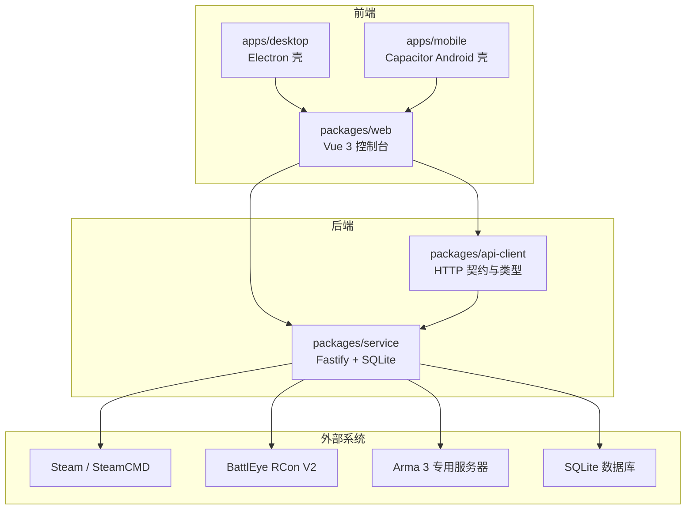
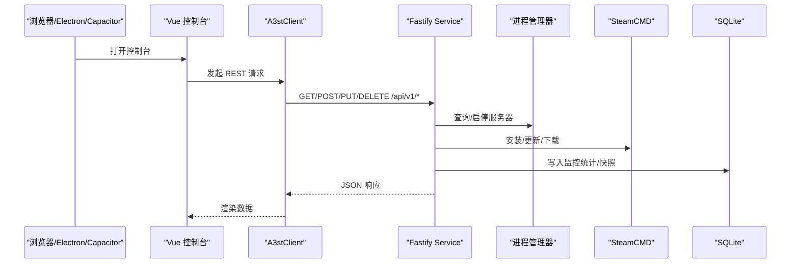
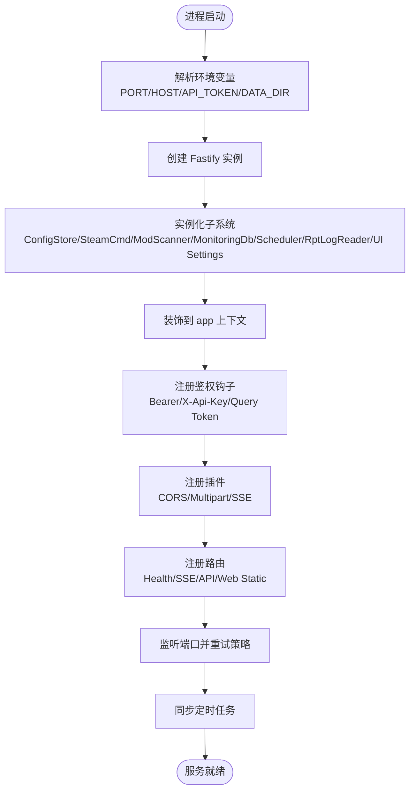
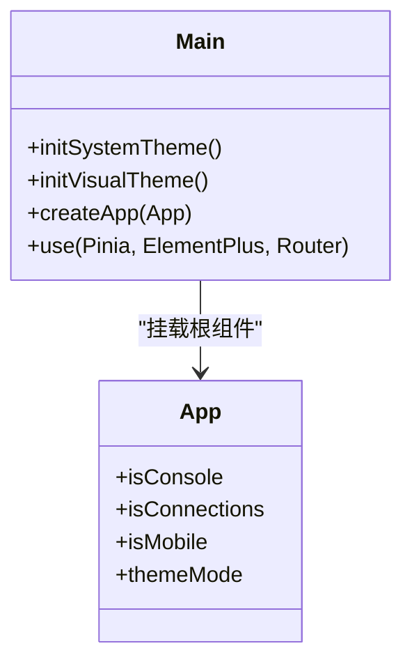
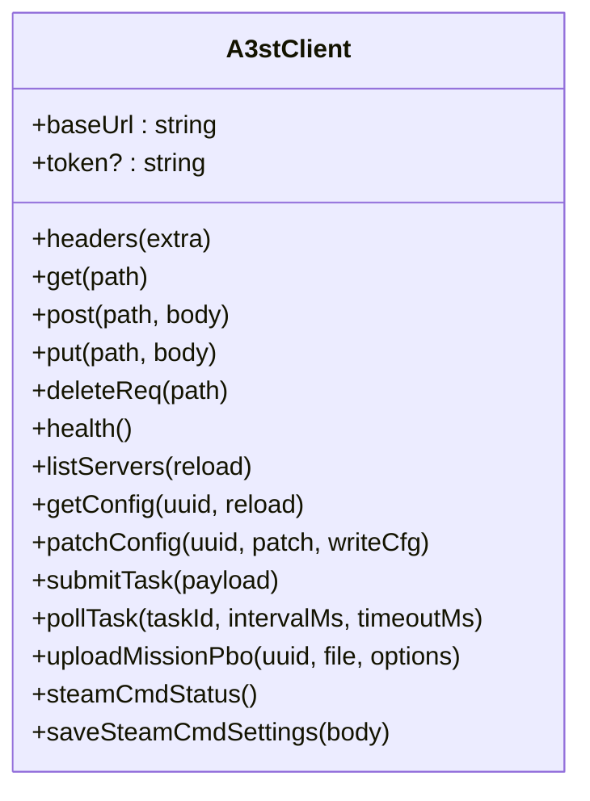
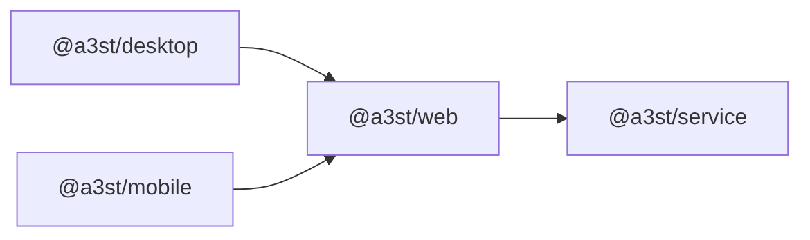
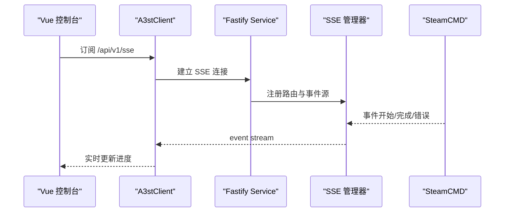
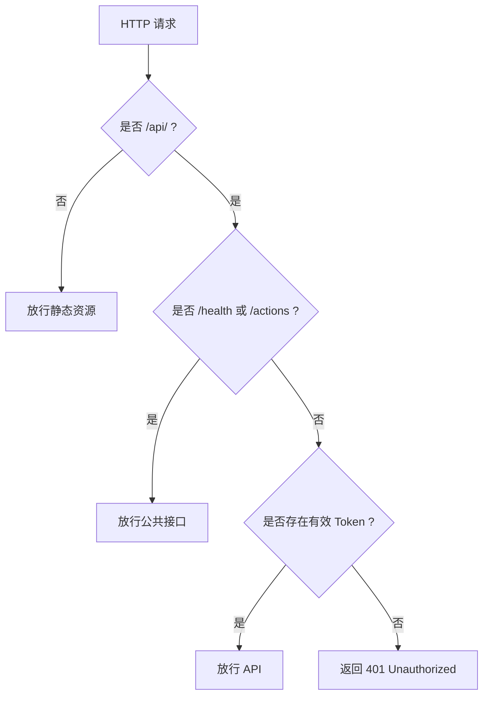
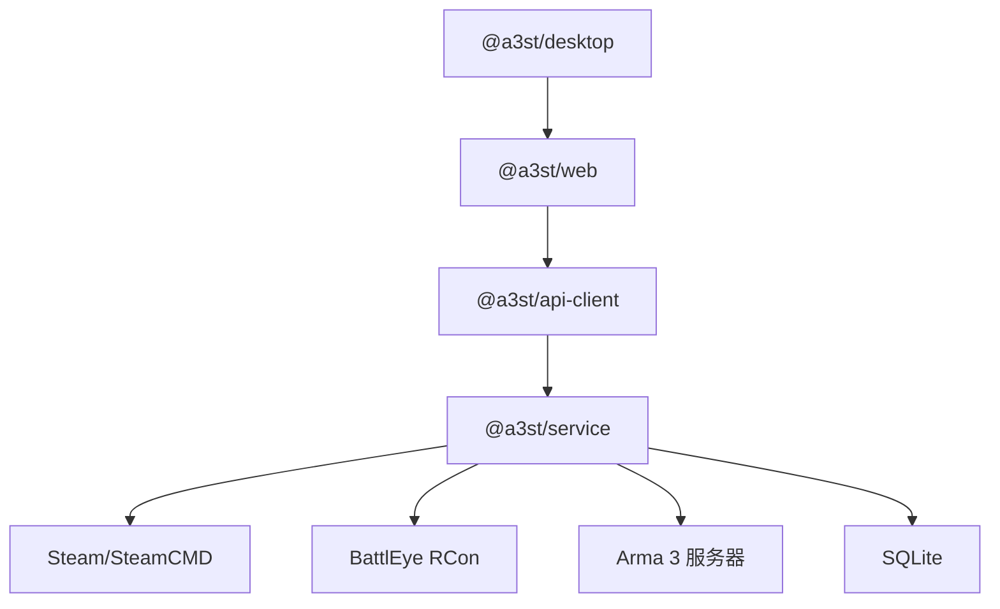

# 系统架构

<cite>
**本文引用的文件**   
- [README.md](file://README.md)
- [package.json](file://package.json)
- [apps/desktop/package.json](file://apps/desktop/package.json)
- [apps/mobile/package.json](file://apps/mobile/package.json)
- [docs/architecture-v2.md](file://docs/architecture-v2.md)
- [packages/service/src/index.ts](file://packages/service/src/index.ts)
- [packages/service/src/app.ts](file://packages/service/src/app.ts)
- [packages/web/src/main.ts](file://packages/web/src/main.ts)
- [packages/web/src/App.vue](file://packages/web/src/App.vue)
- [packages/api-client/src/client.ts](file://packages/api-client/src/client.ts)
</cite>

## 目录
1. [引言](#引言)
2. [项目结构](#项目结构)
3. [核心组件](#核心组件)
4. [架构总览](#架构总览)
5. [详细组件分析](#详细组件分析)
6. [依赖关系分析](#依赖关系分析)
7. [性能与可靠性考虑](#性能与可靠性考虑)
8. [故障排查指南](#故障排查指南)
9. [结论](#结论)
10. [附录：技术选型与权衡](#附录技术选型与权衡)

## 引言
Arma3 Server Tools v2 是一个跨平台 Arma 3 专用服务器管理工具，采用 TypeScript 全栈实现。系统由“控制端 UI + 被控端 Service”的分层模型构成：
- 控制端 UI：Vue 3 Web 控制台，可在浏览器、Electron 桌面壳或 Capacitor Android 壳中运行。
- 被控端 Service：Node.js + Fastify + SQLite，负责进程管理、SteamCMD、配置存储、监控入库、任务调度等。
- 共享契约：@a3st/api-client 提供统一的 REST API 客户端与类型定义，供 Web 控制台和脚本/Agent 复用。

本架构文档重点说明分层设计、前后端分离通信机制（RESTful API + SSE）、多应用架构（桌面、移动、Web 控制台共享同一后端），以及关键组件的职责、交互关系、系统边界与外部依赖集成。

**章节来源**
- [README.md:1-108](file://README.md#L1-L108)
- [docs/architecture-v2.md:1-118](file://docs/architecture-v2.md#L1-L118)

## 项目结构
仓库采用 npm workspaces monorepo，主要目录与职责如下：
- packages/service：后端服务（Fastify + SQLite + RCon + SteamCMD + 调度器 + 日志 + 监控）。
- packages/web：Vue 3 控制面板（ConsoleShell 布局、主题、路由模式）。
- packages/api-client：共享 HTTP 契约与类型，封装 A3stClient。
- apps/desktop：Electron 桌面壳，加载 web 静态资源并 spawn 本机 service。
- apps/mobile：Capacitor Android 壳，打包 web 构建产物为 APK。
- mod：Arma 3 监控模组资源（SQF 与配置）。
- DestinyServerMonitoring：RVExtension C++ 监控源码（与 Arma 服务端集成）。
- scripts：构建、打包、测试与部署脚本。
- docs：产品与架构文档。

**图表来源**
- [README.md:50-66](file://README.md#L50-L66)
- [docs/architecture-v2.md:5-13](file://docs/architecture-v2.md#L5-L13)
- [packages/service/src/app.ts:57-94](file://packages/service/src/app.ts#L57-L94)

**章节来源**
- [README.md:50-66](file://README.md#L50-L66)
- [package.json:1-36](file://package.json#L1-L36)

## 核心组件
- 进程管理器：负责 Arma 3 服务器的启停、重启、状态查询与优雅关闭。
- SteamCMD 客户端：下载/安装/更新 Arma 3 服务器与模组，支持中断与事件推送。
- 配置存储：读写 Arma 3 配置文件、快照与 UI 设置。
- 监控数据库：采集统计与玩家数据，持久化到 SQLite，并提供导出能力。
- 任务调度器：cron 定时任务（如重启、统计采集）与异步任务队列。
- 日志读取器：RPT/BattlEye/控制台日志的读取与分页。
- SSE 管理器：将 SteamCMD 事件与实时状态推送到前端。
- 鉴权中间件：Bearer Token、X-Api-Key、Query Token 三种方式；静态资源免鉴权。
- Web 控制台：ConsoleShell 布局、Rail 导航、Actions 操作条、主题切换。

**章节来源**
- [packages/service/src/app.ts:57-94](file://packages/service/src/app.ts#L57-L94)
- [packages/service/src/app.ts:96-145](file://packages/service/src/app.ts#L96-L145)
- [docs/architecture-v2.md:55-108](file://docs/architecture-v2.md#L55-L108)

## 架构总览
系统采用“控制端 UI + 被控端 Service”的分层模型，强调代码边界、进程边界与部署边界的分离：
- 代码边界：UI 不直接读写磁盘或 spawn 进程，所有业务通过 REST API 调用。
- 进程边界：开发时常见 service(:19580) + web(:5173) 双进程；生产可合并静态托管。
- 部署边界：Linux 开服机仅运行 service；控制端用任意 PC 浏览器连接。

**图表来源**
- [packages/api-client/src/client.ts:48-105](file://packages/api-client/src/client.ts#L48-L105)
- [packages/service/src/app.ts:147-169](file://packages/service/src/app.ts#L147-L169)

**章节来源**
- [docs/architecture-v2.md:15-51](file://docs/architecture-v2.md#L15-L51)

## 详细组件分析

### 后端服务启动与装配（Service）
Service 入口解析环境变量（端口、主机、API Token、数据目录），创建 Fastify 实例并装配各子系统：
- 配置存储、快照存储、SteamCMD 客户端、模组扫描器、监控数据库、调度器、日志读取器、UI 设置、模组扫描路径、SteamCMD 设置。
- 注册 CORS、Multipart、SSE、健康检查、API 路由、静态 Web 资源。
- 监听端口并同步 cron 任务。

**图表来源**
- [packages/service/src/index.ts:1-41](file://packages/service/src/index.ts#L1-L41)
- [packages/service/src/app.ts:57-171](file://packages/service/src/app.ts#L57-L171)

**章节来源**
- [packages/service/src/index.ts:1-41](file://packages/service/src/index.ts#L1-L41)
- [packages/service/src/app.ts:57-171](file://packages/service/src/app.ts#L57-L171)

### 前端应用壳（Web Console）
Vue 控制台通过 main.ts 初始化 Pinia、ElementPlus、路由与主题；App.vue 根据路由决定显示全局顶栏或进入 ConsoleShell 控制台模式。移动端通过 VITE_APP_MODE=mobile 标记，调整 UI 行为。

**图表来源**
- [packages/web/src/main.ts:1-45](file://packages/web/src/main.ts#L1-L45)
- [packages/web/src/App.vue:1-108](file://packages/web/src/App.vue#L1-L108)

**章节来源**
- [packages/web/src/main.ts:1-45](file://packages/web/src/main.ts#L1-L45)
- [packages/web/src/App.vue:1-108](file://packages/web/src/App.vue#L1-L108)

### 共享 API 客户端（A3stClient）
A3stClient 封装统一 HTTP 接口，提供健康检查、服务器管理、配置、模组、日志、监控、任务、文件上传、SteamCMD 设置等能力。默认使用 Bearer Token 鉴权，支持自定义 fetch 实现。

**图表来源**
- [packages/api-client/src/client.ts:48-408](file://packages/api-client/src/client.ts#L48-L408)

**章节来源**
- [packages/api-client/src/client.ts:48-408](file://packages/api-client/src/client.ts#L48-L408)

### 多应用架构（桌面、移动、Web）
- Electron 桌面壳：依赖 @a3st/web，构建后加载 web 静态资源，spawn 本机 service，对用户呈现单一应用体验。
- Capacitor Android 壳：构建 web 产物并通过 Cap sync 打包为 APK，作为移动端主控壳。
- Web 控制台：在浏览器中直接访问 service 提供的静态资源与 API。

**图表来源**
- [apps/desktop/package.json:1-31](file://apps/desktop/package.json#L1-L31)
- [apps/mobile/package.json:1-23](file://apps/mobile/package.json#L1-L23)
- [package.json:10-23](file://package.json#L10-L23)

**章节来源**
- [apps/desktop/package.json:1-31](file://apps/desktop/package.json#L1-L31)
- [apps/mobile/package.json:1-23](file://apps/mobile/package.json#L1-L23)
- [package.json:10-23](file://package.json#L10-L23)

### 实时通信（SSE）
Service 将 SteamCMD 事件通过 SSE 通道推送给前端，用于展示下载/安装进度与状态变化。SSE 管理器在启动时绑定 steamCmd 事件源，并注册 /api/v1/sse 相关路由。

**图表来源**
- [packages/service/src/app.ts:147-153](file://packages/service/src/app.ts#L147-L153)

**章节来源**
- [packages/service/src/app.ts:147-153](file://packages/service/src/app.ts#L147-L153)

### 鉴权与安全
- 静态资源（/, /assets/*）无需鉴权，便于浏览器直接访问。
- API 鉴权支持 Bearer Token、X-Api-Key、Query Token 三种方式。
- CORS 允许 Capacitor WebView Origin 与 LAN 场景下的任意 Origin，避免跨域失败。

**图表来源**
- [packages/service/src/app.ts:96-145](file://packages/service/src/app.ts#L96-L145)

**章节来源**
- [packages/service/src/app.ts:96-145](file://packages/service/src/app.ts#L96-L145)

## 依赖关系分析
- 内部依赖：
  - @a3st/desktop 依赖 @a3st/web。
  - @a3st/web 通过 @a3st/api-client 调用后端。
  - @a3st/service 暴露 REST API，依赖文件系统、SQLite、SteamCMD、BattlEye。
- 外部依赖：
  - Steam/SteamCMD：服务器与模组安装。
  - BattlEye RCon V2：远程踢人、封禁、广播。
  - Arma 3 专用服务器：被管目标。
  - SQLite：监控统计与配置快照。

**图表来源**
- [package.json:1-36](file://package.json#L1-L36)
- [apps/desktop/package.json:19-21](file://apps/desktop/package.json#L19-L21)
- [packages/api-client/src/client.ts:48-408](file://packages/api-client/src/client.ts#L48-L408)
- [packages/service/src/app.ts:57-94](file://packages/service/src/app.ts#L57-L94)

**章节来源**
- [package.json:1-36](file://package.json#L1-L36)
- [apps/desktop/package.json:19-21](file://apps/desktop/package.json#L19-L21)
- [packages/api-client/src/client.ts:48-408](file://packages/api-client/src/client.ts#L48-L408)
- [packages/service/src/app.ts:57-94](file://packages/service/src/app.ts#L57-L94)

## 性能与可靠性考虑
- 端口监听重试：对 EADDRINUSE/EACCES/EADDRNOTAVAIL 进行指数退避式重试，提升服务可用性。
- 大文件上传：启用 multipart 插件并限制文件大小（100MB），满足模组与地图上传需求。
- 任务轮询：A3stClient.pollTask 支持间隔与超时控制，避免长时间阻塞。
- 优雅关闭：SIGINT/SIGTERM 触发停止 SteamCMD、终止所有进程并关闭服务。
- 静态资源托管：可选将 web/dist 交给 service 静态托管，减少部署复杂度。

**章节来源**
- [packages/service/src/app.ts:26-55](file://packages/service/src/app.ts#L26-L55)
- [packages/service/src/app.ts:145-169](file://packages/service/src/app.ts#L145-L169)
- [packages/api-client/src/client.ts:304-321](file://packages/api-client/src/client.ts#L304-L321)
- [packages/service/src/index.ts:25-40](file://packages/service/src/index.ts#L25-L40)

## 故障排查指南
- 无法连接后端：
  - 确认 service 已启动且端口可达（默认 19580）。
  - 检查 CORS 配置与 Origin 匹配（Capacitor WebView 多为 http://localhost）。
- 鉴权失败：
  - 确认传递 Authorization: Bearer <token> 或 X-Api-Key 或 query token。
  - 静态资源不受鉴权限制，确保非 /api/ 路径未被拦截。
- 任务超时：
  - 调整 pollTask 的 intervalMs 与 timeoutMs。
- 端口占用：
  - 观察 listenWithRetry 的重试日志，必要时释放端口或更换端口。
- 静态资源缺失：
  - 若未提供 WEB_ROOT 或未构建 web/dist，GET / 将返回 404。

**章节来源**
- [packages/service/src/app.ts:96-145](file://packages/service/src/app.ts#L96-L145)
- [packages/service/src/app.ts:155-169](file://packages/service/src/app.ts#L155-L169)
- [packages/api-client/src/client.ts:304-321](file://packages/api-client/src/client.ts#L304-L321)

## 结论
Arma3 Server Tools v2 通过清晰的分层架构与前后端分离，实现了跨平台、可扩展的 Arma 3 服务器管理能力。Service 作为唯一业务边界，支撑 Web、Electron、Capacitor 多端一致体验；共享 api-client 保证类型安全与契约稳定。结合 SSE 实时通信、任务调度与监控入库，系统在功能完整性与工程可维护性之间取得良好平衡。

[本节不直接分析具体文件，故无“章节来源”]

## 附录：技术选型与权衡
- Node.js + Fastify：轻量高性能 HTTP 框架，适合 I/O 密集型管理与监控场景。
- Vue 3 + ElementPlus：现代前端生态，组件丰富，适配桌面与移动端。
- Electron + Capacitor：一套 Web 控制台覆盖桌面与移动，降低重复开发成本。
- SQLite：嵌入式数据库，简化部署与维护，适合单机/小规模监控数据。
- SteamCMD：官方工具链，确保服务器与模组版本一致性。
- BattlEye RCon V2：原生远程控制能力，满足在线管理需求。

权衡要点：
- 保留逻辑分离（API + 分包），物理部署可合并（service 托管 web 静态资源）。
- 不为了纯前后端分离而牺牲远程场景与测试边界。
- 不砍掉 api-client，以维持 OpenClaw 与 E2E 的稳定 REST 面。

**章节来源**
- [docs/architecture-v2.md:23-51](file://docs/architecture-v2.md#L23-L51)
- [README.md:37-47](file://README.md#L37-L47)