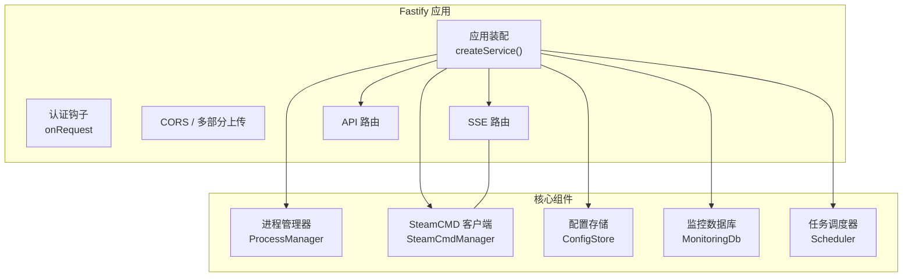
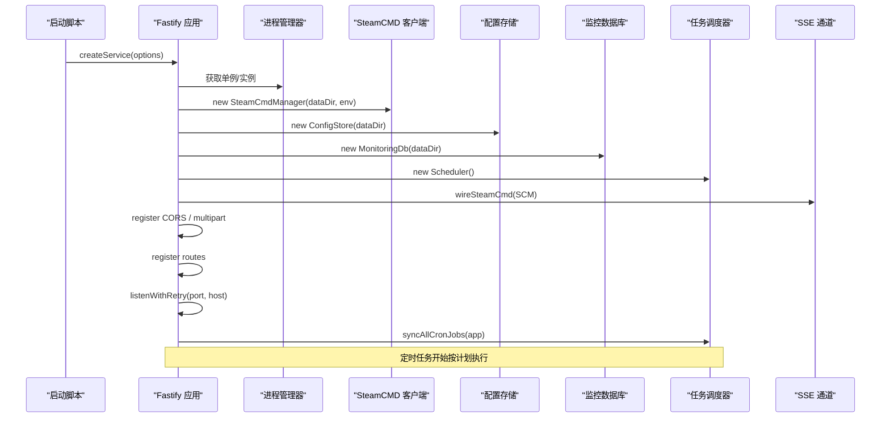
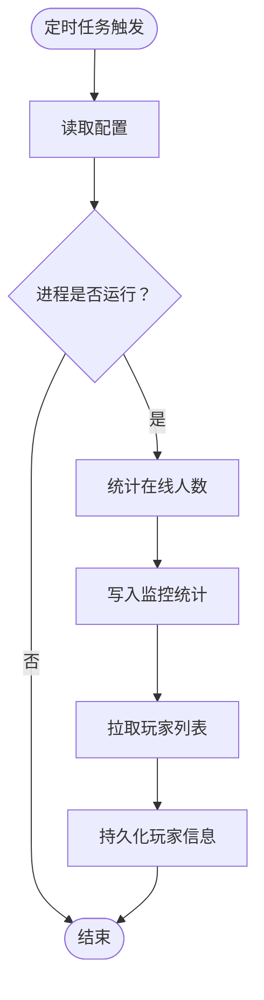
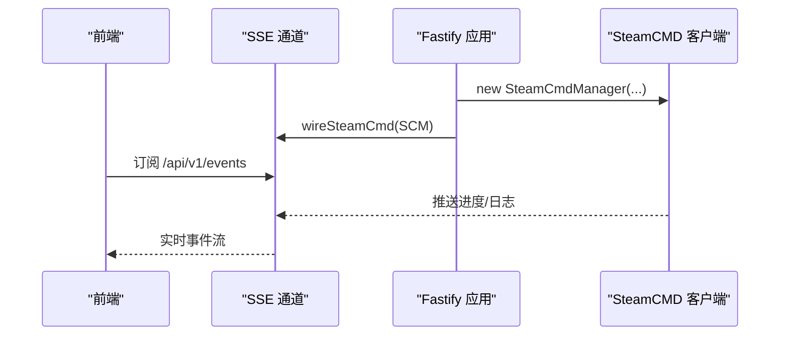
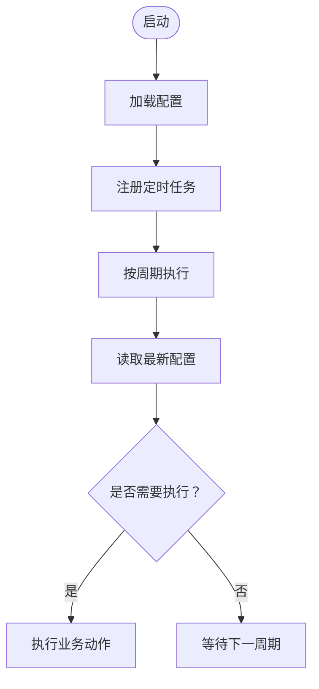
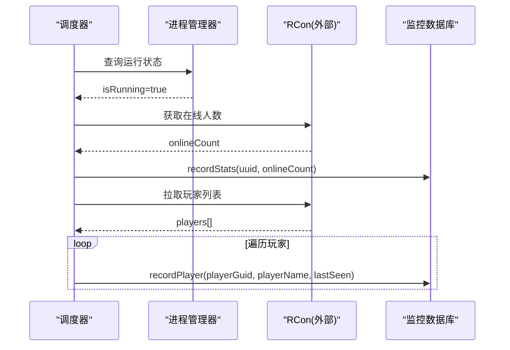
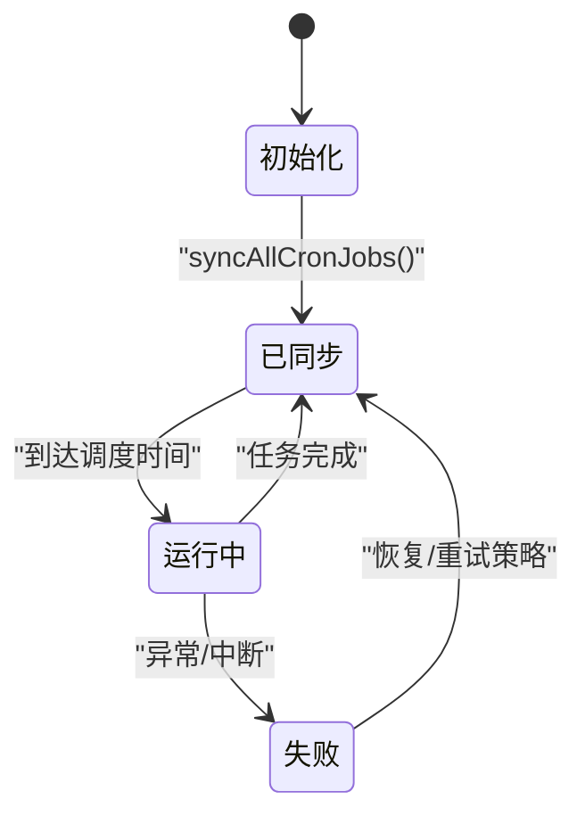
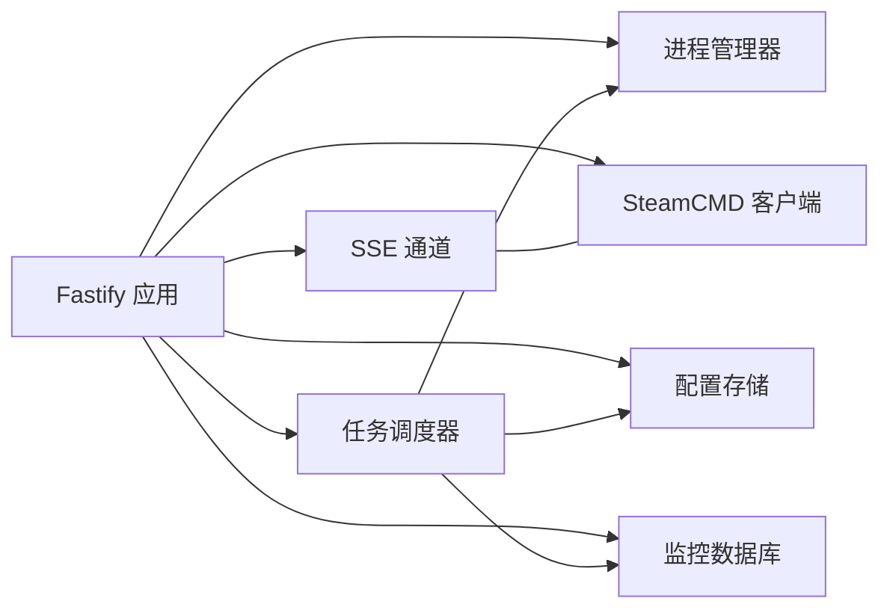

# 组件交互关系

<cite>
**本文引用的文件**   
- [packages/service/src/app.ts](file://packages/service/src/app.ts)
- [packages/service/src/api/types.d.ts](file://packages/service/src/api/types.d.ts)
- [packages/service/src/process/index.ts](file://packages/service/src/process/index.ts)
- [packages/service/src/steamcmd/index.ts](file://packages/service/src/steamcmd/index.ts)
- [packages/service/src/config/index.ts](file://packages/service/src/config/index.ts)
- [packages/service/src/monitoring/index.ts](file://packages/service/src/monitoring/index.ts)
- [packages/service/src/scheduling/index.ts](file://packages/service/src/scheduling/index.ts)
- [packages/service/src/scheduling/cron-sync.ts](file://packages/service/src/scheduling/cron-sync.ts)
- [packages/service/src/api/sse.ts](file://packages/service/src/api/sse.ts)
</cite>

## 目录
1. [引言](#引言)
2. [项目结构](#项目结构)
3. [核心组件](#核心组件)
4. [架构总览](#架构总览)
5. [详细组件分析](#详细组件分析)
6. [依赖关系分析](#依赖关系分析)
7. [性能考虑](#性能考虑)
8. [故障排查指南](#故障排查指南)
9. [结论](#结论)

## 引言
本文面向 Arma 3 服务器管理工具 v2 的后端服务，聚焦五个核心组件的职责与协作：进程管理器（ProcessManager）、SteamCMD 客户端（SteamCmdManager）、配置存储（ConfigStore）、监控数据库（MonitoringDB）和任务调度器（Scheduler）。文档从系统架构、组件职责、数据流、错误传播、生命周期与性能优化等维度展开，并给出关键业务流程的时序图与状态转换图，帮助读者快速理解事件驱动架构下的组件交互。

## 项目结构
后端服务基于 Fastify，采用“应用装配 + 装饰器”的方式将各子系统挂载到应用上下文，路由层通过装饰器访问这些能力。核心装配逻辑位于应用入口，负责实例化、装饰、注册中间件、启动监听、同步定时任务以及连接 SSE 通道。

图示来源
- [packages/service/src/app.ts:57-170](file://packages/service/src/app.ts#L57-L170)
- [packages/service/src/api/types.d.ts:15-30](file://packages/service/src/api/types.d.ts#L15-L30)

章节来源
- [packages/service/src/app.ts:57-170](file://packages/service/src/app.ts#L57-L170)
- [packages/service/src/api/types.d.ts:15-30](file://packages/service/src/api/types.d.ts#L15-L30)

## 核心组件
- 进程管理器（ProcessManager）
  - 职责：封装 Arma 3 服务器的进程生命周期（启动、停止、重启、状态查询），提供按服务器标识的状态视图。
  - 关键点：被调度器在监控采集时读取运行状态；对外暴露统一的状态接口。
- SteamCMD 客户端（SteamCmdManager）
  - 职责：封装 SteamCMD 下载、安装、更新、Workshop 模组拉取等操作；输出标准化日志并通过 SSE 推送。
  - 关键点：与服务启动时的设置应用流程集成；与 SSE 通道绑定以向前端推送进度。
- 配置存储（ConfigStore）
  - 职责：持久化与加载服务器配置；为调度器和业务逻辑提供最新配置快照。
  - 关键点：调度器在定时任务中读取配置以决定采集或执行动作。
- 监控数据库（MonitoringDb）
  - 职责：记录在线人数、玩家信息、趋势统计等监控指标。
  - 关键点：由调度器的监控任务写入；支持导出与部署相关扩展。
- 任务调度器（Scheduler）
  - 职责：基于 cron 表达式调度周期性任务，如监控采集、自定义重启等。
  - 关键点：启动时通过 cron-sync 同步所有已启用任务；内部持有对 ProcessManager、ConfigStore、MonitoringDb 的引用。

章节来源
- [packages/service/src/process/index.ts](file://packages/service/src/process/index.ts)
- [packages/service/src/steamcmd/index.ts](file://packages/service/src/steamcmd/index.ts)
- [packages/service/src/config/index.ts](file://packages/service/src/config/index.ts)
- [packages/service/src/monitoring/index.ts](file://packages/service/src/monitoring/index.ts)
- [packages/service/src/scheduling/index.ts](file://packages/service/src/scheduling/index.ts)

## 架构总览
应用装配阶段完成以下工作：
- 实例化各子系统（进程、SteamCMD、配置、监控、调度、日志、设置等）。
- 将子系统注入 Fastify 装饰器，供路由与中间件使用。
- 注册认证钩子、CORS、多部分上传、SSE 与 API 路由。
- 启动 HTTP 监听，并在成功后同步定时任务。

图示来源
- [packages/service/src/app.ts:57-170](file://packages/service/src/app.ts#L57-L170)
- [packages/service/src/api/sse.ts](file://packages/service/src/api/sse.ts)

## 详细组件分析

### 进程管理器（ProcessManager）
- 角色定位
  - 作为服务器进程的统一控制面，提供状态查询与生命周期操作。
- 与其他组件的关系
  - 被调度器用于判断是否采集监控数据。
  - 被 API 层调用以启停/重启服务器。
- 典型交互
  - 调度器定时任务：读取配置 → 查询进程状态 → 若运行则采集在线人数并落库。

图示来源
- [packages/service/src/scheduling/cron-sync.ts:41-85](file://packages/service/src/scheduling/cron-sync.ts#L41-L85)
- [packages/service/src/process/index.ts](file://packages/service/src/process/index.ts)

章节来源
- [packages/service/src/process/index.ts](file://packages/service/src/process/index.ts)
- [packages/service/src/scheduling/cron-sync.ts:41-85](file://packages/service/src/scheduling/cron-sync.ts#L41-L85)

### SteamCMD 客户端（SteamCMDManager）
- 角色定位
  - 封装 SteamCMD 命令行与网络交互，提供下载、安装、更新、Workshop 拉取等能力。
- 与其他组件的关系
  - 应用装配时创建实例并注入到 Fastify 装饰器。
  - SSE 通道与其绑定，实时推送命令输出与进度。
- 关键流程
  - 应用启动时根据设置应用 SteamCMD 参数。
  - 前端通过 SSE 订阅 SteamCMD 事件，获得下载/更新进度。

图示来源
- [packages/service/src/app.ts:63-79](file://packages/service/src/app.ts#L63-L79)
- [packages/service/src/app.ts:147-153](file://packages/service/src/app.ts#L147-L153)
- [packages/service/src/steamcmd/index.ts](file://packages/service/src/steamcmd/index.ts)

章节来源
- [packages/service/src/app.ts:63-79](file://packages/service/src/app.ts#L63-L79)
- [packages/service/src/app.ts:147-153](file://packages/service/src/app.ts#L147-L153)
- [packages/service/src/steamcmd/index.ts](file://packages/service/src/steamcmd/index.ts)

### 配置存储（ConfigStore）
- 角色定位
  - 提供配置的加载、保存与版本快照能力。
- 与其他组件的关系
  - 调度器在定时任务中读取最新配置以决定是否采集或执行动作。
  - 其他业务模块通过装饰器访问配置。
- 关键流程
  - 启动后，调度器根据配置中的 cron 表达式与开关状态注册任务。

图示来源
- [packages/service/src/config/index.ts](file://packages/service/src/config/index.ts)
- [packages/service/src/scheduling/cron-sync.ts:73-85](file://packages/service/src/scheduling/cron-sync.ts#L73-L85)

章节来源
- [packages/service/src/config/index.ts](file://packages/service/src/config/index.ts)
- [packages/service/src/scheduling/cron-sync.ts:73-85](file://packages/service/src/scheduling/cron-sync.ts#L73-L85)

### 监控数据库（MonitoringDb）
- 角色定位
  - 持久化服务器运行期间的在线人数、玩家信息等监控指标。
- 与其他组件的关系
  - 调度器在监控任务中写入统计数据与玩家信息。
- 关键流程
  - 定时任务检测到服务器运行 → 统计在线人数 → 写入统计 → 拉取玩家列表 → 逐条写入玩家记录。

图示来源
- [packages/service/src/scheduling/cron-sync.ts:41-68](file://packages/service/src/scheduling/cron-sync.ts#L41-L68)
- [packages/service/src/monitoring/index.ts](file://packages/service/src/monitoring/index.ts)

章节来源
- [packages/service/src/scheduling/cron-sync.ts:41-68](file://packages/service/src/scheduling/cron-sync.ts#L41-L68)
- [packages/service/src/monitoring/index.ts](file://packages/service/src/monitoring/index.ts)

### 任务调度器（Scheduler）
- 角色定位
  - 基于 cron 表达式调度周期性任务，包括监控采集与用户自定义任务。
- 与其他组件的关系
  - 依赖 ProcessManager 获取运行状态。
  - 依赖 ConfigStore 读取最新配置。
  - 依赖 MonitoringDb 写入监控数据。
- 关键流程
  - 启动时同步所有已启用任务；每个任务携带名称、调度表达式与处理器。

图示来源
- [packages/service/src/scheduling/index.ts](file://packages/service/src/scheduling/index.ts)
- [packages/service/src/scheduling/cron-sync.ts:41-85](file://packages/service/src/scheduling/cron-sync.ts#L41-L85)

章节来源
- [packages/service/src/scheduling/index.ts](file://packages/service/src/scheduling/index.ts)
- [packages/service/src/scheduling/cron-sync.ts:41-85](file://packages/service/src/scheduling/cron-sync.ts#L41-L85)

## 依赖关系分析
- 应用装配依赖
  - Fastify 应用装配器依赖各子系统构造器，并将实例装饰到 app 对象上。
- 装饰器契约
  - FastifyInstance 扩展了 configStore、processManager、steamCmd、modScanner、monitorDb、scheduler、rptLogReader、uiSettingsStore、modScanPathStore、steamCmdSettingsStore、asyncTaskManager、dataDir 等属性。
- 运行时耦合
  - 调度器强依赖进程管理器与监控数据库。
  - SSE 通道与 SteamCMD 客户端解耦，通过 wireSteamCmd 绑定事件。

图示来源
- [packages/service/src/app.ts:57-94](file://packages/service/src/app.ts#L57-L94)
- [packages/service/src/api/types.d.ts:15-30](file://packages/service/src/api/types.d.ts#L15-L30)
- [packages/service/src/scheduling/cron-sync.ts:41-85](file://packages/service/src/scheduling/cron-sync.ts#L41-L85)
- [packages/service/src/api/sse.ts](file://packages/service/src/api/sse.ts)

章节来源
- [packages/service/src/app.ts:57-94](file://packages/service/src/app.ts#L57-L94)
- [packages/service/src/api/types.d.ts:15-30](file://packages/service/src/api/types.d.ts#L15-L30)
- [packages/service/src/scheduling/cron-sync.ts:41-85](file://packages/service/src/scheduling/cron-sync.ts#L41-L85)

## 性能考虑
- 启动监听重试
  - 端口占用、权限不足或地址不可用等错误会进行有限次数重试，避免瞬时资源竞争导致服务无法启动。
- 异步与事件驱动
  - SteamCMD 输出通过 SSE 推送，避免阻塞主线程；调度器按 cron 周期执行，降低频繁轮询开销。
- I/O 分离
  - 监控数据写入数据库与玩家信息写入分离，减少单次事务压力。
- 可观测性
  - 启动过程与监听失败均记录日志，便于问题定位。

章节来源
- [packages/service/src/app.ts:28-55](file://packages/service/src/app.ts#L28-L55)
- [packages/service/src/app.ts:147-169](file://packages/service/src/app.ts#L147-L169)

## 故障排查指南
- 端口监听失败
  - 现象：服务启动时报端口占用或权限错误。
  - 处理：检查端口占用、权限与主机地址；观察重试日志；必要时调整端口或释放占用。
- 定时任务未执行
  - 现象：监控数据未入库或自定义任务未触发。
  - 处理：确认配置中任务已启用且 cron 表达式正确；检查调度器同步日志；验证进程状态是否为运行中。
- SteamCMD 无输出
  - 现象：前端未收到进度事件。
  - 处理：确认 SSE 已绑定 SteamCMD；检查网络代理与下载路径；查看服务端日志。

章节来源
- [packages/service/src/app.ts:28-55](file://packages/service/src/app.ts#L28-L55)
- [packages/service/src/app.ts:147-169](file://packages/service/src/app.ts#L147-L169)
- [packages/service/src/scheduling/cron-sync.ts:41-85](file://packages/service/src/scheduling/cron-sync.ts#L41-L85)

## 结论
本项目的后端服务以 Fastify 为核心，通过应用装配将进程管理、SteamCMD 客户端、配置存储、监控数据库与任务调度器等核心组件有机组合。调度器作为事件驱动中枢，协调进程状态、配置与监控数据的流转；SteamCMD 通过 SSE 将长耗时任务的进度实时反馈给前端。整体架构清晰、职责分明，具备良好的可扩展性与可观测性。在生产环境中，建议关注端口监听重试、定时任务配置校验与 SSE 通道的稳定性，以获得更可靠的运维体验。