# 部署拓扑

<cite>
**本文引用的文件**   
- [README.md](file://README.md)
- [linux-server.md](file://docs/linux-server.md)
- [mobile-android.md](file://docs/mobile-android.md)
- [apps/desktop/package.json](file://apps/desktop/package.json)
- [apps/mobile/package.json](file://apps/mobile/package.json)
- [scripts/build-desktop.ps1](file://scripts/build-desktop.ps1)
- [scripts/build-release.ps1](file://scripts/build-release.ps1)
- [scripts/stage-desktop.ps1](file://scripts/stage-desktop.ps1)
- [scripts/pack-mobile-apk.ps1](file://scripts/pack-mobile-apk.ps1)
- [.github/workflows/ci.yml](file://.github/workflows/ci.yml)
- [.github/workflows/release.yml](file://.github/workflows/release.yml)
- [apps/desktop/electron-builder.yml](file://apps/desktop/electron-builder.yml)
- [apps/desktop/src/main/index.ts](file://apps/desktop/src/main/index.ts)
- [packages/service/src/web-static.ts](file://packages/service/src/web-static.ts)
- [packages/service/src/api/routes.test.ts](file://packages/service/src/api/routes.test.ts)
</cite>

## 目录
1. [引言](#引言)
2. [项目结构](#项目结构)
3. [核心组件](#核心组件)
4. [架构总览](#架构总览)
5. [详细组件分析](#详细组件分析)
6. [依赖关系分析](#依赖关系分析)
7. [性能与资源规划](#性能与资源规划)
8. [故障排查指南](#故障排查指南)
9. [结论](#结论)
10. [附录：端口、环境变量与安全清单](#附录端口环境变量与安全清单)

## 引言
本部署拓扑文档面向 Arma 3 服务器管理工具 v2，覆盖以下部署模式与扩展场景：
- 开发环境（双进程模式）：前端 Vite 开发服务 + Node.js Service 后端。
- 生产环境（单服务托管 Web）：Service 同时提供静态 Web 与控制台 API。
- Linux 服务器部署：源码运行 Service，使用 systemd 托管，浏览器访问控制台。
- 容器化部署：基于 Node.js 镜像运行 Service，反向代理静态页面。
- Electron 桌面打包与分发：Windows NSIS 安装包与可解压包。
- 移动应用构建流程：Capacitor Android Debug APK。
- 扩展部署：多实例管理、负载均衡、高可用配置建议。

## 项目结构
仓库采用 monorepo 组织：
- packages/service：Node.js Fastify 后端，SQLite 数据持久化，RCon/BattlEye 集成，任务调度与监控统计。
- packages/web：Vue 3 控制面板，支持桌面与移动端两种 UI 模式。
- apps/desktop：Electron 桌面壳，内嵌 Service 运行时与 Web 静态资源。
- apps/mobile：Capacitor Android 壳，仅作为远程连接客户端。
- scripts：构建、打包、发布脚本。
- .github/workflows：CI 与 Release 流水线。

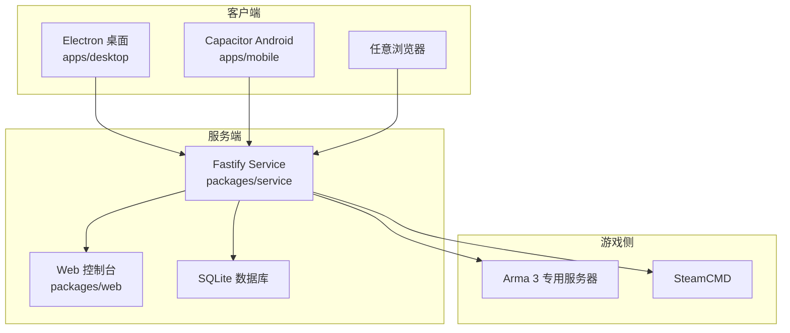

**图示来源** 
- [README.md:50-66](file://README.md#L50-L66)
- [apps/desktop/package.json:1-31](file://apps/desktop/package.json#L1-L31)
- [apps/mobile/package.json:1-23](file://apps/mobile/package.json#L1-L23)

**章节来源**
- [README.md:50-66](file://README.md#L50-L66)

## 核心组件
- Service 后端：提供 REST API、静态 Web 托管、进程管理、BattlEye RCon、SteamCMD 集成、任务自动化、定时任务与监控统计。
- Web 控制台：Vue 3 界面，支持桌面/移动布局切换，通过 API 控制服务器实例。
- Electron 桌面壳：在 Windows 上打包并内嵌 Service 与 Web 资源，默认本地启动。
- Capacitor 移动壳：Android Debug APK，用于局域网或 Tailscale 连接 Service。
- 构建与发布：PowerShell 脚本与 GitHub Actions 流水线负责类型检查、测试、构建、打包与发布。

**章节来源**
- [README.md:37-47](file://README.md#L37-L47)
- [apps/desktop/package.json:1-31](file://apps/desktop/package.json#L1-L31)
- [apps/mobile/package.json:1-23](file://apps/mobile/package.json#L1-L23)

## 架构总览
v2 的运行时由“前端 + 后端”组成，后端可同时托管静态 Web 与 API；桌面端将两者打包在一起，Linux 环境下推荐用 systemd 托管 Service，浏览器直接访问。

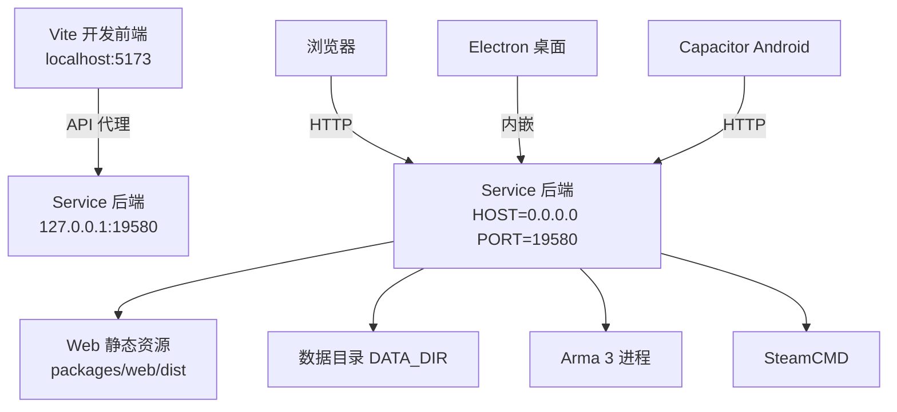

**图示来源** 
- [README.md:70-86](file://README.md#L70-L86)
- [linux-server.md:13-39](file://docs/linux-server.md#L13-L39)
- [packages/service/src/web-static.ts:17-40](file://packages/service/src/web-static.ts#L17-L40)

## 详细组件分析

### 开发环境（双进程模式）
- 前端：`npm run dev:web` 启动 Vite 开发服务，默认监听 `localhost:5173`。
- 后端：`npm run start:service` 启动 Service，默认监听 `127.0.0.1:19580`。
- 前端通过代理访问后端 API，便于本地调试。

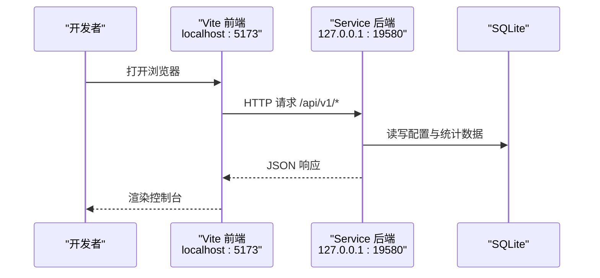

**图示来源** 
- [README.md:70-86](file://README.md#L70-L86)
- [packages/service/src/api/routes.test.ts:67-88](file://packages/service/src/api/routes.test.ts#L67-L88)

**章节来源**
- [README.md:70-86](file://README.md#L70-L86)

### 生产环境（单服务托管 Web）
- Service 同时提供静态 Web 与 API，无需额外 Nginx/Apache。
- 通过环境变量 `WEB_ROOT` 指定静态目录；若未设置，Service 按路径规则自动查找 `packages/web/dist` 等位置。
- 生产部署时建议绑定 `HOST=0.0.0.0`，并通过防火墙限制访问来源。

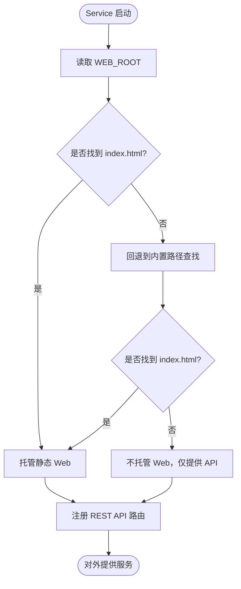

**图示来源** 
- [packages/service/src/web-static.ts:17-40](file://packages/service/src/web-static.ts#L17-L40)

**章节来源**
- [packages/service/src/web-static.ts:17-40](file://packages/service/src/web-static.ts#L17-L40)

### Linux 服务器部署
- 使用源码运行 Service，安装 Node.js ≥ 20，设置 `DATA_DIR` 与 `PORT`。
- 通过 systemd 托管 Service，设置 `Environment=HOST=0.0.0.0` 暴露网络接口。
- 首次需通过控制面板或命令行完成 SteamCMD 下载与 Arma 3 服务器安装。

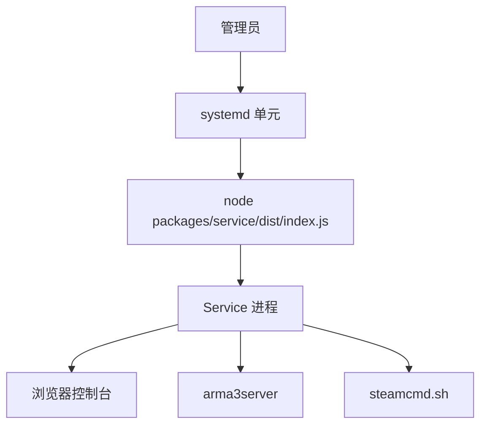

**图示来源** 
- [linux-server.md:13-39](file://docs/linux-server.md#L13-L39)
- [linux-server.md:58-79](file://docs/linux-server.md#L58-L79)

**章节来源**
- [linux-server.md:13-39](file://docs/linux-server.md#L13-L39)
- [linux-server.md:58-79](file://docs/linux-server.md#L58-L79)

### 容器化部署
- 基础镜像：Node.js ≥ 20。
- 工作目录：包含 `packages/service/dist` 与 `packages/web/dist`。
- 环境变量：`PORT`、`HOST`、`DATA_DIR`、`WEB_ROOT`（可选）。
- 健康检查：`GET /api/v1/health` 返回服务状态。
- 反向代理：建议使用 Nginx/Traefik 提供 HTTPS、鉴权与限流。

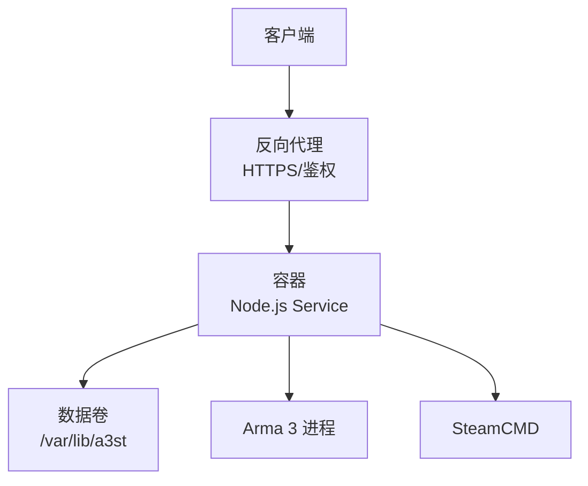

[此图为概念性架构图，不映射具体源文件]

### Electron 桌面打包与分发
- 构建流程：TypeScript 检查 → 测试 → 构建 Service → 构建 Web（桌面基址）→ 构建 Electron main/preload → 准备 extraResources → electron-builder 打包。
- 产物：NSIS 安装包与 win-unpacked 目录；可通过 CI 生成 zip。
- 资源打包：electron-builder.yml 将 web、service、assets 放入 extraResources，asar 启用，禁用 npmRebuild。

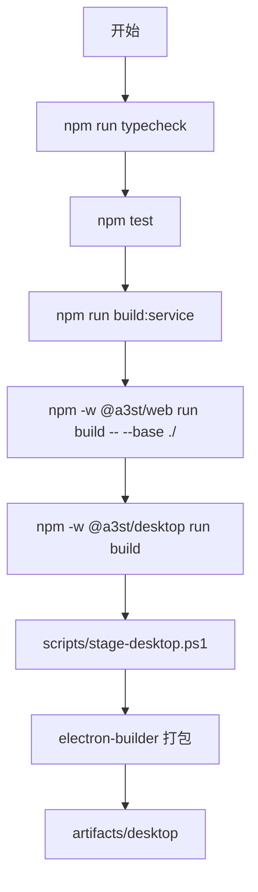

**图示来源** 
- [scripts/build-desktop.ps1:30-54](file://scripts/build-desktop.ps1#L30-L54)
- [apps/desktop/electron-builder.yml:17-34](file://apps/desktop/electron-builder.yml#L17-L34)

**章节来源**
- [scripts/build-desktop.ps1:30-54](file://scripts/build-desktop.ps1#L30-L54)
- [apps/desktop/electron-builder.yml:1-48](file://apps/desktop/electron-builder.yml#L1-L48)

### 移动应用构建流程
- 前置：Node.js ≥ 20、Android Studio（SDK + JBR）。
- 一键构建：`scripts/pack-mobile-apk.ps1` 输出 `artifacts/mobile/a3st-mobile-debug.apk`。
- 开发迭代：`npm -w @a3st/mobile run sync` 与 `open`。
- 连接方式：在 App 中添加主机 URL 为 `http://<Service IP>:19580`，并填写 `API_TOKEN`。

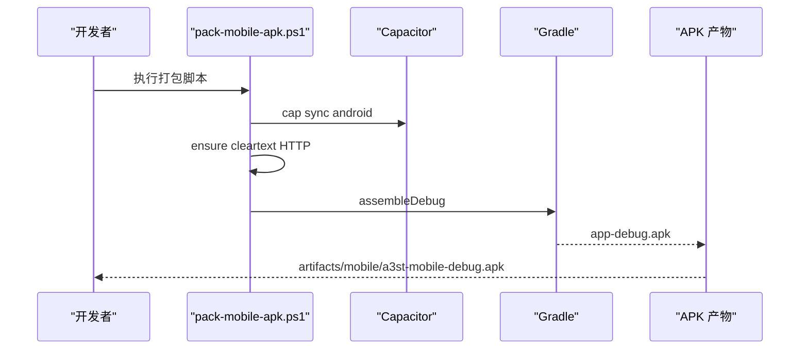

**图示来源** 
- [scripts/pack-mobile-apk.ps1:37-76](file://scripts/pack-mobile-apk.ps1#L37-L76)
- [mobile-android.md:11-25](file://docs/mobile-android.md#L11-L25)

**章节来源**
- [scripts/pack-mobile-apk.ps1:37-76](file://scripts/pack-mobile-apk.ps1#L37-L76)
- [mobile-android.md:11-25](file://docs/mobile-android.md#L11-L25)

### 环境变量与配置
- 通用环境变量：
  - `PORT`：Service 监听端口，默认 19580。
  - `HOST`：绑定地址，生产环境建议 `0.0.0.0`。
  - `DATA_DIR`：数据目录，存放配置与 SQLite 数据。
  - `WEB_ROOT`：静态 Web 根目录（可选），Service 会优先使用该路径。
  - `API_TOKEN`：API 鉴权令牌，生产环境必须设置。
- 桌面端 Settings：
  - Electron 主进程加载 `ServiceSettings`，包括 port、host、apiToken、remoteAccessEnabled。
  - 保存后重启 Service，使新配置生效。

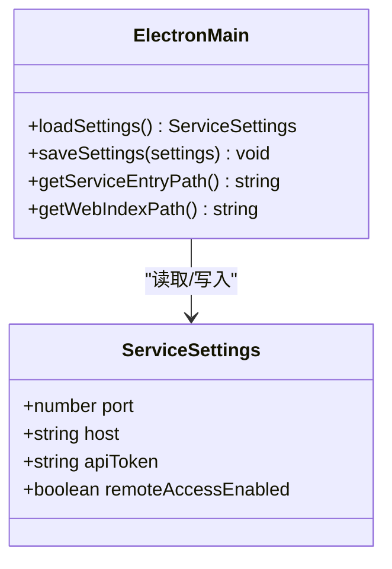

**图示来源** 
- [apps/desktop/src/main/index.ts:46-87](file://apps/desktop/src/main/index.ts#L46-L87)

**章节来源**
- [apps/desktop/src/main/index.ts:46-87](file://apps/desktop/src/main/index.ts#L46-L87)

### 安全考虑
- 生产环境必须设置 `API_TOKEN`，并在防火墙中限制对 `19580` 的访问。
- 允许远程控制时，Service 监听 `0.0.0.0`，应配合反向代理进行 HTTPS 与鉴权。
- 移动端允许明文 HTTP（cleartext）以访问内网地址，但仅限可信局域网或隧道网络（如 Tailscale）。
- 桌面端默认本地运行，避免外部直接访问。

**章节来源**
- [linux-server.md:79-86](file://docs/linux-server.md#L79-L86)
- [mobile-android.md:37-44](file://docs/mobile-android.md#L37-L44)

## 依赖关系分析
- 前端依赖 Service 提供的 REST API。
- Electron 桌面壳依赖 Service 运行时与 Web 静态资源。
- 移动壳仅作为远程客户端，不运行后端。
- Service 依赖 Node.js 运行时、SQLite 与系统命令（SteamCMD、进程管理）。

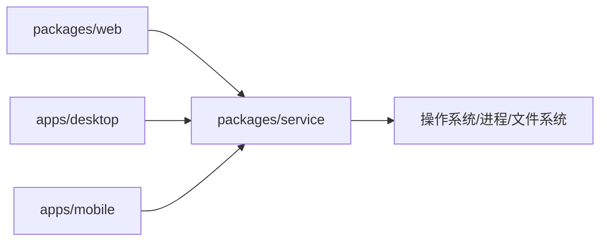

**图示来源** 
- [README.md:50-66](file://README.md#L50-L66)
- [apps/desktop/package.json:19-29](file://apps/desktop/package.json#L19-L29)
- [apps/mobile/package.json:14-21](file://apps/mobile/package.json#L14-L21)

**章节来源**
- [README.md:50-66](file://README.md#L50-L66)

## 性能与资源规划
- Service 内存占用取决于并发请求数、监控采集频率与 SQLite 数据量。
- 多实例管理时，每个 Arma 3 服务器实例独立进程，注意 CPU 与内存分配。
- 日志与监控数据增长较快，建议定期归档与清理。
- 在高负载下，建议将 Service 与 Web 分离部署，并使用反向代理缓存静态资源。

[本节为通用指导，不引用具体文件]

## 故障排查指南
- 健康检查失败：确认 Service 已启动且端口可达，检查 `GET /api/v1/health`。
- Web 无法加载：检查 `WEB_ROOT` 是否存在 `index.html`，或 Service 是否能自动定位到 `packages/web/dist`。
- 移动端无法连接：确认 Service 监听 `0.0.0.0:19580`，并已配置 `API_TOKEN`；检查防火墙与网络连通性。
- Electron 打包失败：检查 icon.ico 是否存在于 `apps/desktop/build/icon.ico`，并确保已执行 stage 步骤。

**章节来源**
- [packages/service/src/web-static.ts:17-40](file://packages/service/src/web-static.ts#L17-L40)
- [scripts/stage-desktop.ps1:89-97](file://scripts/stage-desktop.ps1#L89-L97)

## 结论
本部署拓扑覆盖了从开发到生产的完整链路，明确了各模式的组件分布、网络拓扑与资源需求。通过环境变量与脚本自动化，可在 Windows、Linux 与容器中稳定运行；Electron 与 Capacitor 分别满足桌面与移动端的控制需求。在生产环境中，务必重视鉴权、网络隔离与日志治理，并结合反向代理实现高可用与可扩展部署。

[本节为总结性内容，不引用具体文件]

## 附录：端口、环境变量与安全清单

### 端口规划
- Service HTTP API：默认 `19580`。
- 前端开发服务：默认 `5173`（仅开发环境）。
- Arma 3 服务器端口：由游戏配置决定，不在本工具默认范围内。

**章节来源**
- [README.md:70-86](file://README.md#L70-L86)
- [linux-server.md:13-39](file://docs/linux-server.md#L13-L39)

### 环境变量清单
- `PORT`：Service 监听端口。
- `HOST`：绑定地址。
- `DATA_DIR`：数据目录。
- `WEB_ROOT`：静态 Web 根目录。
- `API_TOKEN`：API 鉴权令牌。

**章节来源**
- [linux-server.md:13-39](file://docs/linux-server.md#L13-L39)
- [apps/desktop/src/main/index.ts:46-87](file://apps/desktop/src/main/index.ts#L46-L87)

### 安全清单
- 生产环境启用 `API_TOKEN`。
- 限制 `19580` 端口访问来源。
- 使用反向代理提供 HTTPS。
- 移动端仅在可信网络中使用明文 HTTP。

**章节来源**
- [linux-server.md:79-86](file://docs/linux-server.md#L79-L86)
- [mobile-android.md:37-44](file://docs/mobile-android.md#L37-L44)

## 自动化流水线与脚本

### CI 流水线
- 触发条件：push 到 main/master 或 PR。
- 步骤：安装依赖 → TypeScript 检查 → 测试 → 构建 Service → 构建 Web → 安装 Playwright Chromium → 启动 Service → 执行 E2E 测试。

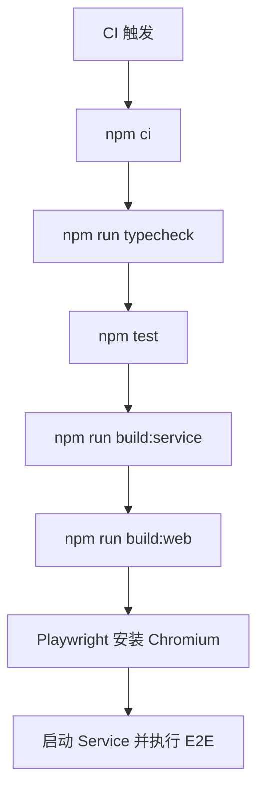

**图示来源** 
- [.github/workflows/ci.yml:13-63](file://.github/workflows/ci.yml#L13-L63)

**章节来源**
- [.github/workflows/ci.yml:13-63](file://.github/workflows/ci.yml#L13-L63)

### Release 流水线
- 触发条件：推送标签 `v*`。
- 步骤：安装依赖 → TypeScript 检查 → 测试 → 打包桌面（NSIS + win-unpacked）→ 压缩 win-unpacked → 收集制品 → 发布 GitHub Release。

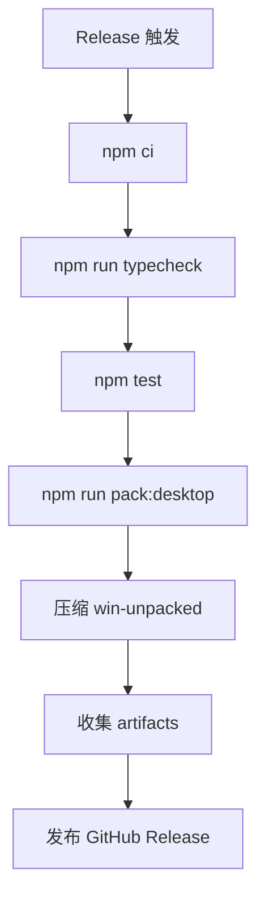

**图示来源** 
- [.github/workflows/release.yml:11-83](file://.github/workflows/release.yml#L11-L83)

**章节来源**
- [.github/workflows/release.yml:11-83](file://.github/workflows/release.yml#L11-L83)

### 构建与打包脚本
- `scripts/build-desktop.ps1`：桌面构建全流程，调用 stage 与 electron-builder。
- `scripts/stage-desktop.ps1`：准备 web、service、assets 资源，生成运行时 package.json 并安装依赖。
- `scripts/pack-mobile-apk.ps1`：构建移动端 Debug APK。
- `scripts/build-release.ps1`：v1 WinForms 解决方案的发布脚本（含 Inno Setup 集成），供历史参考。

**章节来源**
- [scripts/build-desktop.ps1:30-54](file://scripts/build-desktop.ps1#L30-L54)
- [scripts/stage-desktop.ps1:30-97](file://scripts/stage-desktop.ps1#L30-L97)
- [scripts/pack-mobile-apk.ps1:37-76](file://scripts/pack-mobile-apk.ps1#L37-L76)
- [scripts/build-release.ps1:204-402](file://scripts/build-release.ps1#L204-L402)

## 扩展部署场景

### 多实例管理
- 通过 Service 的 `/servers` 接口创建多个服务器实例，每个实例拥有独立 UUID 与配置包。
- 实例间进程隔离，避免端口冲突与资源竞争。
- 建议在 Service 层面对实例启停进行串行化处理，防止竞态条件。

**章节来源**
- [packages/service/src/api/routes.test.ts:90-93](file://packages/service/src/api/routes.test.ts#L90-L93)

### 负载均衡
- Service 本身为无状态 API 服务，可水平扩展多个实例。
- 使用反向代理（Nginx/Traefik）进行负载均衡与健康检查。
- 静态 Web 资源建议缓存至 CDN 或反向代理层，减少后端压力。

[本节为概念性指导，不引用具体文件]

### 高可用性配置
- 多副本部署 Service，结合反向代理实现故障转移。
- 数据目录挂载共享存储或使用外部数据库（当前为 SQLite，适合单机或小规模）。
- 监控与告警：通过 `/api/v1/health` 与日志聚合实现健康巡检。

[本节为概念性指导，不引用具体文件]