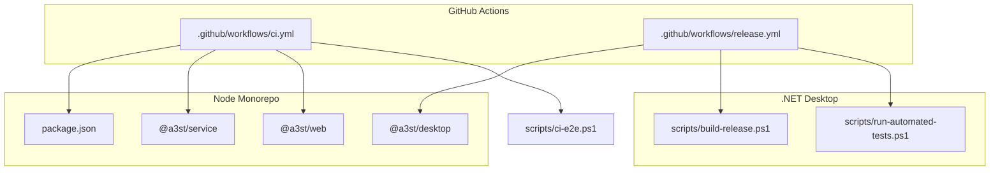
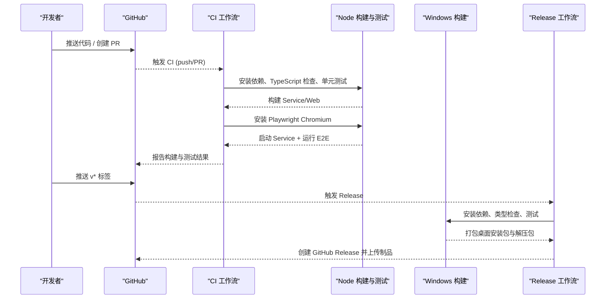
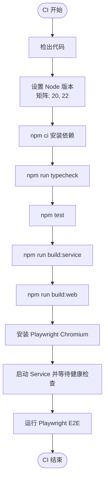
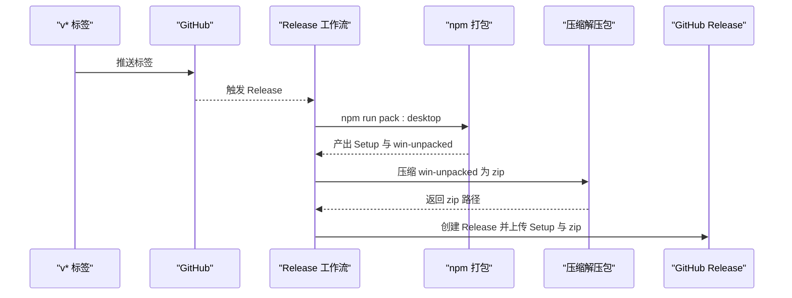
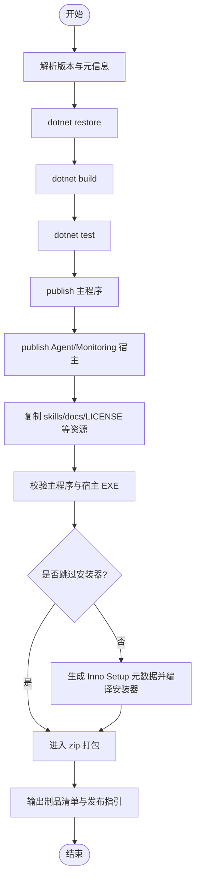
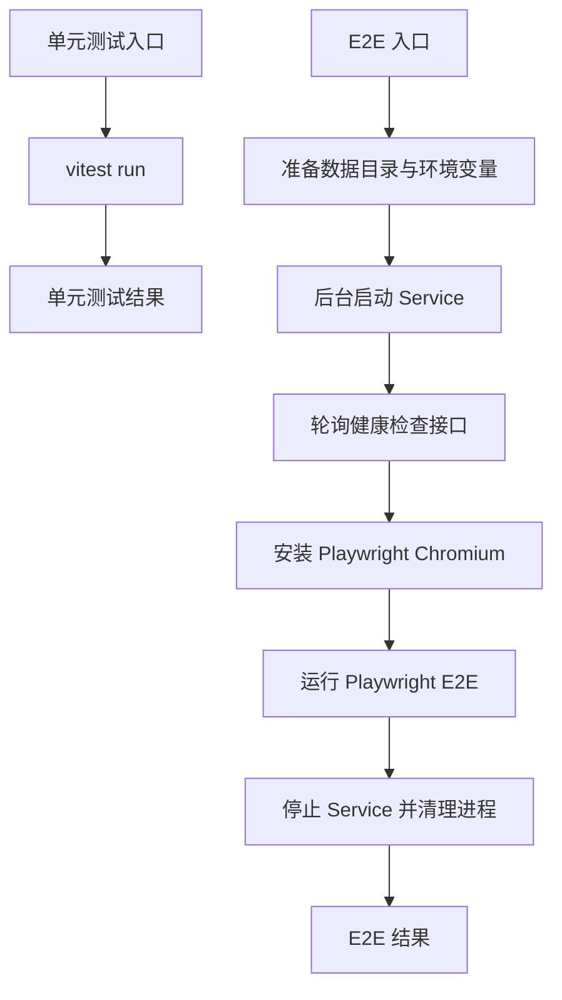
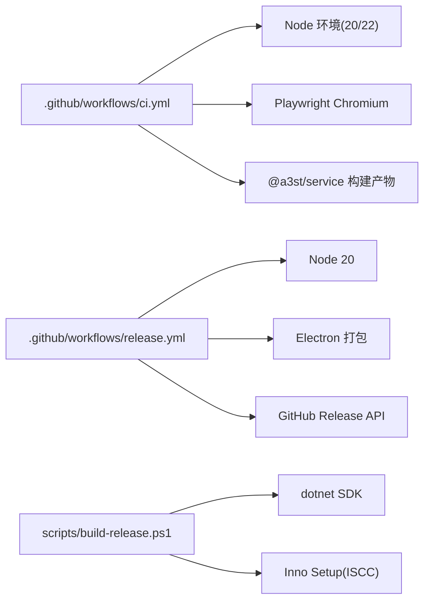

# CI/CD 流水线

<cite>
**本文引用的文件**   
- [.github/workflows/ci.yml](file://.github/workflows/ci.yml)
- [.github/workflows/release.yml](file://.github/workflows/release.yml)
- [package.json](file://package.json)
- [packages/service/package.json](file://packages/service/package.json)
- [apps/desktop/package.json](file://apps/desktop/package.json)
- [scripts/build-release.ps1](file://scripts/build-release.ps1)
- [scripts/run-automated-tests.ps1](file://scripts/run-automated-tests.ps1)
- [scripts/ci-e2e.ps1](file://scripts/ci-e2e.ps1)
</cite>

## 目录
1. [简介](#简介)
2. [项目结构](#项目结构)
3. [核心组件](#核心组件)
4. [架构总览](#架构总览)
5. [详细组件分析](#详细组件分析)
6. [依赖关系分析](#依赖关系分析)
7. [性能与稳定性考虑](#性能与稳定性考虑)
8. [故障排查指南](#故障排查指南)
9. [结论](#结论)
10. [附录：版本与发布策略](#附录版本与发布策略)

## 简介
本文件面向开发者与维护者，系统化说明 Arma3 Server Tools 的持续集成与持续交付流水线。内容覆盖 GitHub Actions 工作流、多平台构建矩阵、代码质量检查、测试自动化（单元测试、集成测试、端到端测试）、发布策略与版本管理、制品管理与分发、回滚与故障恢复机制。文档以仓库中的实际配置脚本为依据，帮助读者在不直接阅读源码的情况下理解并维护该流水线。

## 项目结构
仓库采用 Node.js monorepo 与 .NET 桌面应用混合架构：
- Node 侧包含 Web、Electron 桌面壳与后端 Service，使用 npm workspaces 组织。
- .NET 侧提供 Windows 桌面主程序、Agent Host 与 Monitoring Host，通过 PowerShell 构建脚本统一打包。
- GitHub Actions 定义了两条关键流水线：CI（构建与测试）与 Release（打标签后发布）。

**图表来源**
- [.github/workflows/ci.yml:1-63](file://.github/workflows/ci.yml#L1-L63)
- [.github/workflows/release.yml:1-83](file://.github/workflows/release.yml#L1-L83)
- [package.json:1-36](file://package.json#L1-L36)
- [packages/service/package.json:1-32](file://packages/service/package.json#L1-L32)
- [apps/desktop/package.json:1-31](file://apps/desktop/package.json#L1-L31)
- [scripts/build-release.ps1:1-402](file://scripts/build-release.ps1#L1-L402)
- [scripts/run-automated-tests.ps1:1-33](file://scripts/run-automated-tests.ps1#L1-L33)
- [scripts/ci-e2e.ps1:1-87](file://scripts/ci-e2e.ps1#L1-L87)

**章节来源**
- [.github/workflows/ci.yml:1-63](file://.github/workflows/ci.yml#L1-L63)
- [.github/workflows/release.yml:1-83](file://.github/workflows/release.yml#L1-L83)
- [package.json:1-36](file://package.json#L1-L36)

## 核心组件
- CI 流水线：在 push 到 main/master 或 PR 时触发，执行 TypeScript 类型检查、单元测试、服务与 Web 构建，以及基于 Playwright 的 Web 端到端测试。
- Release 流水线：当推送 v* 标签时触发，构建 Windows 桌面安装包与解压包，生成 GitHub Release 并上传制品。
- 构建脚本：build-release.ps1 负责 .NET 解决方案的 restore/build/test/publish、Inno Setup 安装器打包、产物校验与可选 zip 打包。
- 测试入口：run-automated-tests.ps1 驱动 xUnit 测试；ci-e2e.ps1 启动 Service 并运行 Playwright E2E。

**章节来源**
- [.github/workflows/ci.yml:13-63](file://.github/workflows/ci.yml#L13-L63)
- [.github/workflows/release.yml:11-83](file://.github/workflows/release.yml#L11-L83)
- [scripts/build-release.ps1:204-402](file://scripts/build-release.ps1#L204-L402)
- [scripts/run-automated-tests.ps1:1-33](file://scripts/run-automated-tests.ps1#L1-L33)
- [scripts/ci-e2e.ps1:1-87](file://scripts/ci-e2e.ps1#L1-L87)

## 架构总览
下图展示从代码提交到制品发布的端到端流程，包括分支触发、矩阵构建、测试、打包与发布。

**图表来源**
- [.github/workflows/ci.yml:1-63](file://.github/workflows/ci.yml#L1-L63)
- [.github/workflows/release.yml:1-83](file://.github/workflows/release.yml#L1-L83)

## 详细组件分析

### CI 流水线（构建、测试、E2E）
- 触发条件：对 main/master 分支的 push 与 pull_request。
- 多平台矩阵：当前针对 Node.js 20 与 22 进行并行构建与测试，确保跨版本兼容性。
- 构建步骤：
  - 检出代码、设置 Node 版本、安装依赖。
  - 执行 TypeScript 类型检查。
  - 运行单元测试。
  - 构建 Service 与 Web。
  - 安装 Playwright Chromium 浏览器。
  - 启动本地 Service 并通过健康检查接口确认就绪。
  - 在 packages/web 下运行 Playwright E2E 测试。
- 失败处理：任一步骤失败即中断流水线，便于快速定位问题。

**图表来源**
- [.github/workflows/ci.yml:13-63](file://.github/workflows/ci.yml#L13-L63)

**章节来源**
- [.github/workflows/ci.yml:1-63](file://.github/workflows/ci.yml#L1-L63)
- [package.json:10-30](file://package.json#L10-L30)
- [packages/service/package.json:8-15](file://packages/service/package.json#L8-L15)

### Release 流水线（Windows 桌面打包与发布）
- 触发条件：推送 v* 标签。
- 权限：需要 contents: write 以创建 Release 并上传文件。
- 构建步骤：
  - 检出代码、设置 Node 20、缓存 npm。
  - 安装依赖、执行 TypeScript 检查与单元测试。
  - 调用 npm run pack:desktop 打包 Electron 桌面应用（NSIS 安装器与 win-unpacked）。
  - 将 win-unpacked 压缩为带版本号的 zip。
  - 收集 setup exe 与 zip 路径作为 artifacts。
  - 使用 softprops/action-gh-release 创建 GitHub Release，自动根据 tag 名称判断是否为预发布，并生成发布说明。
- 产物：
  - Arma3ServerTools-Setup-*.exe（NSIS 安装器）
  - Arma3ServerTools-win-unpacked-*.zip（解压即用包）

**图表来源**
- [.github/workflows/release.yml:1-83](file://.github/workflows/release.yml#L1-L83)

**章节来源**
- [.github/workflows/release.yml:1-83](file://.github/workflows/release.yml#L1-L83)
- [apps/desktop/package.json:9-18](file://apps/desktop/package.json#L9-L18)

### .NET 构建与打包脚本（build-release.ps1）
- 功能要点：
  - 解析版本号（支持命令行传入、Directory.Build.props、默认值），统一为四段版本。
  - 生成 Inno Setup 元数据文件，注入版本、版权、发布目录与构建时间戳。
  - 查找或自动安装 Inno Setup 编译器（ISCC.exe）。
  - dotnet restore/build/test，publish 主程序与卫星进程（Agent/Monitoring）。
  - 复制 skills、文档、许可证等必要资源。
  - 校验主程序与宿主可执行文件是否存在。
  - 生成 NSIS 安装器与可选 zip 压缩包。
  - 输出制品清单与后续发布指引。
- 错误处理：
  - 找不到 ISCC.exe 时给出明确提示与安装命令。
  - 缺失预期产物时抛出异常，阻止无效发布。

**图表来源**
- [scripts/build-release.ps1:22-108](file://scripts/build-release.ps1#L22-L108)
- [scripts/build-release.ps1:111-202](file://scripts/build-release.ps1#L111-L202)
- [scripts/build-release.ps1:204-402](file://scripts/build-release.ps1#L204-L402)

**章节来源**
- [scripts/build-release.ps1:1-402](file://scripts/build-release.ps1#L1-L402)

### 测试自动化（单元测试、集成测试、端到端测试）
- 单元测试：
  - Node 侧：通过 @a3st/service 的 vitest 运行单元测试。
  - .NET 侧：通过 run-automated-tests.ps1 调用 dotnet test 执行 xUnit 测试。
- 端到端测试：
  - 通过 scripts/ci-e2e.ps1 启动 Service，轮询健康检查接口，安装 Playwright Chromium，运行 packages/web 下的 E2E 用例，并在 finally 中清理进程。
- 集成测试：
  - 当前仓库未显式区分“集成测试”任务；Service 的单元测试与 E2E 共同承担集成验证职责。建议在新增外部依赖时补充集成测试用例。

**图表来源**
- [scripts/run-automated-tests.ps1:1-33](file://scripts/run-automated-tests.ps1#L1-L33)
- [scripts/ci-e2e.ps1:1-87](file://scripts/ci-e2e.ps1#L1-L87)
- [packages/service/package.json:8-15](file://packages/service/package.json#L8-L15)

**章节来源**
- [scripts/run-automated-tests.ps1:1-33](file://scripts/run-automated-tests.ps1#L1-L33)
- [scripts/ci-e2e.ps1:1-87](file://scripts/ci-e2e.ps1#L1-L87)
- [packages/service/package.json:8-15](file://packages/service/package.json#L8-L15)

## 依赖关系分析
- CI 依赖 Node.js 20/22、npm、Playwright 与 Service 构建产物。
- Release 依赖 Node.js 20、Electron 打包工具链与 GitHub Release API。
- .NET 构建脚本依赖 dotnet SDK、Inno Setup 编译器。
- 工作流之间无循环依赖，职责清晰：CI 保障质量，Release 负责发布。

**图表来源**
- [.github/workflows/ci.yml:1-63](file://.github/workflows/ci.yml#L1-L63)
- [.github/workflows/release.yml:1-83](file://.github/workflows/release.yml#L1-L83)
- [scripts/build-release.ps1:111-202](file://scripts/build-release.ps1#L111-L202)

**章节来源**
- [.github/workflows/ci.yml:1-63](file://.github/workflows/ci.yml#L1-L63)
- [.github/workflows/release.yml:1-83](file://.github/workflows/release.yml#L1-L83)
- [scripts/build-release.ps1:111-202](file://scripts/build-release.ps1#L111-L202)

## 性能与稳定性考虑
- 矩阵构建：CI 同时运行 Node 20 与 22，有助于尽早发现版本兼容性问题，但会增加并发耗时。建议仅在必要时扩展矩阵维度。
- 缓存：Release 流水线启用 npm 缓存，减少依赖安装时间。
- 健康检查：E2E 前通过健康检查接口轮询 Service，避免竞态导致的误判。
- 增量构建：.NET 构建脚本先 restore 再 build/test，遵循标准增量流程。
- 产物校验：构建完成后校验主程序与宿主 EXE 存在性，防止不完整发布。

[本节为通用指导，不直接分析具体文件]

## 故障排查指南
- CI 失败常见原因：
  - Node 版本不匹配：确保工作流 matrix 与 package.json engines 一致。
  - 依赖安装失败：检查网络与 npm registry 可达性。
  - TypeScript 类型检查失败：修复类型错误后再提交。
  - E2E 健康检查超时：检查 Service 端口占用与健康接口实现。
- Release 失败常见原因：
  - 缺少 Inno Setup 编译器：按脚本提示安装或通过环境变量指定路径。
  - 产物缺失：检查 publish 目标与复制资源逻辑。
  - GitHub Release 权限不足：确认 GITHUB_TOKEN 具备写入权限。
- 日志定位：
  - CI：查看 GitHub Actions 各 step 的输出日志。
  - Release：关注 softprops/action-gh-release 的输出与上传状态。
  - .NET 构建：查看 build-release.ps1 输出的制品清单与异常堆栈。

**章节来源**
- [.github/workflows/ci.yml:31-63](file://.github/workflows/ci.yml#L31-L63)
- [.github/workflows/release.yml:34-83](file://.github/workflows/release.yml#L34-L83)
- [scripts/build-release.ps1:179-202](file://scripts/build-release.ps1#L179-L202)
- [scripts/build-release.ps1:328-362](file://scripts/build-release.ps1#L328-L362)

## 结论
该项目的 CI/CD 流水线以 GitHub Actions 为核心，结合 Node monorepo 与 .NET 桌面构建脚本，实现了从代码质量检查、单元测试、端到端测试到 Windows 桌面应用打包与发布的完整闭环。CI 通过多 Node 版本矩阵提升兼容性保障，Release 通过标签驱动与 GitHub Release 集成简化发布流程。建议在后续迭代中补充覆盖率上报、更细粒度的集成测试与更完善的回滚策略，以进一步提升交付质量与可运维性。

[本节为总结性内容，不直接分析具体文件]

## 附录：版本与发布策略
- 版本来源：
  - Node 侧：package.json 中的 version 字段用于桌面解压包命名与标识。
  - .NET 侧：优先使用 Directory.Build.props 中的 Version，其次回退默认值；构建脚本会统一为四段版本。
- 发布分支与标签：
  - CI 对 main/master 分支与 PR 生效。
  - Release 仅对 v* 标签生效，tag 名称决定是否为预发布（包含 alpha/beta/rc）。
- 制品命名规范：
  - 桌面安装包：Arma3ServerTools-Setup-*.exe
  - 桌面解压包：Arma3ServerTools-win-unpacked-*.zip
  - .NET 构建产物：artifacts\_publish 目录下的主程序与宿主 EXE
- 回滚策略：
  - 若新版本存在问题，可在 GitHub Releases 中将旧版本标记为最新稳定版，并删除问题版本或添加说明。
  - 客户端可通过固定版本号下载历史制品，避免自动升级至问题版本。
- 故障恢复：
  - 重新触发 Release 流水线时，需确保 tag 唯一且未被占用；如需修复发布，可新建补丁版本标签。
  - 若 Inno Setup 安装失败，可手动安装 ISCC 并设置 INNO_SETUP_PATH 环境变量后重试。

**章节来源**
- [package.json:1-10](file://package.json#L1-L10)
- [scripts/build-release.ps1:22-74](file://scripts/build-release.ps1#L22-L74)
- [.github/workflows/release.yml:3-10](file://.github/workflows/release.yml#L3-L10)
- [.github/workflows/release.yml:71-83](file://.github/workflows/release.yml#L71-L83)