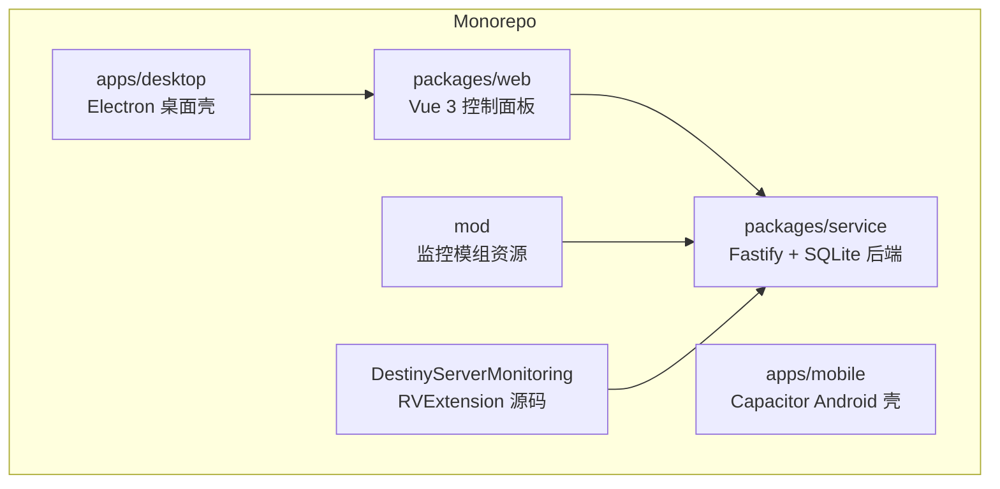
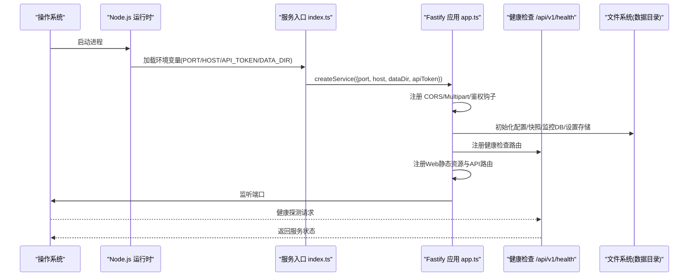
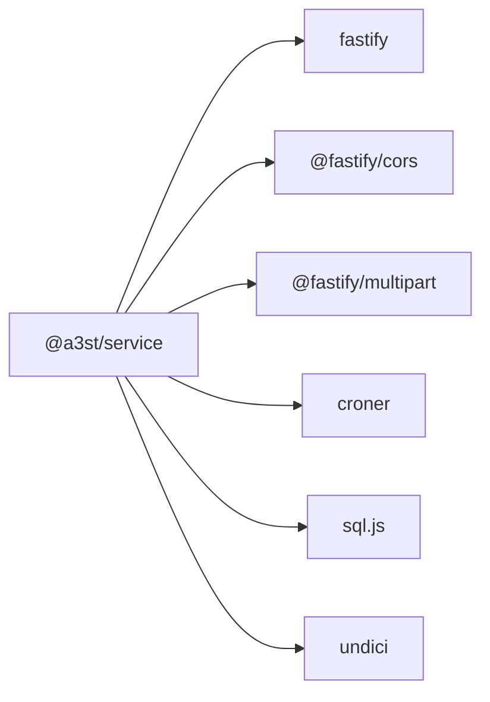

# 容器化部署

<cite>
**本文引用的文件**   
- [README.md](file://README.md)
- [package.json](file://package.json)
- [packages/service/package.json](file://packages/service/package.json)
- [packages/service/src/index.ts](file://packages/service/src/index.ts)
- [packages/service/src/app.ts](file://packages/service/src/app.ts)
- [packages/service/src/api/health.ts](file://packages/service/src/api/health.ts)
- [.github/workflows/ci.yml](file://.github/workflows/ci.yml)
- [.github/workflows/release.yml](file://.github/workflows/release.yml)
</cite>

## 目录
1. [简介](#简介)
2. [项目结构](#项目结构)
3. [核心组件](#核心组件)
4. [架构总览](#架构总览)
5. [详细组件分析](#详细组件分析)
6. [依赖关系分析](#依赖关系分析)
7. [性能与资源限制](#性能与资源限制)
8. [安全加固与网络隔离](#安全加固与网络隔离)
9. [监控与健康检查](#监控与健康检查)
10. [环境变量与数据卷策略](#环境变量与数据卷策略)
11. [Dockerfile 编写规范与最佳实践](#dockerfile-编写规范与最佳实践)
12. [多阶段构建优化镜像大小](#多阶段构建优化镜像大小)
13. [容器编排配置：Docker Compose 与 Kubernetes YAML](#容器编排配置docker-compose-与-kubernetes-yaml)
14. [故障排查指南](#故障排查指南)
15. [结论](#结论)

## 简介
本指南面向 Arma3 Server Tools v2 的容器化部署，覆盖 Dockerfile 编写规范、多阶段构建优化、Docker Compose 与 Kubernetes 编排、环境变量与数据卷策略、监控与健康检查、安全加固与网络隔离、以及性能调优与资源限制。目标是在生产环境中以最小镜像体积、最简权限和可观测性运行后端服务，并便于扩展至集群环境。

## 项目结构
Arma3 Server Tools v2 是 TypeScript 全栈 monorepo，包含桌面端、移动端壳、后端服务与 Web 控制面板。后端服务基于 Fastify + SQLite，提供 REST API、BattlEye RCon、SteamCMD 集成、任务调度与监控统计等能力。

**图表来源**
- [README.md:50-66](file://README.md#L50-L66)

**章节来源**
- [README.md:1-108](file://README.md#L1-L108)

## 核心组件
- 后端服务入口与环境变量解析：端口、主机、API Token、数据目录。
- Fastify 应用装配：中间件（CORS、Multipart）、鉴权钩子、静态 Web UI、SSE、健康检查、路由注册。
- 关键子系统：进程管理、SteamCMD、模组扫描、监控数据库、定时任务、日志读取、UI 设置与 SteamCMD 设置存储。

**章节来源**
- [packages/service/src/index.ts:1-41](file://packages/service/src/index.ts#L1-L41)
- [packages/service/src/app.ts:1-178](file://packages/service/src/app.ts#L1-L178)

## 架构总览
后端服务启动流程如下：读取环境变量 → 创建 Fastify 实例 → 初始化各子系统 → 注册中间件与鉴权 → 挂载路由与静态资源 → 监听端口 → 同步定时任务。

**图表来源**
- [packages/service/src/index.ts:4-23](file://packages/service/src/index.ts#L4-L23)
- [packages/service/src/app.ts:57-171](file://packages/service/src/app.ts#L57-L171)
- [packages/service/src/api/health.ts:1-45](file://packages/service/src/api/health.ts#L1-L45)

## 详细组件分析

### 服务入口与环境变量
- 支持的环境变量：
  - PORT：HTTP 服务端口，默认 19580。
  - HOST：绑定地址，默认 127.0.0.1。
  - API_TOKEN：API 鉴权令牌。
  - DATA_DIR：持久化数据目录，未设置时回退到当前工作目录下的 .a3st-dev-data。
- 优雅关闭：捕获 SIGINT/SIGTERM，中止 SteamCMD 下载、终止所有游戏进程、调用 close() 后退出。

**章节来源**
- [packages/service/src/index.ts:4-41](file://packages/service/src/index.ts#L4-L41)

### Fastify 应用装配与鉴权
- 中间件：
  - CORS：允许空 Origin 与 null，适配 Capacitor WebView 与局域网访问。
  - Multipart：最大上传 100MB。
- 鉴权钩子：
  - 非 /api/ 路径放行（静态页面）。
  - /api/v1/health 与 /api/v1/actions 放行。
  - 支持 Authorization: Bearer、X-Api-Key、查询参数 token。
- 路由与静态资源：
  - 注册健康检查、SSE、API 路由。
  - 若存在 WEB_ROOT 或 packages/web/dist，则提供静态 Web UI。

**章节来源**
- [packages/service/src/app.ts:96-171](file://packages/service/src/app.ts#L96-L171)

### 健康检查接口
- 暴露 /api/v1/health，用于容器探针与外部监控系统探测服务可用性。
- CI 流程中通过 curl 轮询该端点确认服务就绪。

**章节来源**
- [packages/service/src/api/health.ts:1-45](file://packages/service/src/api/health.ts#L1-L45)
- [.github/workflows/ci.yml:52-60](file://.github/workflows/ci.yml#L52-L60)

### 子系统装配
- 配置存储与快照：ConfigStore、ConfigSnapshotStore。
- SteamCMD 管理器：负责 Arma3 服务器安装与更新。
- 模组扫描器：扫描 Workshop 与本地模组。
- 监控数据库：SQLite 存储趋势数据。
- 定时任务：croner 调度重启与采集。
- RPT 日志读取：解析专用服务器日志。
- UI 设置与 SteamCMD 设置存储：持久化用户偏好。

**章节来源**
- [packages/service/src/app.ts:57-94](file://packages/service/src/app.ts#L57-L94)

## 依赖关系分析
- 运行时依赖：
  - fastify：HTTP 框架。
  - @fastify/cors：跨域控制。
  - @fastify/multipart：大文件上传。
  - croner：定时任务调度。
  - sql.js：嵌入式 SQLite。
  - undici：HTTP 客户端。
- 开发依赖：
  - typescript、vitest、@vitest/coverage-v8。

**图表来源**
- [packages/service/package.json:17-29](file://packages/service/package.json#L17-L29)

**章节来源**
- [packages/service/package.json:1-32](file://packages/service/package.json#L1-L32)

## 性能与资源限制
- 建议为容器设置 CPU 与内存限制，避免影响宿主与其他容器。
- 针对 Node.js 进程，可在容器内通过 NODE_OPTIONS 调整堆大小；同时确保系统 ulimit 与内核参数满足并发连接需求。
- 将静态 Web 资源与数据目录分离到独立卷，减少镜像体积与提升缓存命中率。
- 使用只读根文件系统与最小基础镜像，降低攻击面与 I/O 开销。

[本节为通用指导，不直接分析具体文件]

## 安全加固与网络隔离
- 最小权限原则：
  - 以非 root 用户运行容器。
  - 仅开放必要端口（默认 19580），并通过防火墙或云安全组限制来源 IP。
- 鉴权与传输安全：
  - 必须设置 API_TOKEN，并在反向代理层启用 TLS。
  - 前端与后端之间通过 HTTPS 与同源策略保护。
- 文件系统安全：
  - 数据目录挂载为只写卷，禁止写入系统目录。
  - 禁用不必要的系统命令执行与模块加载。
- 网络隔离：
  - 使用自定义桥接网络，隔离游戏进程、后端服务与外部网络。
  - 对 SteamCMD 与 Arma3 服务器进程的网络访问进行白名单控制。

[本节为通用指导，不直接分析具体文件]

## 监控与健康检查
- 健康检查：
  - 使用 /api/v1/health 作为 livenessProbe 与 readinessProbe。
  - 在 CI 中通过 curl 轮询该端点验证服务可用。
- 指标与日志：
  - 将服务日志输出到 stdout/stderr，由容器运行时收集。
  - 可将监控数据（SQLite）持久化到数据卷，便于历史趋势分析。

**章节来源**
- [packages/service/src/api/health.ts:1-45](file://packages/service/src/api/health.ts#L1-L45)
- [.github/workflows/ci.yml:52-60](file://.github/workflows/ci.yml#L52-L60)

## 环境变量与数据卷策略
- 环境变量：
  - PORT：服务监听端口。
  - HOST：服务绑定地址。
  - API_TOKEN：API 鉴权令牌。
  - DATA_DIR：数据目录路径。
- 数据卷：
  - 将 DATA_DIR 映射到宿主机目录，保证配置、日志、监控数据与服务器文件持久化。
  - 可选：将静态 Web 资源目录单独挂载，便于热更新与版本解耦。

**章节来源**
- [packages/service/src/index.ts:4-16](file://packages/service/src/index.ts#L4-L16)

## Dockerfile 编写规范与最佳实践
- 基础镜像：
  - 使用官方 Node.js LTS 镜像，指定明确版本号，避免漂移。
- 多阶段构建：
  - 构建阶段：安装依赖、编译 TypeScript、构建前端静态资源。
  - 运行阶段：仅复制产物与必要运行时依赖，删除构建工具与缓存。
- 安全与健壮性：
  - 非 root 用户运行。
  - 校验依赖完整性（npm ci）。
  - 使用 .dockerignore 排除 node_modules、dist、测试与文档。
- 可观测性：
  - 标准输出日志。
  - 暴露健康检查端点。
- 可移植性：
  - 通过环境变量注入配置，避免硬编码。
  - 使用只读根文件系统与最小权限。

[本节为通用指导，不直接分析具体文件]

## 多阶段构建优化镜像大小
- 构建阶段：
  - 安装 Node.js 依赖（npm ci）。
  - 执行 TypeScript 类型检查与单元测试。
  - 构建后端服务（npm run build:service）与前端静态资源（npm run build:web）。
- 运行阶段：
  - 仅复制 packages/service/dist 与 packages/web/dist。
  - 清理 npm 缓存与临时文件。
  - 设置正确的 USER 与 WORKDIR。
- 效果：
  - 显著减小镜像体积，缩短拉取与启动时间。
  - 减少攻击面，提高安全性。

[本节为通用指导，不直接分析具体文件]

## 容器编排配置：Docker Compose 与 Kubernetes YAML

### Docker Compose
- 定义 service 容器：
  - 暴露端口 19580。
  - 挂载数据卷到 DATA_DIR。
  - 注入环境变量 PORT、HOST、API_TOKEN、DATA_DIR。
- 可选：
  - 添加反向代理容器（如 Nginx/Traefik）提供 TLS 与域名。
  - 添加日志收集容器（如 Fluent Bit）。

[本节为通用指导，不直接分析具体文件]

### Kubernetes YAML
- Deployment：
  - replicas：根据负载与高可用需求设置。
  - resources：requests/limits 限制 CPU 与内存。
  - env：PORT、HOST、API_TOKEN、DATA_DIR。
  - volumeMounts：挂载数据卷。
  - livenessProbe/readinessProbe：指向 /api/v1/health。
- Service：
  - ClusterIP/LoadBalancer/Ingress 暴露服务。
- ConfigMap/Secret：
  - 将 API_TOKEN 放入 Secret。
  - 将配置文件放入 ConfigMap（可选）。
- PersistentVolumeClaim：
  - 持久化数据目录。

[本节为通用指导，不直接分析具体文件]

## 故障排查指南
- 端口冲突：
  - 检查 HOST 与 PORT 配置，必要时更换端口。
  - 查看服务启动日志中的 listen 重试信息。
- 权限问题：
  - 确认 DATA_DIR 可写，且容器用户具备相应权限。
- 鉴权失败：
  - 检查 API_TOKEN 是否正确传递（Authorization、X-Api-Key、query token）。
- 静态资源缺失：
  - 确认已构建前端并复制到运行镜像，或正确设置 WEB_ROOT。
- 健康检查失败：
  - 使用 curl 或 kubectl exec 调用 /api/v1/health，确认响应正常。

**章节来源**
- [packages/service/src/app.ts:28-55](file://packages/service/src/app.ts#L28-L55)
- [packages/service/src/app.ts:96-171](file://packages/service/src/app.ts#L96-L171)
- [packages/service/src/api/health.ts:1-45](file://packages/service/src/api/health.ts#L1-L45)

## 结论
通过遵循本指南，你可以为 Arma3 Server Tools v2 构建安全、高效、可观测的容器化部署方案。结合多阶段构建、最小权限、网络隔离与健康检查，能够在生产环境中稳定运行并提供良好的可维护性与可扩展性。建议在 CI/CD 流水线中集成镜像构建、安全扫描与端到端测试，确保每次发布的质量与一致性。