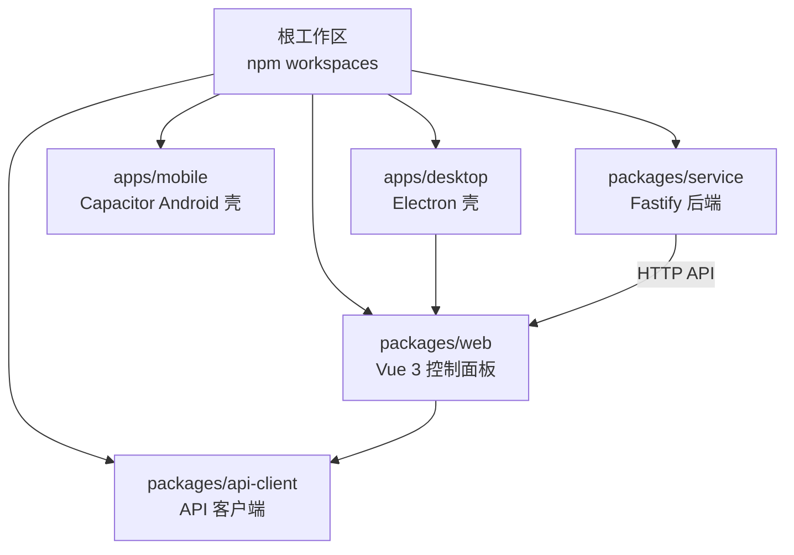
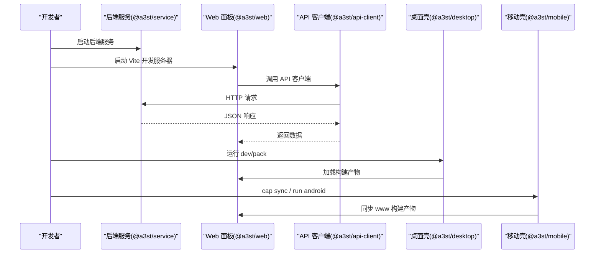
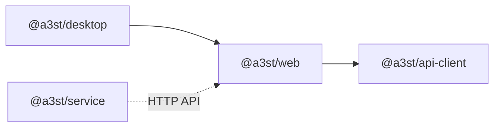

# 开发环境搭建

<cite>
**本文引用的文件**   
- [package.json](file://package.json)
- [README.md](file://README.md)
- [.editorconfig](file://.editorconfig)
- [apps/desktop/package.json](file://apps/desktop/package.json)
- [apps/mobile/package.json](file://apps/mobile/package.json)
- [packages/service/package.json](file://packages/service/package.json)
- [packages/web/package.json](file://packages/web/package.json)
- [packages/api-client/package.json](file://packages/api-client/package.json)
</cite>

## 目录
1. [简介](#简介)
2. [项目结构](#项目结构)
3. [核心组件](#核心组件)
4. [架构总览](#架构总览)
5. [详细组件分析](#详细组件分析)
6. [依赖关系分析](#依赖关系分析)
7. [性能与构建特性](#性能与构建特性)
8. [常见问题排查](#常见问题排查)
9. [结论](#结论)
10. [附录：IDE 与编辑器配置建议](#附录ide-与编辑器配置建议)

## 简介
本指南面向首次参与 Arma3 Server Tools v2 项目的开发者，目标是帮助你从零搭建可运行的本地开发环境。项目采用 TypeScript 全栈实现，包含桌面端 Electron 应用、移动端 Capacitor Android 壳、后端 Fastify 服务以及 Vue 3 Web 控制面板，并通过 npm workspaces 进行多包管理。

你将学到：
- Node.js、TypeScript、Electron、Capacitor 等依赖的安装与版本要求
- 如何克隆仓库、安装依赖、启动后端与前端开发服务器
- IDE（VS Code）扩展、调试与格式化配置建议
- 常见环境问题定位与解决思路
- 多平台开发与工具链差异注意事项

## 项目结构
仓库为 monorepo，根 package.json 通过 workspaces 聚合 apps/* 与 packages/* 下的子包。主要目录职责如下：
- apps/desktop：Electron 桌面壳，打包使用 electron-builder
- apps/mobile：Capacitor Android 壳，构建产物输出到 apps/mobile/www
- packages/service：后端服务（Fastify + SQLite），提供 HTTP API
- packages/web：Vue 3 控制面板 SPA
- packages/api-client：TypeScript API 客户端库
- scripts：构建、打包、测试与发布脚本
- docs：文档与历史归档

图表来源
- [package.json:6-9](file://package.json#L6-L9)
- [apps/desktop/package.json:1-31](file://apps/desktop/package.json#L1-L31)
- [apps/mobile/package.json:1-23](file://apps/mobile/package.json#L1-L23)
- [packages/service/package.json:1-32](file://packages/service/package.json#L1-L32)
- [packages/web/package.json:1-37](file://packages/web/package.json#L1-L37)
- [packages/api-client/package.json:1-24](file://packages/api-client/package.json#L1-L24)

章节来源
- [README.md:50-66](file://README.md#L50-L66)
- [package.json:1-35](file://package.json#L1-L35)

## 核心组件
- 后端服务（@a3st/service）
  - 技术栈：Fastify、SQLite（sql.js）、croner、undici
  - 作用：提供 REST API、任务调度、日志与监控数据持久化
  - 关键脚本：dev/build/start/test/typecheck/clean
- Web 控制面板（@a3st/web）
  - 技术栈：Vue 3、Vite、Pinia、Element Plus、Chart.js
  - 作用：可视化控制与管理界面，调用后端 API
  - 关键脚本：dev/build/build:mobile/preview/typecheck/lint/clean
- API 客户端（@a3st/api-client）
  - 作用：封装对后端服务的类型安全调用
  - 关键脚本：build/typecheck/lint
- 桌面壳（@a3st/desktop）
  - 技术栈：Electron、Vite、electron-builder
  - 作用：将 Web 控制面板打包为 Windows 桌面应用
  - 关键脚本：dev/build/preview/typecheck/stage/pack:dir/pack
- 移动壳（@a3st/mobile）
  - 技术栈：Capacitor Android
  - 作用：将 Web 控制面板打包为 Android 应用
  - 关键脚本：build:web/sync/open/run:android/pack:apk

章节来源
- [packages/service/package.json:1-32](file://packages/service/package.json#L1-L32)
- [packages/web/package.json:1-37](file://packages/web/package.json#L1-L37)
- [packages/api-client/package.json:1-24](file://packages/api-client/package.json#L1-L24)
- [apps/desktop/package.json:1-31](file://apps/desktop/package.json#L1-L31)
- [apps/mobile/package.json:1-23](file://apps/mobile/package.json#L1-L23)

## 架构总览
下图展示了开发时各组件的交互关系：Web 面板通过 API 客户端调用后端服务；桌面壳加载 Web 构建产物；移动壳同步 Web 构建产物到 Android 工程。

图表来源
- [packages/service/package.json:8-15](file://packages/service/package.json#L8-L15)
- [packages/web/package.json:7-14](file://packages/web/package.json#L7-L14)
- [packages/api-client/package.json:9-18](file://packages/api-client/package.json#L9-L18)
- [apps/desktop/package.json:9-18](file://apps/desktop/package.json#L9-L18)
- [apps/mobile/package.json:7-12](file://apps/mobile/package.json#L7-L12)

## 详细组件分析

### 环境与依赖要求
- Node.js
  - 最低版本：>=20.0.0（由根 engines 字段约束）
  - 建议使用 LTS 或稳定版本，确保 npm 与 Node 版本匹配
- TypeScript
  - 多个子包均使用 TypeScript 5.x 进行类型检查与编译
- Electron
  - 桌面壳依赖 Electron 与 electron-builder，用于打包 Windows 桌面应用
- Capacitor
  - 移动壳依赖 @capacitor/android 与 @capacitor/cli，用于构建 Android 应用

章节来源
- [package.json:32-34](file://package.json#L32-L34)
- [apps/desktop/package.json:22-28](file://apps/desktop/package.json#L22-L28)
- [apps/mobile/package.json:14-20](file://apps/mobile/package.json#L14-L20)
- [packages/service/package.json:25-29](file://packages/service/package.json#L25-L29)
- [packages/web/package.json:27-34](file://packages/web/package.json#L27-L34)

### 克隆与安装依赖
- 克隆仓库后，在根目录执行依赖安装命令，npm workspaces 会自动解析并安装所有子包依赖
- 若网络受限，可配置国内镜像源或使用缓存加速

章节来源
- [package.json:6-9](file://package.json#L6-L9)

### 启动开发服务器
- 启动后端服务
  - 先构建服务：npm run build:service
  - 启动服务：npm run start:service
  - 说明：npm run dev:service 仅做 TypeScript 监视编译，不会启动 HTTP 服务
- 启动 Web 开发服务器
  - 命令：npm run dev:web
  - 默认监听端口：5173
- 启动桌面开发模式
  - 命令：npm run dev:desktop
  - 注意：需先完成服务构建，以便桌面壳能加载正确的 Web 资源

章节来源
- [README.md:70-86](file://README.md#L70-L86)
- [package.json:10-23](file://package.json#L10-L23)
- [apps/desktop/package.json:9-18](file://apps/desktop/package.json#L9-L18)
- [packages/web/package.json:7-14](file://packages/web/package.json#L7-L14)
- [packages/service/package.json:8-15](file://packages/service/package.json#L8-L15)

### 构建与打包
- 构建 Web
  - 命令：npm run build:web
  - 移动端构建：npm run build:web:mobile（输出到 apps/mobile/www）
- 构建桌面
  - 命令：npm run build:desktop
  - 打包目录：npm run pack:desktop:dir
  - 打包安装包：npm run pack:desktop
- 构建移动
  - 命令：npm run build:mobile
  - 同步 Android：npm run pack:mobile:apk（内部调用脚本）

章节来源
- [package.json:14-23](file://package.json#L14-L23)
- [apps/desktop/package.json:9-18](file://apps/desktop/package.json#L9-L18)
- [apps/mobile/package.json:7-12](file://apps/mobile/package.json#L7-L12)
- [packages/web/package.json:7-14](file://packages/web/package.json#L7-L14)

### 调试与测试
- 后端测试
  - 命令：npm test（Vitest）
  - 监视模式：npm run test:watch
- 类型检查
  - 根命令：npm run typecheck（针对 api-client 与 service）
  - 子包独立命令：各包提供 typecheck 脚本

章节来源
- [package.json:24-28](file://package.json#L24-L28)
- [packages/service/package.json:8-15](file://packages/service/package.json#L8-L15)
- [packages/api-client/package.json:15-18](file://packages/api-client/package.json#L15-L18)

## 依赖关系分析
monorepo 依赖关系如下：
- apps/desktop 依赖 @a3st/web
- packages/web 依赖 @a3st/api-client
- packages/service 不直接被 web 依赖，但通过 HTTP API 与 web 交互

图表来源
- [apps/desktop/package.json:19-21](file://apps/desktop/package.json#L19-L21)
- [packages/web/package.json:16-18](file://packages/web/package.json#L16-L18)
- [packages/service/package.json:17-23](file://packages/service/package.json#L17-L23)

章节来源
- [apps/desktop/package.json:1-31](file://apps/desktop/package.json#L1-L31)
- [packages/web/package.json:1-37](file://packages/web/package.json#L1-L37)
- [packages/service/package.json:1-32](file://packages/service/package.json#L1-L32)

## 性能与构建特性
- 构建优化
  - Web 使用 Vite 与 esbuild 提升构建速度
  - 桌面壳使用 vite-plugin-electron 与 vite-plugin-electron-renderer 支持 Electron 渲染进程
- 类型检查
  - Web 使用 vue-tsc 进行严格类型检查
  - Service 与 api-client 使用 tsc --noEmit 进行类型校验
- 打包策略
  - 桌面使用 electron-builder 生成安装包
  - 移动使用 Capacitor 同步构建产物到 Android 工程

章节来源
- [packages/web/package.json:16-34](file://packages/web/package.json#L16-L34)
- [apps/desktop/package.json:19-28](file://apps/desktop/package.json#L19-L28)
- [packages/service/package.json:17-29](file://packages/service/package.json#L17-L29)

## 常见问题排查
- Node.js 版本不满足要求
  - 现象：安装失败或脚本报错
  - 处理：升级 Node.js 至 >=20.0.0
- 后端未启动导致前端无法连接
  - 现象：Web 面板请求失败
  - 处理：先执行 npm run build:service，再执行 npm run start:service
- 桌面开发模式找不到 Web 资源
  - 现象：桌面壳白屏或资源 404
  - 处理：确保已构建 Web 与服务，再运行 npm run dev:desktop
- 移动端构建产物不同步
  - 现象：Android 应用显示旧页面
  - 处理：执行 npm run build:web:mobile 或 npm run sync（移动壳脚本）
- 类型检查失败
  - 现象：tsc/vue-tsc 报错
  - 处理：根据错误提示修复类型定义，或在 CI 前运行 npm run typecheck

章节来源
- [README.md:70-86](file://README.md#L70-L86)
- [package.json:10-23](file://package.json#L10-L23)
- [apps/desktop/package.json:9-18](file://apps/desktop/package.json#L9-L18)
- [apps/mobile/package.json:7-12](file://apps/mobile/package.json#L7-L12)
- [packages/web/package.json:7-14](file://packages/web/package.json#L7-L14)
- [packages/service/package.json:8-15](file://packages/service/package.json#L8-L15)

## 结论
通过本指南，你应已完成 Node.js 与项目依赖的安装，理解了 monorepo 结构与各子包职责，并能启动后端、Web 与桌面开发环境。后续可根据需要进一步配置 IDE、调试器与自动化脚本，以提升开发效率与代码质量。

## 附录：IDE 与编辑器配置建议
- VS Code 扩展建议
  - TypeScript 与 Vue 语言支持
  - ESLint/Prettier（如团队引入）
  - GitLens（协作与历史查看）
- 调试配置
  - 后端：Node.js 调试器，指向 packages/service/dist/index.js
  - Web：Chrome 调试器，配合 Vite 热更新
  - 桌面：Electron 调试器，附加到主进程与渲染进程
- 代码格式化规则
  - 项目根 .editorconfig 定义了编码、换行、缩进与 C# 命名风格
  - 建议在 VS Code 中启用 EditorConfig 支持，保持团队一致

章节来源
- [.editorconfig:1-32](file://.editorconfig#L1-L32)