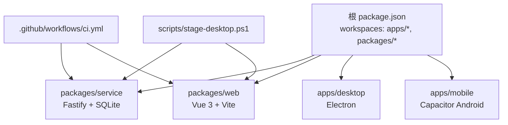
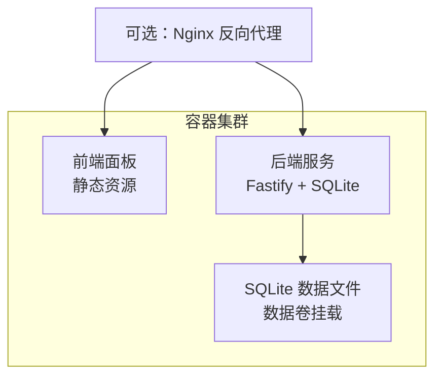
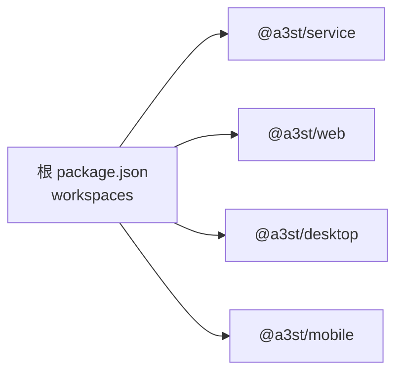

# Docker 容器化部署

<cite>
**本文引用的文件**   
- [README.md](file://README.md)
- [package.json](file://package.json)
- [packages/service/package.json](file://packages/service/package.json)
- [packages/web/package.json](file://packages/web/package.json)
- [.github/workflows/ci.yml](file://.github/workflows/ci.yml)
- [.github/workflows/release.yml](file://.github/workflows/release.yml)
- [scripts/stage-desktop.ps1](file://scripts/stage-desktop.ps1)
- [packages/service/src/config/snapshot.ts](file://packages/service/src/config/snapshot.ts)
</cite>

## 目录
1. [简介](#简介)
2. [项目结构](#项目结构)
3. [核心组件](#核心组件)
4. [架构总览](#架构总览)
5. [详细组件分析](#详细组件分析)
6. [依赖关系分析](#依赖关系分析)
7. [性能与镜像优化](#性能与镜像优化)
8. [安全与合规](#安全与合规)
9. [故障排查指南](#故障排查指南)
10. [结论](#结论)

## 简介
本指南面向 Arma3 Server Tools v2 的容器化部署，目标包括：
- 编写可复用的 Dockerfile 规范与最佳实践
- 设计多阶段构建流程（前端静态资源、后端编译产物、依赖优化）
- 提供 docker-compose 编排示例（服务、网络、数据卷）
- 环境变量与配置文件注入方法
- 健康检查与监控接入
- 镜像体积优化与安全加固建议

本项目为 TypeScript 全栈 monorepo，包含：
- 后端服务：Node.js + Fastify + SQLite
- 前端面板：Vue 3 SPA
- 桌面壳：Electron（Windows）
- 移动端：Capacitor Android（打包产物位于 apps/mobile/www）

## 项目结构
仓库采用 monorepo 组织方式，关键目录如下：
- packages/service：后端服务（Fastify + SQLite），入口 dist/index.js
- packages/web：前端控制面板（Vite + Vue 3），构建输出到 dist
- scripts：构建与发布脚本（含桌面端打包与 staging）
- .github/workflows：CI/CD 流水线（TypeScript 校验、测试、构建、E2E）

图示来源
- [package.json:1-36](file://package.json#L1-L36)
- [.github/workflows/ci.yml:1-63](file://.github/workflows/ci.yml#L1-L63)
- [scripts/stage-desktop.ps1:37-71](file://scripts/stage-desktop.ps1#L37-L71)

章节来源
- [README.md:1-108](file://README.md#L1-L108)
- [package.json:1-36](file://package.json#L1-L36)

## 核心组件
- 后端服务（@a3st/service）
  - 运行时入口：dist/index.js
  - 依赖：fastify、sql.js、croner、undici、@fastify/cors、@fastify/multipart
  - 配置快照：基于文件系统存储，路径在 baseDir/snapshots
- 前端面板（@a3st/web）
  - 开发：Vite dev server
  - 构建：vue-tsc + vite build，输出静态资源
- CI/CD
  - CI：Node 20/22 矩阵，TypeScript 类型检查、单元测试、构建服务与 Web、Playwright E2E
  - Release：Windows 桌面打包与制品归档

章节来源
- [packages/service/package.json:1-32](file://packages/service/package.json#L1-L32)
- [packages/web/package.json:1-37](file://packages/web/package.json#L1-L37)
- [.github/workflows/ci.yml:1-63](file://.github/workflows/ci.yml#L1-L63)
- [packages/service/src/config/snapshot.ts:1-48](file://packages/service/src/config/snapshot.ts#L1-L48)

## 架构总览
推荐容器化架构：
- 构建阶段：Node.js 20+ 基础镜像，安装依赖并分别构建前端与后端
- 运行阶段：精简 Node.js 镜像，仅拷贝构建产物与生产依赖
- 服务暴露：后端 HTTP API（默认端口 19580），前端静态资源由后端或反向代理提供
- 数据持久化：SQLite 数据库文件通过数据卷挂载
- 健康检查：HTTP /api/v1/health

图示来源
- [.github/workflows/ci.yml:47-61](file://.github/workflows/ci.yml#L47-L61)
- [packages/service/package.json:17-24](file://packages/service/package.json#L17-L24)

## 详细组件分析

### 多阶段构建与镜像分层
建议采用两阶段构建：
- 构建阶段（builder）
  - 使用 Node.js 20+ 镜像
  - 安装所有依赖（含 devDependencies）
  - 执行 TypeScript 类型检查与测试
  - 构建前端静态资源（packages/web）
  - 构建后端服务（packages/service）
- 运行阶段（runtime）
  - 使用精简 Node.js 镜像
  - 仅拷贝后端 dist 与前端 dist
  - 仅安装生产依赖（omit devDependencies）
  - 以非 root 用户运行

参考命令流（概念性说明）：
- 构建前端：npm run build:web
- 构建后端：npm run build:service
- 启动服务：node packages/service/dist/index.js

章节来源
- [package.json:10-30](file://package.json#L10-L30)
- [packages/web/package.json:7-14](file://packages/web/package.json#L7-L14)
- [packages/service/package.json:8-15](file://packages/service/package.json#L8-L15)

### 前端构建与静态资源
- 开发模式：Vite dev server
- 构建模式：vue-tsc 类型检查 + vite build
- 移动端产物：build:mobile 输出至 apps/mobile/www

章节来源
- [packages/web/package.json:7-14](file://packages/web/package.json#L7-L14)

### 后端编译与依赖优化
- 开发模式：tsc --watch
- 构建模式：tsc
- 启动模式：node dist/index.js
- 生产依赖：fastify、sql.js、croner、undici、@fastify/cors、@fastify/multipart

章节来源
- [packages/service/package.json:8-24](file://packages/service/package.json#L8-L24)

### 数据持久化与配置快照
- SQLite 数据文件需持久化，建议通过数据卷挂载
- 配置快照功能将 JSON 配置文件复制到 snapshots 目录，便于版本回溯

章节来源
- [packages/service/src/config/snapshot.ts:12-48](file://packages/service/src/config/snapshot.ts#L12-L48)

### 环境变量与配置文件注入
- 环境变量：通过容器环境变量注入（如端口、日志级别、外部服务地址等）
- 配置文件：通过数据卷挂载配置文件目录，避免将敏感信息打入镜像
- 运行时参数：可通过命令行参数覆盖默认配置（结合服务实现）

章节来源
- [packages/service/package.json:17-24](file://packages/service/package.json#L17-L24)

### 健康检查与监控
- 健康检查端点：/api/v1/health
- CI 中通过 curl 轮询该端点确认服务就绪

章节来源
- [.github/workflows/ci.yml:47-61](file://.github/workflows/ci.yml#L47-L61)

### 容器编排（docker-compose 示例）
建议编排以下服务：
- backend：后端服务，暴露 19580 端口，挂载 SQLite 数据卷与配置文件目录
- frontend：可选，若由 Nginx 提供静态资源；否则可直接由后端托管
- nginx：可选，统一入口与 HTTPS 终止

编排要点：
- 网络：同一自定义网络，服务间通过服务名通信
- 数据卷：sqlite-data、config-dir、logs
- 环境变量：PORT、NODE_ENV、LOG_LEVEL 等
- 健康检查：基于 /api/v1/health

章节来源
- [.github/workflows/ci.yml:47-61](file://.github/workflows/ci.yml#L47-L61)

## 依赖关系分析
monorepo 依赖与工作区：
- 根 package.json 定义 workspaces: apps/*, packages/*
- 根脚本聚合各子包构建与测试任务

图示来源
- [package.json:1-36](file://package.json#L1-L36)

章节来源
- [package.json:1-36](file://package.json#L1-L36)

## 性能与镜像优化
- 基础镜像选择
  - 构建阶段：node:20-alpine 或 node:20-slim
  - 运行阶段：node:20-alpine 或 node:20-slim
- 依赖缓存
  - 先复制 package*.json 与 lock 文件，再 npm ci
  - 分阶段安装 devDependencies 与 production dependencies
- 构建缓存
  - 利用 Docker BuildKit 缓存层
  - 分离前端与后端构建步骤，减少无效重建
- 产物裁剪
  - 仅拷贝 dist 目录与必要资源
  - 移除测试与文档等非运行必需文件
- 进程管理
  - 使用 tini 或 dumb-init 作为 PID 1
  - 优雅退出信号处理（SIGTERM/SIGINT）

章节来源
- [packages/service/package.json:8-15](file://packages/service/package.json#L8-L15)
- [packages/web/package.json:7-14](file://packages/web/package.json#L7-L14)

## 安全与合规
- 最小权限
  - 以非 root 用户运行容器
  - 仅开放必要端口（19580）
- 镜像安全
  - 定期扫描镜像漏洞（Trivy、Snyk）
  - 锁定依赖版本，避免动态拉取
- 数据安全
  - 配置文件与密钥通过环境变量或挂载卷注入
  - 不将敏感信息写入镜像层
- 网络安全
  - 启用 TLS（Nginx 或反向代理）
  - 限制跨域访问（@fastify/cors 合理配置）

章节来源
- [packages/service/package.json:17-24](file://packages/service/package.json#L17-L24)

## 故障排查指南
- 服务无法启动
  - 检查端口占用与防火墙规则
  - 查看容器日志与 SQLite 文件权限
- 健康检查失败
  - 确认 /api/v1/health 可达
  - 检查环境变量与服务初始化逻辑
- 前端无法加载
  - 确认静态资源路径与反向代理配置
  - 检查 CORS 设置与域名白名单
- 数据丢失或不一致
  - 检查数据卷挂载是否正确
  - 使用配置快照进行恢复

章节来源
- [.github/workflows/ci.yml:47-61](file://.github/workflows/ci.yml#L47-L61)
- [packages/service/src/config/snapshot.ts:12-48](file://packages/service/src/config/snapshot.ts#L12-L48)

## 结论
通过多阶段构建、精简运行镜像、数据卷持久化与健康检查，Arma3 Server Tools v2 可在容器中稳定运行。结合 docker-compose 编排与 CI/CD 流水线，可实现从代码提交到制品发布的自动化闭环。建议在生产环境引入反向代理、TLS 与镜像扫描，进一步提升安全性与可观测性。