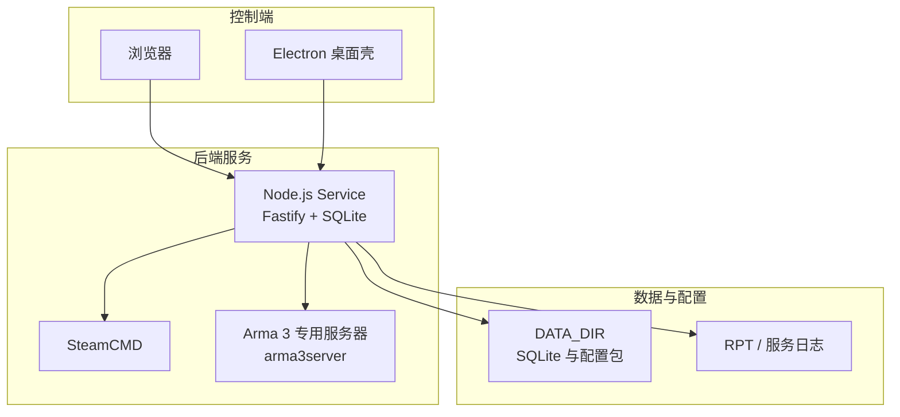
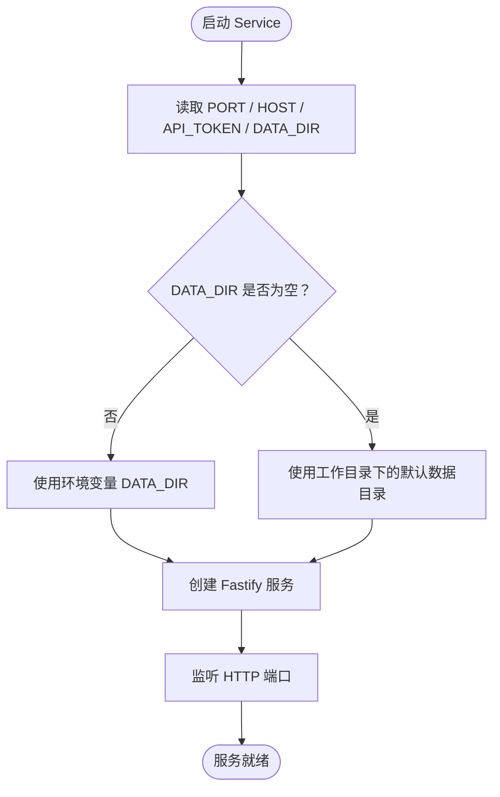
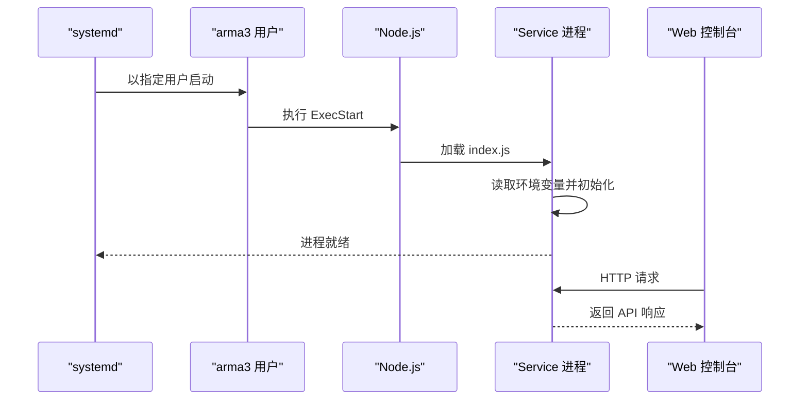
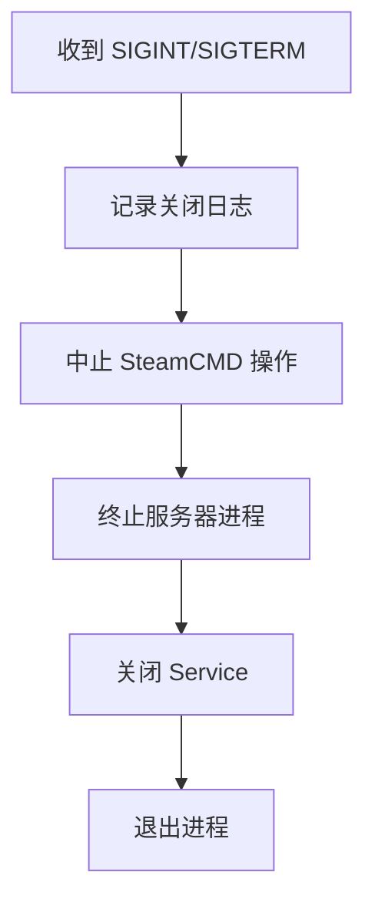

# Linux 环境部署

<cite>
**本文引用的文件**   
- [README.md](file://README.md)
- [package.json](file://package.json)
- [docs/linux-server.md](file://docs/linux-server.md)
- [docs/v2-quickstart.md](file://docs/v2-quickstart.md)
- [packages/service/src/index.ts](file://packages/service/src/index.ts)
- [apps/desktop/src/main/index.ts](file://apps/desktop/src/main/index.ts)
- [packages/web/src/views/HostSettingsView.vue](file://packages/web/src/views/HostSettingsView.vue)
- [packages/service/src/config/game-config-writer.ts](file://packages/service/src/config/game-config-writer.ts)
</cite>

## 目录
1. [简介](#简介)
2. [项目结构](#项目结构)
3. [系统要求与依赖](#系统要求与依赖)
4. [Node.js 与 .NET Runtime 安装配置](#nodejs-与-net-runtime-安装配置)
5. [源码部署与服务启动](#源码部署与服务启动)
6. [systemd 服务配置](#systemd-服务配置)
7. [防火墙与端口开放](#防火墙与端口开放)
8. [性能优化建议](#性能优化建议)
9. [监控与日志管理](#监控与日志管理)
10. [常见问题排查](#常见问题排查)
11. [结论](#结论)

## 简介
本仓库是 Arma 3 专用服务器管理工具 v2，后端为 Node.js + Fastify + SQLite，前端为 Vue 3 Web 控制台，可选 Electron 桌面壳。Linux 上推荐通过浏览器访问 Web 控制台，并使用 systemd 托管后端 Service；Arma 3 专用服务器二进制在 Linux 下为 `arma3server`，SteamCMD 使用 `steamcmd.sh`。

**章节来源**
- [README.md:1-10](file://README.md#L1-L10)
- [docs/linux-server.md:1-11](file://docs/linux-server.md#L1-L11)

## 项目结构
v2 采用 monorepo：
- `packages/service`：后端 HTTP API、SteamCMD 集成、进程管理、SQLite 配置存储。
- `packages/web`：Vue 3 控制面板。
- `apps/desktop`：Electron 桌面壳（当前打包以 Windows 为主）。
- `mod`、`DestinyServerMonitoring`：游戏内监控模组与 RVExtension 相关资源。
- `scripts`：构建与发布脚本。
- `docs`：文档与版本说明。

**图表来源**
- [README.md:50-66](file://README.md#L50-L66)
- [docs/linux-server.md:40-47](file://docs/linux-server.md#L40-L47)

**章节来源**
- [README.md:50-66](file://README.md#L50-L66)
- [docs/linux-server.md:1-11](file://docs/linux-server.md#L1-L11)

## 系统要求与依赖
- 发行版：常见 x64 Linux，官方示例覆盖 Ubuntu 22.04+、Debian 12+。
- Node.js：≥ 20（仅开发或源码运行 Service 时需要；若只运行已编译的 Service 二进制，则不需要 Node.js）。
- 系统工具：`tar`（解压 SteamCMD）、`ss`（UDP 端口检测，通常随 iproute2 提供）。
- 路径约束：服务器目录与 Workshop 路径建议使用英文/ASCII，避免特殊字符导致兼容性问题。
- 内核：未强制指定最低内核版本；生产环境建议使用发行版稳定内核并开启常用网络参数。

**章节来源**
- [docs/linux-server.md:6-11](file://docs/linux-server.md#L6-L11)
- [package.json:32-34](file://package.json#L32-L34)

## Node.js 与 .NET Runtime 安装配置
### Node.js
- 版本要求：≥ 20。
- 安装方式：可使用发行版包管理器、nvm、或 NodeSource 源安装 Node.js 20 及以上版本。
- 验证：执行 `node -v` 应返回 20.x 或更高版本。
- 用途：
  - 源码部署时用于构建 Service 和 Web。
  - 直接运行 `packages/service/dist/index.js`。
  - 若仅部署已编译产物且不使用 Node.js 运行 Service，则可不安装 Node.js。

### .NET Runtime
- 当前仓库中 Linux 服务端主流程由 Node.js 实现；文档未明确声明必须安装 .NET Runtime。
- 若需要运行 DestinyServerMonitoring 中的 .NET 组件，请根据该组件的实际运行时需求安装对应版本的 .NET Runtime；否则可忽略。
- 建议：仅在确认需要 .NET 组件时安装，避免引入不必要的运行时依赖。

**章节来源**
- [docs/v2-quickstart.md:7-11](file://docs/v2-quickstart.md#L7-L11)
- [package.json:32-34](file://package.json#L32-L34)
- [docs/linux-server.md:83-85](file://docs/linux-server.md#L83-L85)

## 源码部署与服务启动
### 最小化部署步骤
1. 准备 Node.js ≥ 20。
2. 克隆仓库并安装依赖：`npm ci`。
3. 构建后端：`npm run build:service`。
4. 构建前端（可选）：`npm run build:web`。
5. 设置环境变量：
   - `DATA_DIR`：Service 数据目录，默认回退到工作目录下的 `.a3st-dev-data`。
   - `PORT`：HTTP 监听端口，默认 `19580`。
   - `HOST`：监听地址，默认 `127.0.0.1`。
   - `API_TOKEN`：远程访问鉴权令牌。
6. 启动 Service：`node packages/service/dist/index.js`。
7. 浏览器访问 Web 控制台，或通过反向代理暴露端口。

### 关键环境变量行为
- `PORT`：解析为整数，默认 `19580`。
- `HOST`：字符串，默认 `127.0.0.1`。
- `API_TOKEN`：字符串，默认空；启用后需在前端或代理层携带令牌。
- `DATA_DIR`：优先使用环境变量；为空时使用工作目录下的默认开发数据目录。

**图表来源**
- [packages/service/src/index.ts:4-16](file://packages/service/src/index.ts#L4-L16)

**章节来源**
- [docs/linux-server.md:13-25](file://docs/linux-server.md#L13-L25)
- [packages/service/src/index.ts:4-23](file://packages/service/src/index.ts#L4-L23)
- [docs/v2-quickstart.md:13-39](file://docs/v2-quickstart.md#L13-L39)

## systemd 服务配置
推荐使用 systemd 托管 Service，确保开机自启、崩溃重启、统一日志。

### 服务单元文件要点
- `Description`：服务描述。
- `After=network.target`：在网络可用后启动。
- `Type=simple`：简单进程模型。
- `User`：运行 Service 的系统用户，例如 `arma3`。
- `WorkingDirectory`：Service 工作目录。
- `Environment`：定义 `DATA_DIR`、`PORT`、`HOST`。
- `ExecStart`：指向 Node.js 与 Service 入口。
- `Restart=on-failure`：失败自动重启。
- `WantedBy=multi-user.target`：多用户目标启用。

### 安全与运维建议
- 使用独立低权限用户运行 Service。
- 将 `DATA_DIR` 放在 `/var/lib/a3st` 等受控路径。
- 生产环境务必设置 `API_TOKEN`。
- 如需远程访问，将 `HOST` 改为 `0.0.0.0`，并通过防火墙限制来源 IP。
- 日志可通过 journalctl 查看；也可结合外部日志采集方案。

**图表来源**
- [docs/linux-server.md:58-77](file://docs/linux-server.md#L58-L77)
- [packages/service/src/index.ts:4-23](file://packages/service/src/index.ts#L4-L23)

**章节来源**
- [docs/linux-server.md:58-79](file://docs/linux-server.md#L58-L79)

## 防火墙与端口开放
### ufw（Ubuntu/Debian）
- 允许 SSH：`ufw allow OpenSSH`。
- 开放 Service 端口：`ufw allow 19580/tcp`。
- 如需开放游戏端口，请根据 Arma 3 实际 UDP/TCP 端口单独放行。
- 启用防火墙：`ufw enable`。
- 检查状态：`ufw status numbered`。

### firewalld（CentOS/RHEL）
- 允许 SSH：`firewall-cmd --permanent --add-service=ssh`。
- 开放 Service 端口：`firewall-cmd --permanent --add-port=19580/tcp`。
- 重载规则：`firewall-cmd --reload`。
- 检查状态：`firewall-cmd --list-all`。

### 端口检测
- Service 内部会尝试检测端口占用情况，但生产环境仍建议在系统层确认端口未被其他进程占用。
- 可使用 `ss` 或 `netstat` 检查 TCP/UDP 端口占用。

**章节来源**
- [docs/linux-server.md:79-85](file://docs/linux-server.md#L79-L85)
- [packages/service/src/config/game-config-writer.ts:197-204](file://packages/service/src/config/game-config-writer.ts#L197-L204)

## 性能优化建议
- 系统层面：
  - 调整文件句柄数、网络连接数、TCP backlog 等内核参数。
  - 为 Arma 3 专用服务器分配足够内存与 CPU 资源。
- Service 层面：
  - 合理设置 `PORT` 与 `HOST`，避免绑定到不必要接口。
  - 使用独立用户运行，减少权限风险。
  - 定期清理旧日志与临时文件。
- 前端层面：
  - 使用反向代理缓存静态资源。
  - 控制轮询频率，避免频繁请求健康检查或状态接口。

[本节为通用优化建议，不直接分析具体代码文件]

## 监控与日志管理
### Service 生命周期与优雅退出
- Service 监听 `SIGINT` 与 `SIGTERM`，收到信号后：
  - 记录关闭日志。
  - 中止正在进行的 SteamCMD 操作。
  - 终止所有被管理的服务器进程。
  - 关闭服务并退出进程。

**图表来源**
- [packages/service/src/index.ts:25-40](file://packages/service/src/index.ts#L25-L40)

### 日志位置
- Service 日志：通过 systemd 输出到 journalctl。
- Arma 3 RPT 日志：位于 Arma 3 服务器目录，由 Service 管理启停与日志读取。
- 建议：
  - 使用 `journalctl -u <service-name>` 查看 Service 日志。
  - 对 Arma 3 日志进行轮转与归档。
  - 结合 Prometheus/Grafana 或 ELK 收集指标与日志。

**章节来源**
- [packages/service/src/index.ts:25-40](file://packages/service/src/index.ts#L25-L40)
- [README.md:39-46](file://README.md#L39-L46)

## 常见问题排查
### Service 无法启动
- 检查 Node.js 版本是否 ≥ 20。
- 检查 `PORT` 是否被占用。
- 检查 `DATA_DIR` 是否存在且可写。
- 检查 systemd 日志：`journalctl -u <service-name> --no-pager -e`。

### 无法远程访问 Web 控制台
- 确认 `HOST` 不是仅限本地回环。
- 确认防火墙已开放对应端口。
- 确认已设置 `API_TOKEN` 并在前端或代理层正确携带。

### SteamCMD 下载或更新失败
- 确认网络可达 Steam 服务器。
- 确认 `steamcmd.sh` 已正确下载并可执行。
- 检查 Arma 3 专用服务器目录是否存在 `arma3server`。

### 端口检测异常
- 使用 `ss` 或 `netstat` 检查端口占用。
- 确认 Service 监听的端口与配置一致。
- 注意 UDP 端口与 TCP 端口的区别。

**章节来源**
- [docs/linux-server.md:40-47](file://docs/linux-server.md#L40-L47)
- [docs/linux-server.md:79-85](file://docs/linux-server.md#L79-L85)
- [packages/service/src/index.ts:4-16](file://packages/service/src/index.ts#L4-L16)

## 结论
在 Linux 生产环境中，Arma 3 Server Tools v2 推荐通过 systemd 托管 Node.js Service，并结合防火墙策略与 `API_TOKEN` 保障安全。Node.js ≥ 20 是源码部署的关键依赖；.NET Runtime 仅在需要运行特定 .NET 组件时才安装。通过合理的系统参数、日志管理与监控配置，可实现稳定、可观测的 Arma 3 服务器管理体验。

[本节为总结性内容，不直接分析具体代码文件]