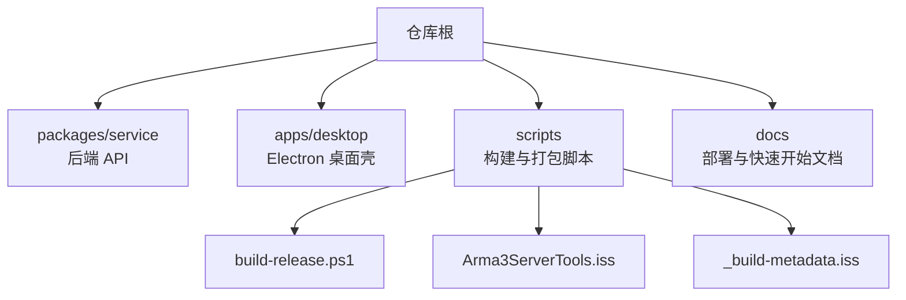
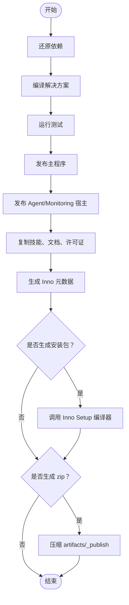
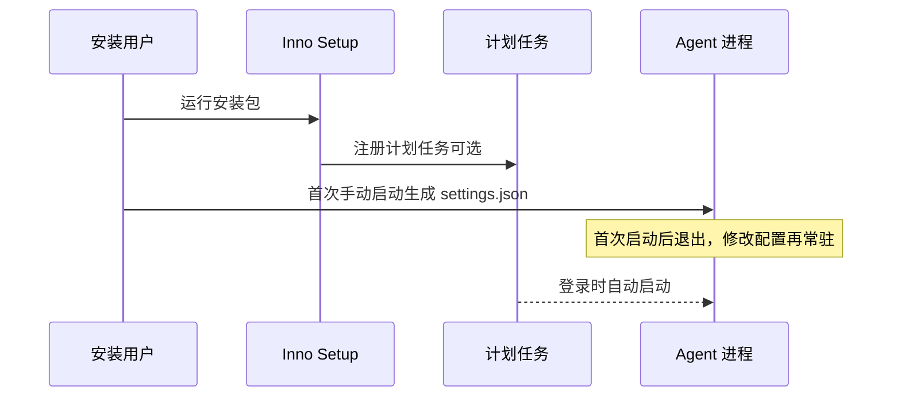
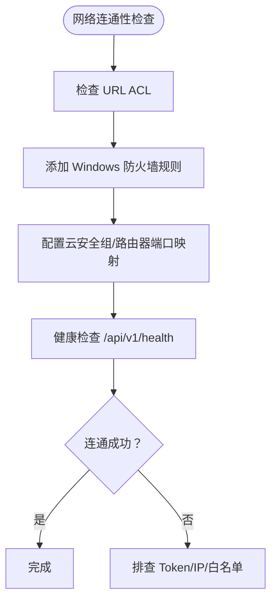
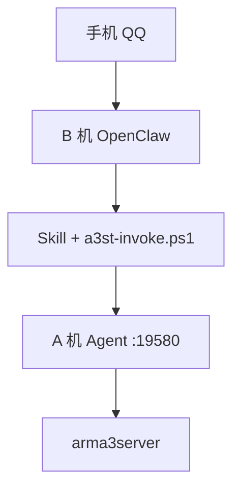
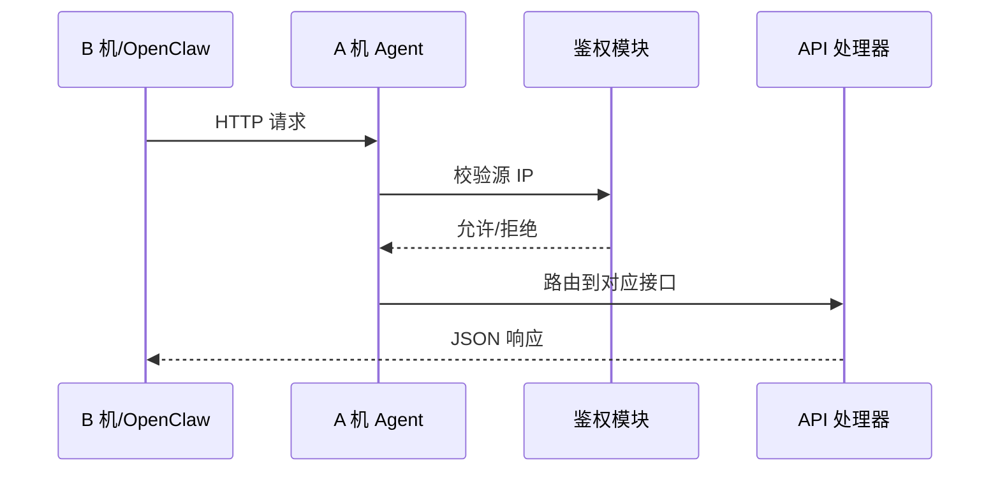
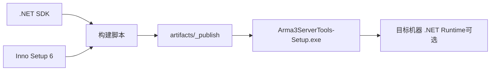

# Windows 环境部署

<cite>
**本文引用的文件**   
- [README.md](file://README.md)
- [v2-quickstart.md](file://docs/v2-quickstart.md)
- [deployment-ab-openclaw.md](file://docs/deployment-ab-openclaw.md)
- [linux-server.md](file://docs/linux-server.md)
- [build-release.ps1](file://scripts/build-release.ps1)
- [Arma3ServerTools.iss](file://scripts/Arma3ServerTools.iss)
- [_build-metadata.iss](file://scripts/_build-metadata.iss)
</cite>

## 目录
1. [简介](#简介)
2. [项目结构](#项目结构)
3. [系统要求与权限](#系统要求与权限)
4. [构建脚本与安装包生成](#构建脚本与安装包生成)
5. [服务注册与启动配置](#服务注册与启动配置)
6. [防火墙与安全组配置](#防火墙与安全组配置)
7. [架构总览](#架构总览)
8. [详细组件分析](#详细组件分析)
9. [依赖关系分析](#依赖关系分析)
10. [性能与运行注意事项](#性能与运行注意事项)
11. [故障排除指南](#故障排除指南)
12. [结论](#结论)

## 简介
本文件面向在 **Windows Server** 上生产部署 Arma3 Server Tools 的运维人员，覆盖系统要求、构建与打包、服务化与开机自启、网络与安全、以及常见问题的定位方法。文档同时兼顾“仅安装 Agent”和“完整桌面工具 + Agent”两种场景，并给出基于仓库现有脚本与文档的可操作建议。

## 项目结构
仓库采用多语言、多产物组织：
- 后端服务：Node.js + Fastify（默认端口 `19580`）
- 桌面端：Electron（当前仅 Windows 打包）
- Windows 发布产物：由 PowerShell 构建脚本驱动，使用 Inno Setup 生成安装包
- 监控与自动化：Agent Host、Monitoring Host、OpenClaw Skill 等



**图示来源**
- [README.md:50-66](file://README.md#L50-L66)
- [build-release.ps1:204-235](file://scripts/build-release.ps1#L204-L235)
- [Arma3ServerTools.iss:36-68](file://scripts/Arma3ServerTools.iss#L36-L68)

**章节来源**
- [README.md:50-66](file://README.md#L50-L66)

## 系统要求与权限
### Windows 版本
- 安装包声明最低版本为 **Windows 10 或更高**；生产服务器建议使用受支持的 **Windows Server** 版本。
- 安装包要求管理员权限进行安装与写入 Program Files。

### .NET Runtime
- 构建脚本会调用 `dotnet restore / build / publish`，因此构建机必须安装 **.NET SDK**。
- 若选择“独立发布”（Self-contained），产物自带运行时；否则目标机器需安装匹配的 **.NET Runtime**。

### 路径与字符限制
- 安装路径 **不能包含中文字符**，否则会触发安装器校验失败。
- 服务器目录、Workshop 目录等建议保持英文/ASCII，避免跨平台与工具内部解析问题。

### 用户数据目录
- 安装在可写目录时，UserData 位于安装根目录下的 `config\`、`logs\`。
- 安装在只读目录（如 `C:\Program Files\...`）时，UserData 位于 `%LocalAppData%\Arma3ServerTools\`。
- WinForms 与 Agent 必须共用同一 UserData，否则会出现“列表为空”“配置不一致”等问题。

**章节来源**
- [Arma3ServerTools.iss:67-68](file://scripts/Arma3ServerTools.iss#L67-L68)
- [Arma3ServerTools.iss:96-99](file://scripts/Arma3ServerTools.iss#L96-L99)
- [deployment-ab-openclaw.md:624-643](file://docs/deployment-ab-openclaw.md#L624-L643)

## 构建脚本与安装包生成
### 构建脚本参数
`scripts/build-release.ps1` 是 Windows 发布主入口，核心参数如下：

| 参数 | 类型 | 默认值 | 说明 |
|------|------|--------|------|
| `-Configuration` | Release/Debug | Release | 构建配置 |
| `-SelfContained` | bool | true | 是否生成独立包（win-x64） |
| `-Version` | string | 空 | 版本号；未提供则读取工程属性 |
| `-SkipInstaller` | switch | false | 跳过 Inno Setup 安装包生成 |
| `-Zip` | switch | false | 将发布产物压缩为 zip |
| `-InstallInnoSetup` | switch | false | 自动尝试安装 Inno Setup 编译器 |

### 构建流程要点
- 恢复、编译、测试解决方案。
- 发布主程序、Agent Host、Monitoring Host。
- 复制 skills、文档、许可证等附加资源。
- 生成 Inno Setup 元数据 `_build-metadata.iss`。
- 调用 Inno Setup 编译器生成 `.exe` 安装包。
- 可选输出 zip 便携包。



**图示来源**
- [build-release.ps1:204-235](file://scripts/build-release.ps1#L204-L235)
- [build-release.ps1:237-303](file://scripts/build-release.ps1#L237-L303)
- [build-release.ps1:341-377](file://scripts/build-release.ps1#L341-L377)

**章节来源**
- [build-release.ps1:3-16](file://scripts/build-release.ps1#L3-L16)
- [build-release.ps1:204-235](file://scripts/build-release.ps1#L204-L235)
- [build-release.ps1:341-377](file://scripts/build-release.ps1#L341-L377)

### Inno Setup 集成
- 安装包名称、版本、版权信息来自 `_build-metadata.iss`，由构建脚本自动生成。
- 安装目录默认为 Program Files 下 `Arma3 Server Tools`。
- 安装包支持勾选“登录 Windows 时自动启动 Agent”，通过计划任务执行 Agent 进程。
- 卸载时会删除该计划任务。

```mermaid
classDiagram
class InnoSetupScript {
"定义应用名/图标/发布者"
"设置安装路径/语言/架构"
"声明管理员权限/最低系统版本"
}
class BuildMetadata {
"MyAppVersion"
"MyAppVersionInfo"
"MyAppCopyright"
"PublishDir"
"MyBuildStamp"
}
class InstallerTasks {
"创建桌面图标"
"注册 Agent 开机计划任务"
}
InnoSetupScript --> BuildMetadata : "引入"
InnoSetupScript --> InstallerTasks : "安装阶段执行"
```

**图示来源**
- [Arma3ServerTools.iss:22-68](file://scripts/Arma3ServerTools.iss#L22-L68)
- [Arma3ServerTools.iss:76-93](file://scripts/Arma3ServerTools.iss#L76-L93)
- [_build-metadata.iss:1-7](file://scripts/_build-metadata.iss#L1-L7)

**章节来源**
- [Arma3ServerTools.iss:36-68](file://scripts/Arma3ServerTools.iss#L36-L68)
- [Arma3ServerTools.iss:76-93](file://scripts/Arma3ServerTools.iss#L76-L93)
- [_build-metadata.iss:1-7](file://scripts/_build-metadata.iss#L1-L7)

## 服务注册与启动配置
### Windows Service 模式
- 当前仓库未提供内置 Windows Service 安装逻辑；生产环境可通过以下方式托管：
  - 使用第三方工具（如 NSSM）将 `Arma3ServerTools.Agent.Host.exe` 注册为服务。
  - 使用计划任务以 SYSTEM 或指定用户身份常驻运行。
- Node.js 后端服务通常以控制台方式运行，也可用 NSSM 或 PM2 托管。

### 计划任务配置
- 安装包可选择“登录 Windows 时自动启动 Agent”，创建计划任务名 `Arma3 Server Tools Agent`。
- 任务执行命令指向 `agent\Arma3ServerTools.Agent.Host.exe`。
- 卸载时会删除该计划任务。



**图示来源**
- [Arma3ServerTools.iss:78-93](file://scripts/Arma3ServerTools.iss#L78-L93)
- [deployment-ab-openclaw.md:263-278](file://docs/deployment-ab-openclaw.md#L263-L278)

**章节来源**
- [Arma3ServerTools.iss:78-93](file://scripts/Arma3ServerTools.iss#L78-L93)
- [deployment-ab-openclaw.md:263-278](file://docs/deployment-ab-openclaw.md#L263-L278)

## 防火墙与安全组配置
### URL ACL
- 当 Agent 监听 `http://+:19580/` 时，Windows 可能需要预留 URL。
- 可在管理员 PowerShell 中添加 urlacl，或改为绑定具体 IP。

### Windows 防火墙
- 内网/Tailscale 场景：仅允许 B 机虚拟网 IP 访问 19580。
- 公网直连场景：路由器/云安全组放行 19580（或 443），Windows 防火墙入站放行 19580，并配合强 Token 与 HTTPS。

### 安全组
- 云服务器安全组按方案开放必要端口；Tailscale 场景可不映射公网 19580。



**图示来源**
- [deployment-ab-openclaw.md:366-400](file://docs/deployment-ab-openclaw.md#L366-L400)
- [deployment-ab-openclaw.md:420-447](file://docs/deployment-ab-openclaw.md#L420-L447)

**章节来源**
- [deployment-ab-openclaw.md:366-400](file://docs/deployment-ab-openclaw.md#L366-L400)
- [deployment-ab-openclaw.md:420-447](file://docs/deployment-ab-openclaw.md#L420-L447)

## 架构总览
生产部署常见拓扑为双机：A 机开服并运行 Agent，B 机运行 OpenClaw 并通过 HTTP 调用 A 机 Agent。



**图示来源**
- [deployment-ab-openclaw.md:48-64](file://docs/deployment-ab-openclaw.md#L48-L64)

## 详细组件分析
### 构建与发布组件
- 构建脚本负责：
  - 解析版本号与版权信息。
  - 发布主程序与卫星宿主。
  - 复制 skills、文档、许可证。
  - 生成 Inno Setup 元数据。
  - 调用 Inno Setup 编译器生成安装包。
  - 可选压缩 zip。

```mermaid
classDiagram
class BuildRelease {
"+参数 : Configuration, SelfContained, Version"
"+发布主程序"
"+发布 Agent/Monitoring 宿主"
"+复制附加资源"
"+生成 Inno 元数据"
"+调用 Inno Setup"
}
class InnoSetup {
"+安装包元信息"
"+安装任务"
"+卸载清理"
}
BuildRelease --> InnoSetup : "生成安装包"
```

**图示来源**
- [build-release.ps1:204-235](file://scripts/build-release.ps1#L204-L235)
- [build-release.ps1:341-377](file://scripts/build-release.ps1#L341-L377)
- [Arma3ServerTools.iss:36-68](file://scripts/Arma3ServerTools.iss#L36-L68)

**章节来源**
- [build-release.ps1:204-235](file://scripts/build-release.ps1#L204-L235)
- [Arma3ServerTools.iss:36-68](file://scripts/Arma3ServerTools.iss#L36-L68)

### Agent 与网络组件
- Agent 使用 ASP.NET Core Kestrel 提供 HTTP API。
- 鉴权顺序：IP 白名单 → health 免 Token → 其他接口需要 Bearer Token。
- 远程访问需开启 `remoteAccessEnabled`，并根据网络场景配置 `allowedCallerIps` 与 `apiToken`。



**图示来源**
- [deployment-ab-openclaw.md:348-358](file://docs/deployment-ab-openclaw.md#L348-L358)
- [deployment-ab-openclaw.md:420-447](file://docs/deployment-ab-openclaw.md#L420-L447)

**章节来源**
- [deployment-ab-openclaw.md:348-358](file://docs/deployment-ab-openclaw.md#L348-L358)
- [deployment-ab-openclaw.md:420-447](file://docs/deployment-ab-openclaw.md#L420-L447)

## 依赖关系分析
- 构建依赖：
  - .NET SDK（用于 restore/build/publish）。
  - Inno Setup 6（ISCC.exe），可通过环境变量、本地 tools 目录或 winget 安装。
- 运行依赖：
  - 若 Self-contained=false，目标机器需安装匹配 .NET Runtime。
  - Node.js 后端服务运行需要 Node.js ≥ 20（开发/源码运行）。
  - Windows 防火墙、urlacl、计划任务等系统能力。



**图示来源**
- [build-release.ps1:114-202](file://scripts/build-release.ps1#L114-L202)
- [build-release.ps1:220-235](file://scripts/build-release.ps1#L220-L235)
- [v2-quickstart.md:7-11](file://docs/v2-quickstart.md#L7-L11)

**章节来源**
- [build-release.ps1:114-202](file://scripts/build-release.ps1#L114-L202)
- [v2-quickstart.md:7-11](file://docs/v2-quickstart.md#L7-L11)

## 性能与运行注意事项
- 避免 GUI 与 Agent 同时对同一台服执行启停/保存，防止状态竞争。
- SteamCMD 下载大文件时可能占用带宽与磁盘 IO，建议在低峰期执行。
- 日志与监控数据写入 UserData，注意磁盘空间与权限。
- 公网暴露时务必启用强 Token 与 HTTPS，避免裸端口扫描风险。

[本节为通用指导，不直接分析具体文件]

## 故障排除指南
### 常见问题与处理
- 连接被拒绝/超时：检查 Agent 是否运行、防火墙、Token、URL。
- 403 Caller IP not allowed：调整 `allowedCallerIps` 或使用 Tailscale。
- 401 Unauthorized：对齐 A/B 的 `apiToken`。
- Agent 启动失败/拒绝访问：补充 urlacl 或绑定具体 IP。
- list 为空：确认已在 GUI 建服且 UserData 一致。
- 路径含中文：安装到纯英文路径。

### 快速决策树
```text
QQ 无反应？ → 只查 B（通道 + Skill + exec）
QQ 有反应但失败？ → B 脚本 health → A 防火墙/Token/IP
A 本机 health 失败？ → Agent 是否运行、端口占用、urlacl
A 本机 OK、B 失败？ → §3 方案是否通、Token、allowedCallerIps / 公网映射
```

**章节来源**
- [deployment-ab-openclaw.md:712-740](file://docs/deployment-ab-openclaw.md#L712-L740)

## 结论
在 Windows Server 上生产部署 Arma3 Server Tools，关键在于：
- 明确系统要求与权限边界。
- 使用构建脚本生成稳定安装包，并确保 Inno Setup 可用。
- 合理选择服务化方式（计划任务/NSSM）与开机自启策略。
- 根据网络拓扑配置防火墙、urlacl 与安全组，并启用强鉴权。
- 按照故障排除清单逐步定位问题，优先验证 health 与连通性。

[本节为总结性内容，不直接分析具体文件]