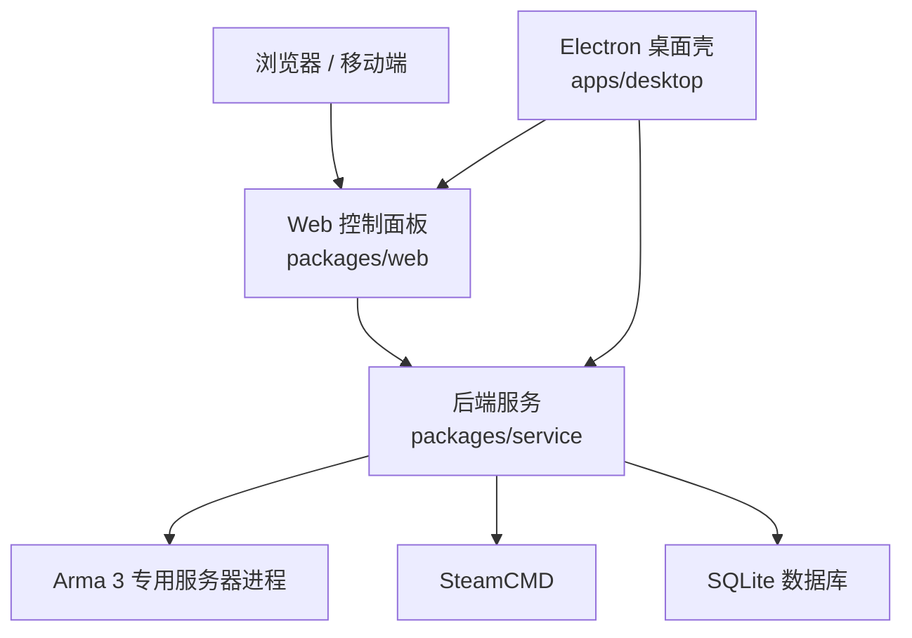
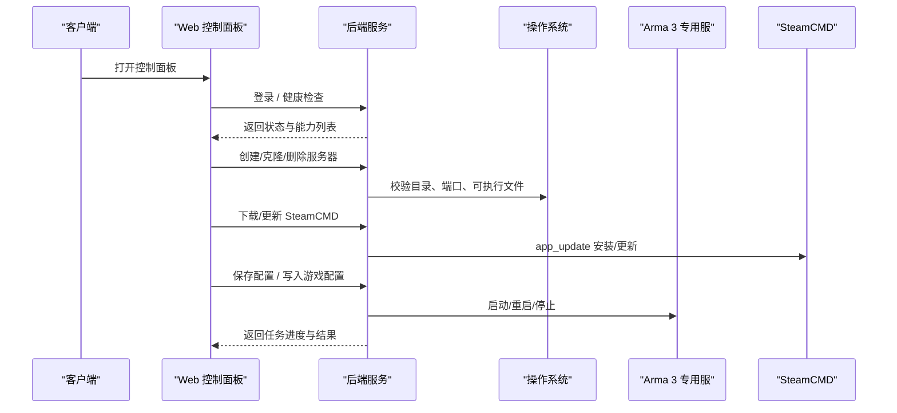
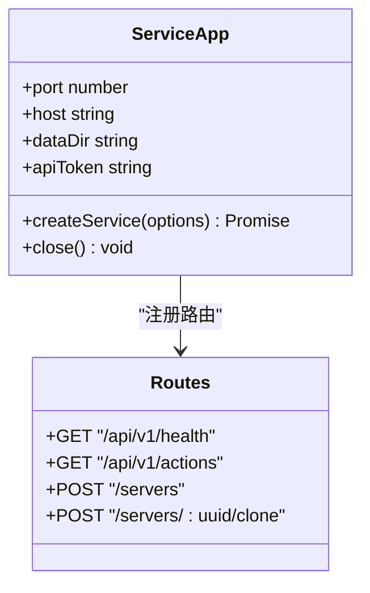
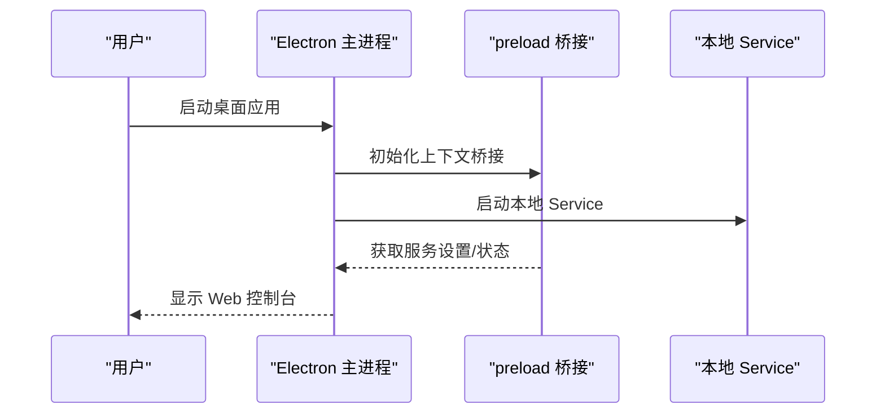
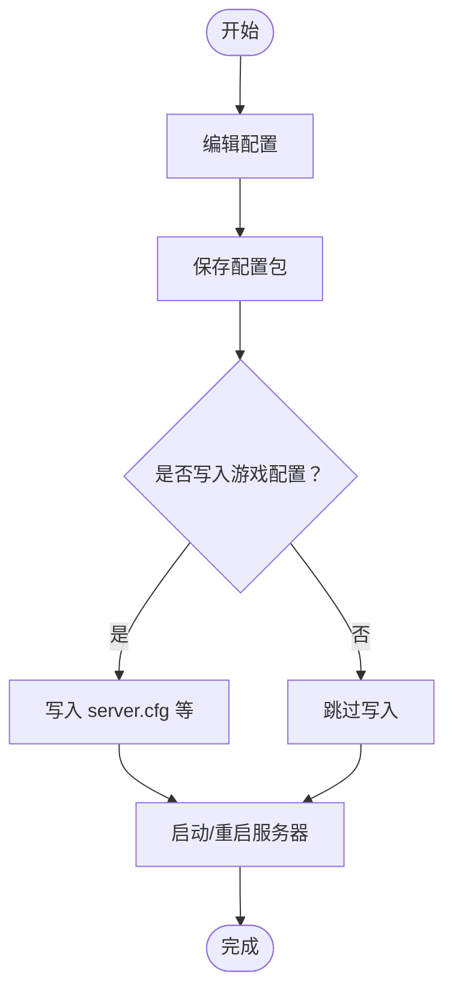
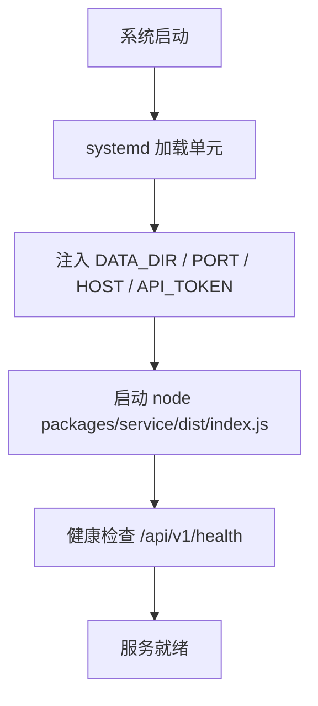

# 生产环境部署

<cite>
**本文引用的文件**   
- [README.md](file://README.md)
- [v2-quickstart.md](file://docs/v2-quickstart.md)
- [linux-server.md](file://docs/linux-server.md)
- [architecture-v2.md](file://docs/architecture-v2.md)
- [config-workflow.md](file://docs/config-workflow.md)
- [package.json](file://package.json)
- [service/package.json](file://packages/service/package.json)
- [apps/desktop/src/main/index.ts](file://apps/desktop/src/main/index.ts)
- [apps/desktop/src/preload/index.ts](file://apps/desktop/src/preload/index.ts)
- [packages/service/src/app.ts](file://packages/service/src/app.ts)
- [packages/service/src/index.ts](file://packages/service/src/index.ts)
- [packages/service/src/api/routes.ts](file://packages/service/src/api/routes.ts)
- [scripts/Arma3ServerTools.iss](file://scripts/Arma3ServerTools.iss)
</cite>

## 目录
1. [简介](#简介)
2. [项目结构](#项目结构)
3. [核心组件](#核心组件)
4. [架构总览](#架构总览)
5. [详细组件分析](#详细组件分析)
6. [依赖与运行环境](#依赖与运行环境)
7. [服务器准备要求](#服务器准备要求)
8. [软件依赖安装](#软件依赖安装)
9. [配置文件与参数说明](#配置文件与参数说明)
10. [服务启动流程与后台运行](#服务启动流程与后台运行)
11. [Windows 与 Linux 部署差异](#windows-与-linux-部署差异)
12. [系统服务与守护进程配置](#系统服务与守护进程配置)
13. [防火墙与安全组建议](#防火墙与安全组建议)
14. [性能与容量规划](#性能与容量规划)
15. [故障排查指南](#故障排查指南)
16. [结论](#结论)

## 简介
本文件面向生产环境，提供 Arma3 Server Tools v2 的完整部署指南。它覆盖操作系统与硬件准备、Node.js 与 SteamCMD 等依赖安装、Service 与 Web 控制面的部署方式、环境变量与配置项说明、Windows/Linux 平台差异、systemd 与 Windows 服务化方案，以及防火墙与安全组建议。

该工具采用“控制端 UI + 被控端 Service”的分层模型：Web 控制台通过 HTTP API 管理 Arma 3 专用服务器、SteamCMD、模组、日志、BattlEye/RCon、任务与监控数据。Electron 桌面壳仅作为本机壳层，实际业务逻辑由 Node Service 承担。

**章节来源**
- [README.md:1-108](file://README.md#L1-L108)
- [architecture-v2.md:1-52](file://docs/architecture-v2.md#L1-L52)

## 项目结构
仓库为 monorepo，关键产物如下：
- `packages/service`：后端服务（Fastify + SQLite），负责进程启停、配置写入、SteamCMD、RCon、任务调度、统计入库等。
- `packages/web`：Vue 3 控制面板，浏览器或 Electron 内嵌加载。
- `apps/desktop`：Electron 桌面壳，默认仅打包 Windows；开发时拉起本地 Service 并嵌入 Web。
- `mod/@a3st_monitor`：Arma 3 监控模组资源。
- `DestinyServerMonitoring`：RVExtension 监控源码（Windows DLL）。
- `scripts`：构建、打包与发布脚本（Inno Setup、PowerShell）。

**图表来源**
- [architecture-v2.md:5-21](file://docs/architecture-v2.md#L5-L21)
- [README.md:50-66](file://README.md#L50-L66)

**章节来源**
- [README.md:50-66](file://README.md#L50-L66)
- [architecture-v2.md:5-21](file://docs/architecture-v2.md#L5-L21)

## 核心组件
- **后端服务（@a3st/service）**
  - 基于 Fastify 暴露 REST API，支持 Bearer 鉴权。
  - 管理服务器实例、SteamCMD、模组、任务、日志、统计、BattlEye/RCon。
  - 可独立运行于 Windows/Linux，也可被 Electron 托管。
- **Web 控制面板（@a3st/web）**
  - Vue 3 控制台，提供向导、配置、部署、日志、RCon、统计等功能。
  - 可通过反向代理或直接访问 Service 托管的静态资源。
- **Electron 桌面壳（apps/desktop）**
  - Windows 安装包使用 Inno Setup。
  - 启动本机 Service，内嵌 Web 控制台，简化本地操作体验。

**章节来源**
- [README.md:37-47](file://README.md#L37-L47)
- [architecture-v2.md:5-21](file://docs/architecture-v2.md#L5-L21)
- [scripts/Arma3ServerTools.iss:1-49](file://scripts/Arma3ServerTools.iss#L1-L49)

## 架构总览
v2 强调“逻辑分离、物理部署可选合并”。推荐在 Linux 开服机只部署 Service，控制端用任意浏览器连接；Electron 则适合 Windows 本地快速体验。

**图表来源**
- [packages/service/src/api/routes.ts:199-241](file://packages/service/src/api/routes.ts#L199-L241)
- [linux-server.md:40-47](file://docs/linux-server.md#L40-L47)
- [config-workflow.md:62-96](file://docs/config-workflow.md#L62-L96)

**章节来源**
- [architecture-v2.md:23-52](file://docs/architecture-v2.md#L23-L52)
- [config-workflow.md:62-96](file://docs/config-workflow.md#L62-L96)

## 详细组件分析

### 后端服务（@a3st/service）
- 入口与环境变量
  - 从环境变量读取 `API_TOKEN`，用于 Bearer 鉴权。
  - 默认监听端口与数据目录可通过环境变量覆盖。
- 鉴权策略
  - 静态 UI 页面允许匿名访问，但 API 接口需携带 `Authorization: Bearer <token>`。
- 主要 API
  - `/api/v1/health`：健康检查。
  - `/api/v1/actions`：列出可用 action 与 REST 端点。
  - `/api/v1/servers`：创建/克隆/删除服务器实例。
- 配置与写入
  - “保存配置包”与“写入游戏配置”是两步操作；“启动”使用已有 cfg，“重启”会先写 cfg 再启服。

**图表来源**
- [packages/service/src/index.ts:6-22](file://packages/service/src/index.ts#L6-L22)
- [packages/service/src/app.ts:23-116](file://packages/service/src/app.ts#L23-L116)
- [packages/service/src/api/routes.ts:199-241](file://packages/service/src/api/routes.ts#L199-L241)

**章节来源**
- [packages/service/src/index.ts:6-22](file://packages/service/src/index.ts#L6-L22)
- [packages/service/src/app.ts:23-116](file://packages/service/src/app.ts#L23-L116)
- [packages/service/src/api/routes.ts:199-241](file://packages/service/src/api/routes.ts#L199-L241)

### Web 控制面板（@a3st/web）
- 开发模式默认 `http://localhost:5173`，Vite 代理到 Service 的 19580。
- 生产环境可直接访问 Service 托管的静态资源，或使用反向代理统一域名。
- 连接页支持设置 `API_TOKEN`，并在请求头中附加 Bearer Token。

**章节来源**
- [v2-quickstart.md:13-39](file://docs/v2-quickstart.md#L13-L39)
- [packages/web/src/stores/connections.ts:93-94](file://packages/web/src/stores/connections.ts#L93-L94)

### Electron 桌面壳（apps/desktop）
- 默认仅 Windows 打包；通过 Inno Setup 生成安装包。
- 启动本机 Service，并将 Web 控制台内嵌到窗口中。
- 通过 IPC 暴露服务设置、状态查询、重启服务等能力。

**图表来源**
- [apps/desktop/src/main/index.ts:43-87](file://apps/desktop/src/main/index.ts#L43-L87)
- [apps/desktop/src/preload/index.ts:1-34](file://apps/desktop/src/preload/index.ts#L1-L34)

**章节来源**
- [apps/desktop/src/main/index.ts:43-87](file://apps/desktop/src/main/index.ts#L43-L87)
- [apps/desktop/src/preload/index.ts:1-34](file://apps/desktop/src/preload/index.ts#L1-L34)
- [scripts/Arma3ServerTools.iss:1-49](file://scripts/Arma3ServerTools.iss#L1-L49)

## 依赖与运行环境
- Node.js ≥ 20（monorepo 与 Service 必需）。
- Linux 服务端需要 `tar`（解压 SteamCMD）、`ss`（UDP 端口检测，通常随 iproute2 安装）。
- Windows 可使用 Electron 安装包；Linux 无官方 Electron 安装包，建议使用 systemd 托管 Service。

**章节来源**
- [package.json:32-34](file://package.json#L32-L34)
- [linux-server.md:6-11](file://docs/linux-server.md#L6-L11)

## 服务器准备要求
- 操作系统
  - Windows：支持 Electron 安装包与桌面壳。
  - Linux：常见 x64 发行版（Ubuntu 22.04+、Debian 12+ 等）。
- 硬件
  - 根据玩家数量、模组规模、地图复杂度与统计采集频率规划 CPU、内存与磁盘 I/O。
  - 建议预留足够空间给 Arma 3 服务器目录、Workshop 模组缓存、日志与 SQLite 数据库。
- 网络
  - 开放 Arma 3 游戏端口（TCP/UDP，依服务器配置而定）。
  - 开放 Service 管理端口（默认 19580），若远程访问需启用防火墙规则与安全组。
  - 若使用 BattlEye/RCon，请确认相关端口与协议已放行。

**章节来源**
- [linux-server.md:6-11](file://docs/linux-server.md#L6-L11)
- [linux-server.md:49-56](file://docs/linux-server.md#L49-L56)

## 软件依赖安装
- Node.js
  - 安装 Node.js ≥ 20；monorepo 与 Service 均依赖其版本约束。
- SteamCMD
  - 通过控制面板的 SteamCMD 页面下载并安装；Linux 下自动拉取 `steamcmd_linux.tar.gz`。
  - 安装/更新 Arma 3 专用服务器后，确认存在对应平台的可执行文件：
    - Linux：`arma3server`
    - Windows：`arma3server_x64.exe`
- 其他
  - Linux：确保 `tar`、`ss` 可用。
  - Windows：如需 Electron 安装包，安装 Inno Setup 或通过脚本自动安装。

**章节来源**
- [linux-server.md:40-47](file://docs/linux-server.md#L40-L47)
- [linux-server.md:6-11](file://docs/linux-server.md#L6-L11)
- [scripts/build-release.ps1:111-139](file://scripts/build-release.ps1#L111-L139)

## 配置文件与参数说明
- 环境变量（Service）
  - `DATA_DIR`：Service 数据目录（包含配置包、数据库、日志等）。
  - `PORT`：Service 监听端口（默认 19580）。
  - `HOST`：Service 绑定地址（远程访问建议设为 `0.0.0.0`）。
  - `API_TOKEN`：REST API 的 Bearer Token。
  - `WEB_ROOT`：可选，指定静态 UI 根目录（Service 托管 Web）。
- 配置包与游戏配置
  - 工具配置包位于 `{UserData}/config/{uuid}/`，包含 manifest、server、startup、mods、basic、profile、battleye、tasks、missionparams 等。
  - 游戏配置位于 `{ServerDir}/a3st_serverconfig/{uuid}/`，由工具“写入游戏配置”生成。
- 常用操作语义
  - 保存配置包：仅更新工具侧配置。
  - 写入游戏配置：保存配置包并生成 server.cfg 等。
  - 启动：使用已有 cfg 启动。
  - 重启：stop → write_cfg → start。

**图表来源**
- [config-workflow.md:62-96](file://docs/config-workflow.md#L62-L96)

**章节来源**
- [config-workflow.md:41-59](file://docs/config-workflow.md#L41-L59)
- [config-workflow.md:62-96](file://docs/config-workflow.md#L62-L96)
- [linux-server.md:58-79](file://docs/linux-server.md#L58-L79)

## 服务启动流程与后台运行
- 开发模式
  - 构建 Service：`npm run build:service`
  - 启动 Service：`npm run start:service`（默认 `http://127.0.0.1:19580`）
  - 启动 Web：`npm run dev:web`（默认 `http://localhost:5173`）
- 生产模式（Linux）
  - 源码部署：编译 Service 与 Web，设置 `DATA_DIR`、`PORT`、`HOST`、`API_TOKEN`，直接运行 `node packages/service/dist/index.js`。
  - 或将 `web/dist` 交给 Service 静态托管，统一通过 19580 访问。
- 生产模式（Windows）
  - 使用 Electron 安装包或便携包；Electron 会自动拉起本机 Service 并内嵌 Web。
  - 也可将 Service 作为独立进程运行，并通过浏览器访问。

**章节来源**
- [v2-quickstart.md:13-39](file://docs/v2-quickstart.md#L13-L39)
- [linux-server.md:13-32](file://docs/linux-server.md#L13-L32)
- [architecture-v2.md:44-52](file://docs/architecture-v2.md#L44-L52)

## Windows 与 Linux 部署差异
- 二进制与工具
  - Linux：专用服二进制为 `arma3server`，SteamCMD 为 `steamcmd.sh`。
  - Windows：专用服二进制为 `arma3server_x64.exe`，SteamCMD 为 `steamcmd.exe`。
- 安装包
  - Windows：Electron + NSIS/Inno Setup 安装包。
  - Linux：源码 + 浏览器；或使用 systemd 托管 Service。
- 进程管理
  - Linux：推荐使用 systemd；进程信号与 argv 解析。
  - Windows：Electron 或脚本通过 taskkill/命令行管理。

**章节来源**
- [linux-server.md:49-56](file://docs/linux-server.md#L49-L56)

## 系统服务与守护进程配置
- Linux systemd
  - 示例单元文件定义 Service 类型、用户、工作目录、环境变量、ExecStart、Restart 策略与开机自启目标。
  - 远程访问务必设置 `API_TOKEN` 并配置防火墙。
- Windows 服务化
  - 可使用 NSSM 或自定义脚本将 Service 注册为 Windows 服务；或使用 Electron 安装包提供的桌面壳托管。
  - 注意以非管理员账户运行，避免权限问题；日志与数据目录应指向可写路径。

**图表来源**
- [linux-server.md:58-79](file://docs/linux-server.md#L58-L79)

**章节来源**
- [linux-server.md:58-79](file://docs/linux-server.md#L58-L79)

## 防火墙与安全组建议
- 最小化开放端口
  - 仅开放必要的 Arma 3 游戏端口与 Service 管理端口（默认 19580）。
  - 若仅本地管理，Service 绑定 `127.0.0.1`；远程管理才绑定 `0.0.0.0`。
- 鉴权
  - 生产环境必须设置 `API_TOKEN`，所有 API 调用需携带 Bearer Token。
  - 静态 UI 页面允许匿名访问，但 API 受鉴权保护。
- 网络安全
  - 云服务器安全组仅允许管理 IP 访问 19580。
  - 建议配合反向代理（Nginx/Caddy）启用 HTTPS，并限制来源 IP。
  - BattlEye/RCon 相关端口按厂商文档开放，并进行白名单控制。

**章节来源**
- [packages/service/src/app.ts:101-116](file://packages/service/src/app.ts#L101-L116)
- [linux-server.md:79-86](file://docs/linux-server.md#L79-L86)

## 性能与容量规划
- CPU/内存
  - 根据在线人数、AI 密度、模组数量与统计采集频率评估；建议预留 20%-30% 余量。
- 磁盘
  - 预留足够空间给服务器目录、Workshop 缓存、日志轮转与 SQLite 数据库。
- 网络
  - 关注上行带宽与 UDP 抖动；必要时调整服务器网络 QoS。
- 监控
  - 使用内置统计与外部监控（如 Prometheus/Grafana）观察 CPU、内存、磁盘、网络与游戏指标。

[本节为通用指导，不直接分析具体文件]

## 故障排查指南
- 无法访问 Web 控制台
  - 确认 Service 已启动且端口可达；检查 `HOST` 与防火墙/安全组。
  - 若使用反向代理，确认静态资源路径与代理规则正确。
- API 鉴权失败
  - 确认已设置 `API_TOKEN`，并在请求头中携带 `Authorization: Bearer <token>`。
- SteamCMD 下载失败
  - 检查网络连通性与 Steam 账号权限；确认 Linux 上 `tar` 可用。
- 服务器启动失败
  - 检查可执行文件路径与权限；确认 server.cfg 已正确写入。
- 日志与诊断
  - 查看 Service 日志与 Arma 3 RPT 日志；使用 `/api/v1/actions` 与 `/api/v1/health` 进行基础诊断。

**章节来源**
- [packages/service/src/api/routes.ts:199-241](file://packages/service/src/api/routes.ts#L199-L241)
- [linux-server.md:81-86](file://docs/linux-server.md#L81-L86)

## 结论
生产环境部署应以 Service 为核心，结合操作系统原生守护机制（systemd 或 Windows 服务）实现高可用。严格遵循最小端口开放原则与 Bearer 鉴权，结合反向代理与 HTTPS 提升安全性。根据玩家规模与模组负载合理评估硬件与网络资源，并通过内置统计与外部监控持续优化稳定性与性能。

[本节为总结性内容，不直接分析具体文件]