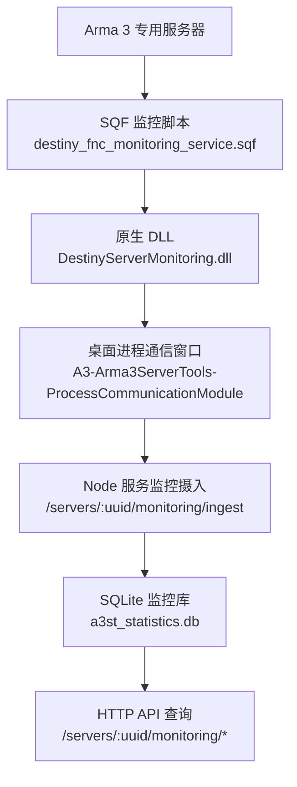
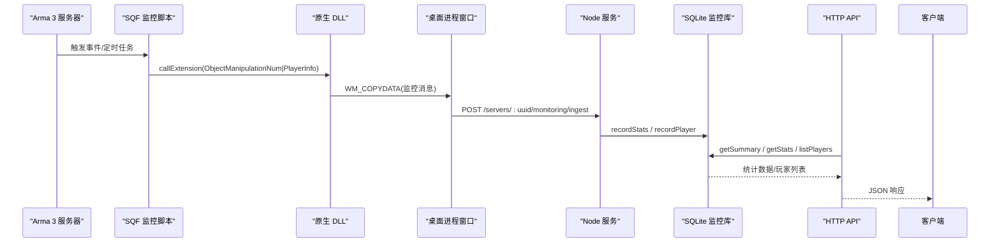
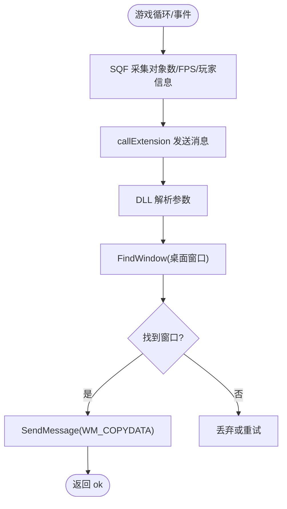
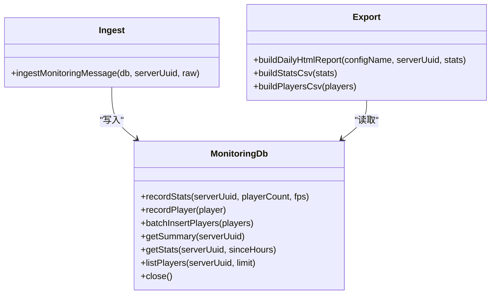
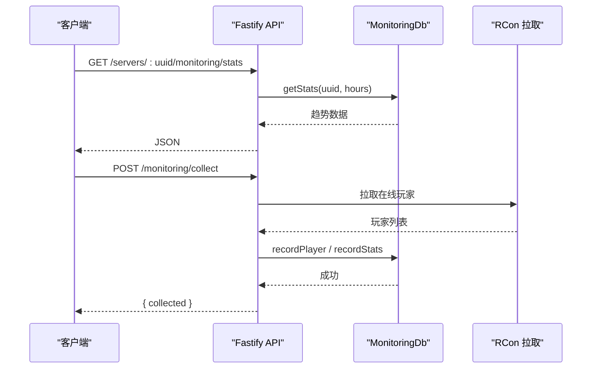
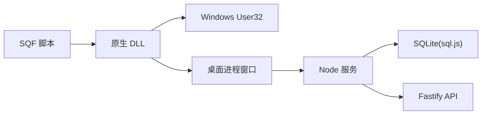

# 监控与日志

<cite>
**本文引用的文件**   
- [README.md](file://README.md)
- [monitoring-cpp-dll-build.md](file://docs/monitoring-cpp-dll-build.md)
- [ArmaMonitoringService.cs](file://DestinyServerMonitoring/DestinyServerMonitoring/ArmaMonitoringService.cs)
- [destiny_fnc_monitoring_service.sqf](file://mod/@a3st_monitor/addons/a3st_monitor/script/destiny_fnc_monitoring_service.sqf)
- [ingest.ts](file://packages/service/src/monitoring/ingest.ts)
- [db.ts](file://packages/service/src/monitoring/db.ts)
- [export.ts](file://packages/service/src/monitoring/export.ts)
- [routes.ts](file://packages/service/src/api/routes.ts)
- [index.ts（服务入口）](file://packages/service/src/index.ts)
- [index.ts（桌面主进程）](file://apps/desktop/src/main/index.ts)
</cite>

## 目录
1. [简介](#简介)
2. [项目结构](#项目结构)
3. [核心组件](#核心组件)
4. [架构总览](#架构总览)
5. [详细组件分析](#详细组件分析)
6. [依赖关系分析](#依赖关系分析)
7. [性能与容量规划](#性能与容量规划)
8. [告警与通知](#告警与通知)
9. [监控系统集成示例](#监控系统集成示例)
10. [日志收集与管理](#日志收集与管理)
11. [故障诊断与常见问题](#故障诊断与常见问题)
12. [结论](#结论)

## 简介
本文件面向生产环境，说明 Arma 3 服务器工具在监控与日志方面的实现、扩展方式与运维建议。内容覆盖：
- 应用监控指标：CPU、内存、进程状态、游戏统计（在线人数、FPS、玩家信息）。
- 日志收集与管理：日志轮转、集中式日志、结构化日志格式。
- 监控系统集成：Prometheus、Grafana、ELK Stack 的配置思路与对接点。
- 告警规则设置与通知机制。
- 性能调优与容量规划指导。
- 故障诊断工具与常见问题排查方法。

本项目为跨平台 Arma 3 专用服务器管理工具，后端基于 Node.js + Fastify + SQLite，提供 HTTP API、任务调度、RCon 控制与监控统计入库能力；同时包含用于从游戏侧采集数据的原生 DLL 与 SQF 脚本。

**章节来源**
- [README.md:37-47](file://README.md#L37-L47)

## 项目结构
与监控和日志相关的代码主要分布在以下位置：
- 游戏侧采集：mod 中的 SQF 脚本与 DestinyServerMonitoring 原生 DLL。
- 服务端监控数据接入与存储：packages/service 下的 monitoring 模块。
- HTTP API 暴露监控查询与数据摄入接口。
- 桌面端负责启动服务、读取 service.log 并展示错误提示。

**图表来源**
- [destiny_fnc_monitoring_service.sqf:1-83](file://mod/@a3st_monitor/addons/a3st_monitor/script/destiny_fnc_monitoring_service.sqf#L1-L83)
- [ArmaMonitoringService.cs:51-144](file://DestinyServerMonitoring/DestinyServerMonitoring/ArmaMonitoringService.cs#L51-L144)
- [routes.ts:697-764](file://packages/service/src/api/routes.ts#L697-L764)
- [db.ts:41-115](file://packages/service/src/monitoring/db.ts#L41-L115)

**章节来源**
- [README.md:50-66](file://README.md#L50-L66)
- [monitoring-cpp-dll-build.md:34-45](file://docs/monitoring-cpp-dll-build.md#L34-L45)

## 核心组件
- 游戏侧采集层
  - SQF 脚本定时采集对象数量、FPS、在线玩家信息，并通过 callExtension 调用原生 DLL。
  - 原生 DLL 通过 Windows 消息 WM_COPYDATA 将数据投递到桌面进程指定窗口句柄。
- 服务侧监控层
  - 监控摄入接口接收原始消息，解析后写入 SQLite。
  - 提供汇总、趋势、玩家列表等查询接口，以及批量 RCon 拉取在线玩家的主动采集接口。
- 导出与报表
  - 生成 HTML 日报与 CSV 导出，便于离线分析与可视化。
- 日志与诊断
  - 桌面端读写 service.log，辅助定位服务启动与运行问题。
  - 监控数据库使用 WAL 模式提升并发写入稳定性。

**章节来源**
- [destiny_fnc_monitoring_service.sqf:1-83](file://mod/@a3st_monitor/addons/a3st_monitor/script/destiny_fnc_monitoring_service.sqf#L1-L83)
- [ArmaMonitoringService.cs:51-144](file://DestinyServerMonitoring/DestinyServerMonitoring/ArmaMonitoringService.cs#L51-L144)
- [ingest.ts:1-39](file://packages/service/src/monitoring/ingest.ts#L1-L39)
- [db.ts:49-115](file://packages/service/src/monitoring/db.ts#L49-L115)
- [export.ts:3-59](file://packages/service/src/monitoring/export.ts#L3-L59)
- [index.ts（桌面主进程）:225-227](file://apps/desktop/src/main/index.ts#L225-L227)

## 架构总览
下图展示了从游戏侧到服务端的监控数据流，以及对外暴露的 API 与存储。

**图表来源**
- [destiny_fnc_monitoring_service.sqf:1-83](file://mod/@a3st_monitor/addons/a3st_monitor/script/destiny_fnc_monitoring_service.sqf#L1-L83)
- [ArmaMonitoringService.cs:102-144](file://DestinyServerMonitoring/DestinyServerMonitoring/ArmaMonitoringService.cs#L102-L144)
- [routes.ts:719-764](file://packages/service/src/api/routes.ts#L719-L764)
- [ingest.ts:1-39](file://packages/service/src/monitoring/ingest.ts#L1-L39)
- [db.ts:121-143](file://packages/service/src/monitoring/db.ts#L121-L143)

## 详细组件分析

### 游戏侧监控采集（SQF + 原生 DLL）
- SQF 脚本职责
  - 周期性采集对象数量、FPS、最小 FPS、在线玩家信息。
  - 通过 callExtension 将结构化字符串发送到原生 DLL。
- 原生 DLL 职责
  - 暴露 RVExtension/RVExtensionArgs/RVExtensionVersion 等入口。
  - 通过 FindWindow + SendMessage 将监控数据投递到桌面进程窗口。
  - 异步处理消息，避免阻塞游戏线程。

**图表来源**
- [destiny_fnc_monitoring_service.sqf:1-83](file://mod/@a3st_monitor/addons/a3st_monitor/script/destiny_fnc_monitoring_service.sqf#L1-L83)
- [ArmaMonitoringService.cs:102-144](file://DestinyServerMonitoring/DestinyServerMonitoring/ArmaMonitoringService.cs#L102-L144)

**章节来源**
- [destiny_fnc_monitoring_service.sqf:1-83](file://mod/@a3st_monitor/addons/a3st_monitor/script/destiny_fnc_monitoring_service.sqf#L1-L83)
- [ArmaMonitoringService.cs:51-144](file://DestinyServerMonitoring/DestinyServerMonitoring/ArmaMonitoringService.cs#L51-L144)

### 服务侧监控摄入与存储（ingest + db）
- 摄入逻辑
  - 解析原始消息头，区分 ObjectManipulationNum 与 PlayerInfo。
  - 提取在线人数、FPS、玩家 GUID/名称等信息，调用数据库写入。
- 数据库设计
  - a3st_statistics：记录服务器 UUID、在线人数、FPS、时间戳。
  - a3st_players：记录玩家 GUID、名称、所属服务器、首次/最后出现时间。
  - 使用 WAL 模式提升并发写入稳定性。
- 导出能力
  - HTML 日报与 CSV 导出，便于离线分析与外部系统消费。

**图表来源**
- [db.ts:22-143](file://packages/service/src/monitoring/db.ts#L22-L143)
- [ingest.ts:1-39](file://packages/service/src/monitoring/ingest.ts#L1-L39)
- [export.ts:3-59](file://packages/service/src/monitoring/export.ts#L3-L59)

**章节来源**
- [ingest.ts:1-39](file://packages/service/src/monitoring/ingest.ts#L1-L39)
- [db.ts:49-143](file://packages/service/src/monitoring/db.ts#L49-L143)
- [export.ts:3-59](file://packages/service/src/monitoring/export.ts#L3-L59)

### HTTP API 监控端点
- 查询类
  - GET /servers/:uuid/monitoring/summary：获取平均/峰值在线人数与条目总数。
  - GET /servers/:uuid/monitoring/stats?hours=24：获取最近 N 小时趋势数据。
  - GET /servers/:uuid/monitoring/players：列出最近出现的玩家。
- 写入类
  - POST /monitoring/collect：遍历所有运行中服务器，通过 RCon 拉取在线玩家并入库。
  - POST /servers/:uuid/monitoring/ingest：接收来自游戏侧的原始监控消息并入库。

**图表来源**
- [routes.ts:697-764](file://packages/service/src/api/routes.ts#L697-L764)
- [db.ts:161-225](file://packages/service/src/monitoring/db.ts#L161-L225)

**章节来源**
- [routes.ts:697-764](file://packages/service/src/api/routes.ts#L697-L764)

## 依赖关系分析
- 游戏侧依赖
  - SQF 脚本依赖 Arma 3 引擎与 BIS 函数库。
  - 原生 DLL 依赖 Windows User32 进行窗口消息投递。
- 服务侧依赖
  - Fastify 路由与请求体解析。
  - sql.js 操作 SQLite 数据库。
  - RCon 模块用于主动拉取在线玩家。
- 桌面端依赖
  - Electron 主进程负责启动服务、捕获日志与显示错误对话框。

**图表来源**
- [ArmaMonitoringService.cs:25-34](file://DestinyServerMonitoring/DestinyServerMonitoring/ArmaMonitoringService.cs#L25-L34)
- [db.ts:1-4](file://packages/service/src/monitoring/db.ts#L1-L4)
- [routes.ts:697-764](file://packages/service/src/api/routes.ts#L697-L764)

**章节来源**
- [monitoring-cpp-dll-build.md:18-32](file://docs/monitoring-cpp-dll-build.md#L18-L32)
- [db.ts:1-4](file://packages/service/src/monitoring/db.ts#L1-L4)

## 性能与容量规划
- 监控写入频率
  - SQF 脚本默认每 60 秒采集一次对象与 FPS 数据，适合常规运营节奏。
  - 若需更高精度，可调整采集间隔，但需注意对服务器性能的影响。
- 数据库性能
  - 使用 WAL 模式提升并发写入稳定性，减少锁竞争。
  - 定期归档历史数据，避免单表过大影响查询性能。
- 导出与报表
  - HTML 日报与 CSV 导出适用于离线分析，建议在低峰时段生成。
- 容量规划建议
  - 根据在线人数峰值与采集频率估算每日数据量，评估磁盘空间与备份策略。
  - 多服务器场景下，按服务器 UUID 分区或分库，降低单库压力。

**章节来源**
- [destiny_fnc_monitoring_service.sqf:75-83](file://mod/@a3st_monitor/addons/a3st_monitor/script/destiny_fnc_monitoring_service.sqf#L75-L83)
- [db.ts:59-63](file://packages/service/src/monitoring/db.ts#L59-L63)
- [export.ts:3-59](file://packages/service/src/monitoring/export.ts#L3-L59)

## 告警与通知
当前仓库未内置告警引擎，但可通过以下方式实现：
- 基于 HTTP API 的指标采集
  - 使用 Prometheus Node Exporter 或自定义抓取器，定时调用 /servers/:uuid/monitoring/stats 与 /servers/:uuid/monitoring/summary，转换为 Prometheus 指标。
- 告警规则
  - 在线人数异常：长时间为零或突增。
  - FPS 过低：持续低于阈值。
  - 玩家列表异常：GUID 重复或名称为空。
- 通知渠道
  - 结合 Alertmanager 发送邮件、企业微信、钉钉或 Slack 通知。

[本节为通用实践建议，不直接分析具体源码文件]

## 监控系统集成示例

### Prometheus 集成思路
- 指标定义
  - arma3_server_online_players：在线人数（来自 summary 或 stats）。
  - arma3_server_fps：服务器 FPS（来自 stats）。
  - arma3_server_stats_entries：统计条目总数（来自 summary）。
- 抓取方式
  - 编写轻量抓取脚本，定时调用 Fastify API，转换为 Prometheus 文本格式。
  - 配置 prometheus.yml 指向抓取脚本。

[本节为通用实践建议，不直接分析具体源码文件]

### Grafana 可视化
- 数据源
  - 添加 Prometheus 数据源。
- 仪表盘
  - 在线人数趋势图、FPS 折线图、玩家活跃度热力图。
  - 关键指标卡片：峰值在线、平均 FPS、统计条目数。

[本节为通用实践建议，不直接分析具体源码文件]

### ELK Stack 集成思路
- 日志采集
  - 使用 Filebeat 采集 service.log 与 Arma 3 RPT 日志。
- 索引设计
  - 按日期分片，字段包括 timestamp、level、message、server_uuid。
- 可视化
  - Kibana 创建日志面板，过滤错误级别与关键字。

[本节为通用实践建议，不直接分析具体源码文件]

## 日志收集与管理
- 本地日志
  - 桌面端会打开并追加写入 service.log，便于快速定位服务启动与运行问题。
- 日志轮转
  - 建议使用 logrotate（Linux）或 Windows 日志管理工具，按大小或时间轮转 service.log。
- 集中式日志
  - 将 service.log 与 Arma 3 RPT 日志统一采集至 ELK Stack，便于检索与分析。
- 结构化日志
  - 在服务端引入结构化日志框架（如 pino），输出 JSON 格式，便于机器解析。

**章节来源**
- [index.ts（桌面主进程）:225-227](file://apps/desktop/src/main/index.ts#L225-L227)
- [index.ts（桌面主进程）:345-346](file://apps/desktop/src/main/index.ts#L345-L346)

## 故障诊断与常见问题
- 监控数据库为空
  - 检查 MonitoringHost 是否启动、DLL 是否加载、EnableMonitoringService 是否勾选。
- 仅有玩家库无快照
  - RCon 有连接但 DLL 未注入；检查服务器目录与扩展配置。
- 图表为空
  - 快照不足或时间戳为 0；运行一段时间后重试。
- 服务无法启动或端口占用
  - 查看 service.log，确认端口冲突或服务进程残留。
- 桌面界面无法加载
  - 检查后端服务是否运行，URL 是否正确，查看 service.log 中的错误描述。

**章节来源**
- [monitoring-cpp-dll-build.md:82-89](file://docs/monitoring-cpp-dll-build.md#L82-L89)
- [index.ts（桌面主进程）:512-530](file://apps/desktop/src/main/index.ts#L512-L530)

## 结论
本项目已具备完整的监控数据采集、存储与查询能力，并提供导出与报表功能。生产环境中建议：
- 启用 SQL WAL 模式并定期归档历史数据。
- 通过 Prometheus/Grafana 实现指标可视化与告警。
- 使用 ELK Stack 集中管理日志，建立检索与告警规则。
- 制定容量规划与性能调优策略，确保在高负载下稳定运行。

[本节为总结性内容，不直接分析具体源码文件]