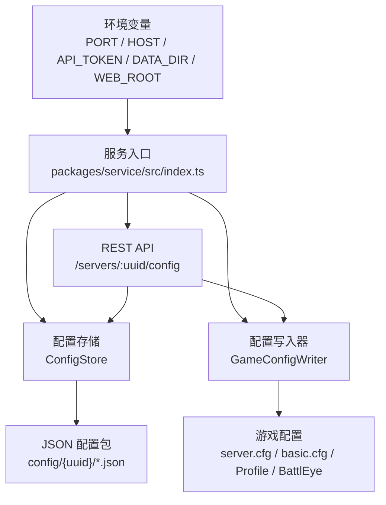
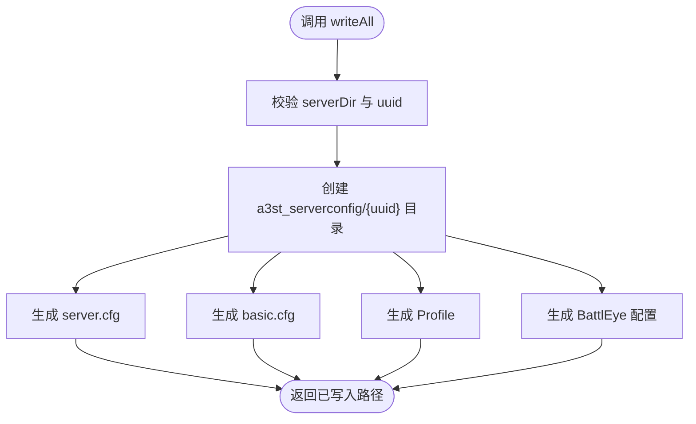
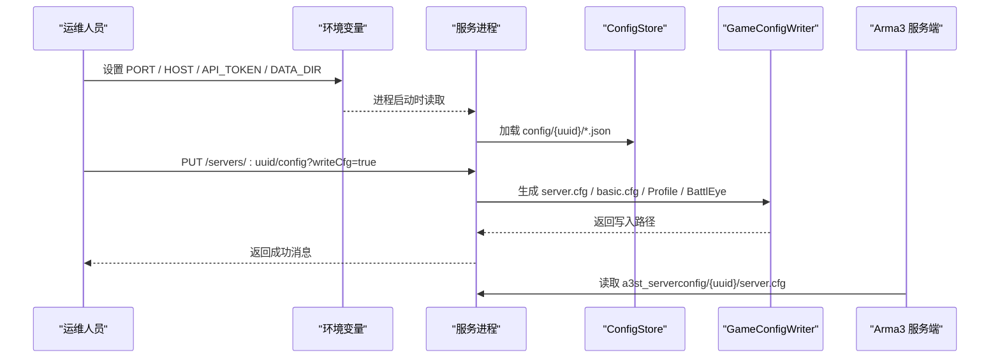
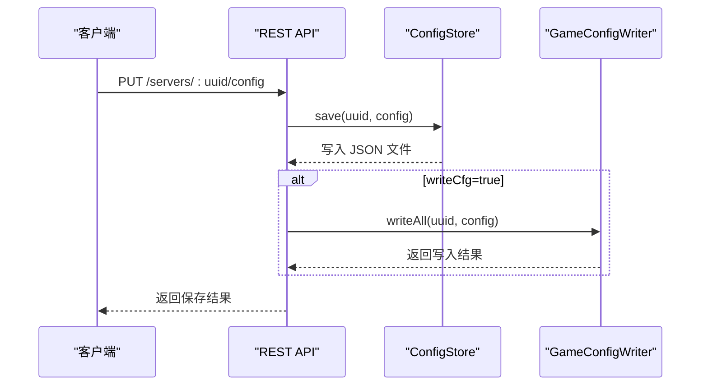

# 配置管理

<cite>
**本文引用的文件**   
- [packages/service/src/index.ts](file://packages/service/src/index.ts)
- [packages/service/src/types/config.ts](file://packages/service/src/types/config.ts)
- [packages/service/src/config/store.ts](file://packages/service/src/config/store.ts)
- [packages/service/src/config/game-config-writer.ts](file://packages/service/src/config/game-config-writer.ts)
- [packages/service/src/api/routes.ts](file://packages/service/src/api/routes.ts)
- [packages/service/src/web-static.ts](file://packages/service/src/web-static.ts)
- [packages/service/src/steamcmd/proxy-fetch.ts](file://packages/service/src/steamcmd/proxy-fetch.ts)
- [apps/desktop/src/main/index.ts](file://apps/desktop/src/main/index.ts)
- [docs/linux-server.md](file://docs/linux-server.md)
- [docs/deployment-ab-openclaw.md](file://docs/deployment-ab-openclaw.md)
</cite>

## 目录
1. [简介](#简介)
2. [项目结构与配置边界](#项目结构与配置边界)
3. [配置文件结构](#配置文件结构)
4. [环境变量与优先级](#环境变量与优先级)
5. [敏感信息安全管理](#敏感信息安全管理)
6. [配置验证与默认值处理](#配置验证与默认值处理)
7. [配置热重载与动态更新](#配置热重载与动态更新)
8. [生产环境部署建议](#生产环境部署建议)
9. [故障排查](#故障排查)
10. [结论](#结论)

## 简介
本文面向生产环境的 Arma3 Server Tool 服务，说明其配置体系、文件格式、环境变量覆盖机制、敏感信息管理、默认值策略以及热更新能力。核心要点如下：
- 工具内部使用 JSON 格式的“服务器配置包”持久化，而不是直接维护 `server.cfg`。
- 游戏运行所需的 `server.cfg`、`basic.cfg`、Profile、BattlEye 等由配置写入器生成到服务器目录下的专用配置文件夹中。
- 服务启动参数、数据目录、Web 根目录、代理设置等通过环境变量注入。
- 当前仓库未实现运行时热重载；配置变更需保存并通过 API 触发写盘或重启。

## 项目结构与配置边界
Arma3 Server Tool 的配置分为三层：
1. **服务进程级配置**：端口、主机、API Token、数据目录、Web 根目录、代理等。
2. **服务器配置包**：以 UUID 为键的 JSON 配置集合，包含服务器路径、启动参数、Mod、基础网络、BattlEye、任务、调度、监控等。
3. **游戏运行配置**：由工具生成的 `server.cfg`、`basic.cfg`、用户 Profile、BattlEye 配置，供 Arma3 服务端程序读取。

**图表来源**
- [packages/service/src/index.ts:4-23](file://packages/service/src/index.ts#L4-L23)
- [packages/service/src/config/store.ts:29-103](file://packages/service/src/config/store.ts#L29-L103)
- [packages/service/src/config/game-config-writer.ts:590-619](file://packages/service/src/config/game-config-writer.ts#L590-L619)
- [packages/service/src/api/routes.ts:126-145](file://packages/service/src/api/routes.ts#L126-L145)

**章节来源**
- [packages/service/src/index.ts:4-23](file://packages/service/src/index.ts#L4-L23)
- [packages/service/src/config/store.ts:29-103](file://packages/service/src/config/store.ts#L29-L103)
- [packages/service/src/config/game-config-writer.ts:590-619](file://packages/service/src/config/game-config-writer.ts#L590-L619)

## 配置文件结构

### 服务器配置包模型
服务器配置包是工具的核心配置载体，类型为 `ServerConfigPackage`。它不是单一文件，而是按字段拆分为多个 JSON 文件，并附带 manifest 元数据。

| 配置段 | JSON 文件名 | 主要用途 |
|---|---|---|
| `manifest` | `manifest.json` | 服务器标识、名称、格式版本、最后修改时间 |
| `server` | `server.json` | 服务器目录、可执行文件、x64 标志、Mod 路径 |
| `startup` | `startup.json` | 启动参数、端口、内存、线程、日志、窗口行为 |
| `mods` | `mods.json` | Mod ID、本地 Mod、启用列表、自动复制 key |
| `basic` | `basic.json` | 主机名、密码、管理员密码、最大玩家、基础网络参数 |
| `profile` | `profile.json` | 服务器 Profile 名称 |
| `battleye` | `battleye.json` | RCon 地址、端口、密码 |
| `tasks` | `tasks.json` | 任务列表、难度、自动选择、Headless Client、进程 ID |
| `missionParams` | `missionparams.json` | 任务参数、按模板参数映射 |
| `scheduler` | `scheduler.json` | 定时重启、监控 Cron、自定义任务 |
| `monitoring` | `monitoring.json` | 监控开关、Mod 监控开关 |

**章节来源**
- [packages/service/src/types/config.ts:12-134](file://packages/service/src/types/config.ts#L12-L134)
- [packages/service/src/config/store.ts:8-20](file://packages/service/src/config/store.ts#L8-L20)
- [packages/service/src/config/store.ts:71-103](file://packages/service/src/config/store.ts#L71-L103)
- [packages/service/src/config/store.ts:122-162](file://packages/service/src/config/store.ts#L122-L162)

### server.cfg 与相关游戏配置
`server.cfg` 不是手工编辑的主配置源，而是由 `GameConfigWriter` 根据服务器配置包生成。生成内容包括：
- 主机名、密码、最大玩家、持久化、跳过大厅、地图绘制、统计、语音、投票、BattlEye、管理员、事件回调、日志文件、时间戳格式等。
- 当前激活任务的 `class Missions` 和可选的任务白名单。
- 高级选项如对象缺失日志、描述解析跳过、任务加载错误忽略、日志队列大小。
- 支持追加额外行，用于扩展 `server.cfgArgs`。

同时还会生成：
- `basic.cfg`：带宽、包大小、错误阈值等基础网络参数。
- `Users/{uuid}/{uuid}.Arma3Profile`：服务器侧 Profile 自定义难度、AI 等级、地形网格、视距等。
- `BattlEye/BEServer_x64.cfg` 与 `BEServer.cfg`：RCon 密码、端口、车辆创建限制、位置设置限制。

**图表来源**
- [packages/service/src/config/game-config-writer.ts:316-320](file://packages/service/src/config/game-config-writer.ts#L316-L320)
- [packages/service/src/config/game-config-writer.ts:322-478](file://packages/service/src/config/game-config-writer.ts#L322-L478)
- [packages/service/src/config/game-config-writer.ts:480-500](file://packages/service/src/config/game-config-writer.ts#L480-L500)
- [packages/service/src/config/game-config-writer.ts:502-554](file://packages/service/src/config/game-config-writer.ts#L502-L554)
- [packages/service/src/config/game-config-writer.ts:556-588](file://packages/service/src/config/game-config-writer.ts#L556-L588)
- [packages/service/src/config/game-config-writer.ts:590-619](file://packages/service/src/config/game-config-writer.ts#L590-L619)

**章节来源**
- [packages/service/src/config/game-config-writer.ts:322-478](file://packages/service/src/config/game-config-writer.ts#L322-L478)
- [packages/service/src/config/game-config-writer.ts:480-500](file://packages/service/src/config/game-config-writer.ts#L480-L500)
- [packages/service/src/config/game-config-writer.ts:502-554](file://packages/service/src/config/game-config-writer.ts#L502-L554)
- [packages/service/src/config/game-config-writer.ts:556-588](file://packages/service/src/config/game-config-writer.ts#L556-L588)
- [packages/service/src/config/game-config-writer.ts:590-619](file://packages/service/src/config/game-config-writer.ts#L590-L619)

### application.json 的实际情况
在当前代码库中，未发现名为 `application.json` 的服务级应用配置文件。服务配置主要通过以下机制提供：
- 环境变量：`PORT`、`HOST`、`API_TOKEN`、`DATA_DIR`、`WEB_ROOT`。
- 桌面端 Electron 主进程注入的环境变量。
- REST API 写入的服务器配置包 JSON。

因此，不应假设存在全局 `application.json`；若需要集中配置，应优先使用环境变量或外部配置管理系统（例如容器编排平台、系统服务管理器）。

**章节来源**
- [packages/service/src/index.ts:4-16](file://packages/service/src/index.ts#L4-L16)
- [packages/service/src/web-static.ts:19-25](file://packages/service/src/web-static.ts#L19-L25)
- [apps/desktop/src/main/index.ts:293-300](file://apps/desktop/src/main/index.ts#L293-L300)

## 环境变量与优先级

### 关键环境变量
| 环境变量 | 默认值 | 作用 | 生产建议 |
|---|---:|---|---|
| `PORT` | `19580` | 服务监听端口 | 固定端口，配合防火墙或反向代理 |
| `HOST` | `127.0.0.1` | 服务绑定地址 | 仅内网暴露时设为 `0.0.0.0`，并配合认证 |
| `API_TOKEN` | 空字符串 | API 访问令牌 | 生产必须设置强随机 Token |
| `DATA_DIR` | `.a3st-dev-data` | 服务数据目录 | 指向持久化卷或受控目录 |
| `WEB_ROOT` | 由 Web 静态资源逻辑解析 | 前端静态资源根目录 | 打包后由桌面端注入，或显式指定 |
| `A3ST_STEAMCMD_ROOT` | 无 | SteamCMD 根目录（子进程） | 由管理器传入子进程环境 |
| `https_proxy` / `HTTP_PROXY` 等 | 无 | HTTP/HTTPS 代理 | 下载 Mod 或 SteamCMD 时使用 |

**章节来源**
- [packages/service/src/index.ts:4-16](file://packages/service/src/index.ts#L4-L16)
- [packages/service/src/web-static.ts:19-25](file://packages/service/src/web-static.ts#L19-L25)
- [packages/service/src/steamcmd/proxy-fetch.ts:5-8](file://packages/service/src/steamcmd/proxy-fetch.ts#L5-L8)
- [packages/service/src/steamcmd/manager.ts:730-730](file://packages/service/src/steamcmd/manager.ts#L730-L730)

### 配置优先级
当前实现的优先级顺序为：
1. **环境变量**：服务启动时从 `process.env` 读取，决定服务自身运行参数和数据目录。
2. **服务器配置包 JSON**：通过 API 保存，位于 `DATA_DIR/config/{uuid}/*.json`。
3. **游戏运行配置**：由 `GameConfigWriter` 根据服务器配置包生成到服务器目录下的 `a3st_serverconfig/{uuid}`。

不存在“application.json 覆盖环境变量”的机制。环境变量在服务进程启动阶段生效，服务器配置包在运行时通过 API 读写。

**图表来源**
- [packages/service/src/index.ts:4-23](file://packages/service/src/index.ts#L4-L23)
- [packages/service/src/config/store.ts:71-103](file://packages/service/src/config/store.ts#L71-L103)
- [packages/service/src/api/routes.ts:126-145](file://packages/service/src/api/routes.ts#L126-L145)
- [packages/service/src/config/game-config-writer.ts:590-619](file://packages/service/src/config/game-config-writer.ts#L590-L619)

**章节来源**
- [packages/service/src/index.ts:4-23](file://packages/service/src/index.ts#L4-L23)
- [packages/service/src/config/store.ts:71-103](file://packages/service/src/config/store.ts#L71-L103)
- [packages/service/src/api/routes.ts:126-145](file://packages/service/src/api/routes.ts#L126-L145)

## 敏感信息安全管理

### 敏感字段范围
服务器配置包中包含多类敏感信息：
- 服务器密码、管理员密码。
- BattlEye RCon 密码。
- 服务器命令密码。
- 可能包含任务参数、自定义启动参数中的密钥片段。

这些字段通常出现在：
- `basic.password`
- `basic.passwordAdmin`
- `basic.serverCommandPassword`
- `battleye.rconPassword`
- `startup.parameters`、`startup.startArgs`、`startup.startConfigArgs`

**章节来源**
- [packages/service/src/types/config.ts:73-90](file://packages/service/src/types/config.ts#L73-L90)
- [packages/service/src/types/config.ts:34-59](file://packages/service/src/types/config.ts#L34-L59)

### 当前安全机制
- 文档历史中提到过 DPAPI 加密前缀 `A3ST_ENC:` 的概念，但当前 TypeScript 服务代码中未发现统一的敏感字段加密/解密实现。
- 配置写入器对启动参数进行一定程度的合法性检查，例如 `isSafeStartupExtraArg` 只允许特定字符集，避免明显危险的命令行注入。
- 服务可通过 `API_TOKEN` 保护 REST API。
- 数据目录 `DATA_DIR` 控制配置文件的磁盘落盘位置，便于操作系统层面权限控制。

**章节来源**
- [packages/service/src/config/game-config-writer.ts:164-180](file://packages/service/src/config/game-config-writer.ts#L164-L180)
- [packages/service/src/index.ts:4-6](file://packages/service/src/index.ts#L4-L6)
- [docs/archive/code-review-2026-05-27.md:49-49](file://docs/archive/code-review-2026-05-27.md#L49-L49)

### 生产环境敏感信息管理建议
由于当前代码未实现统一的配置加密层，生产环境应通过以下方式降低风险：
1. **文件系统权限**：将 `DATA_DIR` 设置为仅服务账户可读写的目录。
2. **环境变量保护**：通过容器编排平台、系统服务管理器或密钥管理服务注入 `API_TOKEN`、代理凭据等。
3. **最小权限原则**：服务进程不应以 root 或高权限账户运行。
4. **审计与备份**：对 `DATA_DIR` 的变更进行审计，备份时注意脱敏。
5. **网络隔离**：除非必要，不要将 `19580` 直接暴露到公网；如需远程访问，使用反向代理并强制 HTTPS 与 Token 认证。

**章节来源**
- [packages/service/src/index.ts:4-16](file://packages/service/src/index.ts#L4-L16)
- [docs/linux-server.md:22-22](file://docs/linux-server.md#L22-L22)
- [docs/linux-server.md:69-79](file://docs/linux-server.md#L69-L79)
- [docs/deployment-ab-openclaw.md:117-117](file://docs/deployment-ab-openclaw.md#L117-L117)

## 配置验证与默认值处理

### 类型与默认值
配置写入器使用辅助函数处理类型转换和默认值：
- `str(value, fallback)`：字符串转换，空值返回 fallback。
- `num(value, fallback)`：数字转换，非数字返回 fallback。
- `bool(value, fallback)`：布尔转换，支持布尔、数字、字符串。
- `parseList(value)`：数组或逗号/分号/空格分隔字符串转数组。
- `appendExtraLines(content, extra)`：追加额外配置行。

这些函数确保即使配置不完整或类型异常，也能生成可用的 `server.cfg` 和 `basic.cfg`。

**章节来源**
- [packages/service/src/config/game-config-writer.ts:28-68](file://packages/service/src/config/game-config-writer.ts#L28-L68)
- [packages/service/src/config/game-config-writer.ts:81-150](file://packages/service/src/config/game-config-writer.ts#L81-L150)

### 配置验证现状
当前验证主要集中在：
- 启动参数合法性检查：`isSafeStartupExtraArg` 限制字符集和长度。
- 端口占用检测：`isPortInUse` 在 Windows 和非 Windows 平台分别调用系统命令。
- 服务器目录与 UUID 校验：`writeAll` 要求 `serverDir` 和 `uuid` 非空。
- JSON 配置加载时跳过损坏文件，避免整个配置包失败。

未发现完整的 schema 校验或字段必填校验。因此，生产环境建议在 API 层或上游配置管理系统增加校验。

**章节来源**
- [packages/service/src/config/game-config-writer.ts:164-180](file://packages/service/src/config/game-config-writer.ts#L164-L180)
- [packages/service/src/config/game-config-writer.ts:197-220](file://packages/service/src/config/game-config-writer.ts#L197-L220)
- [packages/service/src/config/game-config-writer.ts:590-597](file://packages/service/src/config/game-config-writer.ts#L590-L597)
- [packages/service/src/config/store.ts:82-99](file://packages/service/src/config/store.ts#L82-L99)

## 配置热重载与动态更新

### 当前行为
- 配置保存在内存缓存和磁盘 JSON 文件中。
- `ConfigStore.invalidateCache(uuid)` 可按 UUID 清除缓存，或清空全部缓存。
- API `/servers/:uuid/config` 支持保存配置，并可带 `writeCfg=true` 参数触发写入游戏配置。
- 没有检测到监听文件变化或 WebSocket 推送的热重载实现。

**图表来源**
- [packages/service/src/config/store.ts:40-46](file://packages/service/src/config/store.ts#L40-L46)
- [packages/service/src/config/store.ts:122-162](file://packages/service/src/config/store.ts#L122-L162)
- [packages/service/src/api/routes.ts:126-145](file://packages/service/src/api/routes.ts#L126-L145)
- [packages/service/src/config/game-config-writer.ts:590-619](file://packages/service/src/config/game-config-writer.ts#L590-L619)

**章节来源**
- [packages/service/src/config/store.ts:40-46](file://packages/service/src/config/store.ts#L40-L46)
- [packages/service/src/config/store.ts:122-162](file://packages/service/src/config/store.ts#L122-L162)
- [packages/service/src/api/routes.ts:126-145](file://packages/service/src/api/routes.ts#L126-L145)

### 热重载建议
当前仓库未实现真正的运行时热重载。若需要动态更新，推荐流程：
1. 通过 API 更新服务器配置包。
2. 使用 `writeCfg=true` 重新生成 `server.cfg`。
3. 对于需要立即生效的参数，调用重启接口或任务系统触发重启。
4. 对于仅影响新连接或新会话的参数，等待自然刷新或客户端重连。

## 生产环境部署建议

### Linux 服务示例
Linux 文档展示了使用 `DATA_DIR` 指定数据目录，并在 systemd 中设置环境变量。远程访问时必须设置 `API_TOKEN` 并配置防火墙。

**章节来源**
- [docs/linux-server.md:22-22](file://docs/linux-server.md#L22-L22)
- [docs/linux-server.md:69-79](file://docs/linux-server.md#L69-L79)

### 远程 Agent 与反向代理
部署文档提到 Agent URL、公网基地址、防火墙与 Token 的关系。生产环境中应避免直接暴露服务端口，推荐使用反向代理统一鉴权、限流、TLS 终止。

**章节来源**
- [docs/deployment-ab-openclaw.md:117-117](file://docs/deployment-ab-openclaw.md#L117-L117)
- [docs/deployment-ab-openclaw.md:140-140](file://docs/deployment-ab-openclaw.md#L140-L140)
- [docs/deployment-ab-openclaw.md:163-164](file://docs/deployment-ab-openclaw.md#L163-L164)
- [docs/deployment-ab-openclaw.md:306-306](file://docs/deployment-ab-openclaw.md#L306-L306)

### 桌面端与服务端环境变量
桌面端主进程会向服务传递 `DATA_DIR`、`API_TOKEN`，并设置 `WEB_ROOT`。这体现了环境变量作为服务配置注入的主要方式。

**章节来源**
- [apps/desktop/src/main/index.ts:293-300](file://apps/desktop/src/main/index.ts#L293-L300)

## 故障排查

### 常见问题
| 现象 | 可能原因 | 处理建议 |
|---|---|---|
| 启动报缺少 `server.cfg` | 未执行“应用到服务器目录”或未调用 `writeCfg=true` | 先保存配置并生成游戏配置 |
| 端口冲突 | 目标端口已被占用 | 调整 `startup.port` 或释放占用进程 |
| API 无法访问 | 未设置 `API_TOKEN` 或防火墙拦截 | 设置 Token 并检查端口与网络策略 |
| 配置未生效 | 仅修改了 JSON 但未写盘或重启 | 调用保存接口并触发写盘或重启 |
| 下载失败 | 代理未配置或代理不可用 | 设置 `https_proxy` / `HTTP_PROXY` |

**章节来源**
- [packages/service/src/config/game-config-writer.ts:197-220](file://packages/service/src/config/game-config-writer.ts#L197-L220)
- [packages/service/src/steamcmd/proxy-fetch.ts:5-8](file://packages/service/src/steamcmd/proxy-fetch.ts#L5-L8)
- [docs/smoke-checklist.md:27-28](file://docs/smoke-checklist.md#L27-L28)

## 结论
Arma3 Server Tool 的配置体系以“服务环境变量 + 服务器配置包 JSON + 生成的游戏配置”为核心。生产环境应重点关注：
- 使用环境变量注入服务级敏感参数。
- 将服务器配置包存储在受控的 `DATA_DIR`。
- 通过 API 保存配置并显式生成 `server.cfg`。
- 不依赖不存在的 `application.json`。
- 在未实现热重载的情况下，通过写盘与重启完成配置更新。
- 结合文件系统权限、网络隔离、Token 认证保障敏感信息安全。