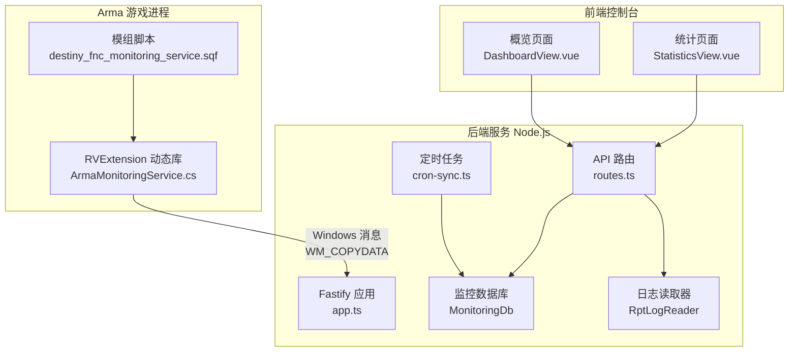
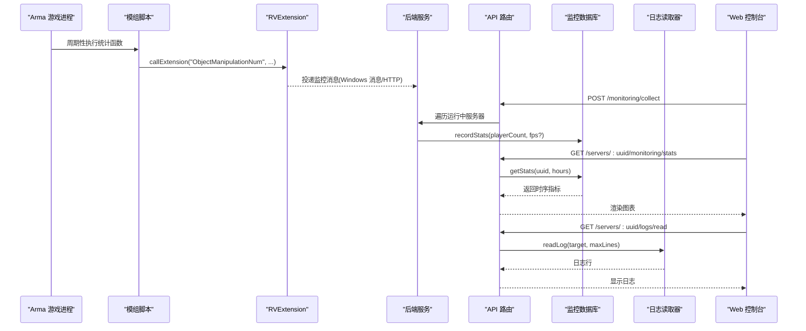
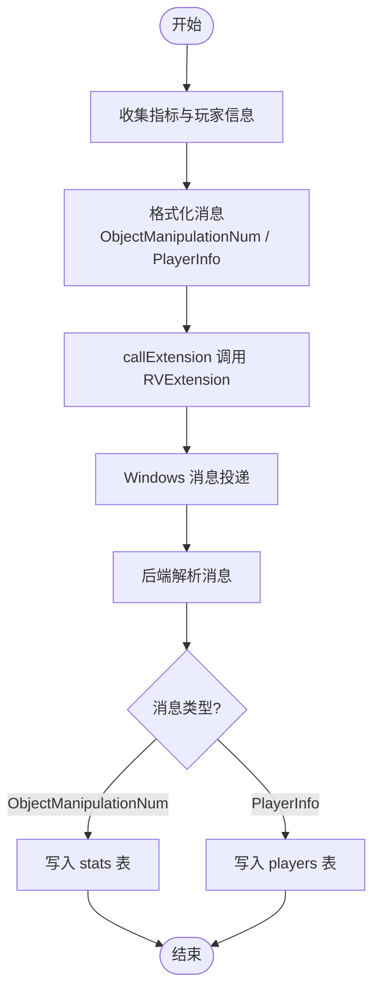
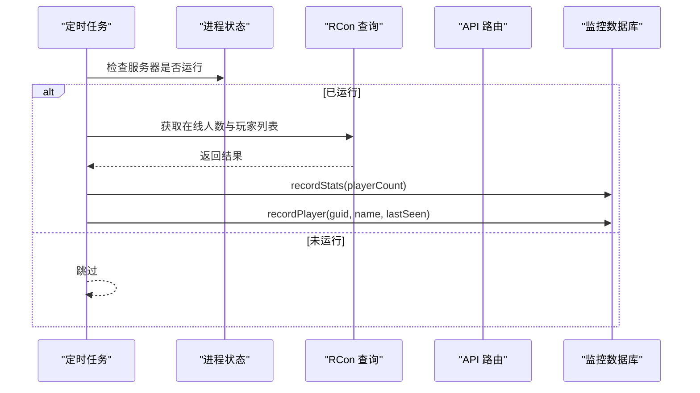
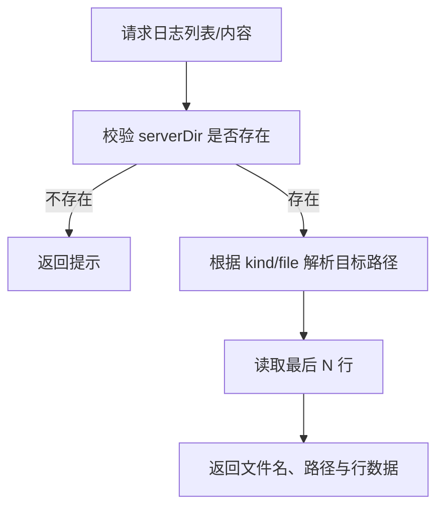
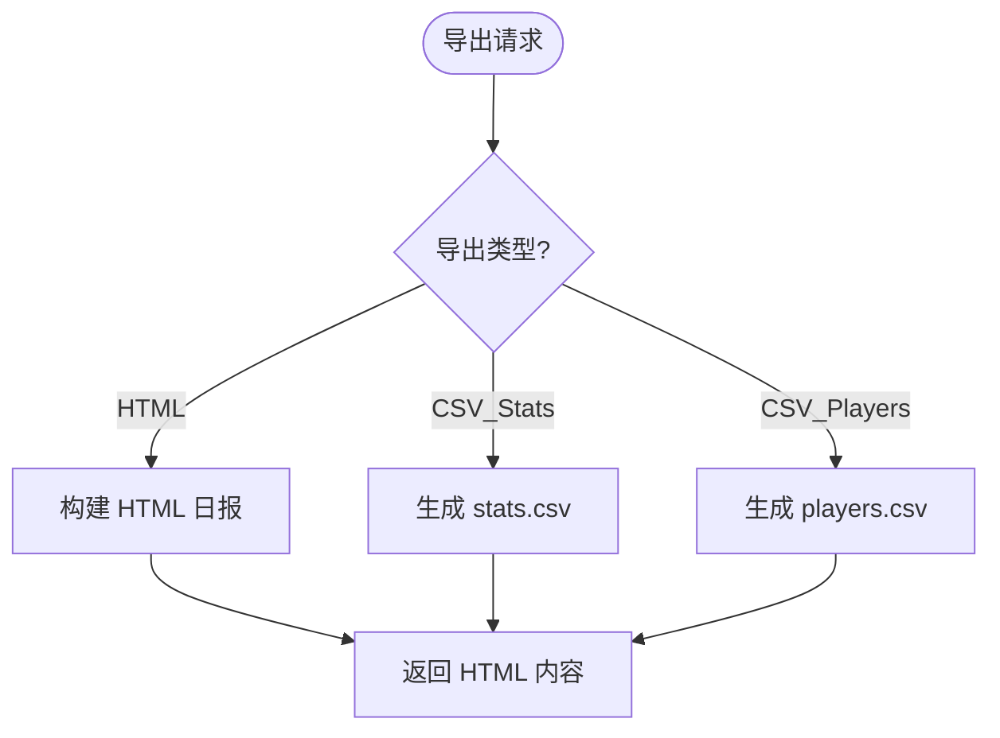
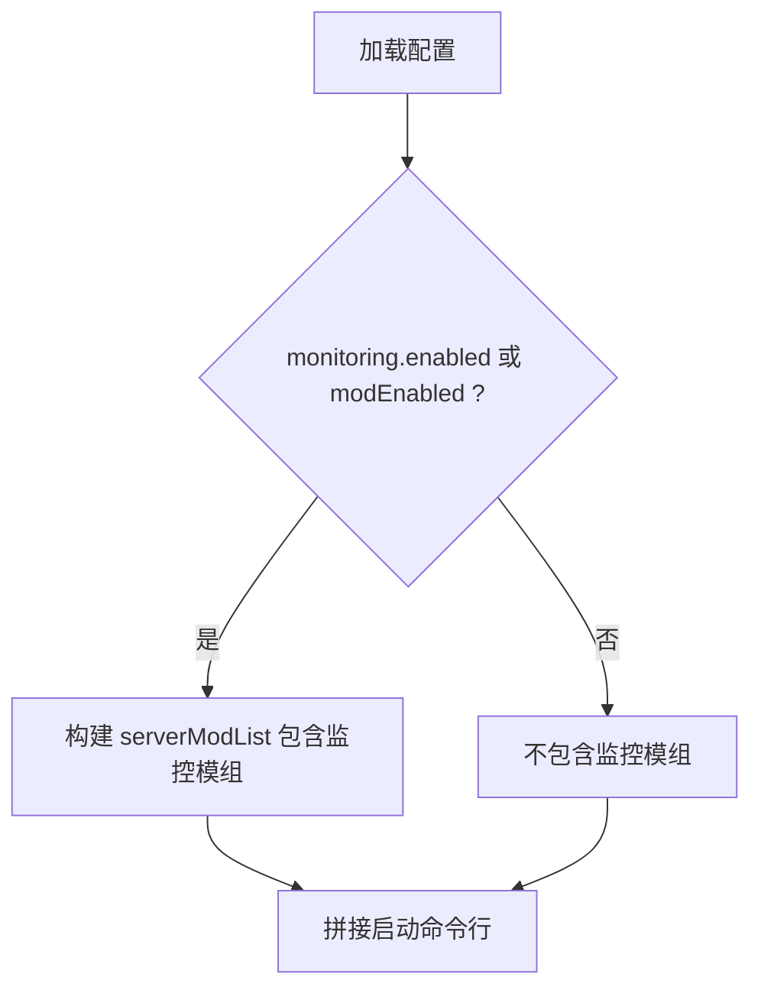
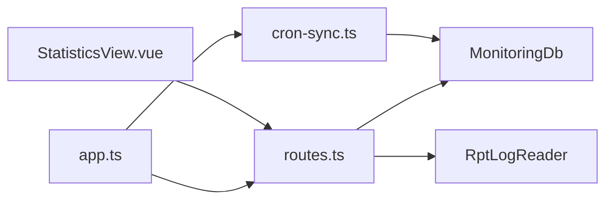

# 监控与日志

<cite>
**本文引用的文件**   
- [README.md](file://README.md)
- [architecture-v2.md](file://docs/architecture-v2.md)
- [ArmaMonitoringService.cs](file://DestinyServerMonitoring/DestinyServerMonitoring/ArmaMonitoringService.cs)
- [destiny_fnc_monitoring_service.sqf](file://mod/@a3st_monitor/addons/a3st_monitor/script/destiny_fnc_monitoring_service.sqf)
- [app.ts](file://packages/service/src/app.ts)
- [routes.ts](file://packages/service/src/api/routes.ts)
- [cron-sync.ts](file://packages/service/src/scheduling/cron-sync.ts)
- [export.ts](file://packages/service/src/monitoring/export.ts)
- [ingest.ts](file://packages/service/src/monitoring/ingest.ts)
- [game-config-writer.ts](file://packages/service/src/config/game-config-writer.ts)
- [StatisticsView.vue](file://packages/web/src/views/StatisticsView.vue)
- [DashboardView.vue](file://packages/web/src/views/DashboardView.vue)
</cite>

## 目录
1. [引言](#引言)
2. [项目结构](#项目结构)
3. [核心组件](#核心组件)
4. [架构总览](#架构总览)
5. [详细组件分析](#详细组件分析)
6. [依赖关系分析](#依赖关系分析)
7. [性能与瓶颈识别](#性能与瓶颈识别)
8. [告警、通知与错误追踪](#告警通知与错误追踪)
9. [日志收集、聚合与轮转策略](#日志收集聚合与轮转策略)
10. [仪表板与可视化配置](#仪表板与可视化配置)
11. [故障排查指南](#故障排查指南)
12. [结论](#结论)

## 引言
本指南面向 Arma 3 服务器管理工具 v2 的监控与日志体系，覆盖指标采集、监控系统集成、日志收集与聚合、告警规则与通知渠道、性能监控与瓶颈定位、错误追踪与诊断、日志轮转与存储策略，以及监控仪表板与可视化配置。该方案以“服务端 Service + 浏览器控制台 Web + Arma 模组与 RVExtension”三部分协同工作：Arma 游戏侧通过模组与 C++ 扩展上报指标；后端 Service 提供 REST API、定时任务、SQLite 指标库与日志读取能力；Web 控制台负责展示与交互。

## 项目结构
从监控与日志视角，关键位置如下：
- 游戏侧采集：模组脚本与 RVExtension 动态库
- 后端服务：Fastify 应用、监控数据入库、日志读取、调度器
- 前端控制台：统计页、仪表盘入口、监控开关与导出

图示来源
- [destiny_fnc_monitoring_service.sqf:1-83](file://mod/@a3st_monitor/addons/a3st_monitor/script/destiny_fnc_monitoring_service.sqf#L1-L83)
- [ArmaMonitoringService.cs:51-143](file://DestinyServerMonitoring/DestinyServerMonitoring/ArmaMonitoringService.cs#L51-L143)
- [app.ts:57-171](file://packages/service/src/app.ts#L57-L171)
- [routes.ts:697-798](file://packages/service/src/api/routes.ts#L697-L798)
- [cron-sync.ts:41-69](file://packages/service/src/scheduling/cron-sync.ts#L41-L69)
- [StatisticsView.vue:37-80](file://packages/web/src/views/StatisticsView.vue#L37-L80)
- [DashboardView.vue:190-200](file://packages/web/src/views/DashboardView.vue#L190-L200)

章节来源
- [README.md:37-47](file://README.md#L37-L47)
- [architecture-v2.md:5-21](file://docs/architecture-v2.md#L5-L21)

## 核心组件
- 指标采集链路
  - Arma 模组脚本周期性收集对象数量、FPS 等指标，并通过 callExtension 调用 RVExtension。
  - RVExtension 将数据通过 Windows 消息投递给桌面壳层或后端监听端点（当前实现为 WM_COPYDATA）。
  - 后端提供 /api/v1/servers/:uuid/monitoring/ingest 接收结构化监控消息并入库。
- 指标查询与导出
  - 后端暴露 summary/stats/players 查询接口，支持 HTML/CSS/CSV 导出。
- 日志读取
  - 后端 RptLogReader 支持列出、读取 rpt/battleye/console 日志，供控制台查看。
- 定时采集
  - Scheduler 按 cron 表达式周期拉取在线人数与玩家列表，写入监控数据库。
- 前端控制
  - 统计页可开启/关闭监控、触发一次采集、导出报表。
  - 概览页提供快速操作入口（含日志、快照等）。

章节来源
- [routes.ts:697-798](file://packages/service/src/api/routes.ts#L697-L798)
- [export.ts:3-74](file://packages/service/src/monitoring/export.ts#L3-L74)
- [ingest.ts:1-39](file://packages/service/src/monitoring/ingest.ts#L1-L39)
- [cron-sync.ts:41-69](file://packages/service/src/scheduling/cron-sync.ts#L41-L69)
- [StatisticsView.vue:37-80](file://packages/web/src/views/StatisticsView.vue#L37-L80)
- [DashboardView.vue:190-200](file://packages/web/src/views/DashboardView.vue#L190-L200)

## 架构总览
监控与日志的整体流程分为三条主线：
- 指标采集线：Arma 模组 → RVExtension → 后端 ingest → SQLite
- 定时采集线：Scheduler → RCon 查询 → SQLite
- 日志读取线：RptLogReader → API → Web 控制台

图示来源
- [destiny_fnc_monitoring_service.sqf:1-83](file://mod/@a3st_monitor/addons/a3st_monitor/script/destiny_fnc_monitoring_service.sqf#L1-L83)
- [ArmaMonitoringService.cs:120-143](file://DestinyServerMonitoring/DestinyServerMonitoring/ArmaMonitoringService.cs#L120-L143)
- [routes.ts:719-798](file://packages/service/src/api/routes.ts#L719-L798)
- [cron-sync.ts:41-69](file://packages/service/src/scheduling/cron-sync.ts#L41-L69)

## 详细组件分析

### 指标采集与入库
- 模组脚本
  - 每 60 秒循环收集对象数量、FPS/FPSMin 等指标，构造形如 “ObjectManipulationNum:...|...” 的消息，并通过 callExtension 发送。
  - 同时收集玩家信息，构造 “PlayerInfo:...|...” 消息。
- RVExtension
  - 注册 RVExtension/RVExtensionArgs 回调，解析参数后通过 WM_COPYDATA 投递到指定窗口句柄。
- 后端 ingest
  - 解析消息头与字段，分别写入 stats 表与 players 表。
  - 对无效或空消息直接丢弃。

图示来源
- [destiny_fnc_monitoring_service.sqf:1-83](file://mod/@a3st_monitor/addons/a3st_monitor/script/destiny_fnc_monitoring_service.sqf#L1-L83)
- [ArmaMonitoringService.cs:120-143](file://DestinyServerMonitoring/DestinyServerMonitoring/ArmaMonitoringService.cs#L120-L143)
- [ingest.ts:1-39](file://packages/service/src/monitoring/ingest.ts#L1-L39)

章节来源
- [destiny_fnc_monitoring_service.sqf:1-83](file://mod/@a3st_monitor/addons/a3st_monitor/script/destiny_fnc_monitoring_service.sqf#L1-L83)
- [ArmaMonitoringService.cs:51-143](file://DestinyServerMonitoring/DestinyServerMonitoring/ArmaMonitoringService.cs#L51-L143)
- [ingest.ts:1-39](file://packages/service/src/monitoring/ingest.ts#L1-L39)

### 定时采集与 RCon 同步
- Scheduler 为每个服务器注册 monitoring 定时任务，按 monitoringCron 执行。
- 若服务器未运行则跳过；否则通过 RCon 获取在线人数与玩家列表，写入监控数据库。
- 前端可通过 /monitoring/collect 手动触发全量采集。

图示来源
- [cron-sync.ts:41-69](file://packages/service/src/scheduling/cron-sync.ts#L41-L69)
- [routes.ts:719-751](file://packages/service/src/api/routes.ts#L719-L751)

章节来源
- [cron-sync.ts:41-69](file://packages/service/src/scheduling/cron-sync.ts#L41-L69)
- [routes.ts:719-751](file://packages/service/src/api/routes.ts#L719-L751)

### 日志读取与展示
- 后端提供三类日志读取接口：rpt、battleye、console，支持按 kind 过滤、tail 行数限制、按文件名读取。
- 前端概览页提供“RPT 日志”快捷入口，统计页也可跳转到日志相关功能。

图示来源
- [routes.ts:631-695](file://packages/service/src/api/routes.ts#L631-L695)

章节来源
- [routes.ts:631-695](file://packages/service/src/api/routes.ts#L631-L695)
- [DashboardView.vue:190-200](file://packages/web/src/views/DashboardView.vue#L190-L200)

### 监控导出与报表
- HTML 日报：包含时间戳、在线人数、FPS 表格。
- CSV 导出：stats 与 players 两种格式，带 UTF-8 BOM。
- 前端统计页可触发导出。

图示来源
- [export.ts:3-74](file://packages/service/src/monitoring/export.ts#L3-L74)
- [routes.ts:786-798](file://packages/service/src/api/routes.ts#L786-L798)

章节来源
- [export.ts:3-74](file://packages/service/src/monitoring/export.ts#L3-L74)
- [routes.ts:786-798](file://packages/service/src/api/routes.ts#L786-L798)

### 监控开关与服务启动参数
- 当 monitoring.enabled 或 modEnabled 为真时，启动命令会加入监控模组，使游戏侧能上报指标。
- 前端统计页可切换 monitoring.enabled，保存后重启生效。

图示来源
- [game-config-writer.ts:705-709](file://packages/service/src/config/game-config-writer.ts#L705-L709)
- [StatisticsView.vue:37-70](file://packages/web/src/views/StatisticsView.vue#L37-L70)

章节来源
- [game-config-writer.ts:705-709](file://packages/service/src/config/game-config-writer.ts#L705-L709)
- [StatisticsView.vue:37-70](file://packages/web/src/views/StatisticsView.vue#L37-L70)

## 依赖关系分析
- 应用装配
  - Fastify 应用初始化时创建 MonitoringDb、Scheduler、RptLogReader 等实例，并挂载到 app 上下文。
  - 注册 CORS、Multipart、健康检查、SSE、静态资源与 API 路由。
- 监控模块
  - routes.ts 依赖 monitorDb、configStore、processManager、rptLogReader。
  - cron-sync.ts 依赖 scheduler、configStore、processManager、monitorDb。
- 前端
  - StatisticsView.vue 调用 client 提供的监控相关方法，最终落到 /api/v1 路由。

图示来源
- [app.ts:57-171](file://packages/service/src/app.ts#L57-L171)
- [routes.ts:697-798](file://packages/service/src/api/routes.ts#L697-L798)
- [cron-sync.ts:41-69](file://packages/service/src/scheduling/cron-sync.ts#L41-L69)
- [StatisticsView.vue:37-80](file://packages/web/src/views/StatisticsView.vue#L37-L80)

章节来源
- [app.ts:57-171](file://packages/service/src/app.ts#L57-L171)
- [routes.ts:697-798](file://packages/service/src/api/routes.ts#L697-L798)
- [cron-sync.ts:41-69](file://packages/service/src/scheduling/cron-sync.ts#L41-L69)

## 性能与瓶颈识别
- 指标维度
  - 在线人数 playerCount、服务器 FPS serverFps、玩家列表与最近可见时间。
- 采集频率
  - 模组侧默认每 60 秒上报一次；Scheduler 的 monitoringCron 可按需调整。
- 常见瓶颈
  - RCon 查询延迟：频繁拉取玩家列表可能成为瓶颈，建议合理设置 cron 间隔。
  - 日志 I/O：大量 rpt 文件读取会影响响应时间，建议限制 tail 行数与定期归档。
  - 指标入库：高并发采集时需关注 SQLite 写入锁竞争，避免过短的采集间隔。
- 优化建议
  - 将 monitoringCron 设置为 1~5 分钟，平衡实时性与开销。
  - 使用 CSV/HTML 导出进行离线分析，减少前端高频刷新。
  - 在服务器侧启用 netlog 仅用于问题诊断，日常关闭以减少磁盘压力。

章节来源
- [cron-sync.ts:41-69](file://packages/service/src/scheduling/cron-sync.ts#L41-L69)
- [routes.ts:719-751](file://packages/service/src/api/routes.ts#L719-L751)
- [routes.ts:631-695](file://packages/service/src/api/routes.ts#L631-L695)

## 告警、通知与错误追踪
- 告警规则
  - 基于现有指标，可在外部系统（如 Prometheus/Grafana）定义阈值：
    - 在线人数突降或为零超过阈值时长
    - FPS 持续低于阈值
    - 玩家 GUID 长时间未更新
  - 若需要内部告警，可扩展 routes.ts 增加告警判定逻辑与通知通道。
- 通知渠道
  - 推荐接入邮件、企业微信、钉钉、Slack 等 webhook。
  - 可将告警事件统一写入日志，便于审计与回溯。
- 错误追踪
  - 利用 RPT/BattleEye 日志关键字匹配异常模式（崩溃、断线、封禁）。
  - 结合调度器与采集失败重试机制，记录失败原因与次数。

[本节为通用实践说明，不直接分析具体代码文件]

## 日志收集、聚合与轮转策略
- 收集范围
  - rpt：服务器运行时日志
  - battleye：反作弊日志
  - console：控制台输出
- 聚合方式
  - 后端 RptLogReader 提供 listLogs/readLog 接口，前端按需分页与尾读。
  - 建议配合外部日志系统（如 Loki/ELK）进行集中化采集与分析。
- 轮转与存储
  - 建议在操作系统或日志系统中按大小/时间轮转，保留最近 N 天。
  - 对历史 rpt 文件进行压缩归档，降低磁盘占用。
  - 清理策略：删除过期 rpt 与临时文件，保留关键诊断日志。

章节来源
- [routes.ts:631-695](file://packages/service/src/api/routes.ts#L631-L695)

## 仪表板与可视化配置
- 内置导出
  - HTML 日报：适合快速分享与存档。
  - CSV：便于 Excel/BI 工具分析。
- 外部可视化
  - 将 stats 时序数据导入 Grafana/Prometheus，绘制在线人数与 FPS 趋势图。
  - 将日志关键字与告警事件接入看板，形成运维视图。
- 前端控制
  - 统计页提供监控开关、手动采集、导出报表等操作。
  - 概览页提供日志、快照、预检等快捷入口。

章节来源
- [export.ts:3-74](file://packages/service/src/monitoring/export.ts#L3-L74)
- [routes.ts:786-798](file://packages/service/src/api/routes.ts#L786-L798)
- [StatisticsView.vue:37-80](file://packages/web/src/views/StatisticsView.vue#L37-L80)
- [DashboardView.vue:190-200](file://packages/web/src/views/DashboardView.vue#L190-L200)

## 故障排查指南
- 监控无数据
  - 确认 monitoring.enabled 或 modEnabled 已开启，且服务器重启后加载了监控模组。
  - 检查 Scheduler 的 monitoringCron 是否正确配置。
  - 验证 RCon 连接与权限，确保能获取在线人数与玩家列表。
- 指标缺失 FPS
  - 模组脚本仅在 ObjectManipulationNum 消息中包含 FPS 字段，需确认解析逻辑正常。
- 日志无法读取
  - 检查 serverDir 是否配置正确，rpt 文件是否存在。
  - 确认 kind/file 参数与路径白名单匹配。
- 导出为空或乱码
  - 检查 stats 数据是否已入库；CSV 导出自带 BOM，注意编辑器兼容性。

章节来源
- [game-config-writer.ts:705-709](file://packages/service/src/config/game-config-writer.ts#L705-L709)
- [cron-sync.ts:41-69](file://packages/service/src/scheduling/cron-sync.ts#L41-L69)
- [routes.ts:631-695](file://packages/service/src/api/routes.ts#L631-L695)
- [export.ts:3-74](file://packages/service/src/monitoring/export.ts#L3-L74)

## 结论
本监控与日志方案以轻量、可观测为核心：Arma 模组与 RVExtension 负责采集，后端 Service 提供统一的 API、调度与存储，前端控制台提供直观的控制与可视化。通过合理的采集频率、日志轮转与外部可视化集成，可实现稳定的性能监控、问题定位与运维自动化。后续可在告警与通知方面进一步扩展，以满足更严格的运维要求。