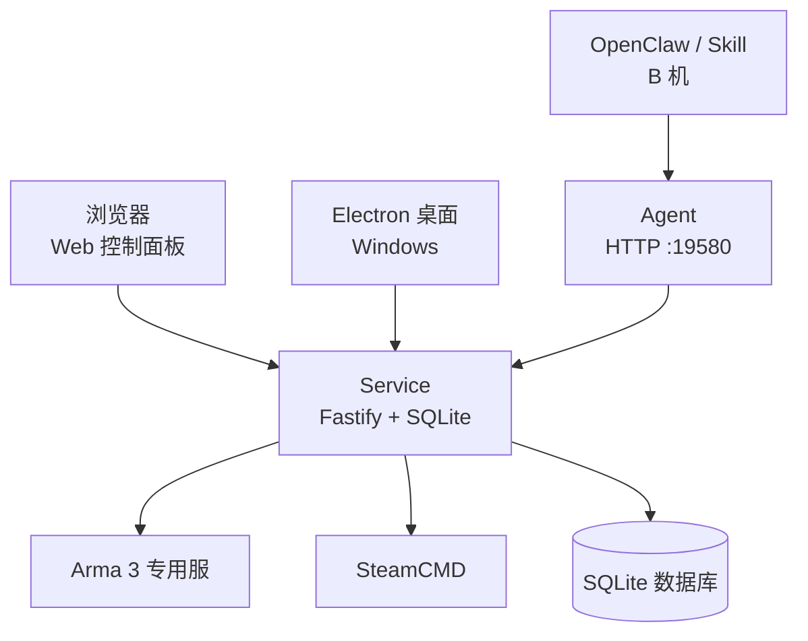
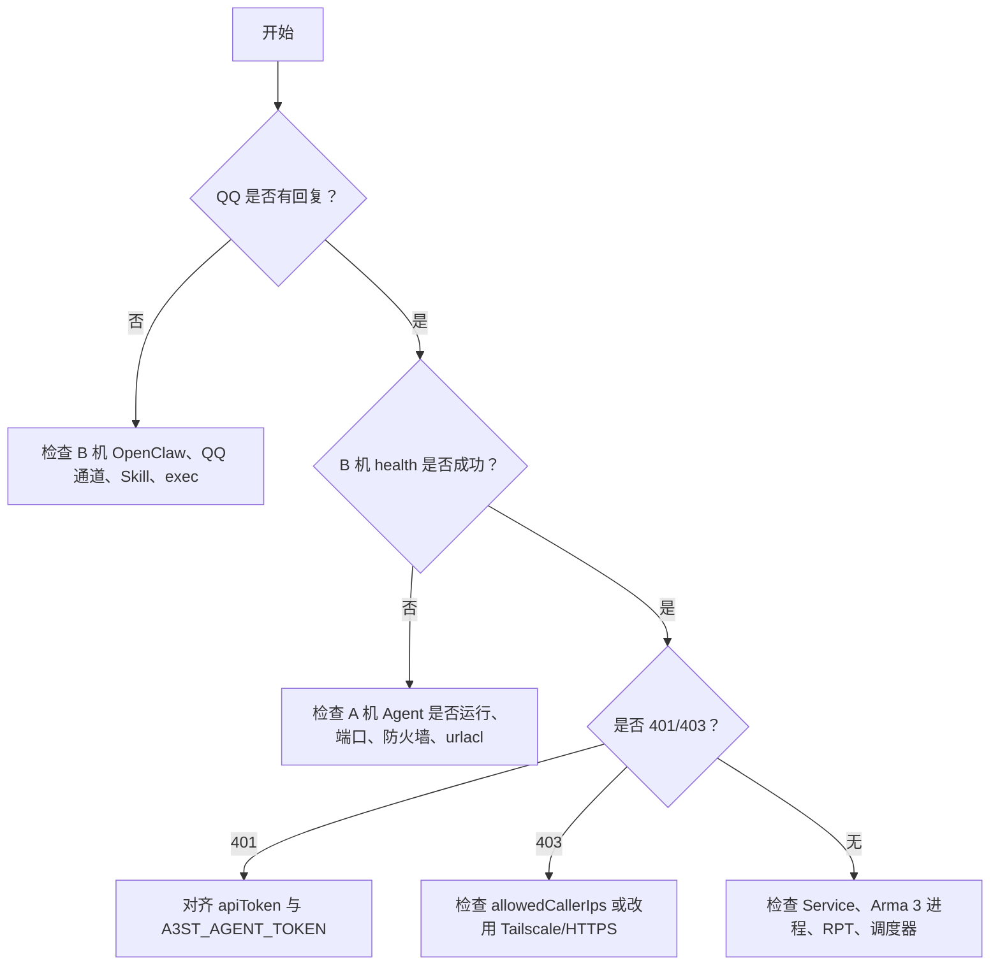
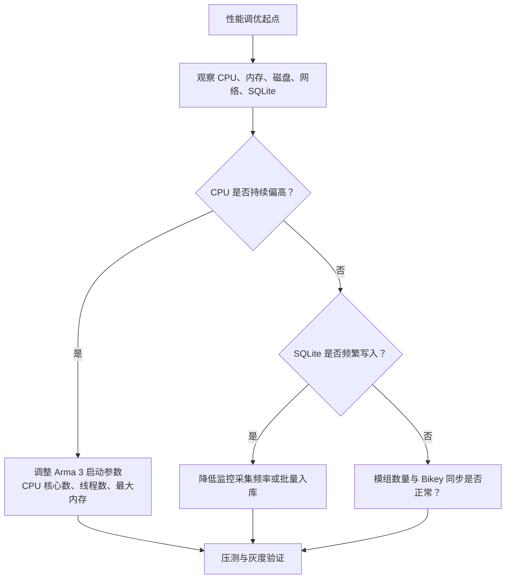
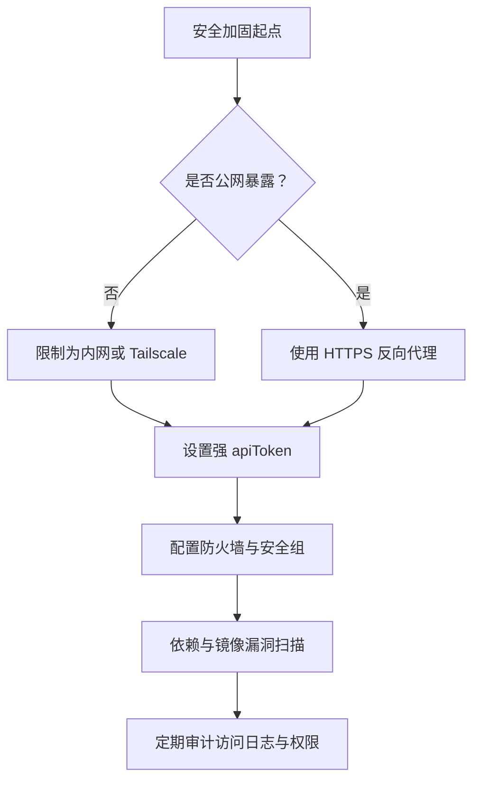
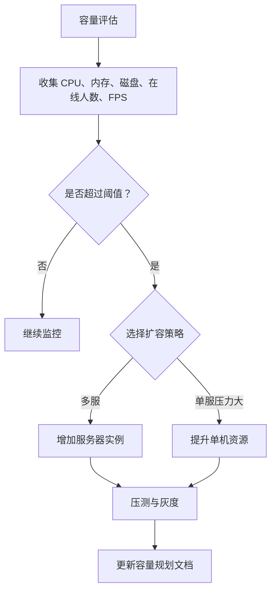
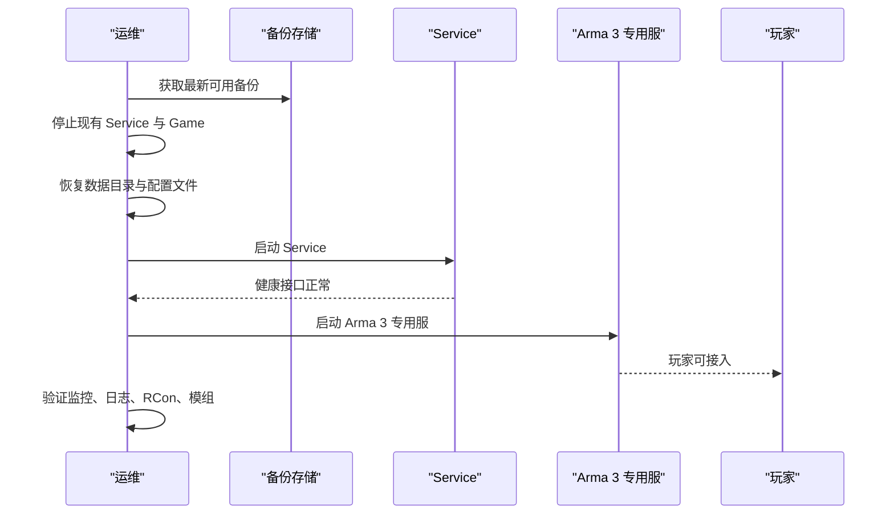
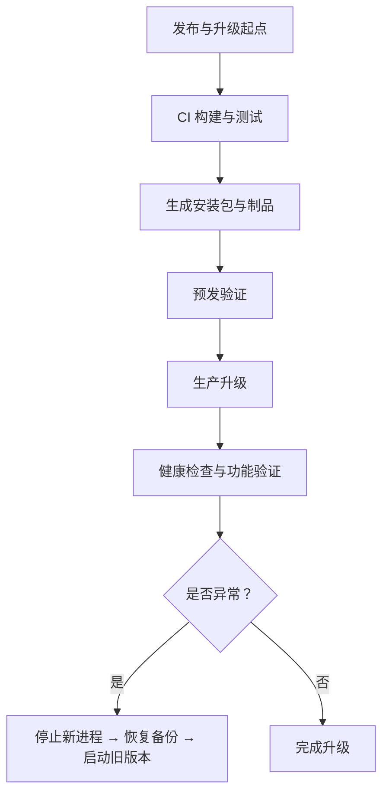

# 运维手册

<cite>
**本文引用的文件**   
- [README.md](file://README.md)
- [linux-server.md](file://docs/linux-server.md)
- [deployment-ab-openclaw.md](file://docs/deployment-ab-openclaw.md)
- [architecture.md](file://docs/architecture.md)
- [ci.yml](file://.github/workflows/ci.yml)
- [release.yml](file://.github/workflows/release.yml)
- [build-release.ps1](file://scripts/build-release.ps1)
- [PerformanceView.vue](file://packages/web/src/views/PerformanceView.vue)
- [SchedulerView.vue](file://packages/web/src/views/SchedulerView.vue)
- [defaults.ts](file://packages/web/src/utils/defaults.ts)
</cite>

## 目录
1. [简介](#简介)
2. [项目结构与运行边界](#项目结构与运行边界)
3. [日常维护任务与检查清单](#日常维护任务与检查清单)
4. [故障排查流程](#故障排查流程)
5. [性能调优建议与最佳实践](#性能调优建议与最佳实践)
6. [备份恢复策略与数据迁移](#备份恢复策略与数据迁移)
7. [安全加固配置与漏洞扫描](#安全加固配置与漏洞扫描)
8. [容量规划与扩容策略](#容量规划与扩容策略)
9. [灾难恢复与业务连续性计划](#灾难恢复与业务连续性计划)
10. [发布、升级与回滚](#发布升级与回滚)
11. [附录：关键术语与参考](#附录关键术语与参考)

## 简介
本运维手册面向 Arma 3 专用服务器管理工具 v2 的运维人员，覆盖日常巡检、故障处理、性能优化、备份恢复、安全加固、容量规划、灾备与发布升级等主题。v2 后端为 Node.js + Fastify + SQLite，前端为 Vue 3 控制面板，桌面端为 Electron（当前仅 Windows），开服机支持 Windows 与 Linux；Agent 通过 HTTP API 暴露远程管理能力，默认端口为 `19580`。

该工具的核心运维价值在于：统一管理多个 Arma 3 服务器实例、控制 SteamCMD 与模组、使用 RCon V2 进行 BattlEye 管理、采集监控指标并持久化到 SQLite，同时提供定时任务与自动化能力。

**章节来源**
- [README.md:1-108](file://README.md#L1-L108)

## 项目结构与运行边界
从运维视角，系统可划分为以下边界：

| 组件 | 角色 | 运维关注点 |
|---|---|---|
| Service | 后端服务，监听 HTTP API | 进程存活、端口、日志、SQLite 数据目录 |
| Web | 控制面板前端 | 静态资源或反向代理后的浏览器访问 |
| Desktop | Electron 桌面壳 | 仅 Windows 安装包；与服务共用用户数据 |
| Agent | 可选远程控制器 | 鉴权、IP 白名单、网络可达性、计划任务 |
| Arma 3 专用服 | 游戏进程 | 二进制路径、SteamCMD、RPT 日志、端口 |
| SQLite | 监控与统计数据库 | 数据目录、备份、体积增长 |
| SteamCMD | 下载/更新专用服与模组 | 镜像、缓存、Steam Guard |
| OpenClaw / Skill | 可选自动化入口 | B 机脚本、环境变量、通道权限 |

**图表来源**
- [README.md:3-10](file://README.md#L3-L10)
- [linux-server.md:1-11](file://docs/linux-server.md#L1-L11)
- [deployment-ab-openclaw.md:38-77](file://docs/deployment-ab-openclaw.md#L38-L77)

**章节来源**
- [README.md:3-10](file://README.md#L3-L10)
- [linux-server.md:1-11](file://docs/linux-server.md#L1-L11)
- [deployment-ab-openclaw.md:38-77](file://docs/deployment-ab-openclaw.md#L38-L77)

## 日常维护任务与检查清单
### 每日巡检
- 确认 Service 进程存活，健康接口返回成功。
- 确认 Agent 进程存活（若启用）。
- 检查 Arma 3 专用服是否在线，玩家数、FPS、内存趋势是否正常。
- 检查 RPT 日志是否有新增错误。
- 检查 SQLite 数据库文件大小是否异常增长。
- 检查 SteamCMD 下载/更新任务是否完成。
- 检查定时任务是否按预期执行。
- 检查磁盘空间、CPU、内存、网络带宽。

### 每周巡检
- 校验备份是否成功生成并可读取。
- 清理过期日志与临时文件。
- 检查模组列表与 Bikey 同步状态。
- 检查封禁列表与玩家库一致性。
- 检查防火墙与安全组规则是否仍符合最小暴露原则。
- 检查 Token 是否长期未轮换。

### 每月巡检
- 评估容量是否接近阈值。
- 审查监控趋势，识别慢查询或高负载时段。
- 验证灾备演练结果。
- 审计 Agent 访问日志与 OpenClaw 调用记录。
- 评估是否需要升级 Service、Agent、Web 或 Arma 3 版本。

### 启动前检查清单
- 安装路径不含中文。
- 专用服可执行文件存在且可执行。
- SteamCMD 已安装并能连接 Steam。
- 端口未被占用。
- 防火墙/云安全组允许必要入站流量。
- Agent 的 `apiToken` 不为空（公网场景）。
- `allowedCallerIps` 与实际访问源一致或采用强 Token + HTTPS。
- 数据目录有写权限。
- 备份最近一次可用。

**章节来源**
- [linux-server.md:49-57](file://docs/linux-server.md#L49-L57)
- [deployment-ab-openclaw.md:81-105](file://docs/deployment-ab-openclaw.md#L81-L105)
- [deployment-ab-openclaw.md:666-685](file://docs/deployment-ab-openclaw.md#L666-L685)

## 故障排查流程
### 通用排查顺序
1. 先判断问题发生在哪一层：
   - 浏览器无法打开 Web。
   - Web 能打开但 API 失败。
   - Agent 不可达。
   - Service 正常但 Arma 3 进程异常。
   - SteamCMD 卡住或失败。
   - SQLite 写入失败。
2. 优先查看健康接口与本地连通性。
3. 再检查鉴权、IP 白名单、防火墙、端口映射。
4. 最后检查业务层：cfg、模组、RCon、RPT、调度器。

### 常见现象与处理
| 现象 | 可能原因 | 处理建议 |
|---|---|---|
| Web 无法访问 | Service 未启动、端口被占、反向代理未配置 | 检查 Service 进程、端口、日志 |
| Agent 返回 403 | `remoteAccessEnabled=false` 或 `allowedCallerIps` 不包含源 IP | 调整 Agent 配置或使用 Tailscale/隧道 |
| Agent 返回 401 | Token 缺失或不一致 | 对齐 `A3ST_AGENT_TOKEN` 与 `apiToken` |
| 连接超时 | 未组网、路由器未映射、云安全组未放行 | 检查 Tailscale、隧道、端口映射、安全组 |
| list 为空 | 未在 GUI 建服或 UserData 不一致 | 用 GUI 保存配置，核对数据目录 |
| download_mods 卡住 | Steam Guard、CDN、代理、网络不稳定 | 到 A 机查看 SteamCMD 输出 |
| 路径含中文 | 工具限制 | 安装到纯英文路径 |
| 执行成功但服没动 | GUI 与 Agent 同时操作或服名错误 | 暂停 GUI 操作，指定 serverName/serverUuid |

### 快速决策树

**图表来源**
- [deployment-ab-openclaw.md:712-740](file://docs/deployment-ab-openclaw.md#L712-L740)

**章节来源**
- [deployment-ab-openclaw.md:712-740](file://docs/deployment-ab-openclaw.md#L712-L740)

## 性能调优建议与最佳实践
### Service 与 Web
- 生产环境建议使用反向代理托管 Web 静态资源，Service 只暴露 API。
- 避免在开发模式下直接让浏览器直连 Service 作为长期方案。
- 合理设置 Node.js 进程管理器，确保崩溃后自动重启。
- 监控 CPU、内存、事件循环延迟与 SQLite I/O。

### Arma 3 专用服
- 根据服务器 CPU 核心数、内存规模调整启动参数。
- 控制同时在线人数、地图复杂度、模组数量。
- 定期清理 RPT 日志与统计历史，避免 SQLite 膨胀。
- 将高频读写的监控入库保持异步，避免阻塞主流程。

### 定时任务
- 重启计划应避开高峰时段。
- 监控采集频率不宜过高，避免对 Service 和 SQLite 造成压力。
- 修改调度器配置后需同步到调度器。

**图表来源**
- [PerformanceView.vue:1-24](file://packages/web/src/views/PerformanceView.vue#L1-L24)
- [SchedulerView.vue:135-172](file://packages/web/src/views/SchedulerView.vue#L135-L172)
- [defaults.ts:151-171](file://packages/web/src/utils/defaults.ts#L151-L171)

**章节来源**
- [PerformanceView.vue:1-24](file://packages/web/src/views/PerformanceView.vue#L1-L24)
- [SchedulerView.vue:135-172](file://packages/web/src/views/SchedulerView.vue#L135-L172)
- [defaults.ts:151-171](file://packages/web/src/utils/defaults.ts#L151-L171)

## 备份恢复策略与数据迁移
### 备份范围
| 数据类型 | 说明 | 备份建议 |
|---|---|---|
| Service 数据目录 | 包含 SQLite 数据库、配置文件、日志 | 每日增量、每周全量 |
| Arma 3 游戏目录 | 地图、存档、RPT、模组 | 按需备份存档，模组可从 Workshop/Steam 重建 |
| SteamCMD 缓存 | 加速下载，非必须 | 可清理，重新下载 |
| Agent 配置 | `settings.json` | 随 Service 数据目录一起备份 |
| Web 构建产物 | 静态资源 | 不纳入生产数据备份，由发布流程重建 |

### 备份策略
- 使用文件系统快照或离线复制方式备份 SQLite，避免边写边拷导致损坏。
- 备份文件名包含时间戳与版本号。
- 至少保留最近一周的增量与一个月的全量。
- 将备份复制到独立存储位置，防止单点故障。
- 定期验证备份可读性与恢复流程。

### 恢复步骤
1. 停止 Service 与 Arma 3 进程。
2. 恢复数据目录中的 SQLite 与配置文件。
3. 校验文件权限与路径。
4. 启动 Service。
5. 检查健康接口与服务器列表。
6. 启动 Arma 3 专用服并验证玩家接入。
7. 检查监控数据是否继续写入。

### 数据迁移
- 跨机器迁移时，确保新旧机器上 Service 版本兼容。
- 迁移后检查 `DATA_DIR` 与路径解析是否一致。
- 若从旧版本升级，先备份再升级，观察日志中是否有兼容性警告。
- 若涉及 Arma 3 版本升级，先在测试服验证地图与模组兼容性。

**章节来源**
- [linux-server.md:22-25](file://docs/linux-server.md#L22-L25)
- [deployment-ab-openclaw.md:624-657](file://docs/deployment-ab-openclaw.md#L624-L657)

## 安全加固配置与漏洞扫描
### 网络暴露原则
- 优先使用虚拟内网（如 Tailscale）或反向隧道，避免裸暴露 `19580`。
- 若必须公网暴露，应使用 HTTPS 反向代理。
- 不要将 QQ 用户手机公网 IP 写入 `allowedCallerIps`。
- 不要在 QQ 群、截图、模型上下文中泄露 `apiToken`、隧道 URL 或 RCon/Steam 密码。

### Agent 鉴权
- 公网场景必须设置足够长的随机 `apiToken`。
- 若 B 机出口 IP 经常变化，可使用空 `allowedCallerIps`，但必须配合强 Token 与 HTTPS。
- 本机回环地址始终允许；非本机请求受 `remoteAccessEnabled` 与 `allowedCallerIps` 控制。
- `/api/v1/health` 无需 Token，其他 API 需要 Bearer Token。

### 防火墙与安全组
- 仅开放必要端口。
- 内网或 Tailscale 场景下，尽量不对公网开放 19580。
- 云主机安全组与路由器端口映射保持一致。
- 定期检查入站连接日志，发现扫描或异常来源及时封禁。

### 漏洞扫描与依赖治理
- CI 中执行 TypeScript 类型检查与单元测试。
- 对 Node.js 依赖启用依赖漏洞扫描。
- 对 .NET 工程启用 NuGet 包漏洞扫描。
- 对容器镜像（若后续引入）启用镜像扫描。
- 对公开仓库启用代码安全扫描。

**图表来源**
- [deployment-ab-openclaw.md:109-130](file://docs/deployment-ab-openclaw.md#L109-L130)
- [deployment-ab-openclaw.md:348-358](file://docs/deployment-ab-openclaw.md#L348-L358)
- [deployment-ab-openclaw.md:666-685](file://docs/deployment-ab-openclaw.md#L666-L685)

**章节来源**
- [deployment-ab-openclaw.md:109-130](file://docs/deployment-ab-openclaw.md#L109-L130)
- [deployment-ab-openclaw.md:348-358](file://docs/deployment-ab-openclaw.md#L348-L358)
- [deployment-ab-openclaw.md:666-685](file://docs/deployment-ab-openclaw.md#L666-L685)

## 容量规划与扩容策略
### 单机容量评估
- 以 Arma 3 专用服的 CPU、内存、磁盘 I/O 为主要瓶颈。
- 监控在线人数、FPS、RPT 错误率、SQLite 写入延迟。
- 当 CPU 持续高于阈值、内存接近上限、磁盘空间不足时，考虑扩容。

### 横向扩容
- 多服并存时，每个服务器实例独立运行，共享 Service 管理。
- 不同服务器使用不同端口、不同地图、不同模组集合。
- 通过 Agent 或 Web 统一启停、写 cfg、拉取模组。

### 纵向扩容
- 提升单机 CPU、内存、磁盘容量。
- 调整 Arma 3 启动参数，匹配硬件能力。
- 调整监控采集频率，避免 SQLite 成为瓶颈。

### 扩容决策流程

**图表来源**
- [README.md:37-47](file://README.md#L37-L47)
- [PerformanceView.vue:1-24](file://packages/web/src/views/PerformanceView.vue#L1-L24)

**章节来源**
- [README.md:37-47](file://README.md#L37-L47)
- [PerformanceView.vue:1-24](file://packages/web/src/views/PerformanceView.vue#L1-L24)

## 灾难恢复与业务连续性计划
### 风险场景
- 服务器宕机。
- 磁盘损坏。
- SQLite 数据库损坏。
- Arma 3 版本升级失败。
- Agent 配置错误或 Token 泄露。
- 网络中断导致远程控制不可用。

### 恢复优先级
1. 恢复 Service 与 Web 访问。
2. 恢复 Arma 3 专用服。
3. 恢复玩家数据与存档。
4. 恢复监控与统计。
5. 恢复自动化与远程控制。

### 恢复流程

**图表来源**
- [deployment-ab-openclaw.md:712-740](file://docs/deployment-ab-openclaw.md#L712-L740)

### 业务连续性措施
- 至少保留一份异地备份。
- 制定明确 RTO 与 RPO。
- 定期演练恢复流程。
- 对 Agent 与 OpenClaw 配置变更实施审批与变更记录。
- 对高危操作增加二次确认。

**章节来源**
- [deployment-ab-openclaw.md:712-740](file://docs/deployment-ab-openclaw.md#L712-L740)

## 发布、升级与回滚
### 构建与发布
- CI 在 push 或 PR 时执行类型检查、测试、Service 与 Web 构建。
- Release 流水线在打 tag 时构建 Windows 桌面安装包与解压包。
- 本地构建脚本会编译主程序、Agent、MonitoringHost，并打包 Inno Setup 安装包。

### 升级步骤
1. 停止 Agent 与 Arma 3 专用服。
2. 备份数据目录。
3. 安装新版本或替换 Service/Web/Agent 文件。
4. 重启 Agent 与 Service。
5. 验证健康接口、服务器列表、模组、RCon。
6. 逐步恢复 Arma 3 专用服。

### 回滚策略
- 保留上一版本的可执行文件与构建产物。
- 保留最近一次可用备份。
- 若新版本导致 SQLite 不兼容，优先回滚数据到旧版本备份。
- 若 Web 或 Agent 行为异常，先回滚对应组件，再决定整体回滚。

**图表来源**
- [ci.yml:1-63](file://.github/workflows/ci.yml#L1-L63)
- [release.yml:1-83](file://.github/workflows/release.yml#L1-L83)
- [build-release.ps1:204-402](file://scripts/build-release.ps1#L204-L402)

**章节来源**
- [ci.yml:1-63](file://.github/workflows/ci.yml#L1-L63)
- [release.yml:1-83](file://.github/workflows/release.yml#L1-L83)
- [build-release.ps1:204-402](file://scripts/build-release.ps1#L204-L402)

## 附录：关键术语与参考
- **Service**：Node.js + Fastify + SQLite 后端。
- **Web**：Vue 3 控制面板。
- **Desktop**：Electron 桌面壳，当前仅 Windows。
- **Agent**：HTTP 远程控制器，默认端口 `19580`。
- **Arma 3 专用服**：游戏进程，由工具启停与管理。
- **SteamCMD**：Steam 命令行工具，用于下载/更新专用服与模组。
- **RCon V2**：BattlEye 远程控制协议。
- **SQLite**：监控与统计数据存储。
- **OpenClaw**：可选自动化网关，通过 Skill 调用 Agent。

**章节来源**
- [README.md:3-10](file://README.md#L3-L10)
- [linux-server.md:1-11](file://docs/linux-server.md#L1-L11)
- [deployment-ab-openclaw.md:38-77](file://docs/deployment-ab-openclaw.md#L38-L77)