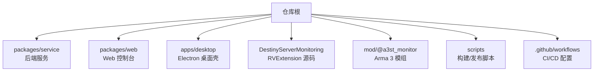
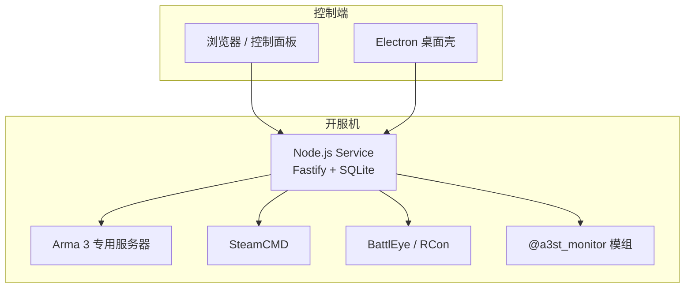
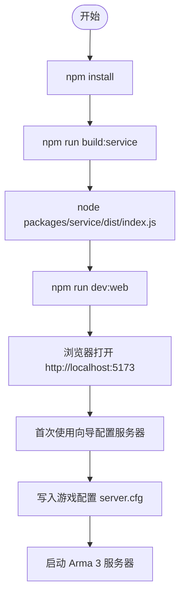
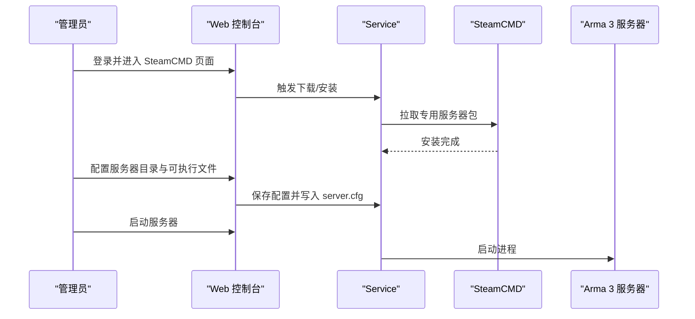
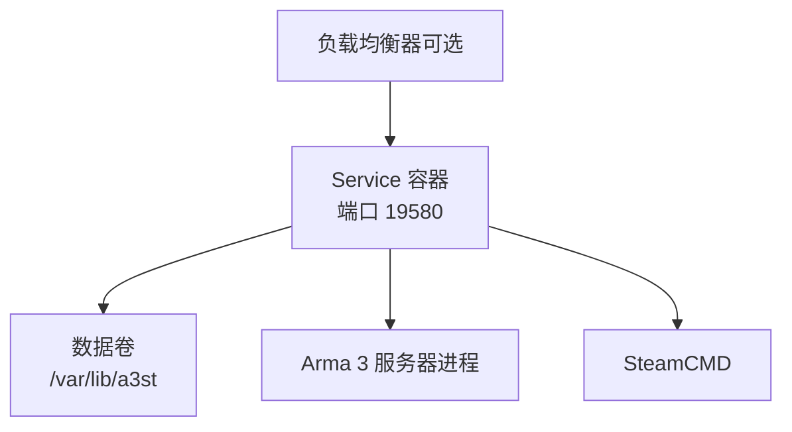
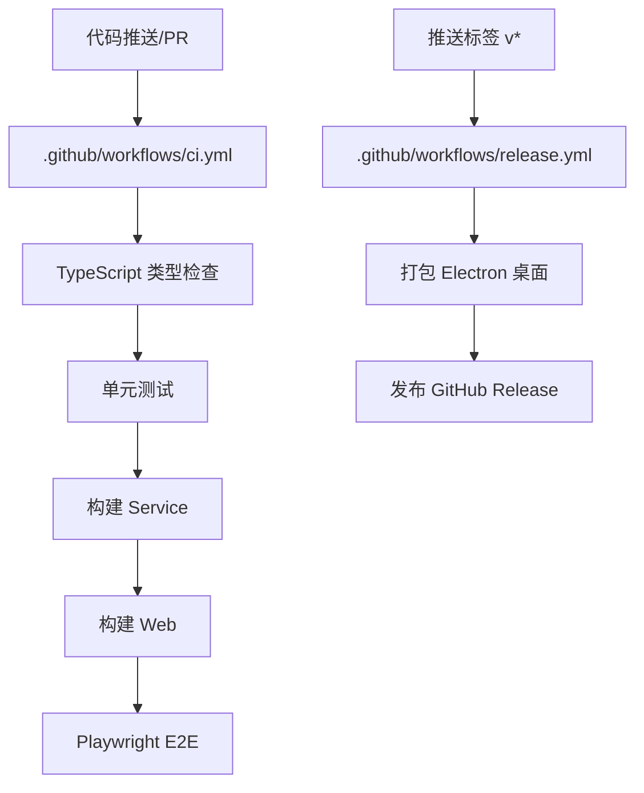
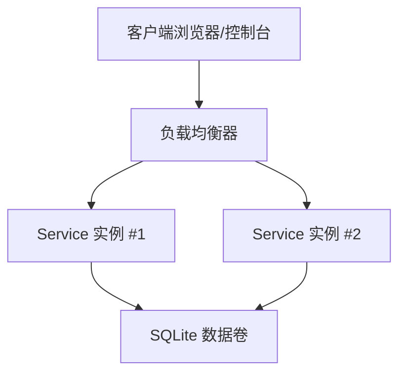
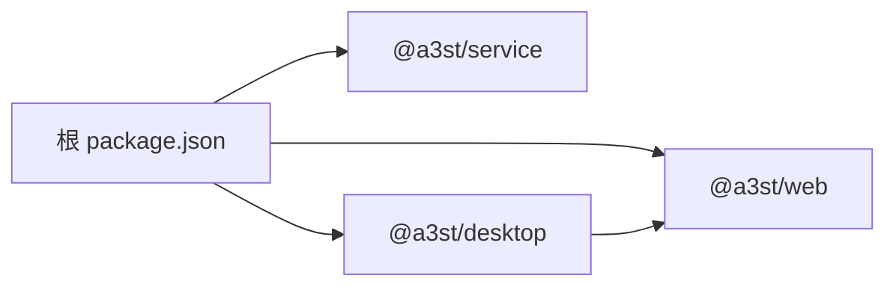

# 部署指南

<cite>
**本文引用的文件**   
- [README.md](file://README.md)
- [package.json](file://package.json)
- [docs/v2-quickstart.md](file://docs/v2-quickstart.md)
- [docs/linux-server.md](file://docs/linux-server.md)
- [.github/workflows/ci.yml](file://.github/workflows/ci.yml)
- [.github/workflows/release.yml](file://.github/workflows/release.yml)
- [scripts/build-desktop.ps1](file://scripts/build-desktop.ps1)
- [apps/desktop/package.json](file://apps/desktop/package.json)
- [apps/desktop/electron-builder.yml](file://apps/desktop/electron-builder.yml)
</cite>

## 目录
1. [简介](#简介)
2. [项目结构](#项目结构)
3. [核心组件](#核心组件)
4. [架构总览](#架构总览)
5. [详细组件分析](#详细组件分析)
6. [依赖关系分析](#依赖关系分析)
7. [性能与容量规划](#性能与容量规划)
8. [故障排查手册](#故障排查手册)
9. [安全加固与最佳实践](#安全加固与最佳实践)
10. [结论](#结论)
11. [附录：平台差异与运维清单](#附录平台差异与运维清单)

## 简介
本指南面向 Arma 3 专用服务器管理工具 v2 的部署与运维，覆盖开发环境搭建、生产环境部署、Docker 容器化与编排、CI/CD 流水线、跨平台差异、负载均衡与高可用、监控告警与日志收集、日常运维与安全加固。项目为 TypeScript 全栈方案，后端使用 Node.js + Fastify + SQLite，前端为 Vue 3 控制面板，并提供 Electron 桌面壳（当前仅 Windows 打包）。

## 项目结构
仓库采用 monorepo 组织方式，核心目录如下：
- packages/service：后端服务（Fastify + SQLite + RCon）
- packages/web：Vue 3 控制面板
- apps/desktop：Electron 桌面壳
- DestinyServerMonitoring：监控 RVExtension 源码（Windows DLL）
- mod/@a3st_monitor：Arma 3 模组资源
- scripts：构建与发布脚本
- .github/workflows：GitHub Actions CI/CD

图表来源
- [README.md:50-66](file://README.md#L50-L66)
- [package.json:1-36](file://package.json#L1-L36)

章节来源
- [README.md:50-66](file://README.md#L50-L66)
- [package.json:1-36](file://package.json#L1-L36)

## 核心组件
- 后端服务（@a3st/service）
  - 提供 HTTP API（默认端口 19580），支持 Bearer 鉴权
  - 管理 Arma 3 服务器进程、SteamCMD、BattlEye/RCon、任务调度、统计入库
  - 数据目录通过 DATA_DIR 环境变量控制
- Web 控制台（@a3st/web）
  - Vue 3 单页应用，开发模式通过 Vite 代理到后端
  - 可独立构建静态资源供反向代理托管
- Electron 桌面壳（@a3st/desktop）
  - 内嵌 Web 控制台并拉起本地 Service
  - 当前仅 Windows 安装包（NSIS）
- 监控与模组
  - DestinyServerMonitoring：RVExtension 源码（Windows DLL）
  - mod/@a3st_monitor：Arma 3 模组脚本与配置

章节来源
- [README.md:37-47](file://README.md#L37-L47)
- [docs/v2-quickstart.md:1-12](file://docs/v2-quickstart.md#L1-L12)
- [apps/desktop/package.json:1-31](file://apps/desktop/package.json#L1-L31)

## 架构总览
系统由“控制端”和“开服机”两部分组成：
- 控制端：浏览器或 Electron 桌面壳访问 Web 控制台
- 开服机：运行 Arma 3 专用服务器、SteamCMD、Service 进程，并通过 RCon/BattlEye 进行远程控制

图表来源
- [README.md:3-10](file://README.md#L3-L10)
- [docs/v2-quickstart.md:1-12](file://docs/v2-quickstart.md#L1-L12)
- [docs/linux-server.md:1-12](file://docs/linux-server.md#L1-L12)

## 详细组件分析

### 开发环境与依赖管理
- 环境要求
  - Node.js ≥ 20
  - Linux 发行版常见 x64（Ubuntu 22.04+、Debian 12+）
  - Linux 依赖 tar、ss（通常随 iproute2 安装）
- 依赖管理
  - 使用 npm workspaces 管理 monorepo
  - 根 package.json 定义统一脚本与 engines.node 约束
- 快速开始
  - 安装依赖、构建服务、启动后端、启动前端开发服务器
  - 首次使用向导配置服务器目录、SteamCMD、写入游戏配置、启动服务器

图表来源
- [docs/v2-quickstart.md:7-41](file://docs/v2-quickstart.md#L7-L41)
- [package.json:10-30](file://package.json#L10-L30)

章节来源
- [docs/v2-quickstart.md:7-41](file://docs/v2-quickstart.md#L7-L41)
- [package.json:32-34](file://package.json#L32-L34)

### 生产环境部署（Linux）
- 服务器准备
  - 安装 Node.js ≥ 20
  - 安装 tar、ss（iproute2）
  - 准备服务器目录与 Workshop 路径（建议英文/ASCII）
- 软件安装
  - 通过控制面板 → SteamCMD → 下载 steamcmd_linux.tar.gz
  - 安装/更新 Arma 3 专用服务器到例如 /opt/arma3server
  - 确认存在可执行文件 arma3server（Steam app 233780 Linux depot）
- 配置文件设置
  - 设置环境变量 DATA_DIR、PORT、HOST
  - 远程访问时务必设置 API_TOKEN 并配置防火墙
- 服务启动
  - 直接运行 node packages/service/dist/index.js
  - 或使用 systemd 托管（示例见文档）

图表来源
- [docs/linux-server.md:40-47](file://docs/linux-server.md#L40-L47)
- [docs/linux-server.md:58-79](file://docs/linux-server.md#L58-L79)

章节来源
- [docs/linux-server.md:1-86](file://docs/linux-server.md#L1-L86)

### Docker 容器化部署与编排
- 镜像构建
  - 基于 Node.js 官方镜像（版本 ≥ 20）
  - 将 Service 构建产物与服务二进制复制到镜像工作目录
  - 暴露端口 19580（HTTP API）
  - 挂载数据卷用于持久化 DATA_DIR
- 运行参数
  - 环境变量：DATA_DIR、PORT、HOST、API_TOKEN
  - 端口映射：宿主机端口 → 容器 19580
- 编排建议（Compose）
  - 定义 service 服务，挂载数据卷
  - 配置重启策略（on-failure）
  - 如需多实例，结合外部负载均衡器（Nginx/HAProxy）

图表来源
- [docs/linux-server.md:58-79](file://docs/linux-server.md#L58-L79)
- [docs/v2-quickstart.md:22-33](file://docs/v2-quickstart.md#L22-L33)

### CI/CD 流水线配置
- 持续集成（CI）
  - 触发条件：push/PR 到 main/master
  - 矩阵测试：Node 20、22
  - 步骤：checkout → setup-node → npm ci → typecheck → test → build:service → build:web → playwright e2e
  - E2E 启动 Service 并轮询健康检查后执行 Playwright 测试
- 发布（Release）
  - 触发条件：推送标签 v*
  - 在 windows-latest 上构建 Electron 桌面安装包与解压包
  - 收集 artifacts 并发布到 GitHub Release

图表来源
- [.github/workflows/ci.yml:1-63](file://.github/workflows/ci.yml#L1-L63)
- [.github/workflows/release.yml:1-83](file://.github/workflows/release.yml#L1-L83)

章节来源
- [.github/workflows/ci.yml:1-63](file://.github/workflows/ci.yml#L1-L63)
- [.github/workflows/release.yml:1-83](file://.github/workflows/release.yml#L1-L83)

### 不同平台的部署差异与注意事项
- Windows
  - Electron 桌面壳提供 NSIS 安装包
  - 专用服二进制为 arma3server_x64.exe
  - SteamCMD 使用 steamcmd.exe
  - 进程启停使用 taskkill 与 verbatim 命令行
- Linux
  - 无 Electron 安装包；使用浏览器或 systemd 托管 Service
  - 专用服二进制为 arma3server
  - SteamCMD 使用 steamcmd.sh
  - 进程启停使用 SIGTERM 与 argv 解析
- macOS
  - 文档未提供 macOS 服务端说明；建议使用 Linux 作为开服机

章节来源
- [docs/linux-server.md:49-57](file://docs/linux-server.md#L49-L57)
- [docs/linux-server.md:81-85](file://docs/linux-server.md#L81-L85)

### 负载均衡与高可用部署架构
- 多实例 Service
  - 在同一网络中部署多个 Service 实例，分别监听不同端口
  - 通过外部负载均衡器（Nginx/HAProxy）将请求分发到各实例
- 状态与数据一致性
  - Service 使用 SQLite 存储统计数据；多实例共享数据目录需评估并发写风险
  - 建议单实例 + 外部负载均衡，或将数据库迁移至支持并发写的引擎（如 PostgreSQL）
- 健康检查与自动恢复
  - 利用 /api/v1/health 接口进行健康检查
  - 配合负载均衡器的健康检查机制实现故障节点剔除

图表来源
- [.github/workflows/ci.yml:52-61](file://.github/workflows/ci.yml#L52-L61)
- [docs/linux-server.md:58-79](file://docs/linux-server.md#L58-L79)

## 依赖关系分析
- 根 package.json 通过 workspaces 聚合 apps/* 与 packages/*
- 后端服务与 Web 控制台解耦，通过 HTTP API 通信
- Electron 桌面壳依赖 @a3st/web 并内嵌 Service 资源

图表来源
- [package.json:1-36](file://package.json#L1-L36)
- [apps/desktop/package.json:1-31](file://apps/desktop/package.json#L1-L31)

章节来源
- [package.json:1-36](file://package.json#L1-L36)
- [apps/desktop/package.json:1-31](file://apps/desktop/package.json#L1-L31)

## 性能与容量规划
- 后端服务
  - 合理设置 Node.js 内存上限（--max-old-space-size）
  - 根据并发连接数调整线程池与事件循环压力
- 数据库
  - SQLite 适合单机低并发场景；高并发建议迁移至 PostgreSQL/MySQL
  - 定期备份数据目录（包含 SQLite 文件与统计缓存）
- 文件系统
  - 确保服务器目录与 Workshop 路径位于高性能磁盘
  - 避免中文/非 ASCII 路径导致兼容性问题
- 网络
  - 开放必要端口（HTTP API、Arma 3 游戏端口、RCon/BattlEye）
  - 使用防火墙规则限制来源 IP

[本节为通用指导，不直接分析具体文件]

## 故障排查手册
- 健康检查
  - 调用 GET /api/v1/health 验证服务是否就绪
  - CI 流程中包含健康检查轮询逻辑
- 常见问题
  - 端口冲突：修改 PORT 环境变量或释放占用端口
  - 权限不足：确保 Service 对 DATA_DIR 有读写权限
  - SteamCMD 下载失败：检查网络与 Steam 账号权限
  - Arma 3 服务器无法启动：检查可执行文件路径与依赖库
- 日志定位
  - Service 输出标准日志到控制台或日志文件
  - Arma 3 RPT 日志可通过控制台查看与归档

章节来源
- [.github/workflows/ci.yml:52-61](file://.github/workflows/ci.yml#L52-L61)
- [docs/linux-server.md:58-79](file://docs/linux-server.md#L58-L79)

## 安全加固与最佳实践
- 认证与授权
  - 启用 API_TOKEN 进行 Bearer 鉴权
  - 限制 API 访问来源 IP（防火墙/反向代理）
- 最小权限原则
  - Service 以专用用户运行（Linux systemd User=arma3）
  - 仅授予必要的文件系统与网络权限
- 数据安全
  - 定期备份 DATA_DIR
  - 敏感配置（如 Steam 账号）使用环境变量或密钥管理服务
- 网络安全
  - 仅开放必要端口
  - 使用 HTTPS（反向代理）加密前端与控制面板通信

章节来源
- [docs/linux-server.md:58-79](file://docs/linux-server.md#L58-L79)
- [README.md:43-47](file://README.md#L43-L47)

## 结论
本指南提供了从开发到生产的完整部署路径，涵盖 Linux 服务端、Docker 容器化、CI/CD 自动化、跨平台差异与高可用架构。建议在生产环境中优先采用单实例 Service + 外部负载均衡，并结合防火墙与 API_TOKEN 强化安全。对于高并发场景，建议将 SQLite 迁移至更健壮的数据库系统。

[本节为总结性内容，不直接分析具体文件]

## 附录：平台差异与运维清单
- Windows
  - 使用 Electron 桌面壳安装包（NSIS）
  - 专用服二进制：arma3server_x64.exe
  - SteamCMD：steamcmd.exe
- Linux
  - 使用浏览器或 systemd 托管 Service
  - 专用服二进制：arma3server
  - SteamCMD：steamcmd.sh
- macOS
  - 文档未提供服务端说明；建议使用 Linux 作为开服机

章节来源
- [docs/linux-server.md:49-57](file://docs/linux-server.md#L49-L57)
- [docs/linux-server.md:81-85](file://docs/linux-server.md#L81-L85)