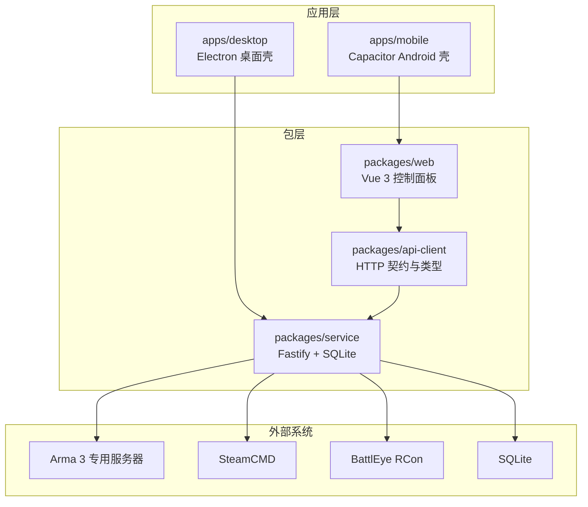
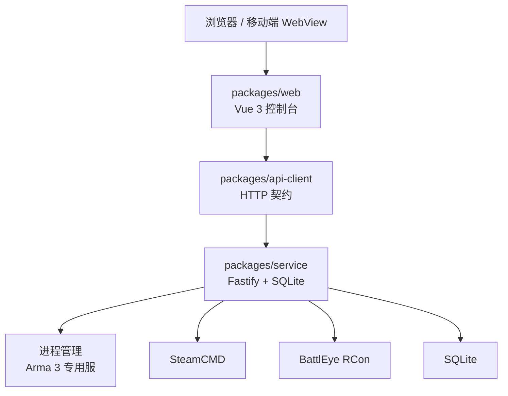
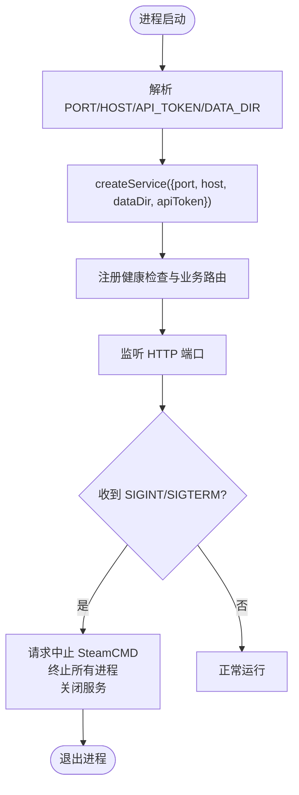
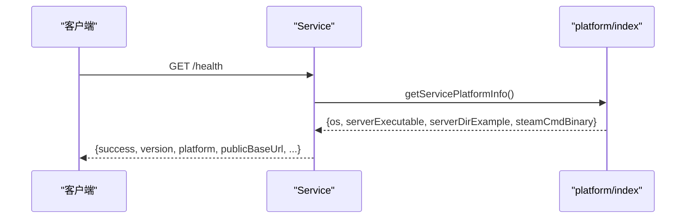
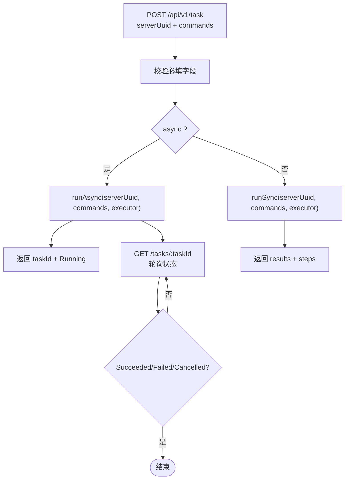
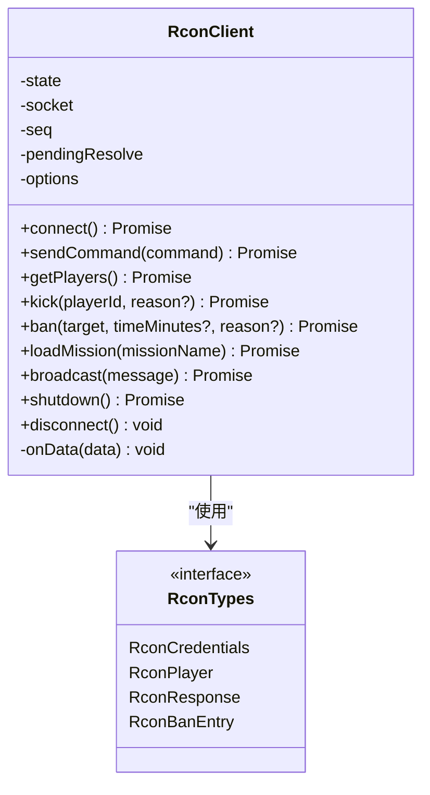
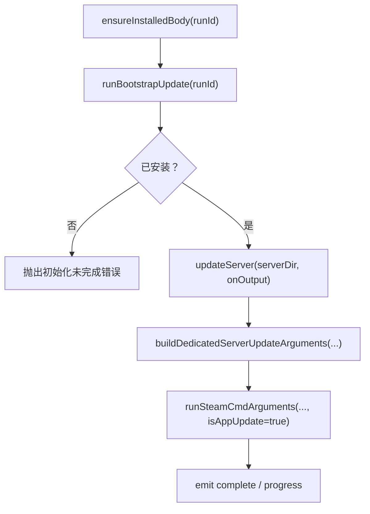
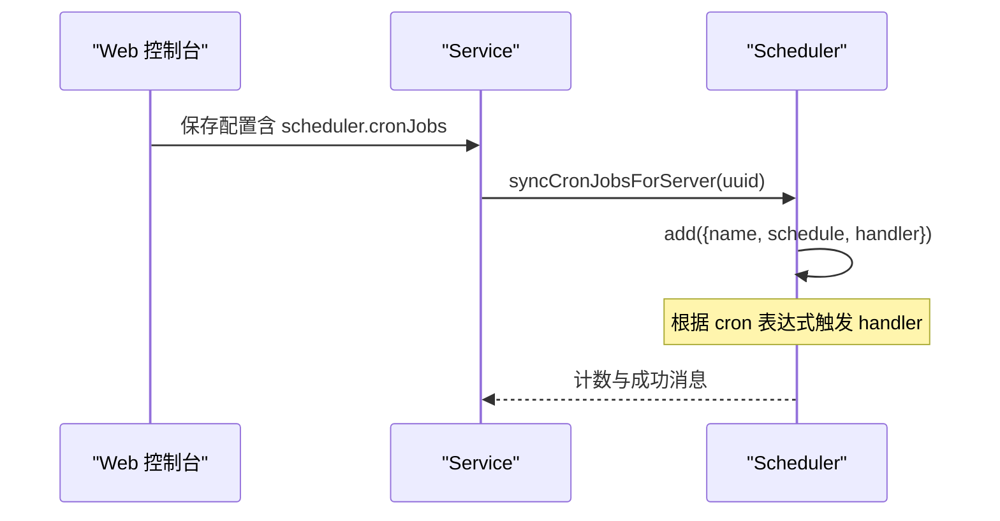
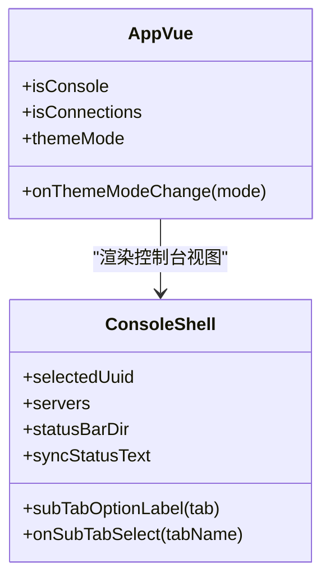
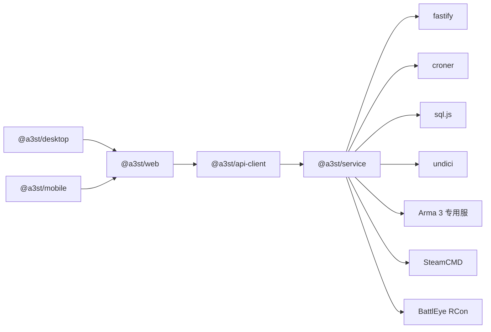

# 项目概述

<cite>
**本文引用的文件**   
- [README.md](file://README.md)
- [package.json](file://package.json)
- [apps/desktop/package.json](file://apps/desktop/package.json)
- [apps/mobile/package.json](file://apps/mobile/package.json)
- [docs/architecture-v2.md](file://docs/architecture-v2.md)
- [docs/v2-quickstart.md](file://docs/v2-quickstart.md)
- [docs/linux-server.md](file://docs/linux-server.md)
- [packages/service/package.json](file://packages/service/package.json)
- [packages/service/src/index.ts](file://packages/service/src/index.ts)
- [packages/service/src/api/health.ts](file://packages/service/src/api/health.ts)
- [packages/service/src/api/routes.ts](file://packages/service/src/api/routes.ts)
- [packages/service/src/rcon/client.ts](file://packages/service/src/rcon/client.ts)
- [packages/service/src/rcon/helpers.ts](file://packages/service/src/rcon/helpers.ts)
- [packages/service/src/types/rcon.ts](file://packages/service/src/types/rcon.ts)
- [packages/service/src/platform/index.ts](file://packages/service/src/platform/index.ts)
- [packages/service/src/steamcmd/arguments.ts](file://packages/service/src/steamcmd/arguments.ts)
- [packages/service/src/steamcmd/manager.ts](file://packages/service/src/steamcmd/manager.ts)
- [packages/service/src/scheduling/cron.ts](file://packages/service/src/scheduling/cron.ts)
- [packages/service/src/scheduling/cron-sync.ts](file://packages/service/src/scheduling/cron-sync.ts)
- [packages/service/src/task/manager.ts](file://packages/service/src/task/manager.ts)
- [packages/web/src/App.vue](file://packages/web/src/App.vue)
- [packages/web/src/components/console/ConsoleShell.vue](file://packages/web/src/components/console/ConsoleShell.vue)
</cite>

## 目录
1. [引言](#引言)
2. [项目结构](#项目结构)
3. [核心组件](#核心组件)
4. [架构总览](#架构总览)
5. [详细组件分析](#详细组件分析)
6. [依赖关系分析](#依赖关系分析)
7. [性能与可维护性](#性能与可维护性)
8. [故障排查指南](#故障排查指南)
9. [结论](#结论)
10. [附录](#附录)

## 引言
Arma3 Server Tools v2 是一个面向 Arma 3 专用服务器的跨平台管理工具，目标是把“开服、配置、模组、日志、监控、自动化”等日常运维工作统一到一套 TypeScript 全栈工具中。它在 Arma 3 服务器管理生态中的定位是：既可作为本地桌面控制台（Electron），也可作为远程 Web 控制面板（浏览器）；后端 Service 可在 Windows 或 Linux 开服机上独立运行，并通过 HTTP API 暴露统一能力面。

从 v1 C# WinForms 到 v2 TypeScript 的重构动机主要包括：
- 跨平台：Service 同时支持 Windows 与 Linux，控制端可通过任意系统浏览器访问。
- 前后端分离：UI 不直接读写磁盘或 spawn 进程，所有操作通过 REST API 完成，便于远程管理与自动化。
- 类型共享：api-client 包提供统一的 HTTP 契约与类型定义，避免前端手写 fetch 和接口漂移。
- 可组合的部署形态：开发时双进程调试，生产时可合并为单端口托管 UI + API，或仅部署 Service。
- 现代化技术栈：Node.js + Fastify + SQLite + Vue 3 + Electron/Capacitor，提升可测试性与可维护性。

主要功能特性概览：
- 服务器管理：多实例并存、启停/重启、RPT 日志查看。
- BattlEye RCon：V2 协议远程控制，支持踢人、封禁、广播、切换任务等。
- 模组管理：Workshop 下载、扫描、Bikey 复制。
- SteamCMD 集成：自动下载 SteamCMD、安装/更新 Arma 3 专用服务器。
- HTTP API：Fastify REST API，支持 Bearer 鉴权与远程控制。
- 任务自动化：按序执行命令、异步轮询进度、取消与失败回退。
- 监控统计：SQLite 入库、趋势数据、定时采集。
- 定时任务：cron 调度重启、统计采集等。

**章节来源**
- [README.md:1-49](file://README.md#L1-L49)

## 项目结构
仓库采用 npm workspaces monorepo 组织，核心分为应用层与包层：
- apps/desktop：Electron 桌面壳，负责启动本机 Service 并内嵌 Web 控制台。
- apps/mobile：Capacitor Android 壳，复用 web 构建产物。
- packages/service：后端服务，基于 Fastify + SQLite，封装进程、SteamCMD、RCon、调度、任务等能力。
- packages/web：Vue 3 控制面板，提供控制台 Shell、连接页、设置页等。
- packages/api-client：TypeScript HTTP 客户端与类型契约，供 web 与脚本使用。
- docs：v2 架构、快速开始、Linux 开服、迁移与历史文档。
- mod：Arma 3 监控模组资源（SQF）。
- DestinyServerMonitoring：RVExtension 监控源码（C#）。
- scripts：构建、打包、CI 与测试脚本。

**图表来源**
- [docs/architecture-v2.md:5-21](file://docs/architecture-v2.md#L5-L21)
- [README.md:50-66](file://README.md#L50-L66)

**章节来源**
- [README.md:50-66](file://README.md#L50-L66)
- [docs/architecture-v2.md:5-21](file://docs/architecture-v2.md#L5-L21)

## 核心组件
本节聚焦 v2 的核心组件及其职责边界：
- Service 入口与生命周期：读取环境变量（端口、主机、API Token、数据目录），创建 Fastify 服务，注册健康检查、路由、静态页面托管，并在 SIGINT/SIGTERM 下优雅关闭。
- Health 与健康探测：返回服务版本、平台信息、默认路径与公共基础 URL，用于连通性检测与部署自检。
- 任务管理器：统一管理同步/异步任务，支持步骤记录、取消、失败处理与结果查询。
- RCon 客户端：实现 BattlEye V2 协议，封装登录、玩家列表、踢人、封禁、广播、切换任务等。
- SteamCMD 管理器：封装下载、初始化、安装/更新专用服务器、Workshop 模组下载，含参数构建与错误提示。
- 调度器：基于 croner 的定时任务，支持添加、移除、清空与列出任务，并与配置持久化联动。
- Web 控制台：App.vue 与 ConsoleShell.vue 构成控制台外壳，提供主题、导航、实例选择、状态栏等。

**章节来源**
- [packages/service/src/index.ts:1-41](file://packages/service/src/index.ts#L1-L41)
- [packages/service/src/api/health.ts:1-32](file://packages/service/src/api/health.ts#L1-L32)
- [packages/service/src/task/manager.ts:178-218](file://packages/service/src/task/manager.ts#L178-L218)
- [packages/service/src/rcon/client.ts:89-178](file://packages/service/src/rcon/client.ts#L89-L178)
- [packages/service/src/steamcmd/manager.ts:190-266](file://packages/service/src/steamcmd/manager.ts#L190-L266)
- [packages/service/src/scheduling/cron.ts:1-60](file://packages/service/src/scheduling/cron.ts#L1-L60)
- [packages/web/src/App.vue:1-108](file://packages/web/src/App.vue#L1-L108)
- [packages/web/src/components/console/ConsoleShell.vue:46-270](file://packages/web/src/components/console/ConsoleShell.vue#L46-L270)

## 架构总览
v2 采用“控制端 UI + 被控端 Service”的分层模型。Web 控制台通过 api-client 调用 Service 的 REST API；Electron 壳只是启动本机 Service 并加载静态 Web 页面，不是第三套后端。Service 在 Linux/Windows 上均可独立运行，支持远程访问与自动化。

**图表来源**
- [docs/architecture-v2.md:5-21](file://docs/architecture-v2.md#L5-L21)
- [packages/service/src/index.ts:18-23](file://packages/service/src/index.ts#L18-L23)

### 关键设计要点
- 代码边界：UI 不直接读写磁盘或 spawn 进程，全部走 REST。
- 进程边界：开发时常见 service :19580 + web :5173 两个进程。
- 部署边界：Linux 开服机通常只装 Service；控制端用任意系统浏览器连接。
- 物理部署可合并：Service 可选托管 web 静态资源，用户只访问 :19580。
- 远程控制：控制端 web 指向 LAN IP + 19580，与是否 Electron 无关。

**章节来源**
- [docs/architecture-v2.md:15-51](file://docs/architecture-v2.md#L15-L51)

## 详细组件分析

### Service 入口与生命周期
Service 入口解析环境变量，创建服务实例，并监听 SIGINT/SIGTERM 进行优雅关闭：停止 SteamCMD、终止所有子进程、关闭服务。

**图表来源**
- [packages/service/src/index.ts:4-23](file://packages/service/src/index.ts#L4-L23)
- [packages/service/src/index.ts:25-40](file://packages/service/src/index.ts#L25-L40)

**章节来源**
- [packages/service/src/index.ts:1-41](file://packages/service/src/index.ts#L1-L41)

### 健康检查与能力面
健康检查返回服务版本、平台信息与默认路径，帮助部署自检与远程连通性判断。

**图表来源**
- [packages/service/src/api/health.ts:5-18](file://packages/service/src/api/health.ts#L5-L18)
- [packages/service/src/platform/index.ts:1-51](file://packages/service/src/platform/index.ts#L1-L51)

**章节来源**
- [packages/service/src/api/health.ts:1-32](file://packages/service/src/api/health.ts#L1-L32)
- [packages/service/src/platform/index.ts:1-51](file://packages/service/src/platform/index.ts#L1-L51)

### 任务自动化流程
任务管理器支持同步与异步执行，支持步骤记录、取消与失败处理。

**图表来源**
- [packages/service/src/api/routes.ts:1038-1074](file://packages/service/src/api/routes.ts#L1038-L1074)
- [packages/service/src/task/manager.ts:178-218](file://packages/service/src/task/manager.ts#L178-L218)

**章节来源**
- [packages/service/src/api/routes.ts:1038-1074](file://packages/service/src/api/routes.ts#L1038-L1074)
- [packages/service/src/task/manager.ts:178-218](file://packages/service/src/task/manager.ts#L178-L218)

### BattlEye RCon 客户端
RCon 客户端封装了 V2 协议的握手、命令发送、超时与解析，并提供常用方法如获取玩家、踢人、封禁、广播、切换任务、关闭服务器等。

**图表来源**
- [packages/service/src/rcon/client.ts:89-178](file://packages/service/src/rcon/client.ts#L89-L178)
- [packages/service/src/types/rcon.ts:1-40](file://packages/service/src/types/rcon.ts#L1-L40)

**章节来源**
- [packages/service/src/rcon/client.ts:89-178](file://packages/service/src/rcon/client.ts#L89-L178)
- [packages/service/src/rcon/helpers.ts:1-44](file://packages/service/src/rcon/helpers.ts#L1-L44)
- [packages/service/src/types/rcon.ts:1-40](file://packages/service/src/types/rcon.ts#L1-L40)

### SteamCMD 集成
SteamCMD 管理器负责下载、初始化、安装/更新专用服务器与 Workshop 模组下载，包含参数构建与错误提示。

**图表来源**
- [packages/service/src/steamcmd/manager.ts:190-266](file://packages/service/src/steamcmd/manager.ts#L190-L266)
- [packages/service/src/steamcmd/arguments.ts:1-42](file://packages/service/src/steamcmd/arguments.ts#L1-L42)

**章节来源**
- [packages/service/src/steamcmd/manager.ts:190-266](file://packages/service/src/steamcmd/manager.ts#L190-L266)
- [packages/service/src/steamcmd/arguments.ts:1-42](file://packages/service/src/steamcmd/arguments.ts#L1-L42)

### 定时任务与调度
调度器基于 croner，支持添加、移除、清空与列出任务；与配置持久化联动，将每个服务器的定时任务同步到运行时。

**图表来源**
- [packages/service/src/scheduling/cron.ts:1-60](file://packages/service/src/scheduling/cron.ts#L1-L60)
- [packages/service/src/scheduling/cron-sync.ts:83-105](file://packages/service/src/scheduling/cron-sync.ts#L83-L105)

**章节来源**
- [packages/service/src/scheduling/cron.ts:1-60](file://packages/service/src/scheduling/cron.ts#L1-L60)
- [packages/service/src/scheduling/cron-sync.ts:83-105](file://packages/service/src/scheduling/cron-sync.ts#L83-L105)

### Web 控制台与主题
Web 控制台由 App.vue 与 ConsoleShell.vue 组成，提供主题模式、导航、实例选择、状态栏等。控制台进入 /console/* 时隐藏全局顶栏，由 shell 接管。

**图表来源**
- [packages/web/src/App.vue:1-108](file://packages/web/src/App.vue#L1-L108)
- [packages/web/src/components/console/ConsoleShell.vue:46-270](file://packages/web/src/components/console/ConsoleShell.vue#L46-L270)

**章节来源**
- [packages/web/src/App.vue:1-108](file://packages/web/src/App.vue#L1-L108)
- [packages/web/src/components/console/ConsoleShell.vue:46-270](file://packages/web/src/components/console/ConsoleShell.vue#L46-L270)

## 依赖关系分析
- 应用层依赖：
  - apps/desktop 依赖 @a3st/web，并通过 electron-builder 打包。
  - apps/mobile 依赖 Capacitor，复用 web 构建产物。
- 包层依赖：
  - packages/service 依赖 fastify、@fastify/cors、@fastify/multipart、croner、sql.js、undici。
  - packages/web 与 packages/api-client 通过 HTTP 契约解耦。
- 外部依赖：
  - Arma 3 专用服务器二进制（Windows/Linux 不同）。
  - SteamCMD（Windows/Linux 不同）。
  - BattlEye RCon（UDP/TCP 协议）。
  - SQLite（sql.js）。

**图表来源**
- [apps/desktop/package.json:1-31](file://apps/desktop/package.json#L1-L31)
- [apps/mobile/package.json:1-23](file://apps/mobile/package.json#L1-L23)
- [packages/service/package.json:1-31](file://packages/service/package.json#L1-L31)

**章节来源**
- [apps/desktop/package.json:1-31](file://apps/desktop/package.json#L1-L31)
- [apps/mobile/package.json:1-23](file://apps/mobile/package.json#L1-L23)
- [packages/service/package.json:1-31](file://packages/service/package.json#L1-L31)

## 性能与可维护性
- 前后端分离：UI 与 Service 解耦，便于远程管理与自动化；开发时双进程调试清晰。
- 类型共享：api-client 统一契约，减少前端手写 fetch 与接口漂移风险。
- 进程隔离：Service 管理子进程（Arma 3 专用服、SteamCMD），具备优雅关闭与异常处理。
- 可观测性：健康检查、任务步骤日志、RCon 响应、SteamCMD 输出与进度事件。
- 可测试性：Service 使用 Vitest，覆盖任务管理、调度器等关键逻辑。
- 可移植性：平台抽象（platform/index）区分 Windows/Linux 二进制与路径，便于扩展。

[本节为通用指导，无需具体文件引用]

## 故障排查指南
- 无法连接 Service：
  - 确认 Service 已启动且端口可达（默认 19580）。
  - 检查健康检查端点返回的平台信息与公共基础 URL。
- SteamCMD 初始化失败：
  - 检查网络是否能访问 Steam CDN。
  - 查看初始化输出与退出码，确认 public 资源文件是否存在。
- RCon 无响应：
  - 检查 BattlEye RCon 密码、主机与端口配置。
  - 确认防火墙允许相关端口。
- 任务执行失败：
  - 查看任务步骤日志与错误消息，必要时取消并重试。
- Linux 环境差异：
  - 确认专用服二进制与 SteamCMD 名称正确。
  - 如需 systemd 托管，确保 Environment 与 ExecStart 配置正确。

**章节来源**
- [packages/service/src/api/health.ts:5-18](file://packages/service/src/api/health.ts#L5-L18)
- [packages/service/src/steamcmd/manager.ts:190-266](file://packages/service/src/steamcmd/manager.ts#L190-L266)
- [packages/service/src/rcon/helpers.ts:1-44](file://packages/service/src/rcon/helpers.ts#L1-L44)
- [docs/linux-server.md:1-86](file://docs/linux-server.md#L1-L86)

## 结论
Arma3 Server Tools v2 通过 TypeScript 全栈重构，实现了跨平台、前后端分离、可远程控制的 Arma 3 服务器管理方案。其核心价值在于统一的服务能力面、清晰的代码与进程边界、以及灵活的部署形态。对于初学者，它提供了从开服到监控的一站式工具链；对于有经验的开发者，它提供了可扩展的架构、完善的类型契约与可测试的后端实现。

[本节为总结，无需具体文件引用]

## 附录
- 快速开始与环境要求见 [docs/v2-quickstart.md](file://docs/v2-quickstart.md)。
- Linux 开服指南见 [docs/linux-server.md](file://docs/linux-server.md)。
- v2 架构说明见 [docs/architecture-v2.md](file://docs/architecture-v2.md)。
- 根级 README 与英文说明见 [README.md](file://README.md)、[README.en.md](file://README.en.md)。
- Monorepo 脚本与工作区配置见 [package.json](file://package.json)。

**章节来源**
- [docs/v2-quickstart.md:1-74](file://docs/v2-quickstart.md#L1-L74)
- [docs/linux-server.md:1-86](file://docs/linux-server.md#L1-L86)
- [docs/architecture-v2.md:1-118](file://docs/architecture-v2.md#L1-L118)
- [README.md:1-108](file://README.md#L1-L108)
- [package.json:1-36](file://package.json#L1-L36)